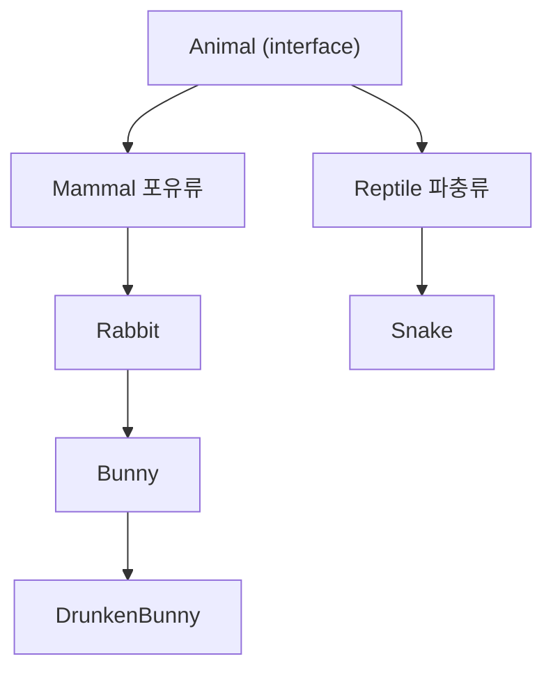
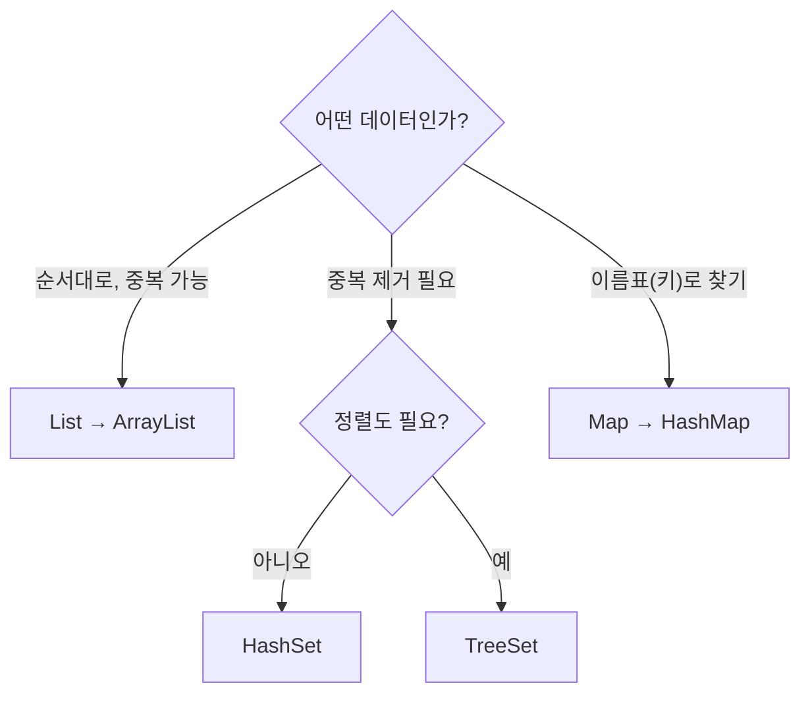

## 들어가며 (Situation)

`chap04-generic-and-collection` 챕터는 크게 두 덩어리였다. `a_generic`(제네릭 기초, 상한 제한, 와일드카드)과 `b_collection`(List, Set, Map)이다. 둘은 따로가 아니라 이어진다. 컬렉션을 `List list = new ArrayList();`처럼 쓰면 무엇이든 들어가는데, 이 문제를 막는 도구가 바로 제네릭이기 때문이다. 그래서 이 글도 "제네릭이 왜 필요한가"에서 시작해 컬렉션으로 넘어가는 순서로 정리했다.

## 문제 상황 (Task)

1. 상자(클래스)에 어떤 타입을 넣을지 **미리 정해두지 않고도**, 잘못된 타입이 들어오면 **컴파일 단계에서 막고** 싶다.
2. 배열은 크기가 고정이고 중간 삽입·삭제가 불편하다. **크기가 자유로운 자료구조**가 필요하다.
3. "순서가 중요한가?", "중복을 허용하는가?", "키로 찾고 싶은가?"에 따라 **알맞은 자료구조를 골라야** 한다.

## 해결 과정 (Action)

### 1. 제네릭 기초 (`a_basic`)

제네릭은 클래스나 메소드가 쓸 **데이터 타입을 컴파일 시점에 지정**하는 방법이다. 컴파일러가 타입을 미리 검사하므로 타입 안정성이 올라간다.

```java
public class GenericTest<T> {      // T = 상자에 무엇을 넣을지(타입 변수, 관례상 T)
    private T value;

    public T getValue() { return value; }
    public void setValue(T value) { this.value = value; }
}
```

```java
GenericTest<String> gt2 = new GenericTest<>();
gt2.setValue("문자열");
// gt2.setValue(1);                 // 컴파일 에러: String 상자에 숫자는 못 넣는다

GenericTest<Integer> gt3 = new GenericTest<>();
gt3.setValue(1);
// GenericTest<int> gt4 = ...       // 컴파일 에러: 기본자료형은 불가
```

> 쉬운 비유: `GenericTest<T>`는 **라벨이 비어 있는 상자**이다. `<String>`이라는 라벨을 붙이는 순간 "문자열 전용 상자"가 되어, 다른 물건을 넣으려 하면 포장 단계(컴파일)에서 거절당한다.

**다이아몬드 `<>` 안에는 기본자료형을 쓸 수 없다.** 참조자료형만 가능하므로 **래퍼 클래스**를 쓴다.

| 기본형 | 래퍼 클래스 |
|---|---|
| `int` | `Integer` |
| `char` | `Character` |
| `byte` / `short` | `Byte` / `Short` |
| `boolean` | `Boolean` |

수업 코드에서는 `GenericTest gt = new GenericTest();`처럼 **`<>` 없이 만들면 1도 "안녕하세요"도 다 들어간다**는 것도 확인했다. 이렇게 타입을 안 쓰는 방식(raw type)은 제네릭의 의미가 사라지니 쓰지 않는 게 좋다.

`toString()`도 함께 다뤘다. 클래스를 그냥 출력하면 주소값이 나오는데, `toString()`을 재정의하면 `GenericTest{value=1}`처럼 **실제 값**이 출력된다.

### 2. 타입 제한 `T extends Rabbit` (`b_use`)

"토끼 농장에는 토끼만 들어와야 한다"를 코드로 표현한 예제이다. 클래스 계층은 다음과 같다.



```java
public class RabbitFarm<T extends Rabbit> {   // Rabbit 이거나 Rabbit의 자식만 T가 될 수 있다
    private T animal;
    ...
}
```

```java
RabbitFarm<Rabbit> farm1 = new RabbitFarm<>();         // O
RabbitFarm<Bunny> farm2 = new RabbitFarm<>();          // O
// RabbitFarm<Mammal> farm = new RabbitFarm();          // X Mammal은 Rabbit의 부모라 불가

farm2.setAnimal(new DrunkenBunny());                   // O 자식은 들어간다
// farm2.setAnimal(new Rabbit());                       // X Bunny 농장에 부모(Rabbit)는 불가
```

여기서 헷갈린 점이 하나 있었다. `T extends Rabbit`는 "T 자리에 올 수 있는 타입의 범위"이고, `RabbitFarm<Bunny>`를 만든 뒤에는 **T가 Bunny로 확정**된다. 그래서 Bunny 농장에는 Bunny와 그 자식만 넣을 수 있다.

### 3. 와일드카드 `?` (`WildcardFarm`)

제네릭 객체를 **메소드 매개변수로 받을 때** 타입 범위를 정하는 문법이다.

| 문법 | 의미 | 받을 수 있는 것 (Bunny 기준) |
|---|---|---|
| `<?>` | 제한 없음 | `Rabbit`, `Bunny`, `DrunkenBunny` 농장 모두 |
| `<? extends Bunny>` | **상한** 제한 | `Bunny`, `DrunkenBunny` (Bunny와 자식) |
| `<? super Bunny>` | **하한** 제한 | `Bunny`, `Rabbit` (Bunny와 부모) |

```java
wildcardFarm.extendsType(new RabbitFarm<Bunny>(new Bunny()));          // O
// wildcardFarm.extendsType(new RabbitFarm<Rabbit>(new Rabbit()));      // X 부모는 상한을 넘는다

wildcardFarm.superType(new RabbitFarm<Rabbit>(new Rabbit()));          // O
// wildcardFarm.superType(new RabbitFarm<DrunkenBunny>(...));           // X 자식은 하한 아래
```

외우는 요령은 **"extends는 위로 막고(자식까지), super는 아래로 막는다(부모까지)"** 이다.

### 4. 컬렉션 한눈에 보기 (`b_collection`)

컬렉션은 배열의 한계(고정 크기, 불편한 수정)를 극복한 자료구조 모음이다. 세 종류를 **순서·중복·키** 기준으로 구분한다.

| 구분 | 순서 | 중복 | 특징 | 대표 구현체 |
|---|---|---|---|---|
| `List` | 있음 (index) | 허용 | 인덱스로 접근 | `ArrayList` |
| `Set` | 없음 | **불가** | 같은 값은 한 번만 | `HashSet`, `TreeSet` |
| `Map` | 키 기준 | 키는 불가, 값은 허용 | 키-값 한 쌍 | `HashMap`, `Properties` |

`List`, `Set`, `Map`은 모두 **인터페이스**라서 `new`로 만들 수 없고, 구현체(`ArrayList` 등)로 객체를 만든다.



### 5. List - 순서가 있고 중복을 허용한다

```java
List list = new ArrayList();      // 제네릭 없이 쓰면 무엇이든 들어간다
list.add("apple"); list.add(1); list.add(123.123); list.add(true);

list.add(1, "banana");            // 1번 자리에 삽입 (뒤는 밀려남)
list.remove(2);                   // 2번 자리 삭제 (뒤는 당겨짐)
```

배열이었다면 크기를 미리 정해야 하고 삽입·삭제가 번거롭지만, `ArrayList`는 알아서 늘고 준다. 하지만 제네릭 없이 쓰면 꺼낼 때 무슨 타입인지 알 수 없으니, 실제로는 이렇게 쓴다.

```java
List<String> strings = new ArrayList<>();
strings.add("a"); strings.add("c"); strings.add("b"); strings.add("d");
Collections.sort(strings);        // [a, b, c, d]
```

**BookDTO 실습**에서는 책(번호, 제목, 저자, 가격) 5권을 `List<BookDTO>`에 담았다. DTO(Data Transfer Object)는 **메소드가 아니라 데이터를 나르는 용도**의 클래스로, 필드 + 기본 생성자 + 전체 생성자 + getter/setter + `toString()`으로 구성한다. 반복은 두 방식으로 해봤다.

```java
for (int i = 0; i < bookList.size(); i++) {   // 인덱스 for
    System.out.println(bookList.get(i));
}
for (BookDTO book : bookList) {               // 향상된 for: 컬렉션에서 하나씩 꺼내 변수에 담는다
    System.out.println(book);
}
```

### 6. Set - 중복을 허용하지 않는다

```java
Set<String> hset = new HashSet<>();
hset.add("java"); hset.add("db"); hset.add("jpa");
hset.add("jpa");                  // 중복 → 무시된다
```

`HashSet`은 **저장 순서를 보장하지 않는다.** 출력 순서가 넣은 순서와 달라도 정상이다. 반면 `TreeSet`은 이진 검색 트리 구조라 **자동으로 정렬**된다. 이를 이용한 로또 추첨기가 좋은 예제였다.

```java
Set<Integer> lotto = new TreeSet<>();
while (lotto.size() < 7) {                    // 7개가 찰 때까지 반복
    lotto.add((int) (Math.random() * 45) + 1);   // 1~45 난수. 중복이면 Set이 알아서 걸러낸다
}
```

중복 검사를 직접 `if`로 하지 않아도 **Set이 해주고, 정렬까지 덤**으로 된다. `Math.random()`은 0 이상 1 미만이라 `* 45`로 0~44.99, `+ 1`로 1~45가 된다.

### 7. Map - 키와 값의 한 쌍

```java
Map<String, String> map2 = new HashMap<>();
map2.put("one", "java");
map2.put("two", "javascript");
map2.put("three", "python");
map2.remove("three");

Map map = new HashMap();
map.put(12, "apple");
map.put(12, "banana");            // 같은 키 → 나중 값으로 덮어쓴다
map.get(12);                      // "banana"
```

키는 내부적으로 Set 방식이라 **중복이 불가**하고, 같은 키로 `put`하면 값이 덮어써진다. 관례상 키는 `String`을 쓴다.

> 쉬운 비유: Map은 **사물함**이다. 번호(키)가 하나뿐이라, 같은 번호에 새 물건을 넣으면 기존 물건이 사라지고 교체된다.

**Properties**는 키와 값이 **모두 String**인 Map이다. DB 접속 정보 같은 **설정값**을 담을 때 쓴다.

```java
Properties prop = new Properties();
prop.setProperty("driver", "cj.jdbc.driver.mysql");
prop.setProperty("url", "jdbc:mysql://localhost/menudb");
```

### 시행착오와 헷갈렸던 점

- **`<int>`는 안 된다**: 기본형을 넣으면 컴파일 에러라서 `Integer`를 써야 했다.
- **제네릭 없는 컬렉션**: `List list = new ArrayList();`는 에러가 없어서 편해 보이지만, 무엇이 들어있는지 알 수 없다. 컴파일러가 도와주지 못한다.
- **HashSet 출력 순서**: 넣은 순서대로 안 나와서 당황했다. Set은 원래 순서를 보장하지 않는다.
- **`extends`와 `super` 방향**: 위(부모)와 아래(자식)를 거꾸로 외우기 쉬워서, 표로 Bunny 기준 예시를 직접 대입해 정리했다.

## 결과 (Result)

| 주제 | 배우기 전 | 배운 후 |
|---|---|---|
| 상자 타입 | 아무 타입이나 들어가고 실행 중에야 문제 발견 | `<T>`로 컴파일 시점에 차단 |
| 허용 범위 | 제한 없음 | `extends`로 "토끼 계열만" 제한 |
| 여러 값 저장 | 고정 크기 배열 | `ArrayList`로 자유롭게 추가·삭제 |
| 중복 제거·정렬 | `if`와 정렬을 직접 작성 | `TreeSet`이 한 번에 처리 |
| 이름표로 조회 | 반복문으로 탐색 | `HashMap.get(key)` |

오늘 가장 크게 와닿은 점은 **"제네릭은 컬렉션을 안전하게 쓰기 위한 짝"** 이라는 것이다. 컬렉션을 `<String>`, `<BookDTO>`처럼 타입을 정해 쓰는 순간, 잘못된 값은 컴파일러가 먼저 걸러준다.

## 더 학습하면 좋은 개념

- **LinkedList vs ArrayList** — 같은 `List`지만 내부 구조가 배열인지 연결 리스트인지에 따라 조회·삽입 속도가 달라진다. 상황에 따라 고르는 기준이 된다.
- **`equals()`와 `hashCode()`** — `HashSet`과 `HashMap`은 이 두 메소드로 "같은 값"을 판단한다. 직접 만든 클래스(예: `BookDTO`)를 Set에 넣으면 중복이 걸러지지 않는 이유를 알 수 있다.
- **`Comparable`과 `Comparator`** — 문자열·숫자가 아닌 `BookDTO`를 가격순으로 정렬하려면 필요하다. 이번 수업의 "가격 오름차순 정렬" 과제를 풀기 위한 다음 단계이다.
- **`LinkedHashMap`·`TreeMap`** — 넣은 순서를 유지하거나 키 기준으로 정렬되는 Map이다. `HashMap`의 한계를 보완한다.
- **제네릭 메소드와 타입 소거(Type Erasure)** — 오늘은 클래스에 `<T>`를 붙였는데, 메소드 단위 제네릭도 있다. 실행 시점에 타입 정보가 사라지는 원리까지 알아야 제네릭의 제약(`<int>` 불가 등)이 이해된다.

## 참고 자료

- [Oracle 공식 문서 - Generics](https://docs.oracle.com/javase/tutorial/java/generics/index.html)
- [Oracle 공식 문서 - Wildcards](https://docs.oracle.com/javase/tutorial/java/generics/wildcards.html)
- [Oracle 공식 문서 - Bounded Type Parameters](https://docs.oracle.com/javase/tutorial/java/generics/bounded.html)
- [Oracle 공식 문서 - Collections Framework Overview](https://docs.oracle.com/en/java/javase/21/docs/api/java.base/java/util/doc-files/coll-overview.html)
- [Oracle 공식 문서 - Collections Trail](https://docs.oracle.com/javase/tutorial/collections/index.html)
