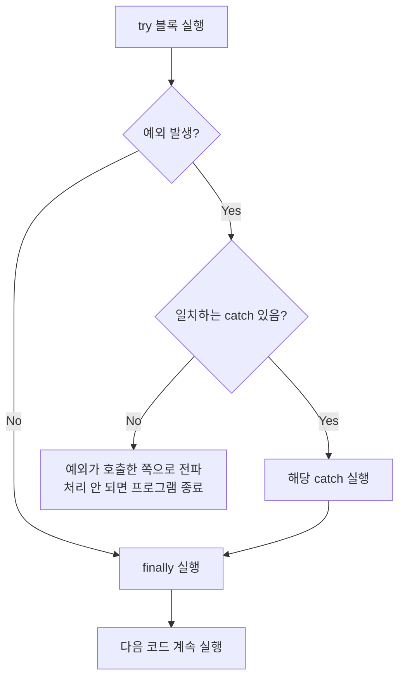
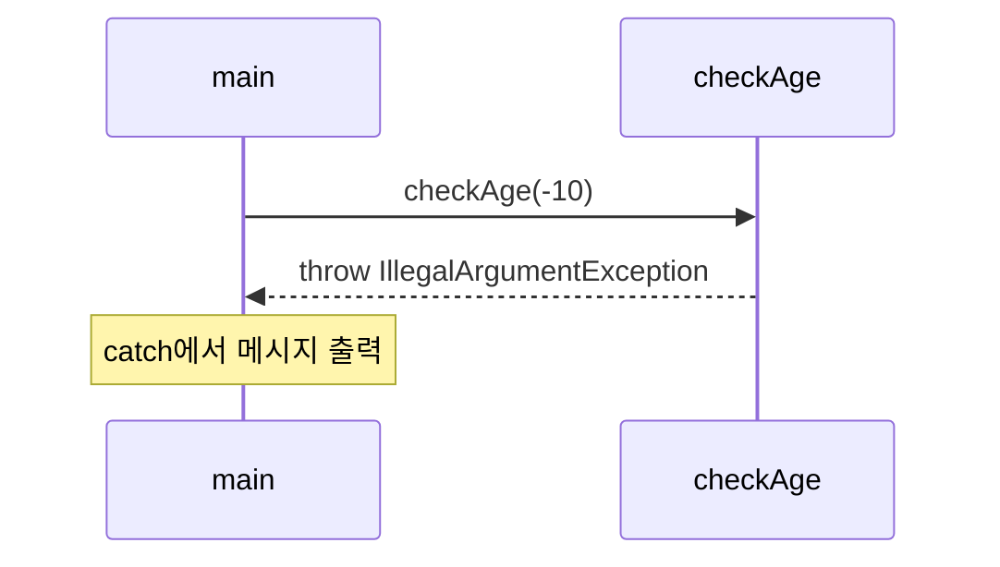
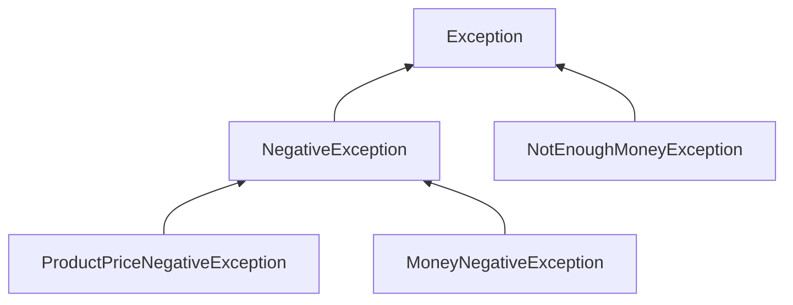
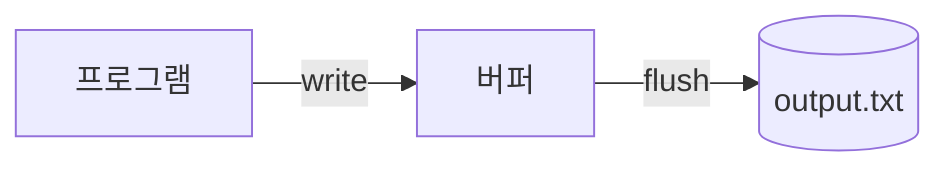

## 들어가며 (Situation)

`chap05-exception-file-io` 챕터는 두 덩어리로 이루어져 있다.

- `a_exception` : 예외(Exception)란 무엇이고, 어떻게 처리하고, 직접 만들 수도 있는가
- `b_fileio` : 프로그램이 끝나도 데이터가 남도록 **파일에 쓰고 읽는** 방법

둘은 이어진다. 파일을 다루는 클래스(`FileWriter`, `FileReader`)는 파일이 없거나 디스크에 문제가 생길 수 있어서, **예외 처리를 하지 않으면 코드가 컴파일조차 되지 않는다.** 그래서 예외부터 이해하고 파일 입출력으로 넘어가는 순서로 정리했다.

## 문제 상황 (Task)

1. 코드에 문제가 있으면 프로그램이 **그 자리에서 비정상 종료**된다. 문제가 생겨도 나머지 로직은 계속 돌아가게 만들고 싶다.
2. JDK가 제공하는 예외(`ArithmeticException` 등)만으로는 "상품 가격이 음수", "가진 돈이 부족" 같은 **업무 상황을 표현하기 어렵다.**
3. 변수에 담은 값은 프로그램이 꺼지면 사라진다. 값을 **파일로 저장하고 다시 읽어야** 한다.

## 해결 과정 (Action)

### 1. 오류의 두 종류: 컴파일 오류 vs 런타임 오류

| 구분 | 발생 시점 | 예시 | 특징 |
|---|---|---|---|
| 컴파일 오류 | 코드를 작성·컴파일할 때 | 없는 변수 참조, 타입 불일치 | 실행 전에 알려주니 오히려 고마운 오류 |
| 런타임 오류 | 프로그램을 **실행하는 도중** | 배열 범위 초과, `null` 참조 | 처리하지 않으면 프로그램이 중간에 죽음 |

예외 처리는 **런타임 오류**를 다루는 기술이다.

### 2. 예외를 처리하지 않으면 어떻게 될까 (`a_basic`)

일부러 예외가 나는 코드를 먼저 돌려봤다.

```java
System.out.println("프로그램 시작!");

int[] iarr = new int[5];
System.out.println("6번째 인덱스 출력 : " + iarr[6]);   // 예외 발생!

String str = null;
str.length();                                           // 여기까지 오지도 못함

System.out.println("프로그램 종료...");                  // 실행되지 않음
```

`new int[5]`는 인덱스 0~4까지만 있다. `iarr[6]`에서 `ArrayIndexOutOfBoundsException`이 발생하고, 그 아래 코드는 **전부 건너뛰어진다.** "프로그램 종료..."가 출력되지 않는 것이 핵심이다. 아래 `str.length()`의 `NullPointerException`은 심지어 실행 기회조차 얻지 못한다.

> 처음에는 두 예외가 모두 출력될 줄 알았다. 하지만 **예외는 가장 먼저 발생한 한 곳에서 흐름을 끊는다.** 이 점이 뒤에 나오는 `try`의 동작 이해와 직결된다.

### 3. try - catch - finally로 흐름 살리기 (`b_solved`)

```java
try {
    int result = 10 / 0;        // ArithmeticException 발생
    String str = null;
    str.length();               // 위에서 이미 예외가 났으므로 실행되지 않음
} catch (ArithmeticException e) {
    System.out.println("예외 메세지 = " + e.getMessage());
} catch (NullPointerException e) {
    System.out.println("예외 메세지 = " + e.getMessage());
} finally {
    System.out.println("예외 발생 여부와 관계 없이 실행됨..");
}
```

| 블록 | 역할 | 실행 조건 |
|---|---|---|
| `try` | 예외가 **발생할 수 있는** 코드를 감쌈 | 항상 시도 |
| `catch` | 특정 예외 타입을 받아 처리. `e`는 발생한 예외 객체 | 해당 타입의 예외가 났을 때만 |
| `finally` | 정리 작업 등 | **예외 여부와 상관없이 항상** |

실행 흐름은 다음과 같다.



**시행착오 1.** `10 / 0`과 `str.length()` 두 줄 중 `NullPointerException` catch가 실행될 줄 알았는데, 출력은 `ArithmeticException` 쪽만 나왔다. try 안에서는 **첫 예외가 발생하는 즉시 나머지 줄을 건너뛰고** catch로 이동하기 때문이다. 두 예외를 모두 확인하려면 try 블록을 나눠야 한다.

`e.getMessage()`는 예외 객체가 가진 설명 문자열을 돌려준다. 이 값은 JDK 예외는 JDK가, 직접 만든 예외는 **내가 생성할 때 넣은 메시지**가 들어간다. 뒤의 사용자 정의 예외에서 이 부분이 활용된다.

### 4. throw: 예외를 직접 일으키고 호출한 쪽에 맡기기

```java
public static void checkAge(int age) {
    if (age < 0) {
        throw new IllegalArgumentException("나이는 음수일 수 없습니다.");
    }
    System.out.println("전달 받은 " + age + " 는 유효한 나이입니다");
}

// 호출하는 쪽 (main)
try {
    checkAge(-10);
} catch (IllegalArgumentException e) {
    System.out.println("e.getMessage() = " + e.getMessage());
}
```

여기서 역할이 나뉜다.

- `checkAge()` : "이 값은 잘못됐다"고 **판단하고 예외를 던진다.** 어떻게 처리할지는 정하지 않는다.
- `main()` : 그 예외를 **받아서 처리**한다. (예외 처리를 호출한 쪽에 위임)



> 예외를 던지는 쪽은 "무엇이 잘못됐는지"만 알고, 받는 쪽은 "그래서 어떻게 할지"를 안다. 이렇게 책임을 나누면 같은 메소드를 여러 곳에서 다른 방식으로 처리할 수 있다.

### 5. 사용자 정의 예외 만들기 (`c_userexception`)

JDK 예외는 "배열 범위", "null" 같은 **일반적인** 상황이다. "상품 가격이 음수"처럼 우리 프로그램에 고유한 상황은 직접 정의하는 편이 의미가 분명하다. 방법은 간단하다. **`Exception`을 상속**하고, 생성자에서 메시지를 부모에게 넘긴다.

이번 예제는 쇼핑 상황이다. (상품 가격, 가진 돈)을 받아 구매 가능한지 확인하며, 문제는 세 가지다.

1. 상품 가격이 음수
2. 가진 돈이 음수
3. 가진 돈이 상품 가격보다 적음

예외 클래스는 4개를 만들었고 계층은 이렇다.



```java
// 음수 관련 예외의 공통 부모
public class NegativeException extends Exception {
    public NegativeException(String message) {
        super(message);
    }
}

// 자식: 부모 생성자에 메시지만 전달
public class ProductPriceNegativeException extends NegativeException {
    public ProductPriceNegativeException(String message) {
        super(message);
    }
}
```

`MoneyNegativeException`도 같은 모양이고, `NotEnoughMoneyException`은 음수가 아니라 "부족"이라 `Exception`을 직접 상속했다.

**왜 부모(`NegativeException`)를 따로 두었나?** 두 음수 예외는 "음수 입력 오류"라는 공통점이 있다. 부모를 두면 나중에 `catch (NegativeException e)` 하나로 둘을 한꺼번에 처리할 수 있다. (이번 예제는 세 개를 각각 catch했지만, 구조상 묶는 것도 가능하다.)

던지는 쪽(`ExceptionTest`)에서는 메소드 선언에 **`throws`** 를 붙인다.

```java
public void checkMoney(int productprice, int money)
        throws ProductPriceNegativeException, MoneyNegativeException, NotEnoughMoneyException {

    if (productprice < 0) {
        throw new ProductPriceNegativeException("상품의 가격은 음수일 수 없습니다!!");
    }
    if (money < 0) {
        throw new MoneyNegativeException("가진 돈이 음수일 수 없습니다 !");
    }
    if (money < productprice) {
        throw new NotEnoughMoneyException("가진 돈보다 상품의 가격이 더 비싸요..");
    }
    System.out.println("가진 돈이 충분합니다~즐거운 쇼핑 하세요");
}
```

받는 쪽(`Application`)에서 `checkMoney(50000, 30000)`을 호출하면 가격이 돈보다 비싸므로 세 번째 조건에 걸려 `NotEnoughMoneyException`이 던져지고, 출력은 다음과 같다.

```text
가진 돈보다 상품의 가격이 더 비싸요..
```

**`throw`와 `throws`의 차이**는 처음에 가장 헷갈렸다.

| 키워드 | 위치 | 의미 |
|---|---|---|
| `throw` | 메소드 **안** | 예외 객체를 **실제로 던지는** 행동 |
| `throws` | 메소드 **선언부** | "이 메소드는 이런 예외를 던질 수 있다"는 **예고** |

**시행착오 2.** `throws`를 빼먹으니 컴파일 오류가 났다. `Exception`을 상속한 예외는 **체크 예외(Checked Exception)** 라서, 던지는 쪽은 `throws`로 선언하고 받는 쪽은 `try-catch`(또는 다시 `throws`)로 반드시 처리해야 한다. 이건 컴파일러가 강제하는 규칙이다.

| 구분 | 대표 예시 | 처리 강제 여부 |
|---|---|---|
| 체크 예외 | `Exception`, `IOException`, 이번에 만든 4개 | 강제 (컴파일 오류) |
| 언체크 예외 | `RuntimeException` 계열 (`ArithmeticException`, `NullPointerException`, `IllegalArgumentException`) | 강제 아님 |

이 표를 보면 앞에서 `IllegalArgumentException`은 `throws` 없이 던질 수 있었던 이유도 이해된다. `RuntimeException` 계열이기 때문이다.

### 6. 파일 입출력: 쓰기와 읽기 (`b_fileio`)

파일 입출력 클래스는 파일이 없거나 쓸 수 없는 경우가 있어서 객체 생성 시 **`IOException` 처리가 필수**이다. 앞서 배운 체크 예외가 실제로 쓰이는 대표적인 곳이다.

**파일 쓰기**

```java
try {
    FileWriter writer = new FileWriter("output.txt");
    writer.write("hello, file IO ");
    writer.write("File Test");
    writer.flush();   // 버퍼에 있는 데이터를 밀어서 디스크에 저장
} catch (IOException e) {
    throw new RuntimeException(e);
}
```

`write()`를 호출해도 데이터가 곧바로 디스크로 가는 것은 아니다. 중간 **버퍼**에 모였다가 내려간다. `flush()`는 그 버퍼를 비우며 디스크에 쓰라고 지시한다.



프로젝트 폴더에 만들어진 `output.txt`를 열어보니 두 `write()` 내용이 이어져서 한 줄로 들어 있었다.

```text
hello, file IO File Test
```

**파일 읽기**

```java
try {
    FileReader reader = new FileReader("output.txt");

    int data;
    while ((data = reader.read()) != -1) {   // 파일 끝이면 -1
        System.out.println((char) data);
    }
} catch (FileNotFoundException e) {
    throw new RuntimeException(e);
} catch (IOException e) {
    throw new RuntimeException(e);
}
```

이 코드에서 이해해야 할 부분은 세 가지다.

| 포인트 | 설명 |
|---|---|
| `reader.read()`의 반환 타입이 `int` | 한 글자를 숫자(문자 코드)로 돌려준다. 그래서 `(char)`로 변환해야 글자로 보인다. |
| 종료 조건 `-1` | 파일 끝에 도달하면 `-1`을 반환한다. 문자 코드는 음수가 될 수 없어 `-1`이 구분용으로 쓰인다. |
| `while ((data = reader.read()) != -1)` | 읽기와 비교를 한 줄에서 한다. 괄호 안에서 먼저 대입하고, 그 값을 `-1`과 비교한다. |

**시행착오 3.** 실행하니 파일 내용이 한 줄이 아니라 **글자마다 한 줄씩** 출력됐다. `println`이 한 글자 출력 때마다 줄바꿈을 하기 때문이다. 한 줄로 보고 싶다면 `print((char) data)`를 쓰면 된다.

**catch 순서도 중요하다.** `FileNotFoundException`은 `IOException`의 자식이다. 위 코드처럼 **자식을 먼저, 부모를 나중에** 써야 한다. 부모를 앞에 두면 자식 catch에 도달하지 못해 컴파일 오류가 난다.

**짚고 넘어갈 점: `close()`.** 이번 수업 코드는 `writer`/`reader`를 닫지 않는다. 지금은 프로그램이 곧 끝나서 문제가 드러나지 않지만, 파일 자원은 직접 닫아주는 것이 원칙이다. 이를 간단히 해결하는 방법이 `try-with-resources`이고, 아래 "더 학습하면 좋은 개념"에 정리했다.

## 결과 (Result)

| 주제 | 배우기 전 | 배운 후 |
|---|---|---|
| 예외 발생 시 | 프로그램이 그 자리에서 비정상 종료 | `try-catch`로 처리하고 이후 코드 계속 실행 |
| 정리 작업 | 예외 여부에 따라 실행이 갈림 | `finally`로 항상 실행 보장 |
| 업무 오류 표현 | JDK 예외 이름만으로 의미 불명확 | 4개의 사용자 정의 예외로 의미 명확화 |
| 에러 처리 책임 | 한 메소드에서 전부 처리 | `throw`/`throws`로 던지는 쪽과 받는 쪽 분리 |
| 데이터 보관 | 프로그램이 꺼지면 사라짐 | `FileWriter`로 `output.txt`에 저장, `FileReader`로 24글자를 다시 읽음 |

이번 챕터에서 가장 크게 와닿은 점은 **"예외는 피해야 할 것이 아니라, 흐름 안에서 다루는 대상"** 이라는 것이다. `throw`로 문제를 선언하고 `catch`에서 대응하는 구조를 이해하니, 파일 입출력에서 `IOException`을 강제하는 이유도 자연스럽게 연결됐다.

## 더 학습하면 좋은 개념

- **`try-with-resources`** — `try (FileWriter writer = new FileWriter("output.txt")) { ... }` 형태로 쓰면 블록이 끝날 때 자동으로 `close()`가 호출된다. 이번 코드의 닫기 누락 문제를 가장 간단히 해결한다.
- **체크 예외 vs 언체크 예외의 설계 기준** — 호출자가 복구할 수 있는 상황이면 체크 예외, 프로그래밍 실수면 언체크 예외를 쓰는 것이 일반적이다. 사용자 정의 예외를 `Exception`으로 할지 `RuntimeException`으로 할지 고를 때 필요하다.
- **버퍼 스트림 (`BufferedWriter`, `BufferedReader`)** — 한 글자씩 읽고 쓰는 방식은 느리다. 버퍼를 쓰면 한 줄 단위(`readLine()`)로 읽을 수 있고 성능도 좋아진다.
- **`java.nio.file.Files`와 `Path`** — 최신 Java에서 권장되는 파일 API이다. `Files.readAllLines()`처럼 파일 읽기·쓰기를 몇 줄로 끝낼 수 있다.
- **예외 연쇄(Exception Chaining)** — 이번 코드의 `new RuntimeException(e)`가 바로 원인 예외를 감싸서 던지는 방식이다. 로그에서 "Caused by"가 보이는 이유를 알 수 있다.

## 참고 자료

- [Oracle 공식 문서 - Lesson: Exceptions](https://docs.oracle.com/javase/tutorial/essential/exceptions/index.html)
- [Oracle 공식 문서 - The try Block / catch Blocks / finally Block](https://docs.oracle.com/javase/tutorial/essential/exceptions/handling.html)
- [Oracle 공식 문서 - Unchecked Exceptions — The Controversy](https://docs.oracle.com/javase/tutorial/essential/exceptions/runtime.html)
- [Oracle 공식 문서 - The try-with-resources Statement](https://docs.oracle.com/javase/tutorial/essential/exceptions/tryResourceClose.html)
- [Oracle 공식 문서 - Basic I/O](https://docs.oracle.com/javase/tutorial/essential/io/index.html)
- [Java API - FileWriter](https://docs.oracle.com/en/java/javase/21/docs/api/java.base/java/io/FileWriter.html)
- [Java API - FileReader](https://docs.oracle.com/en/java/javase/21/docs/api/java.base/java/io/FileReader.html)
