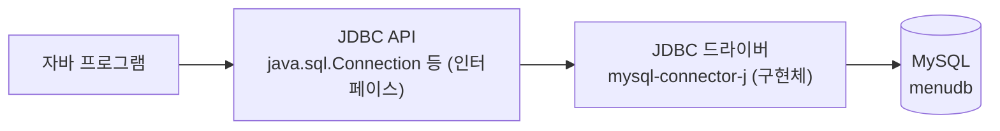
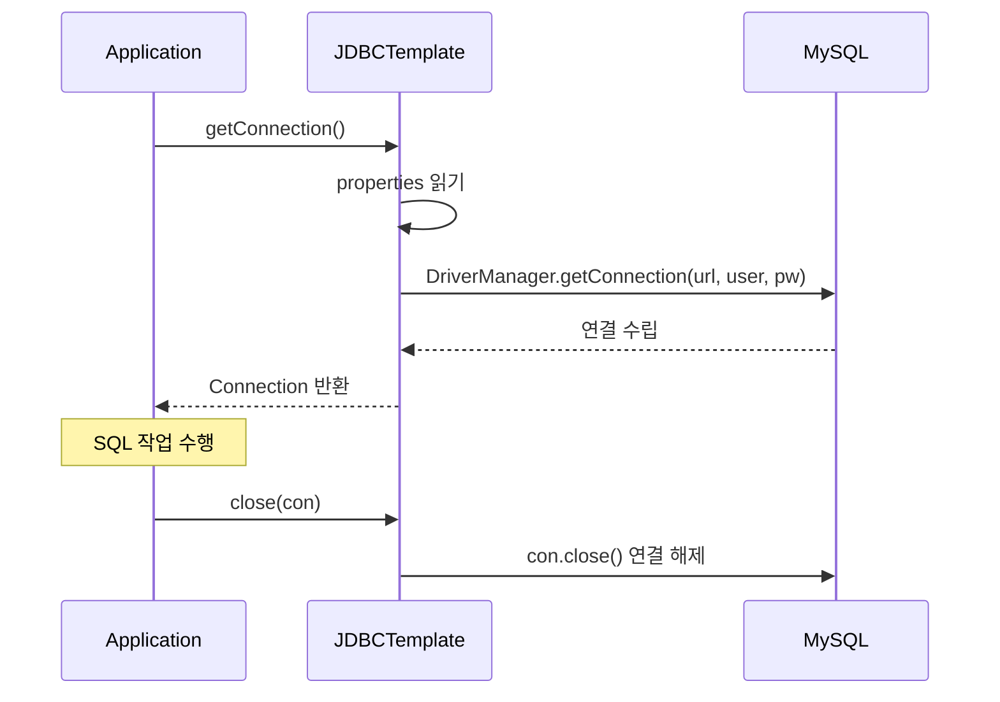

## 들어가며 (Situation)

지금까지 MySQL은 워크벤치에서 SQL을 직접 입력해 썼다. 하지만 실제 서비스에서는 **자바 프로그램이 DB에 접속**해서 SQL을 실행한다. 그 통로가 **JDBC(Java Database Connectivity)** 이다.

`chap01-jdbc-connection` 챕터는 "DB에 연결하는 것" 하나만 다룬다. SQL 실행은 다음 챕터의 몫이고, 여기서는 **연결(Connection) 객체를 만들고 닫는 코드를 어떻게 점점 나아지게 만드는가**가 주제다.

| 단계 | 파일 | 한 줄 요약 |
|---|---|---|
| 1 | `a_connection/Application01` | 접속 정보를 코드에 직접 써서 연결한다 |
| 2 | `a_connection/Application02` | 접속 정보를 `.properties` 파일로 분리한다 |
| 3 | `b_template/JDBCTemplate` | 연결 생성·해제 코드를 메소드로 묶어 재사용한다 |

## 문제 상황 (Task)

1. 자바에서 MySQL에 접속하려면 **무엇이 필요한지** 알아야 한다. (드라이버, 접속 주소, 계정)
2. 접속 정보(주소, 아이디, 비밀번호)가 **소스 코드에 그대로 노출**된다.
3. 회원가입, 로그인, 정보 수정, 회원 삭제처럼 DB 작업은 많은데, 매번 **같은 연결 코드를 복사**해서 붙이게 된다.

## 해결 과정 (Action)

### 1. JDBC는 어떤 구조로 DB와 대화하는가

자바는 MySQL, Oracle 등 DB의 종류를 모른다. 그래서 자바는 **표준 인터페이스(`java.sql`)** 만 정해 두고, 실제 통신은 DB 회사가 만든 **드라이버**가 맡는다.



이 구조 덕분에 프로그램은 `Connection` 같은 표준 타입만 쓰고, DB를 바꿀 때는 드라이버만 교체하면 된다. (SQL 문법 차이까지 사라지는 것은 아니다.)

### 2. 준비: 드라이버를 프로젝트에 추가하기

드라이버는 JDK에 들어 있지 않은 **외부 라이브러리**다. 이 프로젝트는 Gradle을 쓰므로 `build.gradle`에 의존성을 추가한다.

```groovy
dependencies {
    // mysql 연동을 위한 외부 api 의존성
    implementation 'com.mysql:mysql-connector-j:8.4.0'
}
```

`mavenCentral()` 저장소에서 `mysql-connector-j` 8.4.0 jar를 내려받아 프로젝트에 포함시킨다. 같은 파일에 있는 JUnit 의존성은 테스트용(`testImplementation`)이라 이번 내용과는 무관하다.

### 3. Application01: 가장 단순한 연결

```java
Connection con = null;

try {
    Class.forName("com.mysql.cj.jdbc.Driver");

    con = DriverManager.getConnection(
            "jdbc:mysql://localhost/menudb",
            "wanted",
            "wanted"
    );

    System.out.println("con = " + con);   // 값이 나오면 menudb 접근 가능

} catch (ClassNotFoundException e) {
    throw new RuntimeException(e);
} catch (SQLException e) {
    throw new RuntimeException(e);
} finally {
    con = null;
}
```

코드를 세 부분으로 나눠 이해했다.

**① `Class.forName("com.mysql.cj.jdbc.Driver")` — 드라이버 클래스 로딩**

문자열로 지정한 클래스를 메모리에 올린다. 클래스 이름을 잘못 쓰거나 드라이버 jar가 없으면 `ClassNotFoundException`이 난다.

> 참고: JDBC 4.0 이후의 드라이버는 jar 안의 서비스 등록 정보를 통해 `DriverManager`가 **자동으로 찾아 등록**한다. 그래서 최신 `mysql-connector-j`에서는 이 줄이 없어도 연결되는 경우가 많다. 이 줄은 "드라이버가 무엇인지"를 코드로 드러내는 용도로 이해했다. (자동 등록 여부는 사용하는 드라이버 버전에 따라 다르므로 공식 문서를 확인하는 것이 안전하다.)

**② `DriverManager.getConnection(url, user, password)` — 연결 만들기**

`Connection`은 **인터페이스**라서 `new`로 만들 수 없다. 수업 주석은 "인터페이스를 구현한 `DriverManager`를 통해 만든다"고 설명했다. 정확히는 이렇게 이해하는 편이 좋다.

| 역할 | 클래스 |
|---|---|
| 연결을 요청받고 알맞은 드라이버를 찾아주는 **관리자** | `DriverManager` |
| 실제 연결 객체를 만들어 돌려주는 **구현체** | MySQL 드라이버 안의 클래스 |

즉 `DriverManager`는 `Connection`을 구현한 클래스가 아니라, **URL을 보고 드라이버를 골라 연결을 만들게 하는 창구**다.

**접속 URL 읽는 법**

```text
jdbc:mysql://localhost/menudb
└─┬─┘ └─┬─┘   └──┬───┘ └──┬─┘
 프로토콜 DB종류   서버주소   DB(스키마) 이름
```

포트를 생략하면 MySQL 기본 포트(3306)가 쓰인다. 세 번째 인자까지 합쳐 **"어느 DB 서버의 어느 스키마에, 누구로 접속하는가"** 를 전달하는 셈이다.

**③ `con` 출력과 `finally`**

`System.out.println("con = " + con)`이 `com.mysql.cj.jdbc.ConnectionImpl@...` 같은 객체 정보를 출력하면 `menudb`에 접속된 것이다. `ConnectionImpl`이 바로 앞의 표에서 말한 **MySQL 드라이버가 만든 구현체**다.

**짚고 넘어갈 문제: `finally`의 `con = null`은 연결을 닫지 않는다**

수업 주석은 "finally는 자원을 해제하는 데 많이 쓴다"고 했는데, 코드의 `con = null;`은 **변수가 연결을 가리키지 않게 할 뿐** 연결을 닫지 않는다. DB와의 연결은 `con.close()`를 호출해야 끊긴다. 이번 예제는 프로그램이 곧 끝나서 문제가 드러나지 않을 뿐, 이 습관을 그대로 가져가면 **연결이 쌓여 DB가 새 연결을 거부**할 수 있다. 이 문제는 3단계의 `close()` 메소드에서 해결된다.

### 4. Application02: 접속 정보 분리하기

Application01의 문제는 수업 주석 그대로 **"DB 접근 정보가 클래스에 그대로 노출"** 된다는 점이다. 이 코드를 Git으로 공유하면 아이디와 비밀번호도 함께 공개된다. 그래서 접속 정보를 **파일 입출력으로 읽도록** 바꿨다. (이전에 배운 파일 IO가 여기서 쓰인다.)

`jdbc-config.properties`

```properties
driver=com.mysql.cj.jdbc.Driver
url=jdbc:mysql://localhost/menudb
user=wanted
password=wanted
```

`키=값` 형태의 텍스트 파일이고, 자바에서는 `Properties` 클래스가 이를 읽어준다.

```java
Properties prop = new Properties();
prop.load(new FileReader("src/main/java/com/wanted/a_connection/jdbc-config.properties"));

String driver   = prop.getProperty("driver");
String url      = prop.getProperty("url");
String user     = prop.getProperty("user");
String password = prop.getProperty("password");

Class.forName(driver);
con = DriverManager.getConnection(url, user, password);
```

| 구분 | Application01 | Application02 |
|---|---|---|
| 접속 정보 위치 | 자바 코드 안 | 별도 `.properties` 파일 |
| 정보를 바꿀 때 | 코드 수정 후 **다시 컴파일** | 파일만 수정 |
| DB 종류 교체 | 코드 수정 | 파일 값 교체 |
| 파일 IO 예외 | 없음 | `FileNotFoundException`, `IOException` 처리 필요 |

catch 블록이 4개로 늘어난 것도 이 때문이다. `FileReader`와 `prop.load()`가 `IOException`을 던진다. (예외 처리는 앞선 [예외 처리와 파일 입출력 글]({{ site.baseurl }}/2026/10/20/java-exception-and-file-io/) 참고)

**시행착오: 파일 경로가 왜 `src/main/java/...`로 길까?**

`new FileReader("src/main/java/...")`처럼 **프로젝트 루트 기준 상대 경로**를 쓴다. Gradle 프로젝트에서 `src/main/java` 아래의 `.properties`는 빌드할 때 클래스패스로 복사되지 않는다. (복사되는 위치는 `src/main/resources`다.) 그래서 클래스패스 방식 대신 **실행 위치 기준으로 파일을 직접 여는** 방식을 썼다고 이해했다. 대신 프로그램을 **프로젝트 루트에서 실행하지 않으면 `FileNotFoundException`** 이 난다. IDE에서는 보통 프로젝트 루트가 실행 위치라서 문제가 없다.

**짚고 넘어갈 문제 2가지**

1. **비밀번호가 여전히 평문이다.** `.properties`로 분리했지만 파일을 Git에 올리면 똑같이 공개된다. 실제로는 `.gitignore`에 추가하거나 환경 변수를 쓰는 편이 안전하다.
2. **비밀번호가 콘솔에 출력된다.** `System.out.println("prop = " + prop);`는 `password=wanted`까지 그대로 찍는다. 확인용 출력은 개발할 때만 쓰고 지워야 한다.

### 5. JDBCTemplate: 반복되는 코드 묶기

`Application` 주석이 문제를 구체적으로 짚었다.

> 회원가입, 로그인, 회원정보 수정, 회원 삭제 — **4번의 DB 접근**이 필요하고, 접근할 때마다 Application01의 코드가 반복되어야 한다.

반복되는 코드는 세 가지였다.

| 반복되는 코드 | 해결 |
|---|---|
| 커넥션 생성 | `getConnection()` 메소드 |
| 프로퍼티 객체 생성·로딩 | `getConnection()` 안으로 이동 |
| 커넥션 자원 해제 | `close(Connection)` 메소드 |

그래서 `JDBCTemplate` 클래스에 **static 메소드** 2개를 만들었다.

```java
public class JDBCTemplate {

    public static Connection getConnection() {
        Connection con = null;
        Properties prop = new Properties();
        try {
            prop.load(new FileReader("src/main/java/com/wanted/a_connection/jdbc-config.properties"));
            Class.forName(prop.getProperty("driver"));
            con = DriverManager.getConnection(
                    prop.getProperty("url"),
                    prop.getProperty("user"),
                    prop.getProperty("password"));
        } catch (IOException | ClassNotFoundException | SQLException e) {
            throw new RuntimeException(e);
        }
        return con;
    }

    public static void close(Connection con) {
        try {
            if (con != null && !con.isClosed()) {
                con.close();
            }
        } catch (SQLException e) {
            throw new RuntimeException(e);
        }
    }
}
```

(지면상 catch를 한 줄로 합친 요약본이다. 수업 코드는 `FileNotFoundException`, `IOException`, `ClassNotFoundException`, `SQLException`을 각각 따로 catch한다.)

**왜 `static`일까?** `new JDBCTemplate()`로 객체를 만들 필요 없이 `클래스명.메소드명()`으로 바로 호출할 수 있어서, 연결 생성처럼 "상태가 필요 없는 도구 기능"에 알맞다.

**`close()`의 조건문**

```java
if (con != null && !con.isClosed()) {
    con.close();
}
```

| 조건 | 막으려는 문제 |
|---|---|
| `con != null` | 연결 생성에 실패해 `null`일 때 `close()` 호출 → `NullPointerException` |
| `!con.isClosed()` | 이미 닫힌 연결을 또 닫는 중복 호출 |

그리고 호출하는 쪽은 이렇게 간결해진다.

```java
import static com.wanted.b_template.JDBCTemplate.close;
import static com.wanted.b_template.JDBCTemplate.getConnection;

Connection con = getConnection();
System.out.println("con = " + con);
// con을 활용해서 회원가입 진행 완료
close(con);       // 사용한 커넥션 닫기
```

`import static`을 쓰면 `JDBCTemplate.`을 생략하고 메소드 이름만으로 호출할 수 있다.



**남은 아쉬움**

- `JDBCTemplate`이 읽는 properties 경로가 `a_connection` 폴더로 되어 있다. 폴더를 옮기면 같이 고쳐야 하는 **경로 결합**이 있다.
- `getConnection()`을 부를 때마다 **파일을 다시 읽고 새 연결을 만든다.** 작업이 많아지면 비효율적이다. 이를 해결하는 방법이 아래의 커넥션 풀이다.

## 결과 (Result)

| 항목 | Application01 | Application02 | JDBCTemplate |
|---|---|---|---|
| 접속 정보 노출 | 코드에 노출 | 파일로 분리 | 파일로 분리 |
| 연결 생성 코드 | 매번 작성 | 매번 작성 | `getConnection()` 한 줄 |
| 연결 해제 | `con = null` (실제로는 닫히지 않음) | 동일 | `close(con)`로 실제 해제 |
| DB 작업 4개 시 연결 코드 | 4번 복사 | 4번 복사 | 4번 호출 (복사 없음) |

정량 지표(속도 등)는 측정하지 않아서 적지 않았다. 대신 연결 코드가 **약 30줄 → 호출 2줄(`getConnection()`, `close()`)** 로 줄어든 것을 구조적인 개선으로 볼 수 있다. (수업 코드 기준 대략적인 비교이다.)

이번 챕터에서 가장 크게 와닿은 점은 **"동작하는 코드"에서 "다시 쓸 수 있는 코드"로 가는 과정**이다. 한 번에 완성된 설계를 외우는 대신, 코드의 문제(노출, 반복)를 하나씩 찾고 고치는 순서를 따라가니 `JDBCTemplate`이 왜 필요한지 자연스럽게 이해됐다. 반대로 `con = null`이 연결을 닫지 않는다는 점은 주석만 믿고 지나쳤다면 놓쳤을 부분이었다.

## 더 학습하면 좋은 개념

- **`try-with-resources`** — `Connection`은 `AutoCloseable`을 구현하므로 `try (Connection con = ...) { }`로 쓰면 `finally`와 `close()` 없이도 자동으로 닫힌다. 수업의 `JDBCTemplate.close()`가 하는 일을 언어 차원에서 해결해 준다.
- **커넥션 풀(Connection Pool, 예: HikariCP)** — 연결은 만드는 비용이 크다. 미리 여러 개를 만들어 두고 빌려 쓰는 방식으로, 요청마다 연결을 새로 만드는 현재 구조의 한계를 해결한다.
- **`Statement`와 `PreparedStatement`** — 연결을 만든 다음 단계로 SQL을 실제로 실행하는 객체다. 다음 챕터(`chap02-statement`)의 주제이며, `PreparedStatement`는 SQL 인젝션 방어와도 관련된다.
- **설정과 비밀 정보 관리** — 환경 변수, `.gitignore`, 설정 파일 분리, 비밀 관리 도구. 비밀번호를 평문 파일에 두는 현재 방식의 위험을 줄이는 방법이다.
- **클래스패스와 `src/main/resources`** — 설정 파일을 실행 위치와 무관하게 읽으려면 클래스패스에서 읽어야 한다. `FileReader` 상대 경로 방식이 실행 위치에 의존하는 문제를 이해하는 열쇠다.
- **Gradle 의존성 관리** — `implementation`과 `testImplementation`의 차이, 저장소(`mavenCentral`)의 역할. 외부 라이브러리를 프로젝트에 추가하는 원리다.

## 참고 자료

- [Oracle 공식 문서 - JDBC Basics](https://docs.oracle.com/javase/tutorial/jdbc/basics/index.html)
- [Oracle 공식 문서 - Establishing a Connection](https://docs.oracle.com/javase/tutorial/jdbc/basics/connecting.html)
- [Java API - java.sql.DriverManager](https://docs.oracle.com/en/java/javase/21/docs/api/java.sql/java/sql/DriverManager.html)
- [Java API - java.sql.Connection](https://docs.oracle.com/en/java/javase/21/docs/api/java.sql/java/sql/Connection.html)
- [Java API - java.util.Properties](https://docs.oracle.com/en/java/javase/21/docs/api/java.base/java/util/Properties.html)
- [MySQL 공식 문서 - Connector/J Developer Guide](https://dev.mysql.com/doc/connector-j/en/)
- [MySQL 공식 문서 - Connector/J: Connecting to MySQL Using the JDBC DriverManager Interface](https://dev.mysql.com/doc/connector-j/en/connector-j-usagenotes-connect-drivermanager.html)
- [Oracle 공식 문서 - The try-with-resources Statement](https://docs.oracle.com/javase/tutorial/essential/exceptions/tryResourceClose.html)
