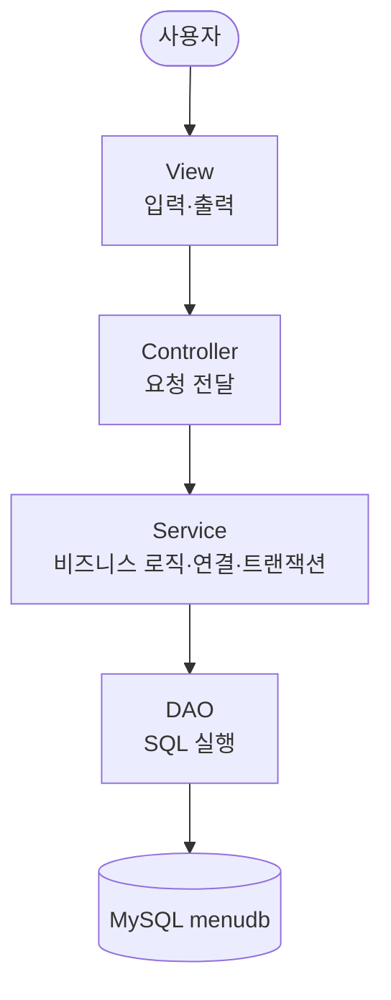
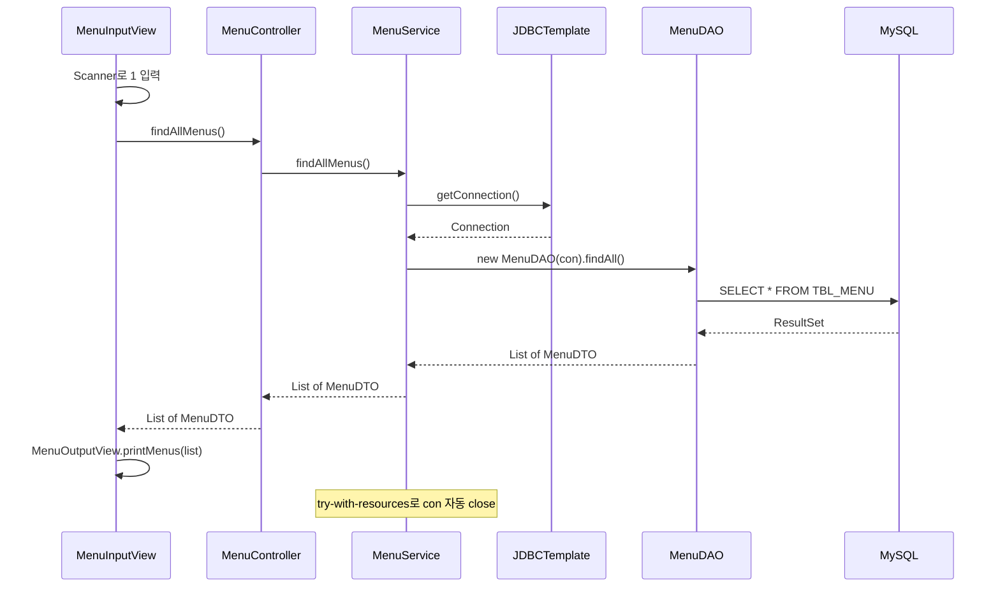
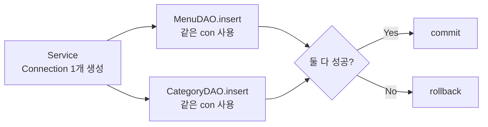

## 들어가며 (Situation)

`chap03-crud`는 이름처럼 CRUD(생성·조회·수정·삭제)를 만드는 챕터다. 다만 지금 수업 코드에는 **CRUD 중 조회(R)인 "메뉴 전체 조회" 한 가지만** 구현되어 있다. 이 글은 기능이 많은 챕터가 아니라, **기능 하나를 구현하면서 코드 구조를 어떻게 나눴는가**를 정리한 글이다. 나머지 C, U, D는 같은 구조 위에 기능을 추가하는 일이 된다.

앞선 `chap02-statement`에서는 `main` 메소드 하나에 **입력 받기, SQL 실행, 결과 출력**이 전부 들어 있었다. 이번에는 같은 일을 **역할별로 쪼갠 클래스**로 옮긴다.

## 문제 상황 (Task)

앞 챕터 방식으로 기능을 계속 늘리면 어떻게 될까?

1. 조회, 등록, 수정, 삭제마다 `Scanner` 입력, SQL, 출력 코드가 **한 메소드에 섞인다.**
2. SQL이 바뀌면 입력·출력 코드까지 열어봐야 한다. 출력 형식만 바꾸고 싶어도 DB 코드를 건드릴 위험이 있다.
3. 회원가입처럼 **DB 작업이 둘 이상 묶이는 기능**(예: 메뉴 생성 시 카테고리도 삽입)은 어디서 `commit`/`rollback`할지 정하기 어렵다.
4. 설정 파일 경로(`src/main/java/...`)가 **실행 위치에 의존**한다는 문제도 남아 있었다.

## 해결 과정 (Action)

### 1. 전체 구조: 4개 계층 + DTO

패키지 구조부터 보면 역할이 보인다.

```text
com.wanted.restaurant
├── Application                       ← 객체를 조립하고 시작하는 곳
├── global
│   ├── common/QueryUtil              ← XML에서 SQL을 읽어오는 도구
│   └── config/JDBCTemplate           ← DB 연결 생성
└── menu
    ├── controller/MenuController
    ├── model
    │   ├── dto/MenuDTO
    │   ├── service/MenuService
    │   └── dao/MenuDAO
    └── view
        ├── input/MenuInputView
        └── output/MenuOutputView
```

요청은 위에서 아래로 내려가고, 결과는 아래에서 위로 올라온다.



각 계층은 **바로 아래 계층만 호출**한다. View가 DAO를 직접 부르지 않는다.

### 2. 계층별 책임: 수업 주석 정리

수업 주석에 각 계층이 **해야 할 일**과 **하면 안 되는 일**이 적혀 있다. 이것이 이 챕터의 핵심이다.

| 계층 | 해야 할 일 | 하면 안 되는 일 |
|---|---|---|
| **View** | `Scanner`로 입력 받기, Controller에 입력값 전달, OutputView로 출력 요청 | SQL 작성, 비즈니스 로직, commit/rollback |
| **Controller** | View의 요청 처리, 알맞은 Service 호출, 필요 시 DTO 조립·간단한 유효성 처리 | `Scanner` 입력 처리, 비즈니스 로직, SQL 작업 |
| **Service** | DAO 호출, 데이터 검증·가공, 여러 DAO 조합, **트랜잭션 처리와 Connection 생성**, 예외 처리 | (SQL 직접 실행 등 DAO의 일) |
| **DAO** | SQL 실행, Statement 생성, 파라미터 바인딩, `ResultSet` 받기, 결과를 **자바 객체로 변환** | 비즈니스 규칙 판단 |

"하면 안 되는 일"을 같이 외우니 **어느 코드를 어디에 둘지** 판단하기 쉬웠다. 예를 들어 "가격이 음수면 안 된다" 같은 규칙은 SQL도 입력도 아닌 **Service**의 일이다.

### 3. 메뉴 전체 조회가 흘러가는 순서

사용자가 `1`을 입력했을 때의 호출 흐름이다.



코드로 보면 각 계층이 맡은 일만 한다.

```java
// View: 입력만 받고, 결과 출력은 OutputView에 맡긴다
int menu = sc.nextInt();
switch (menu) {
    case 1:
        List<MenuDTO> menuList = menuController.findAllMenus();
        menuOutputView.printMenus(menuList);
        break;
}

// Controller: 받은 요청을 Service로 넘긴다
public List<MenuDTO> findAllMenus() {
    return menuservice.findAllMenus();
}
```

현재 Controller는 거의 **전달만** 한다. 규모가 작아서 그렇고, 입력값 검증이나 DTO 조립이 필요해지면 이 계층이 일을 맡는다.

### 4. Service: 왜 Connection을 여기서 만들까

```java
public List<MenuDTO> findAllMenus() {
    try (Connection con = JDBCTemplate.getConnection()) {
        return new MenuDAO(con).findAll();
    } catch (SQLException e) {
        throw new RuntimeException(e);
    }
}
```

`Connection`을 DAO가 아니라 **Service가 만들어 DAO에 넘긴다.** 수업 주석의 설명대로 Service가 "트랜잭션 처리(commit, rollback)와 Connection 생성"을 맡기 때문이다.

예를 들어 "메뉴를 생성하면서 카테고리도 같이 삽입"하는 기능이 있다고 하자.



두 DAO가 **같은 `Connection`** 을 써야 한 트랜잭션으로 묶을 수 있다. DAO가 각자 연결을 만들면 서로 다른 연결이라 함께 `rollback`할 수 없다. 앞서 MySQL 글에서 배운 트랜잭션이 이 구조 위에서 쓰인다.

**`try-with-resources`로 바뀐 점.** 이전 챕터는 `finally`에서 `close(con)`을 직접 호출했다. 이번에는 `try (Connection con = ...)`로 선언하면 **블록이 끝날 때 자동으로 `close()`** 가 호출된다. 앞 글에서 지적했던 "닫기 누락, 닫는 순서 실수"가 구조적으로 사라진다.

### 5. DAO: SQL 실행과 객체 변환만 담당

```java
public List<MenuDTO> findAll() throws SQLException {
    String query = QueryUtil.getQuery("menu.findAll");
    List<MenuDTO> menus = new ArrayList<>();

    try (PreparedStatement pstmt = connection.prepareStatement(query)) {
        ResultSet rset = pstmt.executeQuery();

        while (rset.next()) {
            MenuDTO menu = new MenuDTO(
                rset.getInt("MENU_CODE"),
                rset.getString("MENU_NAME"),
                rset.getInt("MENU_PRICE"),
                rset.getInt("CATEGORY_CODE"),
                rset.getString("ORDERABLE_STATUS")
            );
            menus.add(menu);
        }
    }
    return menus;
}
```

앞 챕터와 달라진 부분이 몇 가지 있다.

| 변화 | 앞 챕터 (`chap02`) | 이번 챕터 (`chap03`) |
|---|---|---|
| DTO 만드는 방식 | 기본 생성자 + setter 5번 | **모든 필드를 받는 생성자** 한 번에 |
| 주문 가능 상태 타입 | `char` (`getString().charAt(0)`) | `String` (`getString()` 그대로) |
| 자원 해제 | `finally`에서 직접 `close` | `try-with-resources` |
| 예외 | 메소드 안에서 `RuntimeException`으로 변환 | `throws SQLException`으로 **던지고** Service가 처리 |
| SQL 위치 | 자바 코드 또는 파일 경로 지정 | `QueryUtil.getQuery("menu.findAll")` |

**`ResultSet`을 따로 닫지 않는데 괜찮을까?** `rset`은 `try ( )` 안에 선언하지 않았다. 그래도 `PreparedStatement`가 닫힐 때 그 `Statement`가 만든 현재 `ResultSet`도 **함께 닫힌다**는 것이 `Statement.close()`의 공식 문서 설명이다. 그래서 동작에는 문제가 없다. 다만 `ResultSet`까지 `try ( )`에 명시하면 의도가 더 분명해진다는 생각이 들었다.

DAO가 `SQLException`을 던지기만 하고 잡지 않는 것은, **예외를 어떻게 처리할지는 Service가 정한다**는 책임 분리와 맞물린다.

### 6. 설정과 SQL 읽기: 클래스패스로 옮기기

`chap02`에서는 설정 파일을 `new FileReader("src/main/java/...")`로 읽었고, 프로젝트 루트에서 실행하지 않으면 실패했다. 이번에는 파일 위치를 `src/main/resources`로 옮겼다.

```text
src/main/resources/
├── db-info.properties     ← DB 접속 정보
└── queries.xml            ← SQL 모음
```

`src/main/resources`는 빌드할 때 **클래스패스로 복사**되므로, 코드에서 파일 경로가 아닌 **클래스패스 기준**으로 읽을 수 있다.

```java
prop.load(JDBCTemplate.class.getClassLoader().getResourceAsStream("db-info.properties"));
```

| 방식 | 읽는 법 | 실행 위치 영향 |
|---|---|---|
| 상대 경로 (`chap02`) | `new FileReader("src/main/java/...")` | **받음** (루트에서 실행해야 함) |
| 클래스패스 (`chap03`) | `getResourceAsStream("db-info.properties")` | 받지 않음 |

앞 글의 "더 학습하면 좋은 개념"에서 클래스패스를 예고했는데, 이번 챕터가 바로 그 해결 방식이다.

**`static` 블록으로 한 번만 읽기**

```java
private static final Properties prop = new Properties();

static {
    try {
        prop.load(JDBCTemplate.class.getClassLoader().getResourceAsStream("db-info.properties"));
    } catch (IOException e) {
        throw new RuntimeException(e);
    }
}
```

`static` 블록은 **클래스가 처음 로드될 때 한 번만** 실행된다. `chap02`의 `getConnection()`은 호출할 때마다 파일을 다시 읽었는데, 이번에는 설정을 한 번만 읽어 재사용한다. 앞 글에서 남겨둔 "매번 파일을 다시 읽는" 아쉬움이 해결됐다.

**QueryUtil: SQL을 키로 꺼내기**

```java
public static String getQuery(String key) {
    return queries.getProperty(key).trim();
}
```

`queries.xml`의 `<entry key="menu.findAll">` 안에는 줄바꿈과 들여쓰기가 포함되어 있어서, 꺼낼 때 `trim()`으로 앞뒤 공백을 제거한다. 키를 `menu.findAll`처럼 **도메인.기능** 형태로 짓는 것도 SQL이 늘어났을 때 구분하기 좋은 습관이다. (존재하지 않는 키를 요청하면 `getProperty()`가 `null`을 돌려주어 `trim()`에서 `NullPointerException`이 난다. 오타를 낼 때 원인을 찾기 쉽도록 알아둘 점이다.)

**연결 방식의 한계도 주석에 적혀 있다.** `JDBCTemplate` 주석은 "커넥션 풀 없이 `DriverManager`로 직접 만들고, `getConnection()`을 호출할 때마다 새 물리 연결이 생기며 `close()`하면 실제로 끊어진다"고 설명한다. 연결 비용이 큰 문제는 이번 단계에서 의도적으로 남겨둔 부분이다.

### 7. Application: 객체를 조립하는 곳

```java
MenuService service = new MenuService();
MenuController controller = new MenuController(service);
MenuOutputView outputView = new MenuOutputView();
MenuInputView inputView = new MenuInputView(controller, outputView);

inputView.displayMainView();
```

각 클래스가 필요한 객체를 **생성자로 전달받는다.** (`MenuController(MenuService)`, `MenuInputView(MenuController, MenuOutputView)`) 클래스 안에서 `new`로 직접 만들지 않고, **바깥에서 만들어 넣어주는** 방식이다.

수업 주석은 이를 "추후 배울 Spring에서는 Application이 실행되면 모든 객체가 조립된다. 지금은 그 구조를 맛보기 형태로 작성"한다고 설명했다. 이 아이디어가 **의존성 주입(DI)** 이다. 안쪽에서 `new MenuService()`를 직접 하면 Service를 바꿀 때 Controller 코드도 고쳐야 하지만, 바깥에서 넣어주면 조립 부분만 바꾸면 된다.

수업 코드의 `MenuService`는 `findAllMenus()` 호출 때마다 `new MenuDAO(con)`을 안에서 만든다. DAO가 연결(`con`)에 의존하기 때문에 `Application`에서 미리 조립하지 못하는 부분이다. 이 차이는 의도된 것으로 이해했다.

**아직 비어 있는 부분**

`MenuInputView`는 `switch`에 `case 1`만 있고 `default`가 없다. 1이 아닌 숫자를 입력하면 아무 처리 없이 프로그램이 끝난다. 등록·수정·삭제 메뉴를 추가하면서 `case`와 반복 구조를 넓혀 갈 부분이다.

## 결과 (Result)

| 항목 | 한 메소드에 모두 (`chap02`) | 계층 분리 (`chap03`) |
|---|---|---|
| 입력·SQL·출력 | 한 클래스·한 메소드에 혼재 | View / DAO / OutputView로 분리 |
| 출력 형식 변경 | DB 코드 근처를 수정 | `MenuOutputView`만 수정 |
| SQL 변경 | 자바 코드 수정 | `queries.xml`만 수정 |
| 트랜잭션 위치 | 정할 곳이 없음 | **Service**에서 연결을 만들어 관리 |
| 설정 파일 읽기 | 실행 위치에 의존, 호출마다 읽음 | 클래스패스, **한 번만** 읽음 |
| 자원 해제 | `finally`에서 직접 | `try-with-resources` 자동 |
| 클래스 수 | 적음 | 늘어남 (MenuController, Service, DAO, DTO, 입·출력 View 등) |

정량 지표는 측정하지 않아서 적지 않았다. 그리고 **기능은 "메뉴 전체 조회" 하나뿐인데 클래스는 8개로 늘었다.** 처음에는 과하다고 느꼈지만, "수정과 삭제를 추가한다면 어디를 고칠까?"를 계층별로 따져 보니 이해가 됐다. 입력은 View, 흐름은 Controller, 규칙·트랜잭션은 Service, SQL은 DAO와 `queries.xml`이다. **고칠 곳이 한눈에 정해지는 것**이 이 구조의 이점이다.

## 더 학습하면 좋은 개념

- **MVC 패턴과 계층형 아키텍처** — View-Controller-Service-DAO는 Spring 웹 프로젝트에서 그대로 쓰는 뼈대다. 이번 수업은 그 맛보기이므로 같은 구조가 웹으로 확장되는 방식을 이어서 보면 좋다.
- **의존성 주입(DI)과 Spring IoC** — `Application`에서 직접 조립한 일을 Spring이 대신해 준다. 생성자 주입이 왜 권장되는지도 이번 코드에서 출발해 이해할 수 있다.
- **트랜잭션 처리 (`setAutoCommit(false)`, `commit`, `rollback`)** — Service가 `Connection`을 쥐고 있는 이유를 실제 코드로 확인하는 단계다. 등록·수정·삭제를 구현할 때 필요하다.
- **`executeUpdate()`와 C·U·D 구현** — 조회는 `executeQuery()`지만 등록·수정·삭제는 `executeUpdate()`가 반환하는 영향 받은 행 수로 성공을 판단한다. 이 구조에 그대로 추가하면 된다.
- **커넥션 풀 (HikariCP)** — `JDBCTemplate` 주석이 남겨둔 "호출마다 새 연결"의 한계를 해결한다.
- **클래스 초기화와 `static` 블록의 예외** — `static` 블록에서 예외가 나면 클래스 로딩 자체가 실패해 에러 원인을 찾기 어려워질 수 있다. 설정 로딩을 이렇게 할 때의 주의점이다.

## 참고 자료

- [Oracle 공식 문서 - The try-with-resources Statement](https://docs.oracle.com/javase/tutorial/essential/exceptions/tryResourceClose.html)
- [Oracle 공식 문서 - Using Transactions (JDBC)](https://docs.oracle.com/javase/tutorial/jdbc/basics/transactions.html)
- [Oracle 공식 문서 - Initializing Fields (static initialization blocks)](https://docs.oracle.com/javase/tutorial/java/javaOO/initial.html)
- [Java API - java.sql.Statement#close](https://docs.oracle.com/en/java/javase/21/docs/api/java.sql/java/sql/Statement.html#close())
- [Java API - java.lang.ClassLoader#getResourceAsStream](https://docs.oracle.com/en/java/javase/21/docs/api/java.base/java/lang/ClassLoader.html#getResourceAsStream(java.lang.String))
- [Java API - java.util.Properties#loadFromXML](https://docs.oracle.com/en/java/javase/21/docs/api/java.base/java/util/Properties.html)
- [Gradle 공식 문서 - Building Java & JVM projects (resources 디렉터리)](https://docs.gradle.org/current/userguide/building_java_projects.html)
- [MySQL 공식 문서 - Connector/J Developer Guide](https://dev.mysql.com/doc/connector-j/en/)
