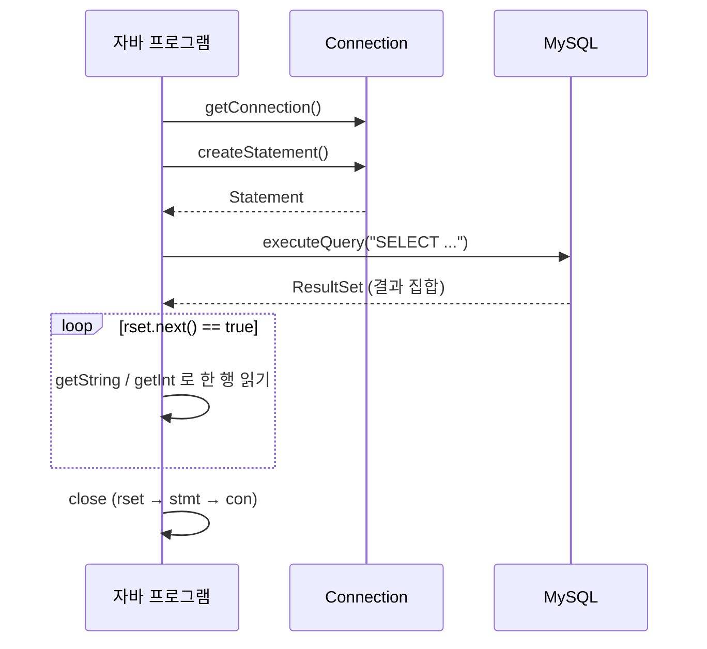
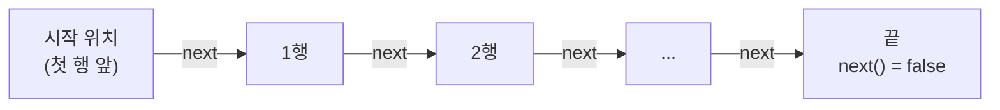
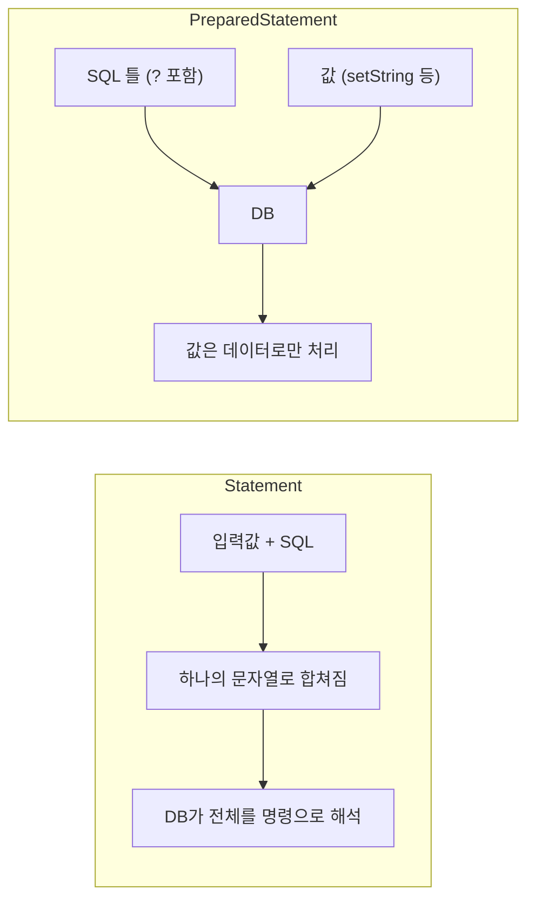

## 들어가며 (Situation)

앞선 [JDBC 연결 글]({{ site.baseurl }}/2026/10/20/jdbc-connection-template/)에서는 `JDBCTemplate`으로 **DB에 연결**하는 데까지 만들었다. 연결만으로는 아무 일도 일어나지 않는다. 이제 그 연결로 **SQL을 보내고 결과를 받아야** 한다.

`chap02-statement` 챕터는 이 흐름을 두 단계로 나눠 다룬다.

| 패키지 | 사용하는 도구 | 내용 |
|---|---|---|
| `a_statements` | `Statement`, `ResultSet` | SQL 실행, 결과 읽기, 결과를 자바 객체(DTO)로 옮기기 |
| `b_preparedstatements` | `PreparedStatement` | `?` 자리표시자, SQL을 XML로 분리, `UPDATE` 실행 |

이번 챕터의 대상 DB는 `menudb`의 `TBL_MENU`이고, 과제로 `employeedb`의 `TBL_JOB`도 조회했다.

## 문제 상황 (Task)

1. 자바에서 SQL을 **실행하고**, 조회 결과를 **한 행씩 읽어야** 한다.
2. 사용자가 입력한 값(메뉴 이름)을 SQL에 넣어야 한다. 그런데 문자열을 이어 붙이면 **불편하고, 위험하다.**
3. 조회 결과를 `System.out`으로 출력하고 끝내면 쓸 수 없다. **자바 객체로 옮겨 담아야** 이후 작업을 할 수 있다.
4. SQL이 길어지면 자바 코드 안의 문자열이 **지저분해진다.**

## 해결 과정 (Action)

### 1. JDBC로 SQL을 실행하는 큰 흐름

수업에서 JDBC의 핵심 인터페이스를 두 개로 정리했다.

| 인터페이스 | 역할 |
|---|---|
| `Statement` | SQL 쿼리문을 저장하고 **실행**하는 기능 |
| `ResultSet` | SQL 실행 **결과**를 결과 집합으로 받아오는 기능 |



`Statement`도 인터페이스라서 `new`로 만들지 않고, **`Connection`의 `createStatement()`** 로 얻는다.

### 2. Statement로 전체 조회 (`a_statements/Application01`)

```java
Connection con = getConnection();
Statement stmt = null;
ResultSet rset = null;

try {
    stmt = con.createStatement();
    rset = stmt.executeQuery("SELECT * FROM TBL_MENU");

    while (rset.next()) {
        System.out.println(
            rset.getString("MENU_NAME") + "은/는"
            + rset.getString("MENU_PRICE") + "원 입니다"
        );
    }
} catch (SQLException e) {
    throw new RuntimeException(e);
} finally {
    close(con);
    close(rset);
    close(stmt);
}
```

코드를 읽는 핵심은 `ResultSet`의 동작 방식이다.

- `executeQuery()`는 `SELECT`를 실행해 **`ResultSet`** 을 반환한다.
- `ResultSet`은 처음에 **첫 번째 행 "앞"** 을 가리킨다. `next()`를 호출해야 첫 행으로 이동한다.
- `next()`는 다음 행이 있으면 `true`, 없으면 `false`를 반환한다. 그래서 `while (rset.next())`로 **전체 행을 순회**한다.
- 열 값은 컬럼 이름으로 `getString("MENU_NAME")`처럼 꺼낸다.



한 건만 필요한 조회(`Application02`)는 `while` 대신 `if (rset.next())`를 쓴다. 결과가 최대 한 행이라고 보기 때문이다.

### 3. 시행착오: 입력값을 이어 붙인 SQL의 문제 (`Application02`)

"메뉴 이름을 입력받아 그 메뉴의 코드, 가격, 판매 상태를 출력"하는 요구사항이다.

```java
String menuName = sc.nextLine();

rset = stmt.executeQuery(
    "SELECT MENU_CODE, MENU_PRICE, ORDERABLE_STATUS FROM TBL_MENU WHERE MENU_NAME = '"
    + menuName + "'");
```

**문제 1 — 따옴표를 직접 맞춰야 한다.** 문자열 값은 `'`로 감싸야 하므로 `"'" + menuName + "'"`처럼 써야 하고, 변수가 늘수록 따옴표 짝 맞추기가 어려워진다.

**문제 2 — SQL 인젝션 위험.** 사용자 입력이 **SQL 문장의 일부가 되어 그대로 실행**된다. 아래는 이해를 돕기 위한 **예시 입력**이다.

| 입력 | 완성되는 SQL의 조건절 |
|---|---|
| `날치알스크류바` (정상) | `WHERE MENU_NAME = '날치알스크류바'` |
| `' OR '1'='1` (악의적) | `WHERE MENU_NAME = '' OR '1'='1'` → **항상 참** |

두 번째 입력이면 `WHERE`가 항상 참이 되어 **모든 행이 조회 대상**이 된다. 로그인 쿼리에 이런 입력이 들어가면 비밀번호 없이 통과되는 사고로 이어진다. 입력값이 "데이터"가 아니라 "명령"이 되어버린 것이다.


> `Application02`의 실제 코드는 `if (rset.next())`로 첫 행만 출력하므로 위 예시를 넣어도 한 줄만 보일 것이다. 하지만 DB는 이미 조건이 뚫린 SQL을 실행한 것이고, 이것이 위험의 핵심이다. (예시 입력은 내가 만든 것이고, 수업에서 실제로 시도한 것은 아니다.)

### 4. 조회 결과를 객체에 담기: DTO (`Application03`, `Application04`)

출력만 하면 값을 다시 쓸 수 없다. 그래서 행 하나를 **자바 객체(`MenuDTO`)** 에 담는다. DTO(Data Transfer Object)는 데이터를 옮기는 용도의 객체다.

수업에서 정리한 **DTO 기본 구성 요소**는 다음과 같다.

| 번호 | 요소 | `MenuDTO`의 예 |
|---|---|---|
| 1 | 필드 | `menuCode`, `menuName`, `menuPrice`, `categoryCode`, `orderableStatus` |
| 2 | 기본 생성자 | `public MenuDTO() {}` |
| 3 | 모든 필드를 초기화하는 생성자 | `MenuDTO(int, String, int, int, char)` |
| 4 | Getter / Setter | `getMenuCode()`, `setMenuCode()` ... |
| 5 | `toString()` | 출력 시 필드 값 확인용 |

**한 행 → 객체 1개** (`Application03`)

```java
if (rset.next()) {
    menu = new MenuDTO();
    menu.setMenuCode(rset.getInt("MENU_CODE"));
    menu.setMenuName(rset.getString("MENU_NAME"));
    menu.setMenuPrice(rset.getInt("MENU_PRICE"));
    menu.setCategoryCode(rset.getInt("CATEGORY_CODE"));
    menu.setOrderableStatus(rset.getString("ORDERABLE_STATUS").charAt(0));
}
```

**여러 행 → 객체 여러 개를 리스트로** (`Application04`)

```java
List<MenuDTO> menuList = new ArrayList<>();

while (rset.next()) {
    MenuDTO menu = new MenuDTO();       // 행마다 새 객체를 만든다
    menu.setMenuCode(rset.getInt("MENU_CODE"));
    // ... 나머지 필드
    menuList.add(menu);
}
```

| DB 컬럼 타입 | `ResultSet` 메소드 | DTO 필드 타입 |
|---|---|---|
| 정수 | `getInt("컬럼명")` | `int` |
| 문자열 | `getString("컬럼명")` | `String` |
| 문자 1개(`'Y'`/`'N'`) | `getString("컬럼명").charAt(0)` | `char` |

`ResultSet`에는 `char` 전용 getter가 없어서 문자열로 읽은 뒤 첫 글자를 꺼낸다. 또 `while` 안에서 **`new MenuDTO()`를 행마다 만들어야** 한다. 반복문 밖에서 한 번만 만들면 같은 객체의 값만 계속 덮어써서 리스트가 같은 값으로 가득 찬다.

`Application04`의 `menuList`는 이후 앞서 배운 컬렉션 문법을 그대로 쓸 수 있는 형태다.

**다른 DB 조회하기** (`Application05`, 수업 과제)

설정 파일의 URL은 `menudb`를 가리킨다. 같은 연결로 `employeedb`를 조회하려고 이렇게 전환했다.

```java
con.setCatalog("employeedb");   // 연결이 바라보는 DB를 변경
rset = stmt.executeQuery("SELECT JOB_CODE, JOB_NAME FROM TBL_JOB");
```

MySQL에서 `catalog`는 곧 데이터베이스(스키마)를 뜻한다. SQL의 `use employeedb;`와 비슷한 역할이다. 결과는 `JobDTO`(`jobCode`, `jobName`) 리스트에 담았다.

### 5. 자원 해제 순서도 중요하다

`a_statements`의 `Application01`~`04`는 이렇게 닫는다.

```java
} finally {
    close(con);
    close(rset);
    close(stmt);
}
```

반면 같은 챕터의 `Application05`는 이렇게 닫는다.

```java
} finally {
    close(rset);
    close(stmt);
    close(con);
}
```

일반적인 원칙은 **만든 순서의 반대**, 즉 `ResultSet → Statement → Connection`이다. 안쪽 자원부터 닫고 바깥(연결)을 마지막에 닫아야 한다. `Application05` 방식이 올바른 순서다. `con`을 먼저 닫아도 보통은 하위 자원이 함께 정리되어 문제가 드러나지 않지만, 순서를 지키는 습관이 안전하다. (자세한 동작은 `Connection.close()`의 공식 문서 참고)

`JDBCTemplate`에는 `close(Connection)`, `close(Statement)`, `close(ResultSet)` 세 개의 **오버로딩** 메소드가 있다. `PreparedStatement`는 `Statement`를 상속하므로 `close(Statement)` 하나로 둘 다 닫을 수 있다.

### 6. PreparedStatement: SQL과 값을 분리하기 (`b_preparedstatements`)

`Statement`의 두 문제(따옴표 번거로움, 인젝션)를 함께 해결하는 도구다. 핵심은 **SQL 틀을 먼저 보내고, 값은 `?`에 따로 채우는 것**이다.

```java
pstmt = con.prepareStatement(
    "SELECT MENU_CODE, MENU_PRICE, ORDERABLE_STATUS FROM TBL_MENU WHERE MENU_NAME = ?");

pstmt.setString(1, menuName);   // 첫 번째 ? 에 값 채우기

rset = pstmt.executeQuery();    // 괄호 안에 SQL을 넣지 않는다
```

| 비교 | Statement | PreparedStatement |
|---|---|---|
| SQL 전달 시점 | `executeQuery(SQL)`로 **실행할 때** | `prepareStatement(SQL)`로 **미리** |
| 값 넣는 방법 | 문자열 이어 붙이기 | `?` + `setString`, `setInt` 등 |
| 따옴표 | 직접 붙임 | 자동 처리 |
| SQL 인젝션 | **취약** | 값이 데이터로만 취급되어 방어 |
| 같은 SQL 반복 | 매번 파싱 (수업 설명) | 재사용 가능 (수업 설명) |

**`?`(placeholder) 사용 규칙** — 수업 주석 정리

- `?`의 개수에 따라 `parameterIndex`가 정해진다. **인덱스는 1부터 시작**한다. (배열처럼 0부터가 아니다.)
- `?`는 반드시 `setXxx()`로 채워야 한다.
- 타입에 맞는 setter를 쓴다. 문자열은 `setString`, 정수는 `setInt`.

**왜 인젝션이 막히나?** `setString(1, "' OR '1'='1")`을 호출하면 이 값은 SQL 문법이 아니라 **"하나의 문자열 값"** 으로 전달된다. 입력에 들어 있는 따옴표도 값의 일부로 처리되므로 조건절의 구조를 바꿀 수 없다. 앞의 표에서 `Statement`가 뚫리던 입력이 여기서는 "이름이 `' OR '1'='1`인 메뉴"를 찾는 평범한 조회가 된다.



**성능에 대해.** 수업 주석은 "`PreparedStatement`는 최초 1회 파싱·컴파일 후 같은 SQL을 재사용하므로 성능이 좋아진다"고 설명했다. 다만 MySQL Connector/J는 **기본 설정에서 서버 측 준비 구문을 쓰지 않고** 드라이버가 `?`를 값으로 채워 보낸다고 알려져 있다. (`useServerPrepStmts` 옵션 참고) 그래서 이 드라이버에서는 속도 이점이 설명만큼 크지 않을 수 있고, **더 확실한 이점은 인젝션 방어와 코드 편의성**이라고 이해했다. 정확한 동작은 Connector/J 공식 문서를 확인해야 한다.

**시행착오: `Application01`(preparedstatements)의 NullPointerException**

수업 코드에는 이런 부분이 있다.

```java
PreparedStatement stmt = null;     // ① 선언만 하고 null
PreparedStatement pstmt = null;

pstmt = con.prepareStatement("SELECT * FROM TBL_MENU");

rset = stmt.executeQuery();        // ② pstmt가 아니라 stmt 를 호출!
```

`prepareStatement()`의 결과는 `pstmt`에 담았는데 실행은 `null`인 `stmt`에서 했다. 이 코드는 **`NullPointerException`** 이 난다. 정상 동작시키려면 `rset = pstmt.executeQuery();`로 고쳐야 하고, 쓰지 않는 `stmt` 변수는 지우는 편이 좋다. 변수 이름이 비슷하면 이런 실수가 쉽게 생긴다는 것을 다시 확인했다. (코드를 읽고 판단한 내용이며, 실행 결과를 직접 확인한 것은 아니다.)

### 7. SQL을 XML로 분리하기 (`Application03`)

SQL이 길어지면(`join`, 긴 `where`) 자바 문자열로 이어 쓰기가 복잡해진다. 그래서 SQL을 **XML 파일로 분리**하고, 앞서 배운 `Properties`로 읽었다.

`menu-query.xml`

```xml
<?xml version="1.0" encoding="UTF-8" ?>
<!DOCTYPE properties SYSTEM "http://java.sun.com/dtd/properties.dtd">
<properties>
    <entry key="findMenuByMenuName">
        SELECT * FROM TBL_MENU WHERE MENU_NAME = ?
    </entry>

    <entry key="modifyMenuPriceByMenuName">
        UPDATE TBL_MENU SET MENU_PRICE = ? WHERE MENU_NAME = ?
    </entry>
</properties>
```

```java
Properties prop = new Properties();
prop.loadFromXML(new FileInputStream("src/main/java/com/wanted/b_preparedstatements/menu-query.xml"));

String query = prop.getProperty("findMenuByMenuName");
pstmt = con.prepareStatement(query);
```

앞 글의 `.properties`는 `load()`, XML 형식은 **`loadFromXML()`** 로 읽는 차이가 있다. `DOCTYPE`을 `properties`로 쓰면 XML이 `Properties`처럼 `키 → 값`으로 읽힌다. 엔트리 안에서 줄바꿈하며 SQL을 보기 좋게 쓸 수 있는 것이 장점이다.

| 방식 | 장점 | 단점 |
|---|---|---|
| 자바 문자열 | 한 곳에서 바로 보임 | 길어지면 `+` 연결로 복잡 |
| XML 분리 | SQL 수정 시 **재컴파일 불필요**, 가독성 | 파일 읽기 예외 처리 필요, 경로 의존 |

> 수업 파일의 `<!DOCTYPE properties SYSTEM ...>` 줄은 `<!DOCTYPE properties SYSTEM`이 **두 번 겹쳐** 적혀 있다. 이런 형식은 올바른 XML이 아니라서 `loadFromXML()`이 파싱 오류(`InvalidPropertiesFormatException`)를 낼 가능성이 높다. 위 코드 블록은 정상 형식으로 고쳐서 적은 것이다. (실제로 실행해 보지는 않았다.)

### 8. SELECT가 아닌 작업: `executeUpdate()` (`Application04`)

CRUD 중 조회(R)는 `executeQuery()`로 `ResultSet`을 받았다. 입력·수정·삭제(C, U, D)는 결과 집합이 아니라 **영향을 받은 행의 수**를 돌려준다.

| 작업 | 메소드 | 반환 |
|---|---|---|
| 조회 (`SELECT`) | `executeQuery()` | `ResultSet` |
| 입력·수정·삭제 (`INSERT`/`UPDATE`/`DELETE`) | `executeUpdate()` | `int` (영향 받은 행 수) |

```java
pstmt = con.prepareStatement(prop.getProperty("modifyMenuPriceByMenuName"));
pstmt.setInt(1, price);           // SET MENU_PRICE = ?
pstmt.setString(2, menuName);     // WHERE MENU_NAME = ?

result = pstmt.executeUpdate();   // 변경된 행 수
```

DML은 조회가 아니라서 `ResultSet`이 필요 없다. 결과를 이렇게 판단한다.

```java
if (result > 0) {
    System.out.println(menuName + "메뉴 가격 수정 성공! (영향 받은 행 : " + result + ")");
} else {
    System.out.println(menuName + "메뉴 가격 변경 실패 !! 메뉴 이름을 다시 확인해주세요");
}
```

앞서 MySQL 글에서 본 **"조건에 맞는 행이 없으면 UPDATE는 에러 없이 0행 변경"** 이 여기서 쓰인다. `result`가 0이라는 것은 에러가 아니라 "`WHERE`에 맞는 메뉴가 없었다"는 뜻이므로, **반환값으로 성공 여부를 판단**한다.

`?`가 두 개이므로 순서에 주의해야 한다. 첫 번째 `?`는 `SET`의 가격(`setInt(1, price)`), 두 번째 `?`는 `WHERE`의 이름(`setString(2, menuName)`)이다. 순서나 타입을 바꾸면 의도와 다른 값이 들어간다.

수업 코드에서 `sc.nextInt()` 뒤에는 줄바꿈이 남지만, 이후 `nextLine()`을 쓰지 않아서 문제가 없다. 순서를 바꿔 `nextInt()` 다음에 `nextLine()`을 쓰면 빈 문자열이 읽힐 수 있다.

## 결과 (Result)

| 항목 | 배우기 전 | 배운 후 |
|---|---|---|
| SQL 실행 | 워크벤치에서만 가능 | 자바에서 `Statement`/`PreparedStatement`로 실행 |
| 조회 결과 | 화면 출력 | `ResultSet` → `MenuDTO` → `List<MenuDTO>` |
| 사용자 입력 SQL | 문자열 이어 붙이기 (인젝션 위험) | `?` + `setXxx()`로 값 분리 |
| SQL 보관 | 자바 코드 안 문자열 | XML 파일로 분리 |
| 데이터 변경 | 불가 | `executeUpdate()` 반환값(행 수)으로 성공 여부 판단 |
| 자원 해제 | 순서 의식 없음 | `ResultSet → Statement → Connection` 순서 |

정량 지표(속도 등)는 측정하지 않아서 적지 않았다. 대신 이번 챕터에서 가장 크게 남은 것은 **"사용자 입력은 SQL의 일부가 아니라 값으로 다뤄야 한다"** 는 원칙이다. `Statement`로 먼저 만들어 보고 문제를 직접 따져본 뒤 `PreparedStatement`로 넘어가니, `?`가 단순히 편의 문법이 아니라 **보안 장치**라는 점이 이해됐다. 또 수업 코드에서 두 가지 오류(`stmt`/`pstmt` 혼동, 중복된 DOCTYPE)를 발견하면서, 코드를 읽고 의심하는 연습이 되었다.

## 더 학습하면 좋은 개념

- **SQL 인젝션과 방어 원칙** — `PreparedStatement`를 써도 컬럼명·테이블명처럼 `?`로 바꿀 수 없는 부분을 이어 붙이면 다시 위험해진다. 어디까지 안전한지 경계를 알아야 한다.
- **`try-with-resources`** — `Connection`, `PreparedStatement`, `ResultSet`은 모두 `AutoCloseable`이다. `finally`에서 순서를 맞춰 닫는 코드를 자동으로 처리해 준다.
- **트랜잭션과 `autoCommit`** — JDBC 연결은 기본이 `autoCommit=true`라서 `executeUpdate()`가 즉시 확정된다. `setAutoCommit(false)`, `commit()`, `rollback()`으로 앞서 배운 트랜잭션을 JDBC에서 제어한다.
- **`Statement.execute()`와 배치(Batch)** — `executeQuery`/`executeUpdate` 외에, 여러 SQL을 모아 한 번에 보내는 `addBatch()`가 있다. 대량 `INSERT` 성능과 관련된다.
- **Connector/J의 서버 측 준비 구문 (`useServerPrepStmts`)** — "SQL을 한 번만 컴파일해 재사용한다"는 설명이 실제로 적용되는 조건을 알려준다.
- **DAO 패턴과 MyBatis** — SQL 실행 코드를 DAO에 모으고, XML로 SQL을 분리하는 아이디어를 발전시킨 것이 MyBatis이다. 이번에 `menu-query.xml`로 SQL을 분리해 본 경험의 다음 단계다.

## 참고 자료

- [Oracle 공식 문서 - Retrieving and Modifying Values from Result Sets](https://docs.oracle.com/javase/tutorial/jdbc/basics/retrieving.html)
- [Oracle 공식 문서 - Using Prepared Statements](https://docs.oracle.com/javase/tutorial/jdbc/basics/prepared.html)
- [Oracle 공식 문서 - Processing SQL Statements with JDBC](https://docs.oracle.com/javase/tutorial/jdbc/basics/processingsqlstatements.html)
- [Java API - java.sql.Statement](https://docs.oracle.com/en/java/javase/21/docs/api/java.sql/java/sql/Statement.html)
- [Java API - java.sql.PreparedStatement](https://docs.oracle.com/en/java/javase/21/docs/api/java.sql/java/sql/PreparedStatement.html)
- [Java API - java.sql.ResultSet](https://docs.oracle.com/en/java/javase/21/docs/api/java.sql/java/sql/ResultSet.html)
- [Java API - java.util.Properties (loadFromXML)](https://docs.oracle.com/en/java/javase/21/docs/api/java.base/java/util/Properties.html)
- [MySQL 공식 문서 - Connector/J: JDBC API Implementation Notes](https://dev.mysql.com/doc/connector-j/en/connector-j-reference-implementation-notes.html)
- [MySQL 공식 문서 - Connector/J: Configuration Properties](https://dev.mysql.com/doc/connector-j/en/connector-j-reference-configuration-properties.html)
