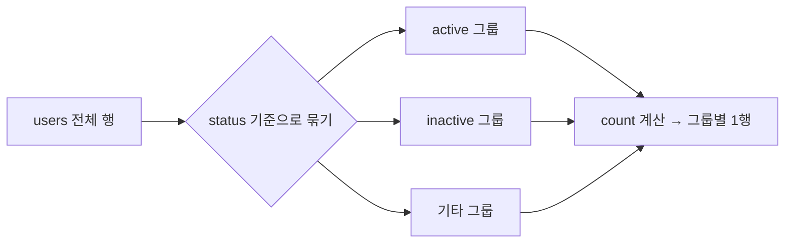
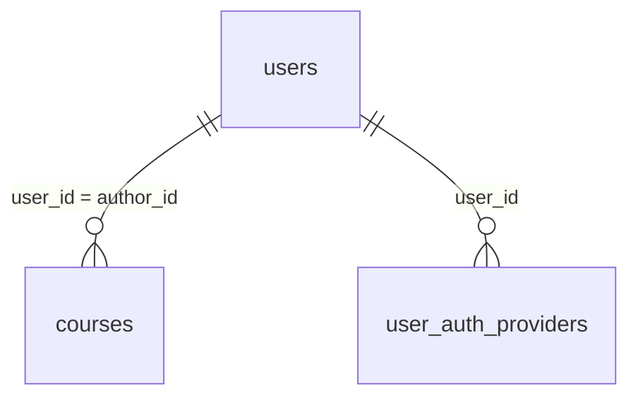

## 들어가며 (Situation)

MySQL 수업의 첫 일곱 파일(`01_select` ~ `07_Join`)은 모두 **데이터를 조회하는 문법**이다. 수업 중에 "SQL의 90% 이상이 조회"라는 설명이 있었고, 실제로 뒤에 나오는 서브쿼리·뷰·인덱스도 결국 조회를 잘하기 위한 도구다.

수업에서 쓴 테이블은 두 묶음이다.

| 묶음 | 테이블 | 사용한 파일 |
|---|---|---|
| 메뉴 DB | `tbl_menu`, `tbl_category` | 01 ~ 05 |
| LMS(학습 관리) DB | `users`, `courses`, `grades`, `enrollments`, `user_auth_providers` | 06, 07 |

## 문제 상황 (Task)

조회 문법은 크게 두 질문으로 줄일 수 있다.

1. **어떤 열(컬럼)을 가져올 것인가?** — 정보의 종류
2. **어떤 행(로우)을 가져올 것인가?** — 정보의 범위

처음에는 문법이 하나씩 따로 외워졌고, 여러 개를 섞으면 "왜 이 순서로 써야 하지?"가 헷갈렸다. 그래서 이 글은 문법을 나열하지 않고 **"이런 요구가 있을 때 → 이 문법"** 순서로 정리했다. 마지막에 이 문법들이 한 쿼리에서 어떤 순서로 실행되는지 하나의 그림으로 묶는다.

## 해결 과정 (Action)

### 1. SELECT: 어떤 열을 가져올까 (`01_select`)

```sql
select
    menu_name       -- 무엇을? (컬럼)
from
    tbl_menu;       -- 어디에서? (테이블)
```

"어디에서(`from`) 무엇을(`select`)" 가져올지 말하는 문장이다. 여러 컬럼은 쉼표로 이어 쓴다.

```sql
select menu_code, category_code, menu_price from tbl_menu;
```

**`*` (애스터리스크)** 는 모든 컬럼을 뜻한다. 편하지만 필요 없는 컬럼까지 가져오므로, 실무에서는 필요한 컬럼만 적는 편이 좋다.

**별칭(`as`)** 은 결과의 열 이름을 바꿔 보여준다.

```sql
select
    menu_name as '메뉴 이름',
    menu_price as '가격'
from tbl_menu;
```

수업 주석에 "띄어쓰기가 없으면 따옴표는 생략 가능"이라고 적혀 있다. 반대로 `메뉴 이름`처럼 **공백이 있으면 따옴표나 백틱이 필요**하다.

FROM 없이 함수만 쓸 수도 있다.

```sql
select now();                -- 현재 날짜와 시각
select concat('조', '평훈'); -- 문자열 합치기 → 조평훈
```

### 2. ORDER BY: 정렬하기 (`02_orderby`)

```sql
select menu_code, menu_name, menu_price
from tbl_menu
order by menu_price desc;
```

| 키워드 | 의미 |
|---|---|
| `asc` | 오름차순 (**기본값**, 생략 가능) |
| `desc` | 내림차순 |

> 수업 파일의 주석은 "오름차순으로 정렬"인데 코드는 `desc`(내림차순)였다. 코드와 주석이 어긋나 있다. `desc`는 내림차순이므로 **주석보다 코드를 믿어야 한다.**

**계산식과 별칭으로 정렬하기.** 계산 결과에 별칭을 붙이면 `order by`에서 그 별칭을 쓸 수 있다.

```sql
select menu_code, menu_price, menu_code * menu_price as `연산결과`
from tbl_menu
order by `연산결과` desc;
```

별칭을 `order by`에서 쓸 수 있는 이유는 뒤의 "실행 순서"에서 설명한다.

**NULL이 있는 컬럼 정렬.** `tbl_category`의 `ref_category_code`에는 NULL이 있다.

```sql
-- 기본 오름차순: MySQL은 NULL을 가장 작은 값으로 취급해 맨 위에 둔다
select * from tbl_category order by ref_category_code asc;

-- NULL을 뒤로 보내고 싶을 때
select * from tbl_category order by ref_category_code is null asc;
```

`ref_category_code is null`은 NULL이면 `1`(참), 아니면 `0`(거짓)이 된다. 오름차순이므로 `0`인 행(값이 있는 행)이 먼저, `1`인 행(NULL)이 뒤로 간다. 수업 주석에는 "null 최상단"이라 적혀 있지만, 같은 파일의 아래 주석("null 값이 뒤로 빠진다")대로 **NULL이 뒤로 빠진다.**

> 이 방식은 "NULL 여부"로만 정렬하므로, 값이 있는 행끼리도 오름차순을 원하면 `order by ref_category_code is null asc, ref_category_code asc`처럼 기준을 하나 더 붙여야 한다. 이 부분은 수업 코드에는 없고 내가 추가로 이해한 내용이다.

### 3. WHERE: 어떤 행을 가져올까 (`03_where`)

```sql
select menu_name, menu_price, orderable_status
from tbl_menu
where orderable_status = 'Y';
```

`where`는 **행을 걸러내는 조건**이다. 자주 쓰는 연산자는 다음과 같다.

| 연산자 | 의미 | 예시 |
|---|---|---|
| `=` | 같다 | `orderable_status = 'Y'` |
| `!=`, `<>` | 같지 않다 | `category_code <> 10` |
| `>`, `<`, `>=`, `<=` | 크기 비교 | `menu_price <= 13000` |
| `AND` | 모두 만족 | `price >= 10000 and price < 20000` |
| `OR` | 하나라도 만족 | `status = 'Y' or category_code = '10'` |
| `BETWEEN a AND b` | a 이상 b 이하 | `menu_price between 10000 and 20000` |
| `LIKE` | 패턴 포함 | `menu_name like '%마늘%'` |
| `IN` | 목록 중 하나 | `category_code in (4,5,6)` |
| `IS NULL` | NULL 여부 | `ref_category_code is not null` |

**AND와 OR의 차이는 결과 건수로 비교할 수 있다.** 수업에서는 같은 조건을 `or`와 `and`로 바꿔 두 번 실행했다.

```sql
where orderable_status = 'Y' or  category_code = '10'   -- 둘 중 하나만 맞아도 포함 → 건수 많음
where orderable_status = 'Y' and category_code = '10'   -- 둘 다 맞아야 포함 → 건수 적음
```

`and`는 조건이 늘수록 결과가 줄고, `or`는 늘수록 결과가 늘어난다.

**BETWEEN은 양 끝값을 포함한다.** `between 10000 and 20000`은 `>= 10000 and <= 20000`과 같다. 위에서 `< 20000`으로 쓴 쿼리와 20000원 메뉴의 포함 여부가 다르므로 주의해야 한다.

**LIKE의 와일드카드 `%`**

| 패턴 | 의미 |
|---|---|
| `'단어%'` | 단어로 **시작**하는 데이터 |
| `'%단어'` | 단어로 **끝나는** 데이터 |
| `'%단어%'` | 단어를 **포함**하는 데이터 |

**IN과 NOT.** `in (4,5,6)`은 `= 4 or = 5 or = 6`을 짧게 쓴 것이다. 수업 코드는 주석(4,5,6인 메뉴 조회)과 달리 `not in (4,5,6)`으로 되어 있었다. `not`을 붙이면 반대 결과가 나온다.

**NULL은 `=`로 비교할 수 없다.** NULL은 "값이 0이다"나 "빈 문자열이다"가 아니라 **값이 없는 상태**다. 그래서 `where name = null`은 참이 되지 않고, 반드시 `is null` / `is not null`을 써야 한다.

### 4. DISTINCT: 중복 제거 (`04_distinct`)

```sql
select distinct category_code
from tbl_menu
order by category_code;
```

`distinct`를 쓰지 않으면 메뉴마다 카테고리 코드가 반복해서 나온다. `distinct`는 `select` 바로 뒤에 붙여 **중복된 값을 하나로** 줄인다.

### 5. LIMIT: 개수 제한과 페이징 (`05_limit`)

```sql
select * from tbl_menu
order by menu_price desc
limit 1, 5;
```

문법은 `limit [offset,] row_count`이다.

| 값 | 의미 | 위 예시 |
|---|---|---|
| `offset` | 건너뛸 행 수 (**0부터 시작**) | 1 → 맨 위 1개를 건너뜀 |
| `row_count` | 가져올 행 수 | 5 → 5개 |

즉 위 쿼리는 **가격이 높은 순으로 2번째~6번째 메뉴**를 가져온다. "1번부터 5개"가 아니라서 처음에 헷갈렸다. 숫자가 하나만 있으면(`limit 5`) `offset`이 0인 것으로 본다.

페이징에 쓰려면 이렇게 계산한다.

| 페이지 | 한 페이지 10개일 때 |
|---|---|
| 1페이지 | `limit 0, 10` |
| 2페이지 | `limit 10, 10` |
| n페이지 | `limit (n-1)*10, 10` |

`limit`을 쓸 때는 `order by`를 함께 써야 한다. 정렬 기준이 없으면 "상위 5개"가 무엇을 기준으로 한 것인지 정해지지 않는다.

### 6. 집계 함수, GROUP BY, HAVING (`06_grouping`)

여기서부터는 LMS 테이블을 쓴다. "전체 사용자는 몇 명인가?", "개설 강좌가 가장 많은 교육자는?" 같은 **통계 질문**을 다룬다.

**집계 함수**

| 함수 | 역할 |
|---|---|
| `count(컬럼)` | 데이터 개수 (**NULL은 제외**) |
| `sum(컬럼)` | 합계 |
| `avg(컬럼)` | 평균 |
| `max(컬럼)` / `min(컬럼)` | 최댓값 / 최솟값 |

```sql
select count(*) as '총 사용자 수' from users;

-- 교육자가 중복해서 나오므로 distinct로 사람 수만 센다
select count(distinct author_id) as '과정 등록 교육자 수' from courses;

select sum(score) as '총점', avg(score) as '평균' from grades;
```

`count(*)`는 행 전체를 세고, `count(컬럼)`은 그 컬럼이 NULL이 아닌 행만 센다.

**시행착오: 집계 함수와 일반 컬럼을 같이 쓰면 에러가 난다**

```sql
select name, count(*) as '총 사용자 수' from users;   -- 에러 케이스
```

수업 주석의 설명은 "어떤 `name` 값을 `count(*)`와 묶어야 할지 모르기 때문"이었다. `count(*)`는 결과가 **1행**인데, `name`은 사용자 수만큼 여러 값이 있다. 어떤 이름을 대표로 보여줄지 DB가 결정할 수 없다. (MySQL 5.7부터 기본으로 켜져 있는 `ONLY_FULL_GROUP_BY` 모드에서 이 쿼리는 에러가 난다. 모드를 끄면 임의의 값이 나오지만, 믿을 수 없는 결과이므로 끄는 것은 권하지 않는다.)

해결책이 **GROUP BY**다. 기준 컬럼으로 묶고, 묶음마다 집계한다.

```sql
select status, count(*) as '사용자 수'
from users
group by status;
```



`select`에 쓸 수 있는 것은 **`group by`에 적은 컬럼**과 **집계 함수**뿐이다. 이 규칙을 알면 위 에러도 이해된다.

교육자별 개설 강좌 수도 같은 패턴이다.

```sql
select author_id as '교육자 번호', count(*) as '개설 강좌 수'
from courses
group by author_id;
```

**HAVING: 그룹을 만든 뒤 거르기**

"개설 강좌가 3개 이상인 교육자만" 보고 싶다. `where count(*) >= 3`이라고 쓰면 될 것 같지만 에러가 난다. **집계는 `where`가 실행된 뒤에야 계산**되기 때문이다.

```sql
select author_id, count(*) as '개설 강좌 수'
from courses
group by author_id
having count(*) >= 3;
```

| 구분 | WHERE | HAVING |
|---|---|---|
| 필터링 시점 | **그룹화 전** (행 단위) | **그룹화 후** (그룹 단위) |
| 집계 함수 사용 | 불가 | 가능 |

둘이 함께 필요한 문제도 있었다. "`completed` 상태의 수강 중 2명 이상이 등록한 과정"이다.

```sql
select course_id, count(*) as '학생 수'
from enrollments
where status = 'completed'      -- ① 먼저 completed 행만 남긴다 (행 필터)
group by course_id              -- ② 과정별로 묶는다
having count(*) >= 2;           -- ③ 학생 수 2명 이상인 그룹만 남긴다 (그룹 필터)
```

`status = 'completed'`는 개별 행의 조건이므로 `where`, "2명 이상"은 그룹의 조건이므로 `having`에 적는다.

### 7. JOIN: 테이블 합치기 (`07_Join`)

실제 DB는 의미 있는 데이터를 **테이블별로 나눠 저장**한다. 예를 들어 `courses`에는 교육자의 이름이 아니라 `author_id`(번호)만 있고, 이름은 `users`에 있다. 이 연결고리가 **외래키(FK)** 이고, 두 테이블을 공통 값으로 이어 붙이는 것이 `join`이다.



위 관계는 수업 코드의 `on` 조건에서 읽어낸 것이다. 수업에서는 `desc users;`, `desc courses;`로 테이블 구조를 먼저 확인했다.

**기본 JOIN (INNER JOIN)**

```sql
select c.title as '과정 제목', u.name as '교육자 이름'
from courses as c join users as u
on c.author_id = u.user_id;
```

- `c`, `u`는 테이블 별칭이다. 두 테이블에 같은 이름의 컬럼이 있을 때 `c.title`처럼 어느 테이블 것인지 밝힐 수 있다.
- `on`은 **무엇을 기준으로 이을지** 적는 부분이다.
- `join`만 쓰면 `inner join`이다. **양쪽에 모두 짝이 있는 행만** 결과에 나온다.

**LEFT JOIN과 RIGHT JOIN**

짝이 없는 행을 어떻게 다룰지가 다르다. 수업에서는 "소셜 로그인 제공자(`user_auth_providers`)"가 없는 사용자도 있다는 상황으로 비교했다.

```sql
-- LEFT: users를 전부 보여주고, 소셜 로그인이 없으면 provider는 NULL
select u.name, uap.provider
from users as u left join user_auth_providers as uap
on u.user_id = uap.user_id;

-- RIGHT: user_auth_providers를 전부 보여준다
select u.name, uap.provider
from users as u right join user_auth_providers as uap
on u.user_id = uap.user_id;
```

| 종류 | 기준(전부 출력) 테이블 | 짝이 없으면 |
|---|---|---|
| `INNER JOIN` | 없음 (양쪽 일치만) | 결과에서 제외 |
| `LEFT JOIN` | `from` 쪽 (왼쪽) | 오른쪽 컬럼이 NULL |
| `RIGHT JOIN` | `join` 쪽 (오른쪽) | 왼쪽 컬럼이 NULL |

아래는 이해를 돕기 위한 **예시 데이터**(실제 DB 값이 아님)이다. `users`는 3명, 그중 철수만 소셜 로그인이 없다고 가정했다.

| `LEFT JOIN` 결과 | provider |
|---|---|
| 영희 | google |
| 민수 | kakao |
| 철수 | NULL |

`INNER JOIN`이라면 철수 행이 사라진다. "**제공자가 없는 사용자도 포함해서 보고 싶다**"면 `left join`을 쓰는 것이다. 반대로 `right join`은 테이블 순서만 바꾸면 `left join`으로 똑같이 쓸 수 있어서, 실무에서는 `left join` 하나로 통일하는 경우가 많다.

수업에서는 `self join`, `outer join`도 종류로 언급만 되었고 코드로 다루지는 않았다. 그래서 이 글에서도 다루지 않았다.

### 8. 한 쿼리 안에서의 실행 순서

지금까지의 문법을 한 쿼리에 모두 넣으면 **쓰는 순서와 실행되는 순서가 다르다.**

```sql
select   author_id, count(*) as cnt     -- ⑤
from     courses                        -- ①
where    status = 'open'                -- ②
group by author_id                      -- ③
having   count(*) >= 3                  -- ④
order by cnt desc                       -- ⑥
limit    5;                             -- ⑦
```

(예시 코드. 수업의 `courses`에 `status` 컬럼이 있는지는 확인하지 못했다.)


이 순서를 알면 앞의 의문이 한 번에 풀린다.

| 의문 | 이유 |
|---|---|
| `where`에서는 집계 함수가 안 되고 `having`에서는 되는 이유 | `where`는 그룹을 만들기 **전**에 실행되기 때문 |
| `order by`에서는 별칭을 쓸 수 있는 이유 | `select`가 `order by`보다 **먼저** 실행되어 별칭이 이미 만들어졌기 때문 |
| `where`에서는 별칭을 못 쓰는 이유 | `where`가 `select`보다 **먼저** 실행되기 때문 |
| `limit` 전에 `order by`가 필요한 이유 | 정렬이 끝난 뒤에 상위 N개를 자르기 때문 |

## 결과 (Result)

| 하고 싶은 일 | 배우기 전 | 배운 후 |
|---|---|---|
| 필요한 컬럼만 보기 | 테이블 전체를 훑어봄 | `select 컬럼`, 별칭으로 이름까지 정리 |
| 조건에 맞는 행 찾기 | 눈으로 찾기 | `where` + `and/or/between/like/in` |
| 순위·페이징 | 전체를 내려받아 직접 처리 | `order by` + `limit offset, n` |
| 통계 | 직접 세어 계산 | `count/sum/avg` + `group by` + `having` |
| 흩어진 데이터 결합 | 테이블을 따로 보고 대조 | `join`으로 한 번에 조회 |

정량 지표는 측정하지 않아서 적지 않았다. 대신 얻은 가장 큰 수확은 **"SQL은 쓰는 순서가 아니라 실행 순서로 이해해야 한다"** 는 점이다. `where`와 `having`의 차이, 별칭을 쓸 수 있는 위치, `limit`과 `order by`의 관계가 모두 실행 순서 하나로 설명됐다.

## 더 학습하면 좋은 개념

- **서브쿼리(Subquery)** — 쿼리 안에 쿼리를 넣어 "평균보다 비싼 메뉴" 같은 조건을 만든다. 다음 수업(`08_subqueries`)이기도 하고, `join`으로 풀 수 있는 문제와 비교해 보면 선택 기준이 생긴다.
- **인덱스(Index)** — `where`와 `join`의 속도를 좌우한다. 조회 문법을 익힌 다음 "왜 이 쿼리가 느린가"를 이해하려면 필요하다.
- **`EXPLAIN` 실행 계획** — MySQL이 쿼리를 어떻게 실행하는지 보여준다. 이 글의 "실행 순서"를 실제로 확인하는 도구다.
- **`ONLY_FULL_GROUP_BY` SQL 모드** — `group by`에서 에러가 나는 이유를 정확히 알려준다. 서버마다 모드가 달라 결과가 달라질 수 있어 알아둬야 한다.
- **NULL과 3값 논리(TRUE / FALSE / UNKNOWN)** — `= null`이 안 되고 `not in`에 NULL이 섞이면 결과가 이상해지는 이유가 여기서 나온다.
- **UNION과 JOIN의 차이** — `join`은 열을 옆으로 붙이고, `union`은 행을 아래로 붙인다. 다음 단계에서 헷갈리기 쉽다.

## 참고 자료

- [MySQL 8.4 공식 문서 - SELECT Statement](https://dev.mysql.com/doc/refman/8.4/en/select.html)
- [MySQL 8.4 공식 문서 - Sorting Rows (ORDER BY)](https://dev.mysql.com/doc/refman/8.4/en/sorting-rows.html)
- [MySQL 8.4 공식 문서 - ORDER BY Optimization (NULL 정렬)](https://dev.mysql.com/doc/refman/8.4/en/order-by-optimization.html)
- [MySQL 8.4 공식 문서 - Aggregate Functions and GROUP BY](https://dev.mysql.com/doc/refman/8.4/en/aggregate-functions.html)
- [MySQL 8.4 공식 문서 - MySQL Handling of GROUP BY](https://dev.mysql.com/doc/refman/8.4/en/group-by-handling.html)
- [MySQL 8.4 공식 문서 - JOIN Clause](https://dev.mysql.com/doc/refman/8.4/en/join.html)
- [MySQL 8.4 공식 문서 - Working with NULL Values](https://dev.mysql.com/doc/refman/8.4/en/working-with-null.html)
- [MySQL 8.4 공식 문서 - Pattern Matching (LIKE)](https://dev.mysql.com/doc/refman/8.4/en/pattern-matching.html)
