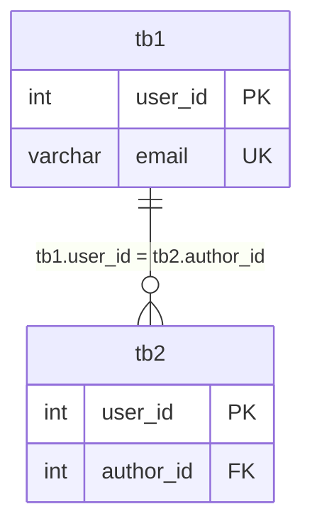
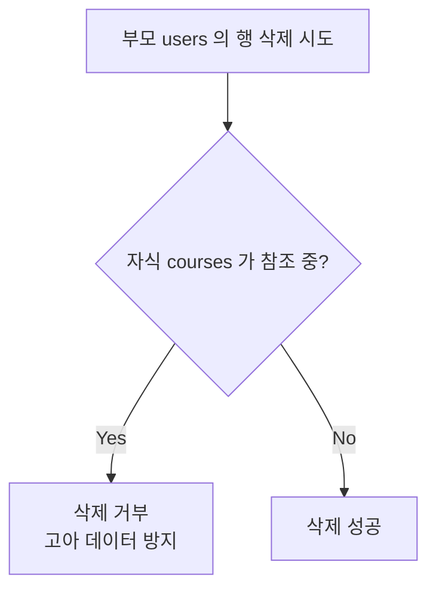
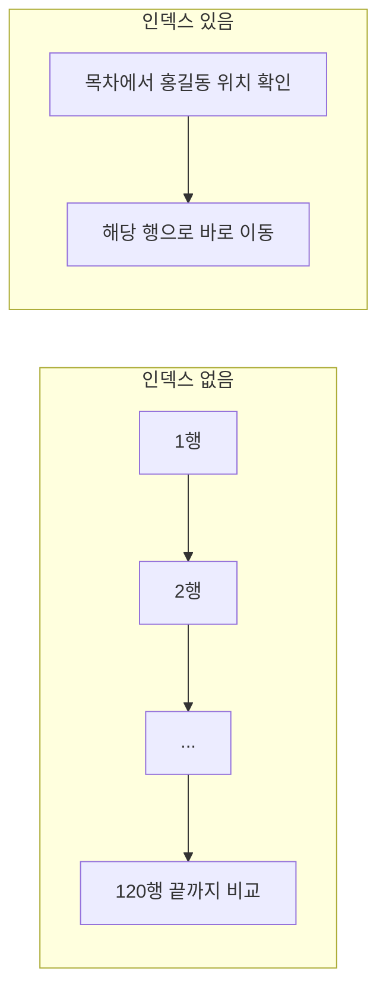
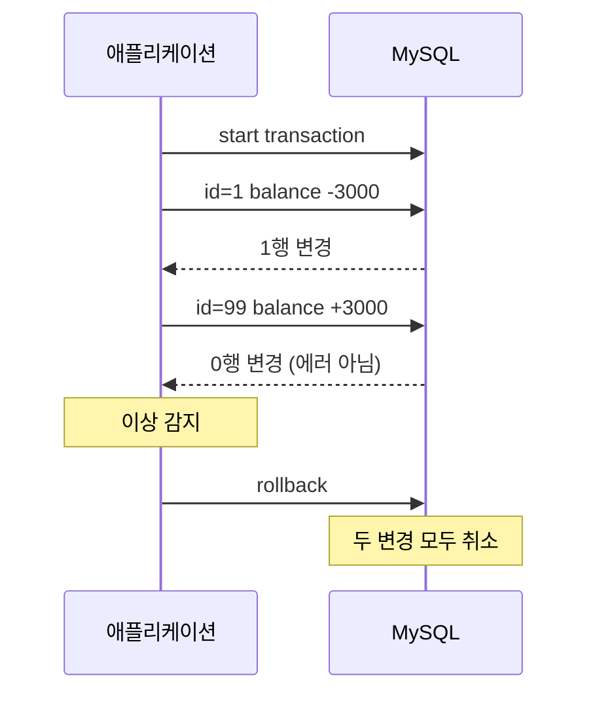

## 들어가며 (Situation)

앞선 글에서는 `01_select` ~ `07_Join`, 즉 **데이터를 읽는 문법**을 정리했다. 이번에는 `08_subqueries` ~ `14_transctional`, 즉 읽는 방법을 한 단계 확장하고 **테이블을 만들고, 데이터를 바꾸고, 안전하게 지키는 문법**까지 이어서 정리한다.

| 파일 | 주제 | 한 줄 요약 |
|---|---|---|
| 08 | 서브쿼리 | 쿼리 안에 쿼리를 넣어 조건을 만든다 |
| 09 | DDL | 테이블의 구조와 규칙을 정의한다 |
| 10 | DML | 데이터를 넣고, 고치고, 지운다 |
| 11 | UNION | 쿼리 결과를 위아래로 합친다 |
| 12 | VIEW | 쿼리에 이름을 붙여 가상 테이블로 쓴다 |
| 13 | INDEX | 검색 속도를 높이는 목차를 만든다 |
| 14 | 트랜잭션 | 여러 작업을 하나로 묶어 전부 성공 또는 전부 취소한다 |

수업에서는 LMS 데이터베이스(`wanted_lms`)의 `users`, `courses`, `enrollments`를 주로 썼고, 마지막 14번은 `accounts`(계좌) 테이블을 새로 만들어 썼다.

## 문제 상황 (Task)

1. 한 번의 조회로는 답이 안 나오는 질문이 있다. 예: "홍길동과 **같은 해에 가입한** 사용자는?" 홍길동의 가입 연도를 먼저 알아야 한다.
2. 잘못된 데이터(중복 이메일, 없는 사용자를 가리키는 강좌 등)가 **들어오지 못하게 DB가 스스로 막아야** 한다.
3. 데이터 변경은 되돌리기 어렵다. `where`를 빼먹거나 중간에 장애가 나면 **데이터가 어중간한 상태로 남는다.**
4. 자주 쓰는 복잡한 쿼리와 느린 검색을 **관리하기 쉽고 빠르게** 만들고 싶다.

## 해결 과정 (Action)

### 1. 서브쿼리: 쿼리 안의 쿼리 (`08_subqueries`)

"홍길동과 같은 연도에 가입한 사용자의 이름과 가입일"을 구하는 문제를 두 단계로 쪼개 보았다.

```sql
-- ① 홍길동의 가입 연도
select year(created_at) from users where name = '홍길동';

-- ② 그 연도에 가입한 사용자 (연도를 모르는 상태)
select name, created_at from users;
```

①의 결과를 ②의 조건으로 넣으려면 두 쿼리를 하나로 합쳐야 한다. 이것이 **서브쿼리**다.

```sql
select name, created_at
from users
where year(created_at) = (
    select year(created_at)
    from users
    where name = '홍길동'
);
```


서브쿼리는 **쓰는 위치**에 따라 역할이 다르다. 수업에서는 두 위치를 다뤘다.

| 위치 | 서브쿼리가 하는 일 | 수업 예시 |
|---|---|---|
| `where` 절 | 조건에 쓸 **값**을 계산해 준다 | 홍길동의 가입 연도 |
| `from` 절 | 결과를 **가상 테이블**처럼 쓴다 | 교육자별 개설 과정 수 |

**`from` 절 서브쿼리**는 집계한 결과를 다시 `join`할 때 유용하다.

```sql
select u.name as '교육자 이름', aut.course_count as '교육자 개설 과정 수'
from users u join (
    select author_id, count(*) as course_count
    from courses
    group by author_id
) as aut on u.user_id = aut.author_id
order by `교육자 개설 과정 수` desc;
```

`courses`를 교육자별로 먼저 집계(`aut`)하고, 그 결과에 `users`를 붙여 이름을 얻는다. 안쪽 쿼리의 결과에는 **반드시 별칭(`as aut`)을 붙여야** 한다. MySQL이 파생 테이블에 이름을 요구하기 때문이다.

**주의할 점.** `where year(created_at) = (서브쿼리)`처럼 `=`를 쓰면 서브쿼리가 **값 하나만** 돌려줘야 한다. 같은 이름의 사용자가 2명 이상이면 에러가 난다. 여러 값이 나올 수 있을 땐 `in`을 쓴다.

> 수업 파일 앞부분에는 "SQL 기초 강의 수강생의 평균 점수보다 높은 학생" 문제도 적혀 있지만 코드는 없고 문제만 있었다. 같은 방식(① 평균을 구하고 ② 그보다 높은 점수 조회)으로 풀 수 있는 문제라 풀이를 직접 만들어 보면 좋은 연습이 된다.

### 2. DDL: 테이블의 규칙을 정의하기 (`09_ddl`)

DDL(Data Definition Language)은 데이터가 아니라 **데이터의 틀**을 다룬다. 수업의 핵심 문장은 이것이었다.

> 테이블을 만드는 것은 단순히 칸을 나누는 작업이 아니다. 데이터가 지켜야 할 규칙을 정의하고, 데이터베이스가 스스로 데이터의 품질을 유지하도록 만드는 시스템을 설계하는 과정이다.

그 규칙의 두 축이 **데이터 타입**과 **제약 조건**이다.

**데이터 타입**

| 타입 | 용도 | 예 |
|---|---|---|
| `INT` / `BIGINT` | 정수 | `user_id` |
| `VARCHAR(n)` | 최대 n글자 가변 문자열 | `email`, `name` |
| `TEXT` | 매우 긴 글 | `description` |
| `DATE` | 날짜 | `2026-10-20` |
| `DATETIME` / `TIMESTAMP` | 날짜 + 시간 | 가입 일시 |

**제약 조건 (수업에서 "중요"로 표시한 부분)**

| 제약 조건 | 의미 |
|---|---|
| `NOT NULL` | 비워둘 수 없음 (필수 입력) |
| `UNIQUE` | 테이블 안에서 값이 중복될 수 없음 |
| `PRIMARY KEY` | `NOT NULL` + `UNIQUE`, 행을 대표하는 식별자 |
| `FOREIGN KEY` | 다른 테이블의 기본 키를 참조해 관계를 맺음 |
| `DEFAULT` | 값을 안 넣었을 때 쓸 기본값 |

수업 주석은 제약 조건을 DB가 스스로 데이터의 정합성을 지키는 **"자동 경찰"** 이라고 표현했다.

**테이블 생성 (`create table`)**

```sql
create table tb1(
    user_id int primary key,
    user_pwd varchar(12) not null comment '사용자 비밀번호',
    email varchar(30) not null unique comment '이메일',
    user_status varchar(10) default 'active' comment '계정 활성 상태',
    created_at timestamp not null default current_timestamp comment '가입 일시'
) comment '서비스 유저 정보 테이블';
```

한 줄씩 보면 `user_id`는 대표 식별자, `email`은 필수이면서 중복 불가, `user_status`는 안 넣으면 `'active'`, `created_at`은 안 넣으면 **현재 시각이 자동 입력**된다. `describe tb1;`(줄여서 `desc`)로 구조를 확인할 수 있다.

**외래 키로 두 테이블 연결하기**

```sql
create table tb2(
    user_id int primary key,
    author_id int not null comment 'tb1 에서 전달 받는 외래 키',
    -- (중간 컬럼 생략)
    foreign key(`author_id`) references `tb1`(`user_id`)
);
```

`tb2.author_id`는 `tb1.user_id`를 참조한다. 이때 부모 테이블(`tb1`)에 없는 값을 자식 테이블(`tb2`)에 넣으려 하면 DB가 막는다. 이것이 **참조 무결성**이다.



**시행착오: 삭제 순서.** 수업 파일은 `drop table tb1;` 다음에 `drop table tb2;`가 나온다. 그런데 `tb2`가 `tb1`을 참조하고 있으므로, 부모인 `tb1`을 먼저 지우려 하면 MySQL이 **외래 키가 참조 중이라는 이유로 거부**한다. 수업 주석("tb1은 tb2에 user_id를 제공하고 있다")이 바로 이 관계를 가리킨다. 안전한 순서는 **자식(`tb2`) → 부모(`tb1`)** 다. (이 순서 문제는 수업 코드에 대한 내 해석이며, 실제 에러 메시지는 직접 실행해서 확인해 보기를 권한다.)

**테이블 구조 변경 (`alter table`)**

수업에서는 원본 `courses`를 건드리지 않으려고 **복제본**을 만들어 실습했다.

```sql
create table courses_temp as select * from courses;   -- 복제
```

| 목적 | 문법 |
|---|---|
| 컬럼 추가 | `alter table courses_temp add column price int not null default 0;` |
| 컬럼 수정 | `alter table courses_temp modify column price varchar(200) not null default '0원';` |
| 컬럼 삭제 | `alter table courses_temp drop column price;` |

`modify`로 `int`를 `varchar`로 바꾸면서 기본값도 `'0원'`으로 바꿨다. 기본값이 `'0원'`이라는 문자열이므로, 타입도 숫자가 아닌 문자열이어야 했던 것이다.

> `create table ... as select`는 **컬럼과 데이터만 복제**한다. 원본의 기본 키, 인덱스 같은 제약은 복제본에 그대로 따라오지 않는다. 복제본은 연습용으로만 써야 하는 이유다. (공식 문서의 `CREATE TABLE ... SELECT` 항목 참고)

**DROP과 TRUNCATE**

| 구분 | `drop table` | `truncate table` |
|---|---|---|
| 삭제 대상 | 데이터 + **테이블 구조 전부** | **데이터만** (구조는 남음) |
| 롤백 | 불가 | 불가 |
| 속도 | 매우 빠름 | 매우 빠름 |

수업에서는 두 명령 모두 "롤백이 불가능하므로 신중하게 써야 한다"고 강조했다. DDL은 실행 즉시 확정되기 때문이다.

### 3. DML: 데이터 넣고 고치고 지우기 (`10_dml`)

수업 파일 첫 줄에 "좀 더 주의 깊게 보기"라고 적혀 있을 만큼 **실수의 대가가 큰** 영역이다.

**INSERT**

```sql
insert into users (`email`, `name`) values ('email@gamil.com', '조평훈');
```

"테이블명 (컬럼들) values (값들)" 형태이고, 컬럼 순서와 값 순서가 **짝**을 이뤄야 한다.

수업에서는 INSERT가 실패하는 경우를 하나씩 일부러 만들어 봤다. 수업의 핵심 조언은 *에러가 나면 테이블의 제약 조건과 데이터 타입을 확인하라* 였다.

| 시도 | 원인 | 수업 설명 |
|---|---|---|
| 같은 이메일로 다시 insert | `UNIQUE` 위반 | 중복 이메일 불허 |
| `name` 없이 insert | `NOT NULL` 위반 (수업 설명) | name은 반드시 있어야 함 |
| `name`에 숫자 `123` insert | **에러 아님** | DB가 `'123'` 문자열로 자동 형변환 |
| 없는 회원(999)을 `author_id`로 insert | 외래 키 위반 | 참조 무결성, 고아 데이터 방지 |

표의 세 번째 줄이 의외였다. 문자열 컬럼에 숫자를 넣어도 DB는 조용히 문자열로 바꿔 저장한다. 수업 주석은 "예외 처리는 DB가 아니라 **프론트·백엔드에서 해야 한다**"고 정리했다.

> 수업 코드의 두 번째 케이스는 `insert into users (email) values ('email2@gamil.com', '조평순')`이다. 컬럼은 1개인데 값이 2개라서, 실제로는 NOT NULL 위반보다 먼저 **"컬럼 수와 값 수가 맞지 않음"** 에러가 난다고 보는 것이 맞다. NOT NULL 위반을 보려면 `insert into users (email) values ('email2@gamil.com');`처럼 값을 하나만 넣어야 한다.

**UPDATE**

```sql
update users set `name` = '조평훈';                      -- 위험!
update users set `name` = '조평순' where `user_id` = 1;  -- 안전
```

`where`가 없으면 **테이블의 모든 행**이 바뀐다. 수업에서는 `where`에 **한 행을 식별할 수 있는 값(PK, UNIQUE)** 을 쓰도록 권장했다. 이름은 중복될 수 있지만 `user_id`는 유일하기 때문이다.

> 참고: MySQL Workbench는 기본으로 "Safe Updates" 모드가 켜져 있어, key 컬럼을 쓰지 않는 `update`/`delete`를 막는다. 설정을 끄면 위 위험한 쿼리가 그대로 실행되므로 주의해야 한다.

**DELETE**

```sql
delete from users where email = 'email@gamil.com';
delete from users where user_id = 1;    -- 에러 케이스
```

두 번째 `delete`는 거부된다. `users.user_id`를 `courses.author_id`가 참조하고 있어서, 지우면 `courses`의 행이 **주인 없는 고아 데이터**가 되기 때문이다. 정리하면 이렇다.

| 용어 | 뜻 |
|---|---|
| 부모 테이블 | FK를 **주는** 테이블 (`users`) |
| 자식 테이블 | FK를 **받는** 테이블 (`courses`) |



자식 행을 먼저 지우거나 다른 값으로 바꾼 뒤에야 부모를 지울 수 있다.

### 4. UNION: 결과를 위아래로 합치기 (`11_union`)

활성(`active`)과 정지(`suspended`) 사용자에게만 메일을 보내고, 탈퇴(`deleted`) 사용자는 제외해야 한다.

```sql
select `name`, `email`, `status` from users where status = 'active'
union
select `name`, `email`, `status` from users where status = 'suspended';
```

| 규칙 | 설명 |
|---|---|
| 컬럼 **개수**가 같아야 함 | 위 쿼리는 둘 다 3개 |
| 컬럼 **순서**와 **타입**이 호환되어야 함 | 위치 기준으로 합쳐진다 |
| 중복된 행은 **제거** | 수학의 합집합 |

JOIN과 헷갈리기 쉬워서 비교해 두었다.

| 구분 | JOIN | UNION |
|---|---|---|
| 합치는 방향 | 열을 **옆으로** | 행을 **아래로** |
| 기준 | `on` 조건 (연결 컬럼) | 컬럼 개수·순서·타입 |

이 예제는 같은 테이블에서 조건만 다르므로 `where status in ('active', 'suspended')` 하나로도 같은 결과를 얻을 수 있다. UNION은 **서로 다른 테이블의 결과를 합쳐야 할 때** 진가가 드러난다. 또 중복 제거가 필요 없다면 `union all`이 있고, 중복 검사를 생략하므로 일반적으로 더 빠르다. (수업에서는 `union`만 다뤘다.)

### 5. VIEW: 쿼리에 이름 붙이기 (`12_view`)

수업의 시나리오는 두 가지였다.

- 데이터 분석팀이 **과정별 등록 학생 수**를 매일 확인한다. 매번 긴 쿼리를 쓰기 번거롭다.
- 마케팅팀에게는 사용자의 전체 정보 대신 **이메일·이름만** 보여주고 싶다.

해결책이 **뷰(View)**, 즉 가상의 테이블이다.

```sql
create view v_coureses_stats as
select c.course_id, c.title, count(e.enrollment_id) as '등록 학생 수'
from courses as c
left join enrollments as e on c.course_id = e.course_id
group by c.course_id, c.title;
```

한 번 만들어 두면 이후에는 일반 테이블처럼 쓴다.

```sql
select * from v_coureses_stats where `등록 학생 수` >= 3;
```

`left join`을 쓴 덕분에 **수강생이 0명인 과정도** 결과에 포함된다. `inner join`이었다면 등록자가 없는 과정은 사라졌을 것이다.

| 장점 | 설명 |
|---|---|
| 편의성 | 복잡한 쿼리를 간단한 테이블처럼 조회 |
| 보안성 | 민감한 컬럼을 뺀 뷰만 공개해 원본 테이블 접근을 숨김 |
| 가독성 | 자주 쓰는 컬럼만 모아 읽기 쉬움 |

수업 주석에는 "속도가 빨라진다"는 설명도 있었다. 다만 MySQL의 일반 뷰는 **결과를 저장하지 않고**, 조회할 때마다 안쪽 쿼리를 실행한다. 그래서 뷰 자체가 쿼리를 빠르게 만들지는 않는다. 속도는 인덱스 같은 별도 수단으로 해결해야 하고, 뷰의 가치는 편의성과 보안성에 더 가깝다고 이해했다. (공식 문서의 "CREATE VIEW Statement" 참고)

**삭제와 수정**

```sql
drop view v_coureses_stats;                       -- 삭제

create or replace view v_coureses_stats as ...;   -- 있으면 교체, 없으면 생성
```

수업에서는 `create or replace`로 뷰에 `c.status` 컬럼을 추가했다. 단, 그 쿼리의 `group by`에는 `c.course_id, c.title`만 있고 `c.status`는 없다. MySQL은 `course_id`가 기본 키라서 `status`가 `course_id`에 **함수적으로 종속**되면 허용하지만, 그렇지 않으면 `ONLY_FULL_GROUP_BY` 모드에서 에러가 난다. `courses.course_id`가 PK인지는 확인하지 못했다.

### 6. INDEX: 검색을 빠르게 하는 목차 (`13_index`)

사용자가 100만 명인 `users`에서 '홍길동'을 찾는다고 하자. 인덱스가 없으면 DB는 **첫 행부터 마지막 행까지 하나씩 비교**한다. 이를 **풀 테이블 스캔(full table scan)** 이라 한다.

인덱스(index)는 "목차"라는 뜻이다. 특정 컬럼 값과 그 데이터의 물리적 위치를 **미리 정렬된 목차**로 저장해 두고, 쿼리가 오면 목차를 보고 바로 해당 위치로 이동한다.



**인덱스 생성과 효과 확인**

```sql
explain select * from users where name = '홍길동';   -- 적용 전

create index idx_users_name on users(name);

explain select * from users where name = '홍길동';   -- 적용 후
```

`explain`은 쿼리의 **실행 계획**을 보여주는 명령이다. 수업에서는 실행 계획의 `rows`를 비교했다.

| 시점 | 스캔한 행 수 (수업 설명) |
|---|---|
| 인덱스 적용 전 | 120 행 (풀 스캔) |
| 인덱스 적용 후 | 1 행 |

데이터가 120건뿐이어도 120배의 차이다. 데이터가 100만 건이라면 그 차이는 훨씬 크게 벌어질 것이다.

**그런데 왜 모든 컬럼에 인덱스를 만들지 않을까? "양날의 검"**

| 단점 | 이유 |
|---|---|
| 저장 공간 | 인덱스는 테이블과 **별도의 공간**을 차지한다 (목차도 10~20쪽을 차지하는 것과 같다) |
| DML 성능 저하 | 데이터가 바뀔 때마다 **인덱스도 함께 갱신**해야 한다 |

DML 성능 저하가 가장 중요한 요인이었다.

| 작업 | 인덱스에서 추가로 일어나는 일 |
|---|---|
| `INSERT` | 정렬된 위치를 찾아 새 항목 추가 |
| `DELETE` | 해당 항목을 찾아 삭제 |
| `UPDATE` (인덱스 컬럼) | 기존 항목 삭제 **+** 새 위치에 삽입 (최악) |

그래서 인덱스 적용 대상은 두 가지 기준으로 고른다.

1. **조회 비율이 압도적으로 높은** 테이블 (DML이 조금 느려지는 것은 감수)
2. DML 중에서도 **수정이 자주 일어나지 않는** 컬럼

**이미 인덱스가 있는 경우.** `PRIMARY KEY`와 `UNIQUE` 제약 조건이 걸린 컬럼은 유일성을 보장해야 하므로 테이블 생성 시 **인덱스가 자동으로 만들어진다.** 이 컬럼들로 조회하면 따로 인덱스를 만들지 않아도 빠른 이유다.

### 7. 트랜잭션: 전부 성공하거나 전부 취소하거나 (`14_transctional`)

계좌 이체를 예로 들어 보자. 홍길동(10,000원)이 김짱구(5,000원)에게 3,000원을 보낸다.

```sql
create table accounts(
    id int primary key,
    owner varchar(50),
    balance decimal(10,2)
);

insert into accounts(id, owner, balance)
values (1, '홍길동', 10000.00), (2, '김짱구', 5000.00);
```

계좌 이체는 논리적으로 **하나의 일**이지만, 실제로는 `UPDATE`가 **두 번** 실행된다.

1. 홍길동 계좌 −3,000
2. (은행 정전!)
3. 김짱구 계좌 +3,000

2번에서 문제가 생기면 **3,000원이 허공으로 사라진다.** 이 문제를 막는 것이 트랜잭션이다. **여러 작업을 하나의 논리적 작업 단위로 묶고, 하나라도 잘못되면 전부 되돌리는 것**이 핵심이다.

| 명령 | 역할 |
|---|---|
| `start transaction` | 트랜잭션 시작 |
| `commit` | 모든 작업을 **영구 반영** |
| `rollback` | 시작 이후의 작업을 **전부 취소** |

**정상 흐름**

```sql
start transaction;

update accounts set balance = balance - 3000 where id = 1;
update accounts set balance = balance + 3000 where id = 2;

select * from accounts;   -- 중간 확인: 아직 영구 반영된 상태가 아님
commit;                    -- 여기서 확정
```

수업 주석이 강조한 부분은 "중간 확인 / 영구 반영된 상태는 아니다"였다. `commit` 전의 `select`에는 내 변경이 보이지만, 그것은 **임시 상태**다.

**비정상 흐름**

```sql
start transaction;

update accounts set balance = balance - 3000 where id = 1;
update accounts set balance = balance + 3000 where id = 99;   -- 없는 계좌

select * from accounts;
rollback;   -- 일부가 문제였으므로 전부 취소
```



**여기서 이해해야 할 점.** `id = 99`인 계좌는 없지만 `update`는 **에러를 내지 않는다.** 조건에 맞는 행이 0개일 뿐, 문법적으로는 정상이기 때문이다. 그래서 "이상하다"는 판단과 `rollback` 호출은 **애플리케이션이 변경된 행 수를 확인해서** 해야 한다. 수업 코드에서는 사람이 `rollback`을 직접 입력하는 방식이라 이 판단 과정이 드러나지 않는다.

> 참고 1: MySQL은 기본이 **autocommit** 모드다. `start transaction` 없이 실행한 문장은 즉시 확정되고, `start transaction`을 쓰면 `commit`/`rollback`이 나올 때까지 묶인다.
> 참고 2: `create table`, `drop table` 같은 DDL은 실행 시 **암묵적으로 commit**되어 롤백할 수 없다. 앞서 DDL에서 "롤백 불가"가 강조된 이유다.

## 결과 (Result)

| 하고 싶은 일 | 배우기 전 | 배운 후 |
|---|---|---|
| 값이 선행 쿼리에 달린 조건 | 쿼리를 두 번 실행하고 값을 눈으로 옮김 | 서브쿼리로 한 번에 |
| 잘못된 데이터 방지 | 앱에서만 검증 | 제약 조건(`NOT NULL`, `UNIQUE`, `FK`)으로 DB가 차단 |
| 데이터 변경 | `where` 유무의 위험성을 몰랐음 | PK/UNIQUE로 한 행을 특정해 변경 |
| 반복되는 긴 쿼리 | 매번 작성 | 뷰로 이름 붙여 재사용 |
| 느린 검색 | 풀 스캔 | 인덱스로 120행 → 1행 (수업 `explain` 기준) |
| 여러 단계 작업 | 중간 장애 시 불일치 | 트랜잭션으로 전부 성공 또는 전부 취소 |

정량 지표는 수업에서 제시된 인덱스의 `120행 → 1행` 한 가지만 사용했다. 직접 측정한 수치가 아니라 수업 설명을 인용한 값이다.

이번 파트에서 가장 크게 와닿은 점은 **"DB는 데이터를 저장하는 곳이 아니라 데이터의 품질을 지키는 곳"** 이라는 것이다. 제약 조건이 입력을 막고, 외래 키가 삭제를 막고, 트랜잭션이 중간 상태를 막는다. 앞의 일곱 개가 "어떻게 꺼내는가"였다면, 이번 일곱 개는 "어떻게 안전하게 넣고 지키는가"였다.

## 더 학습하면 좋은 개념

- **트랜잭션의 ACID** — 원자성·일관성·격리성·지속성. 이번에 본 "전부 성공 또는 전부 취소"가 원자성이다. 나머지 셋까지 알아야 트랜잭션이 보장하는 범위를 정확히 이해할 수 있다.
- **격리 수준(Isolation Level)과 락(Lock)** — 두 사람이 동시에 같은 계좌를 바꾸면 어떻게 되는지를 다룬다. 실제 서비스에서 트랜잭션이 가장 어려워지는 지점이다.
- **B-Tree 인덱스와 복합 인덱스** — 인덱스가 "목차"로 빨라지는 실제 자료구조와, 컬럼 여러 개로 만드는 인덱스의 순서 규칙이다. 인덱스를 만들었는데 안 타는 이유를 이해하려면 필요하다.
- **정규화와 외래 키 옵션 (`ON DELETE CASCADE` 등)** — 이번에는 부모 삭제가 거부되는 경우만 봤다. 옵션을 주면 자식을 함께 지우거나 NULL로 바꿀 수 있어, 테이블 설계 기준과 함께 알아둘 가치가 있다.
- **서브쿼리 vs JOIN, 상관 서브쿼리** — 같은 결과를 두 방식으로 쓸 수 있는 경우가 많다. 성능과 가독성을 기준으로 고르는 법과, 바깥 쿼리 값을 참조하는 상관 서브쿼리를 이어서 배우면 좋다.
- **물리적 뷰(Materialized View)와 `UNION ALL`** — 결과를 실제로 저장해 속도를 높이는 방식, 중복 검사를 생략하는 합치기 방식이다. 이번 글에서 짚은 "일반 뷰는 빠르지 않다", "UNION은 중복 제거 비용이 있다"의 다음 단계이다. (MySQL은 물리적 뷰를 기본 제공하지 않으므로 다른 DBMS와의 차이도 같이 보면 좋다.)

## 참고 자료

- [MySQL 8.4 공식 문서 - Subqueries](https://dev.mysql.com/doc/refman/8.4/en/subqueries.html)
- [MySQL 8.4 공식 문서 - Derived Tables](https://dev.mysql.com/doc/refman/8.4/en/derived-tables.html)
- [MySQL 8.4 공식 문서 - CREATE TABLE Statement](https://dev.mysql.com/doc/refman/8.4/en/create-table.html)
- [MySQL 8.4 공식 문서 - CREATE TABLE ... SELECT Statement](https://dev.mysql.com/doc/refman/8.4/en/create-table-select.html)
- [MySQL 8.4 공식 문서 - ALTER TABLE Statement](https://dev.mysql.com/doc/refman/8.4/en/alter-table.html)
- [MySQL 8.4 공식 문서 - TRUNCATE TABLE Statement](https://dev.mysql.com/doc/refman/8.4/en/truncate-table.html)
- [MySQL 8.4 공식 문서 - FOREIGN KEY Constraints](https://dev.mysql.com/doc/refman/8.4/en/create-table-foreign-keys.html)
- [MySQL 8.4 공식 문서 - INSERT / UPDATE / DELETE Statements](https://dev.mysql.com/doc/refman/8.4/en/sql-data-manipulation-statements.html)
- [MySQL 8.4 공식 문서 - UNION Clause](https://dev.mysql.com/doc/refman/8.4/en/union.html)
- [MySQL 8.4 공식 문서 - CREATE VIEW Statement](https://dev.mysql.com/doc/refman/8.4/en/create-view.html)
- [MySQL 8.4 공식 문서 - How MySQL Uses Indexes](https://dev.mysql.com/doc/refman/8.4/en/mysql-indexes.html)
- [MySQL 8.4 공식 문서 - EXPLAIN Statement](https://dev.mysql.com/doc/refman/8.4/en/explain.html)
- [MySQL 8.4 공식 문서 - START TRANSACTION, COMMIT, and ROLLBACK Statements](https://dev.mysql.com/doc/refman/8.4/en/commit.html)
- [MySQL 8.4 공식 문서 - Statements That Cause an Implicit Commit](https://dev.mysql.com/doc/refman/8.4/en/implicit-commit.html)
