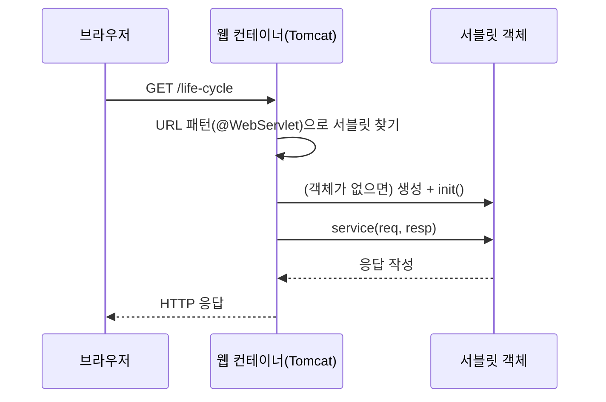
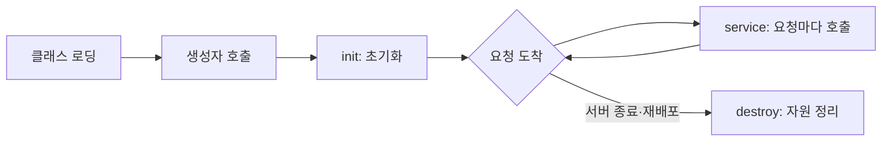
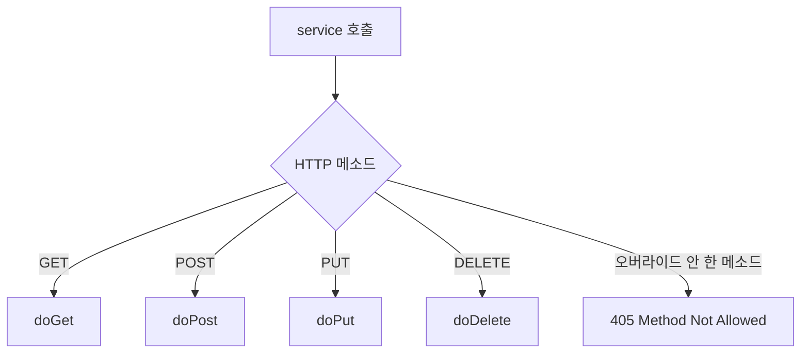
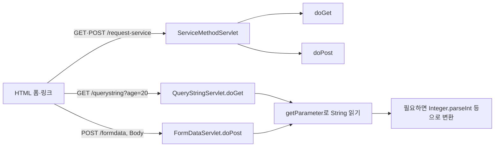

## 들어가며 (Situation)

JDBC까지는 `main()`을 직접 실행하는 콘솔 프로그램이었다. 하지만 웹 서비스에서는 **브라우저가 보낸 HTTP 요청을 받아서 처리하는 자바 코드**가 필요하다. 그 역할을 하는 자바 클래스가 **서블릿(Servlet)** 이다.

`06_Servlet/chap01-servlet` 프로젝트는 서블릿의 기본기를 세 가지 주제로 나눠 확인한다. 이 글에서는 각 주제를 코드와 함께 짚고, 코드 주석에 적혀 있던 설명 중 **공식 문서로 다시 확인해야 했던 부분**도 같이 정리한다.

| 단계 | 패키지 | 서블릿 | URL 패턴 | 확인하는 것 |
|---|---|---|---|---|
| 1 | `a_lifecycle` | `LifeCycleServlet` | `/life-cycle` | 생성자·`init`·`service`·`destroy`가 언제 호출되는가 |
| 2 | `b_service` | `ServiceMethodServlet` | `/request-service` | `service()`와 `doGet()`/`doPost()`의 관계 |
| 3 | `c_parameter` | `QueryStringServlet`, `FormDataServlet` | `/querystring`, `/formdata` | GET/POST로 넘어온 값을 `getParameter()`로 읽기 |

프로젝트 구성은 다음과 같다. (`build.gradle`, `web.xml` 기준)

| 항목 | 내용 |
|---|---|
| 빌드 도구 | Gradle, `war` 플러그인 (결과물은 `.war`) |
| 서블릿 API | `compileOnly('jakarta.servlet:jakarta.servlet-api:6.1.0')` |
| 서블릿 등록 방식 | `@WebServlet` 어노테이션 (`web.xml`은 비어 있음) |

`compileOnly`인 이유는 서블릿 API는 **실행 환경(웹 컨테이너)이 이미 제공**하기 때문이다. `.war`에 같이 넣으면 컨테이너의 것과 충돌할 수 있다.

## 문제 상황 (Task)

1. `main()`이 없는데 **내 클래스가 누가, 언제 실행**하는지 모른다. 객체는 누가 만들고 몇 개나 만들어지는가?
2. 같은 URL(`/request-service`)에 **링크 클릭(GET)** 과 **폼 전송(POST)** 이 모두 들어온다. 이 둘을 어떻게 구분해서 처리하는가?
3. 폼에 입력한 이름, 나이, 취미 같은 값이 **서버 코드에서 어떤 형태로** 읽히는가? 특히 체크박스처럼 **값이 여러 개**인 경우는?

## 해결 과정 (Action)

### 1. 서블릿은 누가 실행하는가: 웹 컨테이너와 요청 흐름

서블릿은 직접 실행하지 않는다. **웹 컨테이너(Tomcat 같은 서블릿 컨테이너)** 가 서블릿 객체를 만들고, 요청이 오면 `HttpServletRequest`/`HttpServletResponse` 객체를 만들어 서블릿의 메소드에 넘겨준다. Servlet 6.1을 쓰는 이 프로젝트는 Servlet 6.1을 지원하는 컨테이너(Tomcat 11 등)가 필요하다. (`javax.servlet`이 아니라 `jakarta.servlet` 패키지를 쓰는 것이 Servlet 5.0 이후의 차이다.)



`@WebServlet(value = "/life-cycle")`가 이 "URL 패턴 → 서블릿 클래스" 연결표 역할을 한다. 예전에는 `web.xml`에 `<servlet>`, `<servlet-mapping>`을 일일이 써야 했고, 지금은 어노테이션으로 대체할 수 있어서 이 프로젝트의 `web.xml`은 빈 껍데기다.

### 2. 서블릿 생명주기 확인하기 (`LifeCycleServlet`)

각 단계마다 로그를 찍고 호출 횟수를 세도록 만든 코드다.

```java
@WebServlet(value = "/life-cycle")
public class LifeCycleServlet extends HttpServlet {

    private int initCount = 1;
    private int serviceCount = 1;
    private int destroyCount = 1;

    public LifeCycleServlet(){
        System.out.println("기본 생성자 호출됨..");
    }

    @Override
    protected void service(HttpServletRequest req, HttpServletResponse resp) throws ServletException, IOException {
        System.out.println("service() 호출됨.." + serviceCount++);
    }

    @Override
    public void init(ServletConfig config) throws ServletException {
        System.out.println("init() 호출됨.." + initCount++);
    }

    @Override
    public void destroy() {
        System.out.println("destroy() 호출됨.." + destroyCount++);
    }
}
```

`index.html`의 링크(`/life-cycle`)를 여러 번 클릭하면, **서블릿 명세 기준으로** 콘솔에는 아래와 같은 순서가 나와야 한다. (아래는 명세에 따른 예상 출력이며, 이 글을 쓰며 직접 실행해 캡처한 값은 아니다.)

```text
기본 생성자 호출됨..      ← 첫 요청 때 1번
init() 호출됨..1          ← 첫 요청 때 1번
service() 호출됨..1       ← 요청마다 호출
service() 호출됨..2
service() 호출됨..3
...
destroy() 호출됨..1       ← 서버 종료(또는 앱 재배포) 때 1번
```



| 단계 | 호출 횟수 | 역할 |
|---|---|---|
| 생성자 | 서블릿당 1번 | 객체 생성 |
| `init()` | 서블릿당 1번 | 초기화 (DB 연결 준비 같은 1회성 작업) |
| `service()` | **요청마다** | 실제 요청 처리 |
| `destroy()` | 서블릿당 1번 | 자원 해제 |

여기서 얻는 핵심은 **서블릿 객체는 요청마다 새로 만들어지지 않고 하나를 여러 요청이 공유한다**는 점이다. 그래서 `serviceCount`가 요청이 올 때마다 1, 2, 3으로 누적된다. 같은 이유로 서블릿의 **인스턴스 필드에 요청별 데이터를 저장하면 안 된다.** 여러 요청이 동시에(여러 스레드로) 같은 객체의 같은 필드를 건드리기 때문이다. 이 코드의 카운터 필드도 학습용이라서 괜찮은 것이지, 동시 요청이 많은 환경에서는 `int++`가 안전하지 않다.

#### 시행착오와 주의할 점

이 코드를 그대로 실행하면 두 가지를 알아두어야 한다.

| 관찰 | 원인 | 정리 |
|---|---|---|
| 링크를 눌러도 **빈 화면**이 나온다 | `service()`에서 로그만 찍고 응답을 쓰지 않았다 | 로그 확인용 코드라서 정상이다. 화면에 내용을 보여주려면 `resp.getWriter()` 등으로 출력해야 한다 |
| `init(ServletConfig)`를 오버라이드하면서 `super.init(config)`를 호출하지 않았다 | `GenericServlet.init(ServletConfig)`는 `config`를 필드에 저장하고 파라미터 없는 `init()`을 호출한다 | 이 상태에서는 `getServletConfig()`가 `null`일 수 있다. 가장 안전한 방법은 `init(ServletConfig)` 대신 **파라미터 없는 `init()`을 오버라이드**하는 것이다 |

그리고 "생성자와 `init()`이 첫 요청 때 호출된다"는 것은 기본 동작이다. `@WebServlet(loadOnStartup = 1)`처럼 **서버 시작 시점에 미리 초기화**하도록 설정할 수도 있다. 이 부분은 명세와 API 문서의 `loadOnStartup` 항목을 근거로 정리했다.

### 3. `service()`와 `doGet()`/`doPost()` (`ServiceMethodServlet`)

`service.html`은 **같은 URL(`/request-service`)에 세 가지 방식으로** 요청을 보낸다.

| 요청 방법 | HTML | HTTP 메소드 |
|---|---|---|
| 링크 클릭 | `<a href="/request-service">` | GET |
| 폼 (method="get") | `<form action="/request-service" method="get">` | GET |
| 폼 (method="post") | `<form action="/request-service" method="post">` | POST |

처음에는 `service()`를 직접 오버라이드해서, 요청 객체의 `getMethod()`로 메소드 종류를 확인하는 코드를 썼다. 지금은 주석 처리되어 있다.

```java
// @Override
// protected void service(HttpServletRequest req, HttpServletResponse resp) ... {
//     String httpMethod = req.getMethod();
//     System.out.println("httpMethod = " + httpMethod);
// }
```

이 방식으로도 동작하지만, 메소드마다 `if (httpMethod.equals("GET")) ... else if ...`로 분기해야 한다. 최종 코드는 **`doGet()`과 `doPost()`를 각각 오버라이드**한다.

```java
@WebServlet(value = "/request-service")
public class ServiceMethodServlet extends HttpServlet {

    @Override
    protected void doGet(HttpServletRequest req, HttpServletResponse resp) throws ServletException, IOException {
        System.out.println("Get 요청을 처리할 메소드 호출됨..");
    }

    @Override
    protected void doPost(HttpServletRequest req, HttpServletResponse resp) throws ServletException, IOException {
        System.out.println(" post 요청을 처리할 메소드 호출됨");
    }
}
```

이게 가능한 이유는 `HttpServlet`이 이미 `service()`를 구현해 두었기 때문이다. `HttpServlet.service()`는 요청의 HTTP 메소드를 보고 알맞은 `doXxx()`를 호출하는 **분기 담당**이다.



그래서 `LifeCycleServlet`처럼 `service()`를 직접 오버라이드하면 이 **분기 로직을 통째로 대체**하게 되고, `doGet()`/`doPost()`는 호출되지 않는다. 반대로 `doGet()`만 오버라이드한 서블릿에 POST가 들어오면, 기본 구현이 오류 응답(405)을 돌려준다. 이 부분은 `HttpServlet` API 문서의 설명을 기준으로 정리했으니, 실제 응답 코드는 실행해서 한 번 더 확인해 두면 좋다.

| 비교 | `service()` 오버라이드 | `doGet()`/`doPost()` 오버라이드 |
|---|---|---|
| 메소드 분기 | 직접 구현 | `HttpServlet`이 대신 처리 |
| 지원하지 않는 메소드 | 직접 처리해야 함 | 기본 오류 응답 |
| 권장 상황 | 생명주기 학습, 모든 요청 공통 처리 | 일반적인 웹 요청 처리 |

### 4. 요청 파라미터 읽기 (`c_parameter`)

`parameter.html`은 같은 입력 항목(이름, 나이, 생일, 성별, 국적, 취미)을 **GET 폼 / 쿼리스트링 링크 / POST 폼** 세 가지로 보낸다.

| 방식 | HTML | 서블릿 | 값이 전달되는 위치 |
|---|---|---|---|
| GET 폼 | `<form action="/querystring" method="get">` | `QueryStringServlet.doGet` | URL 뒤의 쿼리스트링 |
| 링크 | `<a href="/querystring?name=홍길동&age=20&...">` | `QueryStringServlet.doGet` | URL 뒤의 쿼리스트링 |
| POST 폼 | `<form action="/formdata" method="post">` | `FormDataServlet.doPost` | 요청 본문(Body) |

폼의 각 입력 요소에 붙은 **`name` 속성이 파라미터 이름**이 된다. `<input name="age">`의 값은 서블릿에서 `req.getParameter("age")`로 읽는다. 즉 HTML의 `name`과 자바의 문자열 키가 **글자 그대로 일치**해야 한다.

```java
@WebServlet(value = "/querystring")
public class QueryStringServlet extends HttpServlet {

    @Override
    protected void doGet(HttpServletRequest req, HttpServletResponse resp) throws ServletException, IOException {
        String name = req.getParameter("name");
        System.out.println("name = " + name);

        int age = Integer.parseInt(req.getParameter("age"));
        System.out.println("age = " + age);
    }
}
```

쿼리스트링은 이런 모양으로 만들어진다.

```text
/querystring?name=홍길동&age=20&birthday=2021-01-08&gender=M&national=ko&hobbies=movie&hobbies=music&hobbies=sleep
              └ ? 뒤부터 파라미터 ┘ └ & 로 구분 ┘                                  └ 같은 이름 반복 = 값 여러 개 ┘
```

#### 값은 전부 문자열이다

코드 주석에도 적혀 있듯, URL이나 폼으로 전달되는 값은 **모두 `String`** 이다. 나이를 숫자로 쓰려면 `Integer.parseInt()`로 변환해야 한다. 이때 바로 문제가 생길 수 있다.

| 입력 | `getParameter("age")` | `Integer.parseInt()` 결과 |
|---|---|---|
| 20 | `"20"` | 20 |
| (비워둠) | `""` | `NumberFormatException` |
| 파라미터 자체가 없음 (`?name=a`) | `null` | `NumberFormatException` |
| abc | `"abc"` | `NumberFormatException` |

`age`를 입력하지 않고 전송하면 예외가 나고 브라우저에는 500 오류가 보일 것이다. 학습용 코드는 입력이 항상 정상이라고 가정하지만, 실제 서비스에서는 **변환 전에 `null`/빈 문자열을 검사하거나 예외를 처리**해야 한다. (이 예외는 직접 재현한 로그가 아니라, `Integer.parseInt` 문서의 동작을 근거로 한 설명이다.)

#### 체크박스(취미)는 `getParameter()`로 다 읽히지 않는다

`hobbies`는 같은 이름으로 값이 여러 개 온다 (`hobbies=movie&hobbies=music&hobbies=sleep`). 그런데 현재 코드에는 `hobbies`를 읽는 부분이 없다. 읽으려면 `getParameter()`가 아니라 다음 메소드를 써야 한다.

| 메소드 | 반환 | 용도 |
|---|---|---|
| `getParameter("name")` | `String` (여러 값이면 **첫 번째**) | 값이 하나인 입력 |
| `getParameterValues("hobbies")` | `String[]` | 체크박스, 다중 선택 |
| `getParameterMap()` | `Map<String, String[]>` | 전체 파라미터를 한 번에 |

```java
// 예시 코드 (수업 코드에는 없음)
String[] hobbies = req.getParameterValues("hobbies");
if (hobbies != null) {            // 하나도 체크하지 않으면 null
    System.out.println(Arrays.toString(hobbies));
}
```

체크박스를 하나도 선택하지 않으면 **파라미터 자체가 전송되지 않아서** `null`이 반환된다는 점도 같이 기억해야 한다. 라디오 버튼(`gender`)도 선택하지 않으면 마찬가지다.

#### GET과 POST, 코드 주석을 공식 문서로 다시 확인하기

`FormDataServlet`의 주석에는 GET/POST의 차이가 길게 적혀 있다. 맞는 부분과 보완이 필요한 부분을 나눠 정리했다.

| 주석의 설명 | 확인 결과 |
|---|---|
| GET은 URL에 데이터가 노출된다 | 맞다. 주소창, 브라우저 기록, 서버 로그에 남는다 |
| POST는 데이터를 Body(Payload)에 담는다 | 맞다 |
| GET은 약 200자까지만 보낼 수 있다 | **정확한 수치는 아니다.** HTTP 명세에는 URL 길이 제한이 정해져 있지 않고, 브라우저와 서버 설정마다 다르다. "길이에 제한이 있어 긴 데이터에는 부적합하다"까지가 안전한 표현이다 |
| POST는 속도가 느려서 조회에는 GET을 쓴다 | **핵심 이유는 속도가 아니다.** GET은 서버 상태를 바꾸지 않는 조회용(안전한 메소드)으로 정의되어 있고 캐시와 북마크가 가능하다. POST는 데이터 생성·변경에 쓴다 |
| POST가 GET보다 보안상 안전하다 | 주석에는 없지만 흔한 오해다. Body에 담는다고 암호화되는 것이 아니므로, 민감한 정보는 **HTTPS**로 보호해야 한다 |

#### 한글 깨짐은 어떻게 막는가

이 프로젝트는 `build.gradle`에서 `options.encoding = 'UTF-8'`로 **컴파일 인코딩**을 지정했다. 하지만 이것은 소스 파일을 읽는 설정일 뿐, **요청으로 들어오는 한글을 해석하는 방식과는 별개**다. POST 본문은 `getParameter()`를 처음 호출하기 전에 `req.setCharacterEncoding("UTF-8")`로 인코딩을 지정해 두는 것이 일반적인 방법이다. 서블릿 버전과 컨테이너 설정에 따라 기본값이 달라질 수 있으므로, 수업 환경에서는 한글 이름을 직접 입력해 `name = ...` 출력이 깨지는지 확인해 보는 것이 가장 확실하다.

### 5. 전체 요청 흐름 정리



## 결과 (Result)

이번 챕터에서 확인한 내용을 표로 정리하면 다음과 같다.

| 질문 | 정리 |
|---|---|
| 서블릿 객체는 누가, 몇 개 만드는가 | 웹 컨테이너가 서블릿당 하나를 만들고 모든 요청이 공유한다 |
| 어떤 메소드가 몇 번 호출되는가 | 생성자·`init`·`destroy`는 1번, `service`는 요청마다 |
| GET과 POST는 어떻게 구분되는가 | `HttpServlet.service()`가 분기해서 `doGet()`/`doPost()`를 호출한다 |
| 폼 값은 어떤 타입으로 오는가 | 전부 `String`. 필요하면 직접 변환한다 |
| 값이 여러 개인 입력은 | `getParameterValues()`로 `String[]`을 읽는다 |

정량 지표(응답 시간 등)는 측정하지 않아서 적지 않았다. 대신 이번 글은 **수업 코드가 동작하는 이유를 설명할 수 있게 되었는지**를 기준으로 정리했다. 코드 구조 면에서는 `service()`에서 직접 분기하던 방식을 `doGet()`/`doPost()`로 나누면서 **메소드 분기 코드가 사라졌다.**

배운 점은 세 가지다.

1. 서블릿은 "내가 실행하는 프로그램"이 아니라 **컨테이너가 호출해 주는 부품**이다. 그래서 객체 생성 횟수와 호출 시점을 컨테이너가 정한다.
2. 코드 주석은 출발점일 뿐이다. "GET은 200자 제한" 같은 설명은 공식 문서와 대조해야 정확해진다.
3. 학습용 코드가 건너뛴 부분(응답 쓰기, 입력 검증, `getParameterValues`, 인코딩)이 곧 **다음에 배울 내용**이다. 빈 화면이 나오는 것이 버그가 아니라 아직 응답을 만들지 않았기 때문이라는 걸 알고 나면 다음 단계(응답 작성, 포워딩)가 자연스럽게 이어진다.

## 더 학습하면 좋은 개념

- **`HttpServletResponse`로 응답 작성하기 (`getWriter()`, `setContentType`)** — 지금까지는 서버 콘솔에 로그만 찍었다. 브라우저에 HTML이나 JSON을 돌려주는 방법이며, 빈 화면 문제를 해결하는 다음 단계다.
- **서블릿의 스레드 안전성(Thread Safety)** — 서블릿 객체 하나를 여러 요청 스레드가 공유한다는 사실에서 나오는 개념이다. 인스턴스 필드에 요청별 데이터를 두면 안 되는 이유를 정확히 이해할 수 있다.
- **HTTP 메소드의 의미 (안전성·멱등성, REST)** — GET, POST, PUT, DELETE가 각각 무엇을 의미하는지 배우면 "조회는 GET, 등록은 POST"라는 규칙의 이유가 속도가 아니라 설계에 있다는 것을 알게 된다.
- **포워드(forward)와 리다이렉트(redirect)** — 서블릿이 처리한 뒤 다른 서블릿이나 화면으로 넘기는 두 가지 방법이다. 요청 객체가 유지되는지 여부가 다르며, 처리 결과를 화면으로 보여줄 때 필요하다.
- **JSP와 템플릿 엔진 (Thymeleaf)** — 서블릿에서 `println()`으로 HTML을 만드는 방식의 한계를 해결하는 기술이며, 이후 Spring MVC로 이어지는 흐름을 이해하는 데 도움이 된다.
- **필터(Filter)와 인코딩 처리** — 모든 요청에 공통으로 적용할 작업(인코딩 설정, 로그인 검사)을 서블릿마다 반복하지 않고 한곳에서 처리하는 방법이다.

## 참고 자료

- [Jakarta Servlet 6.1 명세](https://jakarta.ee/specifications/servlet/6.1/)
- [Jakarta Servlet API - HttpServlet](https://jakarta.ee/specifications/servlet/6.1/apidocs/jakarta.servlet/jakarta/servlet/http/httpservlet)
- [Jakarta Servlet API - ServletRequest (getParameter, getParameterValues)](https://jakarta.ee/specifications/servlet/6.1/apidocs/jakarta.servlet/jakarta/servlet/servletrequest)
- [Jakarta Servlet API - WebServlet](https://jakarta.ee/specifications/servlet/6.1/apidocs/jakarta.servlet/jakarta/servlet/annotation/webservlet)
- [Apache Tomcat 11 - Servlet 명세 지원 버전](https://tomcat.apache.org/whichversion.html)
- [MDN - HTTP 요청 메소드](https://developer.mozilla.org/en-US/docs/Web/HTTP/Reference/Methods)
- [MDN - GET](https://developer.mozilla.org/en-US/docs/Web/HTTP/Reference/Methods/GET)
- [MDN - POST](https://developer.mozilla.org/en-US/docs/Web/HTTP/Reference/Methods/POST)
- [MDN - HTML 폼 데이터 전송](https://developer.mozilla.org/en-US/docs/Learn_web_development/Core/Structuring_content/Forms/Sending_and_retrieving_form_data)
- [Oracle - Integer.parseInt](https://docs.oracle.com/en/java/javase/21/docs/api/java.base/java/lang/Integer.html#parseInt(java.lang.String))
