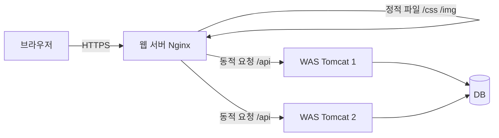
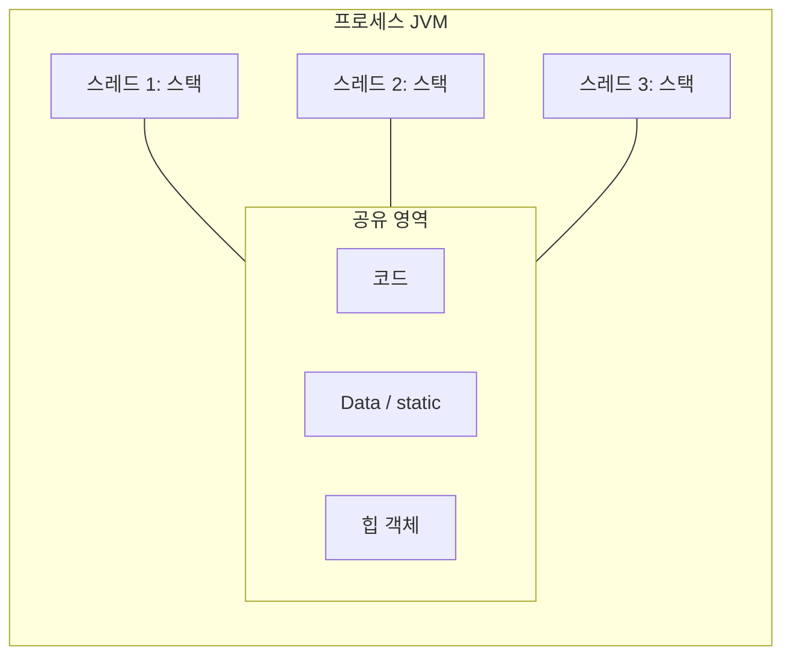
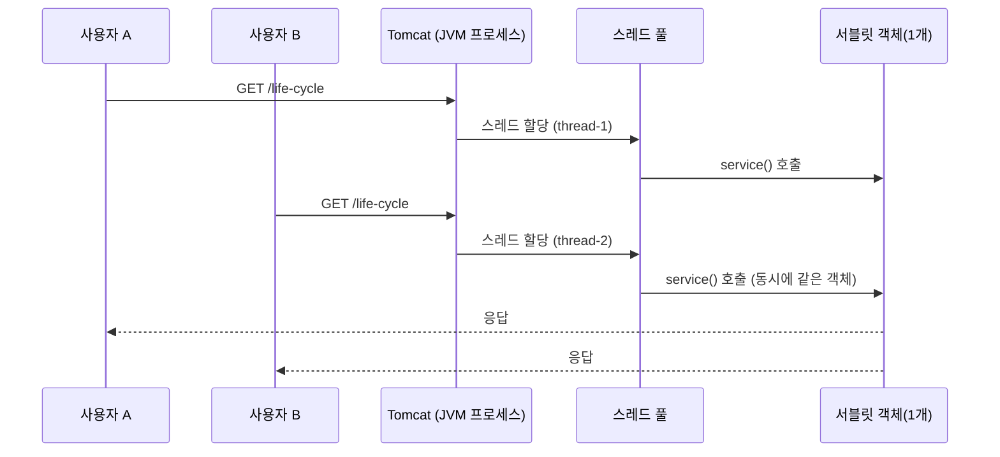

## 들어가며 (Situation)

서블릿을 배우면서 두 가지 질문이 계속 남았다.

1. 서블릿을 실행해 주는 **Tomcat은 웹 서버인가, WAS인가?** 자료마다 표현이 다르다.
2. 서블릿 객체는 **하나만 만들어지는데** 여러 사용자의 요청을 어떻게 동시에 처리하는가? 이 질문은 **프로세스와 스레드**의 차이로 이어진다.

앞선 글 [서블릿 생명주기, service/doGet/doPost, 요청 파라미터 정리]({{ site.baseurl }}/2026/10/21/servlet-lifecycle-service-parameter/)에서 "서블릿 객체 하나를 여러 요청이 공유한다"고 정리했다. 이 글은 그 말이 **왜 가능하고 왜 위험한지**를 운영체제와 서버 구조 관점에서 풀어 쓴 것이다.

> 이 글은 별도의 수업 코드가 없는 **개념 정리 글**이다. 코드 예시는 모두 설명을 위해 만든 "예시 코드"이며, 직접 실행해 측정한 결과는 포함하지 않았다.

## 문제 상황 (Task)

| 헷갈렸던 지점 | 구체적인 의문 |
|---|---|
| 웹 서버 vs WAS | 둘 다 HTTP 요청을 받는데 왜 구분하는가? Tomcat만 있으면 되지 않는가? |
| 프로세스 vs 스레드 | "스레드가 가볍다"는 말은 무엇이 가볍다는 뜻인가? |
| 둘의 연결 | 서블릿 컨테이너는 요청 100개를 어떻게 동시에 처리하는가? |

## 해결 과정 (Action)

### 1. 웹 서버(Web Server)란

**웹 서버는 HTTP 요청을 받아서 정적 콘텐츠(HTML, CSS, JS, 이미지 파일)를 돌려주는 서버**다. 대표적으로 Nginx, Apache HTTP Server(httpd)가 있다. 요청한 파일이 디스크에 이미 있으면 그대로 읽어 보내면 되므로 구조가 단순하고 빠르다.

웹 서버가 하는 일은 정적 파일 전달에서 끝나지 않는다.

| 역할 | 설명 |
|---|---|
| 정적 파일 제공 | HTML, CSS, JS, 이미지 전송 |
| 리버스 프록시 | 동적 요청을 뒤쪽 애플리케이션 서버로 전달 |
| 로드 밸런싱 | 여러 대의 앱 서버에 요청 분산 |
| TLS(HTTPS) 처리 | 암호화 연결을 앞단에서 종료 |

### 2. WAS(Web Application Server)란

**WAS는 웹 서버의 기능에 더해, 프로그램을 실행해서 동적인 응답을 만들어 주는 서버**다. 이 프로젝트에서 서블릿을 실행해 주는 Tomcat이 여기에 해당한다. 요청이 오면 DB를 조회하고, 로직을 실행하고, 그 결과로 HTML이나 JSON을 만들어 응답한다.

| 구분 | 정적 요청 | 동적 요청 |
|---|---|---|
| 예시 | `/logo.png`, `/style.css` | `/querystring?name=홍길동` |
| 응답 | 이미 있는 파일 | 요청마다 코드를 실행해 생성 |
| 담당 | 웹 서버로 충분 | WAS(서블릿 컨테이너 등) |

### 3. 비교표와 용어 정리

| 항목 | 웹 서버 | WAS |
|---|---|---|
| 주 용도 | 정적 콘텐츠, 프록시, 로드 밸런싱 | 애플리케이션 로직 실행 (동적 콘텐츠) |
| 대표 제품 | Nginx, Apache httpd | Tomcat, Jetty, WildFly, WebLogic |
| 코드 실행 | 보통 하지 않음 | 서블릿 등 자바 코드 실행 |
| 자원 사용 | 가벼움 | 상대적으로 무거움 |

여기서 용어를 하나 바로잡아야 했다. **둘의 경계가 칼로 자른 듯 명확하지는 않다.**

- Tomcat도 정적 파일을 제공할 수 있다. Nginx도 설정에 따라 FastCGI 같은 방식으로 동적 처리에 연결된다.
- 엄밀하게 Tomcat은 서블릿 명세를 구현한 **서블릿 컨테이너(웹 컨테이너)** 이고, 자바 EE 전체 명세(EJB 등)를 구현한 제품이 "애플리케이션 서버"(WildFly, WebLogic 등)다. 그래서 자료에 따라 Tomcat을 "WAS가 아니라 서블릿 컨테이너"라고 부르기도 한다.
- 그래도 실무에서는 "Tomcat = WAS"라고 부르는 경우가 많으므로, 시험이나 면접에서는 **"동적 처리를 담당하는 서버"** 라는 기준으로 설명하면 된다.

### 4. 왜 굳이 둘을 나눠서 쓰는가

Tomcat 하나로도 동작하는데 앞에 웹 서버를 두는 구성은 흔하다.



| 분리했을 때 얻는 것 | 이유 |
|---|---|
| 부하 분산 | 이미지·CSS 같은 정적 요청을 웹 서버가 처리하면 WAS는 로직 실행에만 집중할 수 있다 |
| 확장성 | WAS를 여러 대로 늘리고 웹 서버가 요청을 나눠줄 수 있다 |
| 보안 | WAS를 외부에 직접 노출하지 않고 웹 서버만 공개할 수 있다 |
| 무중단 배포 | WAS를 한 대씩 내리고 올려도 서비스가 유지된다 |

반대로 **모든 서비스에 분리가 필수는 아니다.** 트래픽이 적은 개인 프로젝트나 학습 환경에서는 Tomcat 하나만 두는 것이 더 단순하다. 분리는 비용(서버 관리, 설정 증가)을 감수하고 얻는 선택이다.

### 5. 프로세스(Process)란

**프로세스는 실행 중인 프로그램이다.** 디스크의 `.exe`나 `.jar`가 "프로그램"이라면, 그것이 메모리에 올라가 운영체제로부터 자원을 할당받아 실행되는 상태가 프로세스다. 운영체제는 프로세스마다 **독립된 메모리 공간**을 준다.

Tomcat을 실행하면 JVM 프로세스가 하나 생기고, 그 안에서 서블릿들이 돌아간다.

| 프로세스가 가지는 것 | 설명 |
|---|---|
| 코드(Code) | 실행할 명령어 |
| 데이터(Data) | 전역 변수, static 변수 |
| 힙(Heap) | 동적으로 할당하는 객체 (자바의 `new`) |
| 스택(Stack) | 메소드 호출과 지역 변수 |

프로세스끼리는 메모리가 분리되어 있어서 **한 프로세스가 죽어도 다른 프로세스는 영향을 받지 않는다.** 대신 서로 데이터를 주고받으려면 IPC(파이프, 소켓, 공유 메모리 등) 같은 별도 방법이 필요하다.

### 6. 스레드(Thread)란

**스레드는 프로세스 안에서 실제로 코드를 실행하는 흐름의 단위**다. 모든 프로세스는 최소 하나의 스레드(자바에서는 `main` 스레드)를 가진다. 하나의 프로세스 안에 여러 스레드를 만들면 **코드, 데이터, 힙은 공유하고 스택(과 레지스터, 프로그램 카운터)만 각자 가진다.**



### 7. 프로세스와 스레드 비교

| 항목 | 프로세스 | 스레드 |
|---|---|---|
| 정의 | 실행 중인 프로그램 | 프로세스 안의 실행 흐름 |
| 메모리 | 각자 독립된 공간 | 코드·데이터·힙 공유, 스택만 독립 |
| 생성 비용 | 크다 (메모리 공간 새로 할당) | 작다 |
| 문맥 전환(Context Switching) | 비용이 큼 | 상대적으로 작음 |
| 통신 | IPC 필요 | 힙의 변수를 직접 공유 |
| 안정성 | 한 프로세스 오류가 다른 프로세스에 영향 없음 | 한 스레드의 치명적 오류가 프로세스 전체에 영향 줄 수 있음 |
| 동기화 문제 | 거의 없음 | 공유 자원 때문에 **반드시 고려** |

"스레드가 가볍다"는 말은 **생성과 전환에 드는 비용이 적고, 메모리를 공유해서 통신이 쉽다**는 뜻이다. 하지만 그 장점이 곧 **공유 때문에 생기는 위험**과 한 몸이다.

### 8. 둘을 연결하기: Tomcat은 요청을 스레드로 처리한다

Tomcat은 요청이 올 때마다 프로세스를 새로 만들지 않고, **스레드 풀(Thread Pool)** 에서 스레드 하나를 꺼내 그 요청을 맡긴다. (요청당 스레드 모델)



이 구조 덕분에 앞 글의 질문이 풀린다.

| 앞 글의 사실 | 이 글로 설명하면 |
|---|---|
| 서블릿 객체는 하나만 만들어진다 | 요청마다 프로세스나 객체를 만들면 비용이 크므로, 객체 하나를 **힙에 두고** 스레드들이 공유한다 |
| 여러 요청이 동시에 `service()`를 호출한다 | 요청마다 다른 스레드가 같은 객체의 메소드를 실행한다 |
| 인스턴스 필드에 요청별 데이터를 두면 안 된다 | 필드는 **힙에 있고 스레드 사이에 공유**되기 때문이다 |
| 지역 변수는 안전하다 | 지역 변수는 **스레드마다 따로 가진 스택**에 있다 |

Tomcat의 최대 요청 처리 스레드 수는 HTTP 커넥터의 `maxThreads` 속성으로 설정하며 기본값은 200이다. 값은 버전과 설정에 따라 달라질 수 있으니 사용하는 버전의 공식 문서를 확인해야 한다.

### 9. 공유의 위험을 코드로 확인하기

앞 글의 `LifeCycleServlet`에는 `serviceCount++` 카운터가 있었다. 이를 동시 요청 환경으로 확장하면 어떤 문제가 생기는지 보여주는 **예시 코드**다.

```java
// 예시 코드: 수업 코드가 아니라 설명을 위해 만든 코드
@WebServlet("/counter")
public class CounterServlet extends HttpServlet {

    private int count = 0;                 // 힙에 있는 필드 → 모든 요청 스레드가 공유

    @Override
    protected void doGet(HttpServletRequest req, HttpServletResponse resp) throws IOException {
        int local = 0;                     // 지역 변수 → 스레드마다 따로 (스택)
        local++;
        count++;                           // 읽기 → 더하기 → 쓰기 (원자적이지 않음)
        resp.getWriter().println("count=" + count + ", local=" + local);
    }
}
```

`count++`은 한 줄처럼 보여도 "값 읽기 → 1 더하기 → 값 쓰기" 세 단계다. 두 스레드가 거의 동시에 같은 값을 읽으면 둘 다 같은 값에 1을 더해서 저장하므로 **증가가 한 번 사라진다.** 이를 **경쟁 상태(Race Condition)** 라고 한다.

| 방법 | 설명 | 비고 |
|---|---|---|
| 필드를 쓰지 않기 | 요청별 데이터는 지역 변수나 요청 객체에 둔다 | **서블릿의 기본 원칙** |
| `synchronized` | 한 번에 한 스레드만 실행 | 요청이 줄 서므로 성능 저하 |
| `AtomicInteger` | 증가 연산을 원자적으로 수행 | 단순 카운터에 적합 |

```java
// 예시 코드: 원자적 증가
private final AtomicInteger count = new AtomicInteger();
...
int current = count.incrementAndGet();
```

이 글에서 코드를 실행해 실제로 숫자가 틀어지는 것까지는 확인하지 않았다. 재현하려면 `ab`나 JMeter 같은 도구로 동시 요청을 많이 보내 `count` 최종값이 요청 횟수와 같은지 비교하면 된다. (재현은 다음에 해볼 과제로 남겨 둔다.)

### 10. 시행착오: 헷갈렸던 오해들

| 처음 생각 | 정리 |
|---|---|
| 웹 서버 = 정적, WAS = 동적, 완전히 다른 물건 | 역할 구분이지 칼같은 분류는 아니다. Tomcat도 정적 파일을 줄 수 있다 |
| Tomcat은 JSP/서블릿 파일 하나당 프로세스를 띄운다 | 하나의 JVM 프로세스 안에서 **스레드**로 처리한다 |
| 스레드가 여러 개면 서블릿 객체도 여러 개 | 객체는 (기본적으로) 서블릿 클래스당 하나, 스레드만 여러 개다 |
| 스레드가 많을수록 무조건 빠르다 | 스레드가 늘면 문맥 전환 비용과 메모리 사용이 늘고, CPU 코어 수를 넘으면 이득이 줄어든다 |

## 결과 (Result)

이번 정리로 아래 연결 고리를 하나의 흐름으로 설명할 수 있게 되었다.


| 질문 | 한 줄 답 |
|---|---|
| 웹 서버와 WAS의 차이 | 웹 서버는 정적 콘텐츠·프록시 중심, WAS는 프로그램을 실행해 동적 콘텐츠를 만든다 |
| 프로세스와 스레드의 차이 | 프로세스는 독립된 메모리를 가진 실행 단위, 스레드는 프로세스 안에서 메모리(스택 제외)를 공유하는 실행 흐름이다 |
| 서블릿이 동시에 처리되는 이유 | 요청마다 스레드가 할당되고, 객체는 공유된다 |
| 서블릿에서 주의할 점 | 인스턴스 필드에 요청별 값을 저장하지 않는다 |

정량 지표(처리량, 응답 시간)는 측정하지 않았다. 이 글의 성과는 **서블릿 객체 공유, 스레드 안전성, 서버 구조라는 흩어진 개념을 한 줄로 연결했다**는 점이다. 배운 점은 "개념을 따로따로 외우면 헷갈리지만, 요청이 들어와 처리되는 순서를 따라가면 서로 이어진다"는 것이다.

## 더 학습하면 좋은 개념

- **동기화와 자바 동시성 도구 (`synchronized`, `volatile`, `java.util.concurrent`)** — 스레드가 공유 자원을 안전하게 쓰는 방법이다. 이 글의 경쟁 상태를 실제로 해결하려면 필요하다.
- **스레드 풀과 `ExecutorService`** — Tomcat이 스레드를 재사용하는 방식과 같은 원리다. 스레드 생성 비용을 줄이는 이유를 이해할 수 있다.
- **블로킹 I/O vs 논블로킹 I/O (NIO, 이벤트 루프)** — "요청당 스레드"의 한계(동시 접속이 매우 많을 때)와 Nginx, Netty, WebFlux가 다른 방식을 쓰는 이유를 설명해 준다.
- **리버스 프록시와 로드 밸런싱** — 웹 서버 앞단 구성의 핵심이다. 서버를 여러 대로 확장할 때 필요한 다음 단계다.
- **문맥 전환(Context Switching)과 CPU 스케줄링** — "스레드가 가볍다"는 말의 비용을 운영체제 수준에서 이해하는 개념이다.
- **JVM 메모리 구조 (Heap, Stack, Method Area)** — 지역 변수는 안전하고 필드는 위험한 이유를 정확히 설명해 준다.

## 참고 자료

- [MDN - 웹 서버란 무엇인가](https://developer.mozilla.org/en-US/docs/Learn_web_development/Howto/Web_mechanics/What_is_a_web_server)
- [Apache Tomcat 11 - HTTP Connector (maxThreads)](https://tomcat.apache.org/tomcat-11.0-doc/config/http.html)
- [Apache Tomcat - 소개와 버전별 Servlet 지원](https://tomcat.apache.org/whichversion.html)
- [Jakarta Servlet 6.1 명세 (스레드와 서블릿 인스턴스 관련 내용)](https://jakarta.ee/specifications/servlet/6.1/)
- [NGINX 공식 문서 - Reverse Proxy](https://docs.nginx.com/nginx/admin-guide/web-server/reverse-proxy/)
- [Apache HTTP Server 공식 문서](https://httpd.apache.org/docs/current/)
- [Oracle - Java Tutorials: Processes and Threads](https://docs.oracle.com/javase/tutorial/essential/concurrency/procthread.html)
- [Oracle - Java Tutorials: Synchronization](https://docs.oracle.com/javase/tutorial/essential/concurrency/sync.html)
- [Java API - AtomicInteger](https://docs.oracle.com/en/java/javase/21/docs/api/java.base/java/util/concurrent/atomic/AtomicInteger.html)
