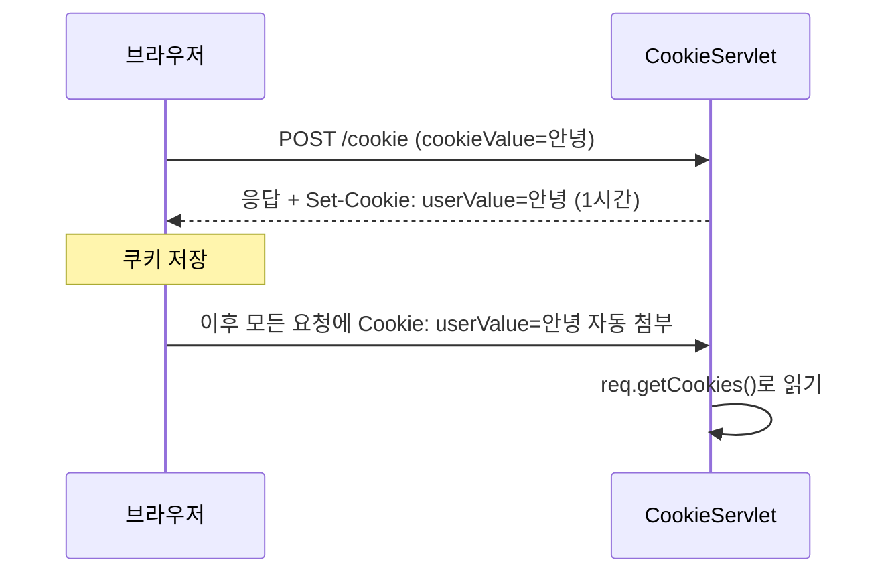
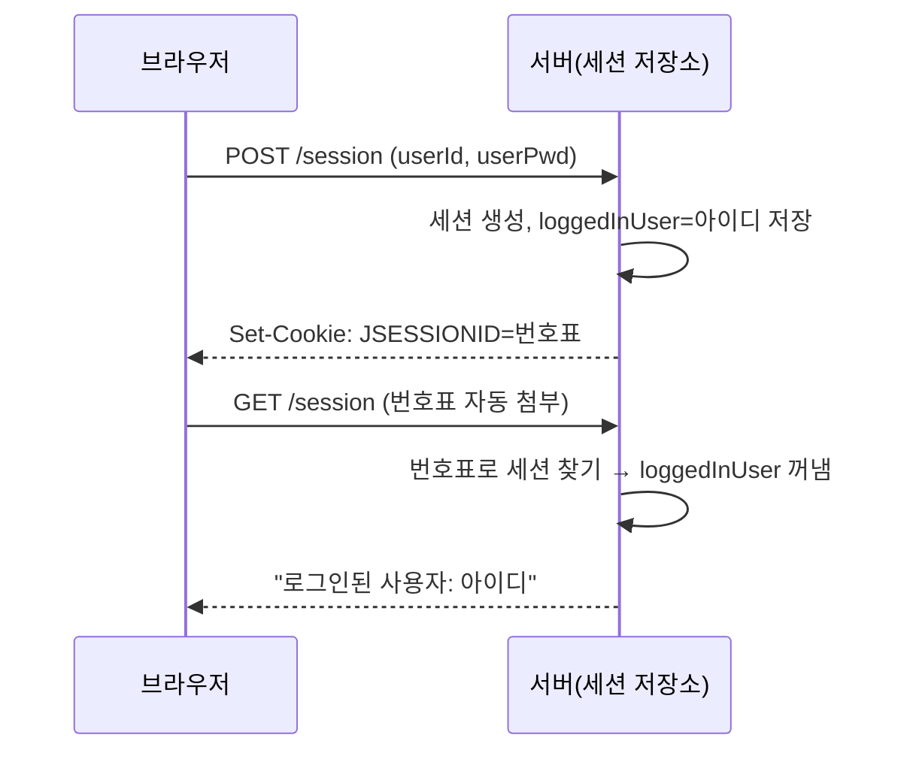
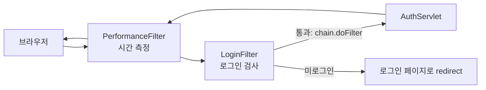

## 들어가며 (Situation)

앞 글에서 redirect는 **이전 요청을 잊어버린다**는 약점을 봤다. HTTP는 원래 요청마다 "처음 보는 사람"처럼 대한다(무상태, stateless). 이 글에서는 `chap01-servlet`의 **`h_cookie_session`** 과 **`i_filter`** 를 다룬다.

| 단계 | 해결하려는 것 | 도구 |
|---|---|---|
| h | 요청이 바뀌어도 **"누구인지/무엇을 했는지" 기억**하고 싶다 | 쿠키, 세션 |
| i | 여러 서블릿에 반복되는 **공통 작업(인코딩, 로그인 검사)** 을 한곳에 모으고 싶다 | 필터 |

식당 비유를 이어가 보자.

| 도구 | 비유 | 어디에 저장되나 |
|---|---|---|
| **쿠키** | 손님에게 **쪽지**를 쥐여 보낸다. 손님이 다음 방문 때 들고 온다 | 브라우저 |
| **세션** | 식당이 **손님 장부**를 갖고 있고, 손님에게는 **번호표**만 준다 | 서버 (번호표만 브라우저의 쿠키) |
| **필터** | 입구의 **안내원**. 주방(서블릿)에 가기 전에 검사한다 | 서블릿 앞단 |

## 문제 상황 (Task)

1. 로그인한 사용자의 아이디를 **다음 요청에서도** 알고 싶다. redirect를 하더라도.
2. `/auth` 같은 페이지는 **로그인한 사람만** 봐야 한다. 서블릿마다 `if (로그인 안 했으면 ...)`을 쓰기 싫다.
3. 응답 인코딩 설정(`setContentType`)이 모든 서블릿에서 반복된다.

## 해결 과정 (Action)

### 1. 쿠키: 브라우저에 쪽지 맡기기 (`CookieServlet`)

```java
@Override
protected void doPost(HttpServletRequest req, HttpServletResponse resp) throws ServletException, IOException {
    String cookieValue = req.getParameter("cookieValue");

    Cookie cookie = new Cookie("userValue", cookieValue);  // 이름="userValue", 값=입력값
    cookie.setMaxAge(60 * 60);                             // 1시간 동안 유효 (초 단위)
    resp.addCookie(cookie);                                // 응답에 "이 쪽지를 저장해라" 추가

    doGet(req, resp);
}
```

```java
@Override
protected void doGet(HttpServletRequest req, HttpServletResponse resp) throws ServletException, IOException {
    String savedValue = "없음";

    Cookie[] cookies = req.getCookies();         // 브라우저가 보내 준 쪽지 전부
    if (cookies != null) {
        for (Cookie cookie : cookies) {
            if ("userValue".equals(cookie.getName())) {
                savedValue = cookie.getValue();
                break;
            }
        }
    }

    req.setAttribute("savedValue", savedValue);
    req.getRequestDispatcher("/h_cookie_session/cookie-result.jsp").forward(req, resp);
}
```



| 메소드 | 의미 |
|---|---|
| `new Cookie(이름, 값)` | 쿠키 만들기 |
| `setMaxAge(초)` | 유효 기간. 안 정하면 브라우저를 닫을 때 사라진다 |
| `resp.addCookie` | 브라우저에 저장하라고 응답에 실음 |
| `req.getCookies()` | 브라우저가 보낸 쿠키들 (**하나도 없으면 `null`**) |

쿠키 읽는 방식에는 `null` 체크 후 **이름으로 찾는 반복문**이 필요하다. `getCookie("이름")` 같은 편한 메소드는 없다.

#### 코드를 읽다 발견한 함정: 방금 저장한 쿠키는 이 요청에서 안 보인다

`doPost`가 쿠키를 `addCookie`한 직후에 `doGet`을 **직접 호출**해서 `req.getCookies()`로 읽는다. 그런데 `req`의 쿠키는 **브라우저가 이번 요청에 실어 보낸 것**이다. 방금 응답에 추가한 쿠키는 아직 브라우저에 도착하지 않았다. 따라서 처음 입력한 때는 `savedValue`가 `"없음"`이거나 **이전에 저장한 값**으로 보일 가능성이 높다. 두 번째 요청부터 새 값이 보인다.

> 이 부분은 쿠키 동작 방식에 기반한 **추론**이며 직접 실행해 확인하지는 않았다. 직접 입력해 보며 화면의 값이 한 박자 늦는지 확인해 보면 좋다. 한 번에 보이게 하려면 `doPost`에서 `savedValue`를 `cookieValue`로 직접 담아 넘기는 방법이 있다.

또 한 가지, 쿠키 값에 공백·한글·특수문자를 그대로 넣으면 환경에 따라 문제가 될 수 있다. 값을 인코딩해 넣는 편이 안전하다.

### 2. 세션: 장부는 서버에, 번호표만 브라우저에 (`SessionServlet`)

쿠키는 브라우저에 저장되므로 **사용자가 보고 바꿀 수 있다.** 비밀번호처럼 중요한 정보를 둘 곳이 아니다. 그래서 **정보는 서버 메모리(세션)에 두고**, 브라우저에는 그 장부를 찾는 번호표(세션 ID, 보통 `JSESSIONID` 쿠키)만 준다.



```java
// 로그인 (doPost)
HttpSession session = req.getSession(true);        // 없으면 만든다
String existUser = (String) session.getAttribute("loggedInUser");
session.setAttribute("loggedInUser", userId);      // 장부에 기록
session.setAttribute("userPwd", userPwd);
session.setMaxInactiveInterval(30);                // 30초 동안 활동 없으면 만료

// 확인 (doGet)
HttpSession session = req.getSession(false);       // 있으면 가져오고, 없으면 null
if (session != null) {
    loggeInUser = (String) session.getAttribute("loggedInUser");
}
```

| 호출 | 세션이 없을 때 |
|---|---|
| `getSession(true)` (기본값) | **새로 만든다** |
| `getSession(false)` | `null`을 돌려준다 (만들지 않음) |

로그인 시에는 `true`, 확인할 때는 `false`로 쓴 이유가 이것이다. 확인만 하는데 세션이 마구 생기면 낭비다.

주석의 **캐스트 연산자 설명**도 실용적이다. `session.getAttribute("x").toString()`은 값이 없으면 `null`에서 `toString()`을 불러 `NullPointerException`이 난다. `(String) session.getAttribute("x")`는 `null`이 그대로 `null`로 남아 안전하다.

그리고 만료.

```java
HttpSession session = req.getSession(false);
if (session != null) {
    session.invalidate();            // 세션 즉시 무효화 (로그아웃)
}
resp.sendRedirect("/session");       // 무효화 후 확인 화면으로 redirect
```

**redirect를 쓰는 이유**도 이제 이해된다. 로그아웃 처리 후 `/session`을 새 GET으로 요청해야 새로고침해도 안전하다.

#### 쿠키 vs 세션

| 비교 | 쿠키 | 세션 |
|---|---|---|
| 저장 위치 | 브라우저 | 서버 (번호표만 브라우저) |
| 보안 | 사용자가 볼 수 있어 낮음 | 상대적으로 높음 |
| 용량·개수 | 제한 있음 | 서버 메모리 사용 |
| 만료 | `setMaxAge` | `setMaxInactiveInterval`, `invalidate` |
| 대표 용도 | 아이디 저장, 최근 본 상품 | 로그인 상태 |

#### 수업 코드에서 고려할 점

| 코드 | 이야기 |
|---|---|
| 세션에 **비밀번호 평문**을 저장하고 화면에 출력 | 실습용 확인 목적이다. 실제 서비스에서는 비밀번호를 세션에 저장하지 않는다 |
| `if / else` 두 분기의 내용이 동일 | 지금은 결과가 같다. 정리하면 분기 없이 한 번만 쓰면 된다 |
| 아이디만 입력하고 비밀번호가 `null`일 가능성 | `userId != null && !userPwd.isEmpty()`에서 `userPwd`가 `null`이면 `NullPointerException`. 폼으로 보내면 빈 문자열이라 보통 괜찮다 |
| 비밀번호가 비면 아무 응답이 없음 | 조건이 거짓이면 `doGet`이 호출되지 않아 **빈 화면**이 된다 |

(이 표는 코드를 읽고 정리한 것이며, 각 상황을 실행해 확인하지는 않았다.)

### 3. JSP: 서블릿이 만든 값을 보여주는 화면

`cookie-result.jsp`, `session-result.jsp`는 `${savedValue}`, `${loggedInUser}`처럼 쓴다. 서블릿에서 `req.setAttribute("savedValue", ...)`로 넣은 값이다. 주석에도 있듯 **JSP는 HTML처럼 보이지만 실제로는 서블릿으로 변환되어 실행**된다. 그래서 서블릿에서 `forward`로 값을 넘기고(`setAttribute`), JSP가 꺼내 화면을 그린다. 앞 글에서 `StringBuilder`로 HTML을 조립하던 불편함을 덜어 준다.

### 4. 필터: 서블릿 앞의 안내원

필터는 **요청이 서블릿에 도달하기 전**(그리고 응답이 나가기 전)에 끼어드는 부품이다.



`chain.doFilter(request, response)`가 **"다음으로 진행"** 이다. 이 호출을 하지 않으면 서블릿까지 가지 못한다.

#### 4-1. `PerformanceFilter` — 전후로 감싸기

```java
@WebFilter("/*")                                     // 모든 요청
public class PerformanceFilter implements Filter {
    @Override
    public void doFilter(ServletRequest request, ServletResponse response, FilterChain chain) throws IOException, ServletException {
        long startTime = System.currentTimeMillis();
        System.out.println("[요청 된 URL] : " + ((HttpServletRequest) request).getRequestURI());

        chain.doFilter(request, response);           // 서블릿 실행

        long endTime = System.currentTimeMillis();
        System.out.println("최종 수행 시간 : " + (endTime - startTime) + "(ms)");
    }
}
```

`chain.doFilter` **앞**은 요청 전, **뒤**는 응답 후에 실행된다. 그래서 처리 시간을 잴 수 있다.

#### 4-2. `LoginFilter` — 로그인 검사 한곳에 모으기

```java
@WebFilter("/auth/*")
public class LoginFilter implements Filter {
    @Override
    public void doFilter(ServletRequest request, ServletResponse response, FilterChain chain) throws IOException, ServletException {
        HttpServletRequest req = (HttpServletRequest) request;     // getSession()을 쓰려고 형변환
        HttpServletResponse resp = (HttpServletResponse) response;

        HttpSession session = req.getSession(false);

        if (session == null || session.getAttribute("loggedInUser") == null) {
            resp.sendRedirect("/h_cookie_session/cookie_session.html");   // 로그인 안 했으면 로그인 페이지로
        } else {
            chain.doFilter(req, resp);                                     // 통과
        }
    }
}
```

`doFilter`의 파라미터는 `ServletRequest`(부모 타입)라서, **세션 메소드를 쓰려면 `HttpServletRequest`로 형변환**해야 한다. 주석의 "클래스 형변환"이 이것이다.

여기서 `/auth` 서블릿은 이제 **로그인 검사 코드를 몰라도** 된다. 필터가 먼저 걸러 주기 때문이다. 로그인 검사가 필요한 URL이 늘어나도 필터의 매핑만 늘리면 된다.

| 상황 | 결과 |
|---|---|
| 로그인 안 하고 `/auth` 접근 | `LoginFilter`가 로그인 폼 페이지로 redirect |
| 로그인(세션 있음) 후 `/auth` 접근 | `chain.doFilter` → `AuthServlet` → `auth.jsp`에 사용자 아이디 표시 |
| 로그인 후 30초 동안 활동 없음 | 세션 만료 → 다시 로그인 페이지로 |

(`/auth/*` 매핑이 `/auth` 자체에도 적용되는지는 서블릿 명세의 URL 매핑 규칙에 따른 것이다. 수업 환경에서 `/auth`에 접근했을 때 필터 로그("login 필터 호출됨...")가 찍히는지 확인해 보자. 이 글에서는 직접 실행하지 않았다.)

#### 4-3. `EncodingFilter` — 설정을 `web.xml`로 주입

앞서 `setContentType`이 주석 처리된 이유가 이것이다.

```java
public class EncodingFilter implements Filter {
    private String encodingType;

    @Override
    public void init(FilterConfig filterConfig) throws ServletException {
        encodingType = filterConfig.getInitParameter("encoding-type");   // web.xml 값 읽기
    }

    @Override
    public void doFilter(ServletRequest request, ServletResponse response, FilterChain chain) throws IOException, ServletException {
        response.setContentType(encodingType);        // 모든 응답에 UTF-8 지정
        chain.doFilter(request, response);
    }
}
```

```xml
<filter>
    <filter-name>encoding</filter-name>
    <filter-class>com.wanted.servlet.i_filter.EncodingFilter</filter-class>
    <init-param>
        <param-name>encoding-type</param-name>
        <param-value> text/html; charset = UTF-8 </param-value>
    </init-param>
</filter>
<filter-mapping>
    <filter-name>encoding</filter-name>
    <url-pattern>/*</url-pattern>
</filter-mapping>
```

주석대로 필터 등록 방법은 **2가지**다.

| 방식 | 예 | 특징 |
|---|---|---|
| `@WebFilter` 어노테이션 | `LoginFilter`, `PerformanceFilter` | 클래스에서 바로 설정, 간단 |
| `web.xml` | `EncodingFilter` | 설정값(`init-param`)을 코드 밖에서 바꿀 수 있고 **순서를 명시**할 수 있다 |

주의할 점이 두 가지 있다.

- `param-value`에 **앞뒤 공백**과 `charset = UTF-8`처럼 **`=` 앞뒤 공백**이 들어 있다. 컨테이너가 이 값을 어떻게 해석하는지는 확인되지 않았으므로, `text/html; charset=UTF-8`처럼 공백 없이 쓰는 편이 안전하다.
- 이 필터는 **응답**의 인코딩만 설정한다. POST 요청 본문의 한글은 `req.setCharacterEncoding("UTF-8")` 같은 별도 설정과 관련된다. (서블릿 버전·컨테이너 기본값에 따라 다를 수 있어 확인이 필요하다.)

#### 필터 실행 순서와 forward

| 질문 | 정리 |
|---|---|
| 필터 여러 개의 순서는? | `web.xml`에 선언한 필터는 선언 순서대로다. `@WebFilter`끼리의 순서는 명세에서 보장하지 않으므로, 순서가 중요하면 `web.xml`로 지정한다 |
| `forward`할 때도 필터가 또 도나? | 기본적으로 필터는 **브라우저에서 온 요청(REQUEST)** 에만 적용된다. 서버 내부 forward에는 별도 설정이 없으면 적용되지 않는다 |

## 결과 (Result)

| 문제 | 해결 |
|---|---|
| redirect하면 값이 사라짐 | 세션(서버)이나 쿠키(브라우저)에 저장해 요청 사이에 이어 준다 |
| 로그인 검사가 서블릿마다 반복됨 | `LoginFilter` 한 곳에 모으고 `chain.doFilter`로 통과시킨다 |
| `setContentType`이 반복됨 | `EncodingFilter` + `web.xml`의 `init-param`으로 한 번에 설정한다 |
| 처리 시간을 알고 싶음 | `PerformanceFilter`가 `chain.doFilter` 앞뒤 시간을 계산한다 |

정량 지표(응답 시간 개선 수치 등)는 측정하지 않았다. 필터가 찍는 수행 시간(ms)을 직접 확인하면 좋지만, 이 글에서 실행 결과를 확보하지는 않았다.

배운 점은 이렇다.

1. **HTTP는 기억하지 못한다.** 기억은 쿠키·세션이라는 장치로 **덧붙인 것**이다.
2. 중요한 정보는 브라우저(쿠키)가 아니라 **서버(세션)** 에 둔다. 다만 세션에도 비밀번호를 평문으로 두지 않는다.
3. 반복되는 공통 로직은 서블릿 코드 안이 아니라 **필터 같은 앞단**으로 빼는 것이 구조를 깔끔하게 만든다. 이후 Spring의 Interceptor·Security로 이어지는 발상이다.

## 더 학습하면 좋은 개념

- **쿠키 속성 (HttpOnly, Secure, SameSite)** — 쿠키를 JavaScript나 외부 사이트로부터 보호하는 설정이다. 세션 ID 쿠키를 지킬 때 필수다.
- **세션 고정 공격과 CSRF** — 번호표(세션 ID)를 탈취하거나 도용하는 공격이다. 로그인 후 세션 ID 재발급 같은 대응을 이해하게 된다.
- **비밀번호 해시(BCrypt)와 HTTPS** — 평문 비밀번호를 쓰지 않는 이유와 방법이다. 로그인 기능을 실제로 만들 때 반드시 필요하다.
- **JWT와 세션의 차이** — 서버가 상태를 기억하는 방식(세션)과 토큰에 담아 클라이언트가 들고 다니는 방식(JWT)의 비교다. 서버 여러 대로 확장할 때 중요해진다.
- **Spring Interceptor / Spring Security** — 필터와 같은 목적을 프레임워크 수준으로 확장한 것이다. 지금 배운 필터의 `chain.doFilter` 개념이 그대로 쓰인다.

## 참고 자료

- [Jakarta Servlet API - Cookie](https://jakarta.ee/specifications/servlet/6.1/apidocs/jakarta.servlet/jakarta/servlet/http/cookie)
- [Jakarta Servlet API - HttpSession](https://jakarta.ee/specifications/servlet/6.1/apidocs/jakarta.servlet/jakarta/servlet/http/httpsession)
- [Jakarta Servlet API - Filter](https://jakarta.ee/specifications/servlet/6.1/apidocs/jakarta.servlet/jakarta/servlet/filter)
- [Jakarta Servlet API - WebFilter](https://jakarta.ee/specifications/servlet/6.1/apidocs/jakarta.servlet/jakarta/servlet/annotation/webfilter)
- [Jakarta Servlet 6.1 명세](https://jakarta.ee/specifications/servlet/6.1/)
- [MDN - HTTP 쿠키 사용하기](https://developer.mozilla.org/en-US/docs/Web/HTTP/Guides/Cookies)
- [MDN - 웹 보안](https://developer.mozilla.org/en-US/docs/Web/Security)
