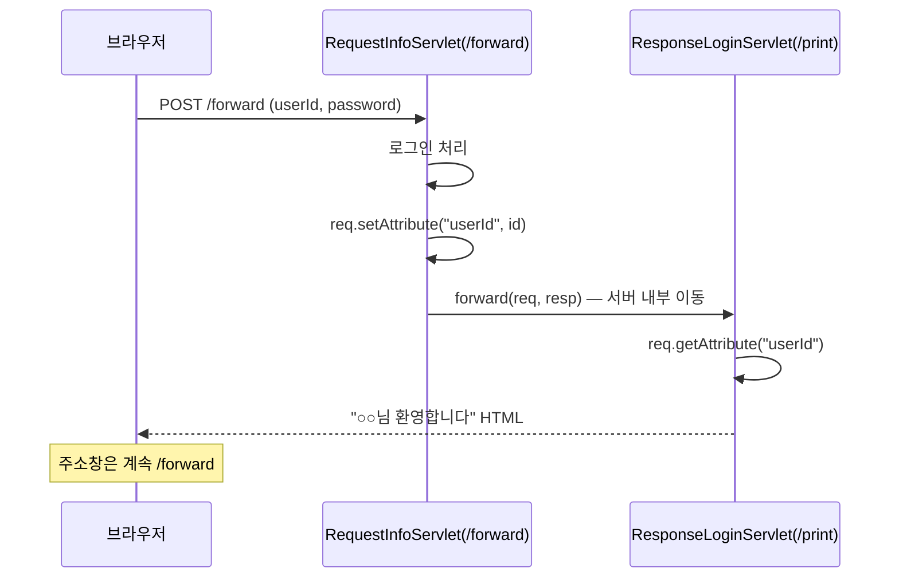
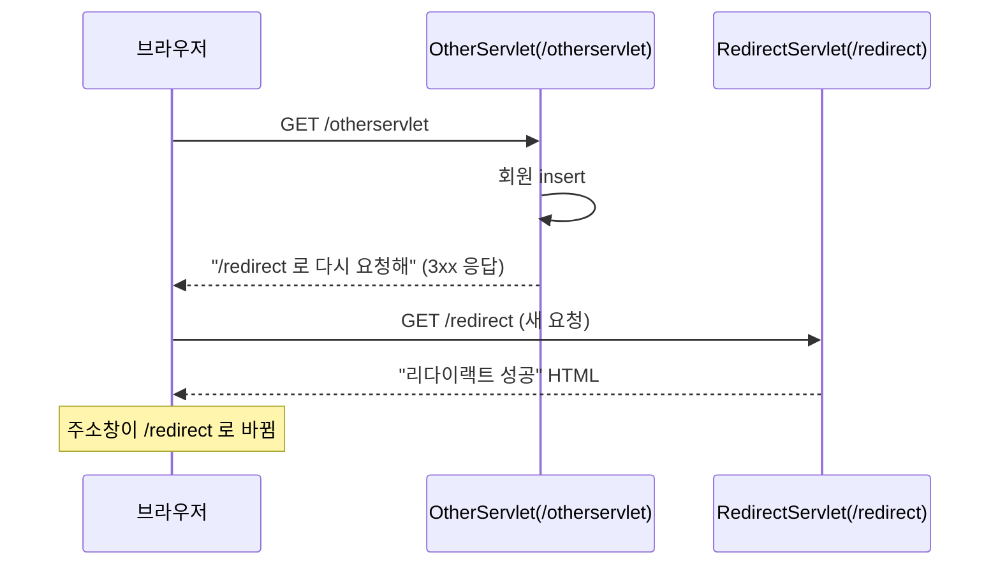
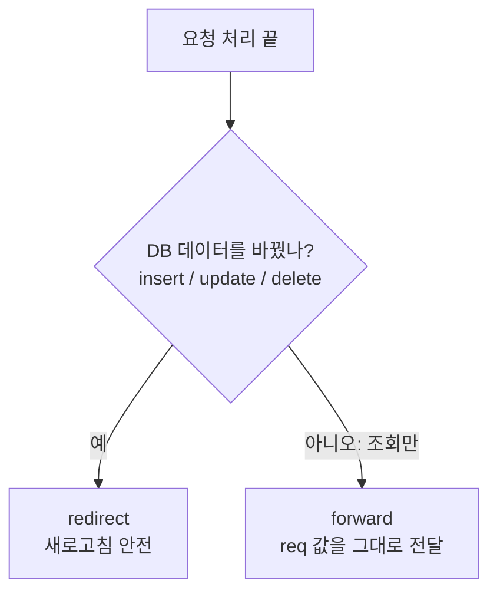

## 들어가며 (Situation)

서블릿 수업 `chap01-servlet`의 **`f_forward`** 와 **`g_redirect`** 를 정리한다. 둘 다 "처리가 끝난 뒤 **다른 서블릿으로 넘기는**" 방법이라 처음에는 똑같아 보인다. 하지만 동작 방식은 정반대에 가깝다.

식당 비유로 먼저 감을 잡자.

| 방식 | 비유 | 손님(브라우저)이 아는가 |
|---|---|---|
| **forward** | 주문받은 직원이 **주방 안쪽에서** 다른 직원에게 일을 넘긴다. 손님은 한 번 주문했을 뿐이다 | 모른다 |
| **redirect** | 직원이 "**저쪽 창구로 다시 가서** 주문하세요"라고 손님에게 안내한다 | 안다. 직접 다시 간다 |

## 문제 상황 (Task)

1. 로그인 요청을 처리하는 서블릿이 **환영 HTML까지 직접 만들면** 책임이 너무 많아진다. 응답 만드는 일을 다른 서블릿에 맡기고 싶다.
2. 회원가입(DB insert) 후 화면을 보여줄 때, 사용자가 **새로고침(F5)** 을 누르면 **가입이 또 실행**되면 곤란하다.

## 해결 과정 (Action)

### 1. forward: 서버 안에서 일을 넘긴다

`forward.html`은 아이디·비밀번호를 POST로 `/forward`에 보낸다.

```java
@WebServlet("/forward")
public class RequestInfoServlet extends HttpServlet {

    @Override
    protected void doPost(HttpServletRequest req, HttpServletResponse resp) throws ServletException, IOException {
        String id = req.getParameter("userId");
        String pwd = req.getParameter("password");

        // 로그인 처리 (실제로는 Service → DAO → MySQL)
        System.out.println("로그인 성공 !!");

        req.setAttribute("userId", id);               // ① 넘길 값을 req에 담기

        RequestDispatcher rd = req.getRequestDispatcher("/print");
        rd.forward(req, resp);                        // ② /print 서블릿에게 넘기기
    }
}
```

받는 쪽 서블릿은 이렇다.

```java
@WebServlet("/print")
public class ResponseLoginServlet extends HttpServlet {

    @Override
    protected void doPost(HttpServletRequest req, HttpServletResponse resp) throws ServletException, IOException {
        String id = req.getAttribute("userId").toString();   // ③ 앞 서블릿이 담은 값 꺼내기

        // ... "<id>님 환영합니다." HTML 조립 후 resp.getWriter()로 출력
    }
}
```



#### `getParameter`와 `getAttribute`는 다르다

| | `getParameter` | `getAttribute` |
|---|---|---|
| 값을 넣는 사람 | **브라우저**(사용자 입력) | **서버 코드**(`setAttribute`) |
| 타입 | `String` 고정 | `Object` (꺼낼 때 형변환) |
| 용도 | 사용자가 보낸 값 읽기 | 서버 안에서 서블릿끼리 값 넘기기 |

`req`라는 같은 가방을 다음 서블릿에 통째로 넘기기 때문에, 가방에 `setAttribute`로 넣어 두면 받는 쪽이 꺼낼 수 있다.

#### forward 특징 3가지 (코드 주석 정리)

| 특징 | 설명 |
|---|---|
| ① `req`, `resp`를 **공유** | 앞 서블릿의 파라미터, attribute를 뒤 서블릿이 그대로 쓴다 |
| ② **URL이 안 바뀐다** | 브라우저는 `/print`의 존재를 모른다. 주소창은 `/forward` 그대로 |
| ③ **새로고침하면 같은 요청이 다시 간다** | 마지막으로 보낸 요청(POST /forward)을 브라우저가 다시 보낸다 |

그리고 코드에 한 가지 규칙이 더 숨어 있다. 주석에도 있듯 **`/print`가 `doPost`인 이유는 원래 요청이 POST였기 때문**이다. forward는 요청 메소드를 그대로 유지하므로, 받는 서블릿도 같은 메소드(`doPost`)를 구현해야 한다. `doGet`만 있으면 허용되지 않는 메소드 오류가 난다. (`HttpServlet` 기본 동작 기준 설명이며 직접 실행해 확인하지는 않았다.)

#### ③이 왜 위험한가

POST로 "회원 등록"을 forward로 응답했다고 하자. 사용자가 F5를 누르면 브라우저는 "이 POST를 다시 보낼까요?" 경고를 띄우고, 확인하면 **등록 요청이 한 번 더 간다.** DB에 같은 회원이 중복 insert될 수 있다.

> 주석의 결론: **조회(select)는 forward, 데이터를 바꾸는 DML(insert/update/delete)은 forward로 끝내면 안 된다.**

### 2. redirect: 브라우저에게 "다시 가세요"라고 안내한다

```java
@WebServlet("/otherservlet")
public class OtherServlet extends HttpServlet {

    @Override
    protected void doGet(HttpServletRequest req, HttpServletResponse resp) throws ServletException, IOException {
        System.out.println("회원정보 DB 에 Insert 완료 !!");   // 가입 처리 (예시)

        resp.sendRedirect("/redirect");   // "/redirect 로 다시 요청하세요"
    }
}
```

```java
@WebServlet("/redirect")
public class RedirectServlet extends HttpServlet {
    @Override
    protected void doGet(HttpServletRequest req, HttpServletResponse resp) throws ServletException, IOException {
        // "리다이랙트 성공!!" HTML 조립 후 출력
    }
}
```



핵심은 **요청이 2번**이라는 것이다.

1. `/otherservlet` 요청 → 응답은 HTML이 아니라 "다른 주소로 가라"는 안내(상태 코드 3xx + `Location` 헤더)
2. 브라우저가 그 주소로 **새 GET 요청**

주석에서 "URL 변경은 a 태그를 누르는 것과 같아서 GET 방식"이라고 한 것이 이 뜻이다. ([MDN - HTTP 리다이렉션](https://developer.mozilla.org/en-US/docs/Web/HTTP/Guides/Redirections))

#### redirect가 새로고침 문제를 해결하는 이유

브라우저가 **마지막으로 보낸 요청**은 `GET /redirect`다. `/otherservlet`(insert 수행)이 아니다. 그러니 F5를 눌러도 `/redirect`만 다시 요청되고 **insert는 재실행되지 않는다.** 이 패턴을 흔히 PRG(Post-Redirect-Get)라고 부른다.

### 3. forward vs redirect 한 장 정리

| 비교 | forward | redirect |
|---|---|---|
| 이동 주체 | **서버**(내부에서) | **브라우저**(다시 요청) |
| 요청 횟수 | 1번 | 2번 |
| 주소창 | 안 바뀜 | 바뀜 |
| `req`/`resp` | 공유 (attribute 전달 가능) | 새 요청이라 **공유 안 됨** |
| 새로고침 | 같은 요청 **반복** | 바뀐 주소만 반복 |
| 외부 사이트로 이동 | 불가(같은 웹앱 내부만) | 가능 |
| 추천 용도 | 조회 결과 화면 | insert/update/delete 후 이동 |



### 4. redirect의 약점과 다음 단계

`RedirectServlet` 마지막 주석이 핵심을 짚는다.

> Redirect는 이전 요청을 아예 모른다가 장점이자 단점이 된다.

새 요청이라서 `req.setAttribute`로 담은 값이 **사라진다.** "가입 성공, ○○님!" 같은 값을 redirect 뒤 화면에 보여주고 싶을 때 곤란하다. 이를 해결하는 것이 **쿠키(Cookie)와 세션(Session)** 이고, 다음 글에서 이어진다.

## 결과 (Result)

| 질문 | 이제 이렇게 설명할 수 있다 |
|---|---|
| forward는 뭐가 특별한가 | 서버 내부 이동이라 `req`, `resp`를 공유하고 URL이 안 바뀐다 |
| redirect는 뭐가 특별한가 | 브라우저가 새로 요청해서 URL이 바뀌고 이전 `req`는 사라진다 |
| DML 후엔 무엇을 쓰나 | redirect (새로고침 중복 실행 방지) |
| 조회 결과는 | forward로 값을 넘겨 화면에 보여준다 |
| forward 받는 서블릿의 메소드는 | 원래 요청의 메소드와 같아야 한다 (POST면 `doPost`) |

정량 지표는 측정하지 않았다. 대신 "새로고침을 눌렀을 때 무슨 요청이 다시 가는가"를 forward와 redirect 각각 **말로 설명할 수 있는 것**을 기준으로 삼았다. 실제 중복 insert는 이 수업 코드에서 DB 없이 `println`만 하기 때문에 **재현해 보지는 않았다.**

배운 점은 이렇다.

1. forward/redirect는 "어디로 가느냐"보다 **"누가 이동하느냐"** 가 본질이다.
2. 새로고침은 **마지막 요청을 재전송**하는 것이다. 이걸 이해하면 중복 등록 버그를 예방할 수 있다.
3. 서블릿 하나가 모든 걸 하지 않고 **책임을 나누는**(처리 / 응답) 설계는 이후 MVC의 기초다.

## 더 학습하면 좋은 개념

- **PRG(Post-Redirect-Get) 패턴** — POST 처리 후 redirect로 GET 화면을 보여주는 표준 패턴이다. 중복 제출 문제를 구조로 해결하는 방법을 알게 된다.
- **HTTP 상태 코드 301/302/303/307/308** — redirect에도 종류가 있다. `sendRedirect`가 보내는 코드와 메소드 유지 여부의 차이를 알면 API 설계에 도움이 된다.
- **Request 스코프와 attribute** — `req.setAttribute`로 담은 값이 언제까지 살아 있는지의 범위 개념이다. 다음 글의 session 스코프와 비교하면 이해가 쉽다.
- **MVC 패턴 (Controller / Service / View)** — "요청 처리 서블릿과 응답 서블릿 분리"를 일반화한 구조다. Spring MVC를 배울 때 그대로 만난다.
- **멱등성(Idempotency)** — 같은 요청을 여러 번 보내도 결과가 같은가를 따지는 개념이다. GET은 멱등하고 POST는 아닌 이유와 연결된다.

## 참고 자료

- [Jakarta Servlet API - RequestDispatcher](https://jakarta.ee/specifications/servlet/6.1/apidocs/jakarta.servlet/jakarta/servlet/requestdispatcher)
- [Jakarta Servlet API - HttpServletResponse (sendRedirect)](https://jakarta.ee/specifications/servlet/6.1/apidocs/jakarta.servlet/jakarta/servlet/http/httpservletresponse)
- [MDN - HTTP 리다이렉션](https://developer.mozilla.org/en-US/docs/Web/HTTP/Guides/Redirections)
- [MDN - POST 메소드](https://developer.mozilla.org/en-US/docs/Web/HTTP/Reference/Methods/POST)
