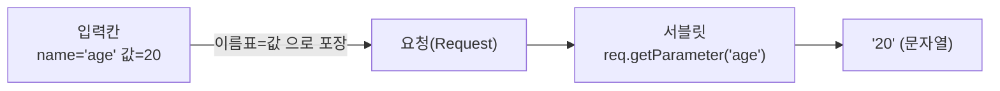
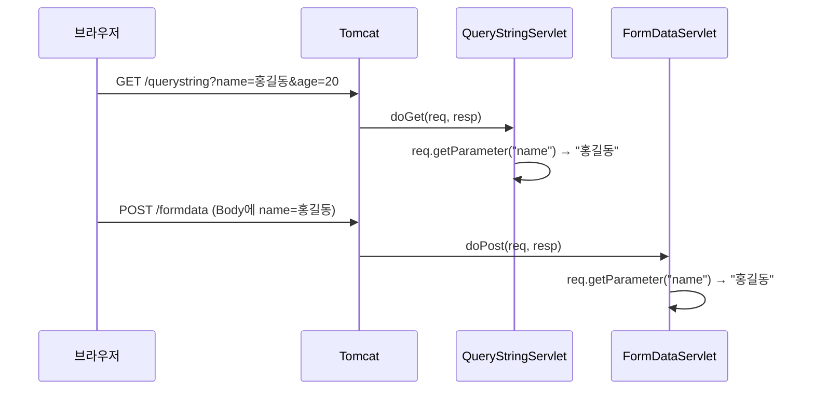
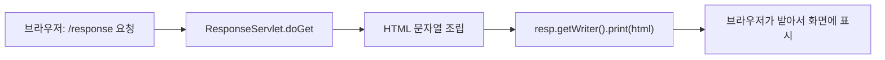
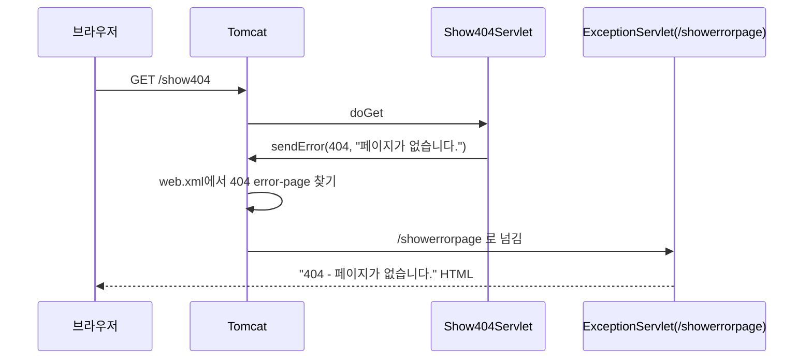

## 들어가며 (Situation)

서블릿 수업의 `chap01-servlet` 프로젝트에서 **`c_parameter` → `d_response` → `e_exception`** 세 단계를 다룬다. 이 세 단계는 한 문장으로 이어진다.

> 브라우저가 **값을 보내고(c)**, 서블릿이 **답을 돌려주고(d)**, 문제가 생기면 **에러 화면을 대신 보여준다(e)**.

식당에 비유하면 이해가 쉽다.

| 식당 | 서블릿 | 이 글에서 다루는 코드 |
|---|---|---|
| 손님이 주문서를 적어 낸다 | 브라우저가 입력값을 보낸다 | `parameter.html` |
| 주방장이 주문서를 읽는다 | `req.getParameter("name")` | `QueryStringServlet`, `FormDataServlet` |
| 완성된 음식을 내보낸다 | `resp.getWriter()`로 HTML 출력 | `ResponseServlet` |
| 재료가 없으면 "품절" 안내판을 낸다 | 404/500 에러 페이지 | `ExceptionServlet` |

> 서블릿이 무엇인지, 생명주기가 무엇인지는 [이전 글]({{ site.baseurl }}/2026/10/21/servlet-lifecycle-service-parameter/)에서 다뤘다. 이 글은 그 뒤를 이어, 같은 `c_parameter`를 **더 천천히** 풀어 설명하고 `d`, `e`까지 간다.

## 문제 상황 (Task)

수업 코드를 따라 치긴 했지만 이런 질문에 막혔다.

1. 폼에 쓴 "홍길동"이 **어떻게** 자바의 `String name`이 되는가?
2. GET이랑 POST는 **뭐가 다른데** 서블릿 메소드(`doGet`/`doPost`)를 따로 만드는가?
3. `System.out.println`만 하면 브라우저는 **왜 빈 화면**인가? 화면에 글자를 띄우려면?
4. `404`, `500` 에러 화면을 **내 마음대로** 만들 수 있는가?

## 해결 과정 (Action)

### 1. c_parameter: 값이 전달되는 길

#### 1-1. 핵심은 `name` 속성 하나

`parameter.html`의 입력칸마다 `name="..."`이 붙어 있다. 이게 **택배 송장의 "받는 사람 칸 이름"** 같은 역할을 한다.

```html
<input type="text" name="name">     <!-- 이 칸의 값은 "name"이라는 이름표를 달고 전송 -->
<input type="number" name="age">    <!-- 이 칸의 값은 "age"라는 이름표 -->
```

서블릿에서는 같은 이름표로 꺼낸다.

```java
String name = req.getParameter("name");   // "name" 이름표가 붙은 값을 꺼내라
```



이름표가 **한 글자라도 다르면** (`"Name"`, `"userName"`) `null`이 나온다. 대소문자도 구분한다.

#### 1-2. 값을 보내는 3가지 방법

`parameter.html`은 같은 입력 항목을 세 가지 방법으로 보낸다.

| # | 방법 | HTML | 받는 서블릿 | 값이 실리는 곳 |
|---|---|---|---|---|
| ① | 폼 GET | `<form action="/querystring" method="get">` | `QueryStringServlet.doGet` | 주소(URL) 뒤 |
| ② | 링크(쿼리스트링 직접 작성) | `<a href="/querystring?name=홍길동&age=20...">` | `QueryStringServlet.doGet` | 주소(URL) 뒤 |
| ③ | 폼 POST | `<form action="/formdata" method="post">` | `FormDataServlet.doPost` | 요청 본문(Body) |

①과 ②는 사실상 **같은 것**이다. 폼 GET은 브라우저가 ②처럼 주소를 대신 만들어 주는 것뿐이다. 홍길동, 20을 입력하고 GET 버튼을 누르면 브라우저 주소창이 이렇게 바뀐다. (아래는 폼 구조를 근거로 한 예상 모양이다.)

```text
/querystring?name=홍길동&age=20&birthday=2021-01-08&gender=M&national=ko&hobbies=movie&hobbies=music
             └─ ? 뒤부터 값 시작 ─┘ └ & 로 항목 구분 ┘                       └ 같은 이름이 반복되면 "값이 여러 개" ┘
```

읽는 규칙은 단 3가지다.

- `?` 뒤부터가 데이터다.
- 항목은 `&`로 나눈다.
- 각 항목은 `이름=값` 모양이다.

(한글은 실제로는 `%ED%99%8D...` 같은 형태로 인코딩되어 전송되지만, 서블릿이 읽을 때 복원된다.)

#### 1-3. GET과 POST, 쉽게 구분하기

| | GET | POST |
|---|---|---|
| 비유 | **엽서** (겉에 다 보임) | **봉투** (안에 넣음) |
| 데이터 위치 | URL 뒤 (`?name=...`) | 요청 본문(Body) |
| 주소창에 보이는가 | 보인다 | 안 보인다 |
| 주 용도 | 조회 | 등록·수정 (데이터를 보냄) |
| 서블릿 메소드 | `doGet` | `doPost` |

봉투라고 해서 **암호화되는 것은 아니다**. 안 보일 뿐 중간에서 가로채면 읽힌다. 비밀번호는 HTTPS로 보호해야 한다.

수업 코드(`FormDataServlet`) 주석에는 "GET은 200자 정도만 보낼 수 있다", "POST는 느려서 조회엔 GET을 쓴다"는 설명이 있다. 이 두 문장은 정확하지 않다.

| 주석 | 정리 |
|---|---|
| GET은 약 200자 제한 | 정확한 숫자는 HTTP 표준에 없다. 브라우저·서버마다 다르다. "길이 제한이 있어 긴 글에는 부적합"까지만 쓰자 |
| POST는 느려서 조회에 GET | 핵심은 속도가 아니라 **의미**다. GET은 "서버 데이터를 바꾸지 않는 조회", POST는 "새로 만들거나 바꾸는 요청"이다 ([MDN - GET](https://developer.mozilla.org/en-US/docs/Web/HTTP/Reference/Methods/GET), [MDN - POST](https://developer.mozilla.org/en-US/docs/Web/HTTP/Reference/Methods/POST)) |

#### 1-4. 꺼낸 값은 전부 문자열

```java
String name = req.getParameter("name");           // "홍길동"
int age = Integer.parseInt(req.getParameter("age")); // "20" → 20 으로 직접 변환
```

주석에도 있듯 URL로 오는 값은 **전부 `String`**이다. 숫자 입력칸(`type="number"`)이어도 서블릿이 받는 건 문자열 `"20"`이다. 그래서 숫자로 쓰려면 `Integer.parseInt()`가 필요하다.

그런데 여기서 사고가 난다.

| 사용자가 한 행동 | `getParameter("age")` | `Integer.parseInt(...)` |
|---|---|---|
| 20 입력 | `"20"` | 20 (정상) |
| 아무것도 안 쓰고 전송 | `""` (빈 문자열) | `NumberFormatException` → 500 에러 |
| 링크에서 `age`를 아예 뺌 | `null` | `NumberFormatException` |

수업 코드는 "항상 정상 입력"이라고 가정하고 있다. 실제 서비스라면 변환 전에 비었는지 확인해야 한다. (표의 예외는 직접 실행 로그가 아니라 `Integer.parseInt` 문서의 동작을 근거로 한 설명이다.)

```java
// 예시 코드 (수업 코드에는 없음)
String ageStr = req.getParameter("age");
if (ageStr != null && !ageStr.isEmpty()) {
    int age = Integer.parseInt(ageStr);
}
```

#### 1-5. 체크박스(취미)는 따로 읽는다

`hobbies`는 영화·음악·취침 중 **여러 개** 체크할 수 있다. 3개를 다 체크하면 요청에는 `hobbies=movie&hobbies=music&hobbies=sleep`처럼 **같은 이름이 3번** 들어간다.

| 메소드 | 돌려주는 것 | 언제 쓰나 |
|---|---|---|
| `getParameter("hobbies")` | `String` — 여러 개면 **맨 앞 하나만** | 값이 하나인 칸 |
| `getParameterValues("hobbies")` | `String[]` — **전부** | 체크박스, 다중 선택 |

```java
// 예시 코드 (수업 코드에는 hobbies를 읽는 부분이 없음)
String[] hobbies = req.getParameterValues("hobbies");
if (hobbies != null) {                       // 하나도 체크 안 하면 null
    System.out.println(Arrays.toString(hobbies));
}
```

체크박스·라디오(`gender`)는 **선택하지 않으면 그 이름표 자체가 전송되지 않는다.** 그래서 `null` 체크가 필수다.

#### 1-6. 흐름 한눈에



> 값 읽는 방법은 GET이든 POST든 **똑같이 `getParameter`**다. 달라지는 건 "어느 메소드(`doGet`/`doPost`)가 호출되는가"뿐이다.

### 2. d_response: 화면에 글자를 보여주기

여기까지의 서블릿은 `System.out.println`으로 **이클립스/IntelliJ 콘솔**에만 글자를 찍었다. 그래서 브라우저는 빈 화면이다. 브라우저에 보이려면 **응답(Response)** 에 써야 한다.

```java
@WebServlet("/response")
public class ResponseServlet extends HttpServlet {

    @Override
    protected void doGet(HttpServletRequest req, HttpServletResponse resp) throws ServletException, IOException {

        StringBuilder response = new StringBuilder();
        response.append("<!doctype html>\n")
                .append("<html>\n")
                .append("<body>\n")
                .append("<h1>servlet 의 응답 결과 </h1>")
                .append("</body>\n")
                .append("</html>\n");

        PrintWriter out = resp.getWriter();   // 브라우저로 글자를 내보내는 펜
        out.print(response);
        out.flush();
        out.close();
    }
}
```

| 줄 | 하는 일 |
|---|---|
| `StringBuilder`로 HTML 문자열 만들기 | 브라우저에 보낼 HTML을 한 글자씩 조립 |
| `resp.getWriter()` | **브라우저 쪽으로 글자를 쓰는 `PrintWriter`**를 받음 (콘솔이 아님) |
| `out.print(...)` | 응답에 내용을 씀 |
| `flush()` / `close()` | 버퍼에 남은 내용을 밀어내고 닫음 |



주석에 적힌 **서블릿의 3가지 역할**을 정리하면 이렇다.

1. 요청 받기 (파라미터 꺼내기)
2. 받은 값을 Service 계층에 전달 (MVC 중 **Controller** 역할)
3. 응답 돌려주기 (`resp` 활용)

#### 한글이 깨지는 이유와 `setContentType`

코드에는 `resp.setContentType("text/html; charset=UTF-8");`가 **주석 처리**되어 있고, 여러 파일에서 같은 줄이 주석으로 반복된다. 이유는 `i_filter` 단계에서 이 작업을 필터가 **한 번에** 처리하도록 바꿨기 때문이다. (다음 글 `EncodingFilter` 참고.)

핵심 규칙은 하나다. **`getWriter()`를 부르기 전에** "이 응답은 UTF-8 HTML이다"를 알려야 한다. 그래야 한글이 안 깨진다.

> 이 글에서는 한글 깨짐 여부를 **직접 실행해 확인하지 않았다.** 환경(Tomcat 버전, 필터 설정)에 따라 다를 수 있으니, "servlet 의 응답 결과" 같은 한글이 정상 출력되는지 직접 확인해 보자.

### 3. e_exception: 에러 화면 직접 만들기

`exception.html`의 링크 두 개는 일부러 에러를 낸다.

```java
@WebServlet("/show404")
public class Show404Servlet extends HttpServlet {
    @Override
    protected void doGet(HttpServletRequest req, HttpServletResponse resp) throws ServletException, IOException {
        resp.sendError(404, "페이지가 없습니다.");   // "404 에러를 내라"고 컨테이너에 요청
    }
}
```

`Show500Servlet`도 같은 모양으로 `sendError(500, ...)`을 호출한다. 그러면 누가 에러 화면을 만들까? 열쇠는 **`web.xml`** 에 있다.

```xml
<error-page>
    <error-code>404</error-code>
    <location>/showerrorpage</location>
</error-page>
<error-page>
    <error-code>500</error-code>
    <location>/showerrorpage</location>
</error-page>
```

뜻은 "404나 500이 나면 `/showerrorpage`로 가서 에러 화면을 만들어라"이다.



`ExceptionServlet`은 컨테이너가 담아 준 **에러 정보 꾸러미(attribute)** 를 꺼내 쓴다.

```java
int statusCode = (int) req.getAttribute("jakarta.servlet.error.status_code"); // 404
String msg = req.getAttribute("jakarta.servlet.error.message").toString();     // "페이지가 없습니다."
```

| 속성 이름 | 의미 |
|---|---|
| `jakarta.servlet.error.status_code` | 에러 번호 (404, 500) |
| `jakarta.servlet.error.message` | `sendError`에 넘긴 메시지 |

(이 속성 이름은 서블릿 명세의 에러 처리 부분에 정의되어 있다. 같은 코드 안의 `jakarta.servlet.forward.request_uri` 역시 컨테이너가 넣어 주는 값인지, 실제로 `null`이 아닌지는 **실행해서 확인**해 보기를 권한다. 이 글에서는 직접 실행하지 않았다.)

`e` 단계의 포인트는 두 가지다.

- **에러 처리 서블릿을 하나 만들어 두면** 어떤 서블릿에서 에러가 나도 같은 화면으로 모은다.
- 주석의 표현대로, 요청을 받은 서블릿이 아닌 **다른 서블릿에게 응답을 넘기는** 구조다. 이 개념이 바로 다음 글의 **forward**다.

## 결과 (Result)

| 질문 | 이제 이렇게 설명할 수 있다 |
|---|---|
| 폼 값이 자바로 오는 법 | 입력칸의 `name`이 이름표가 되어 `getParameter("이름표")`로 꺼낸다 |
| GET vs POST | GET은 URL 뒤에 값이 붙는 엽서, POST는 Body에 담는 봉투. 서블릿에서는 `doGet`/`doPost`로 나뉜다 |
| 꺼낸 값의 타입 | 전부 `String`. 숫자는 직접 변환하고, 빈 값·`null`을 먼저 확인한다 |
| 체크박스 | `getParameterValues`로 배열로 받는다. 하나도 체크 안 하면 `null` |
| 화면 출력 | `resp.getWriter()`로 HTML을 써야 브라우저에 보인다 (`println`은 콘솔) |
| 에러 화면 | `sendError` + `web.xml`의 `<error-page>`로 직접 만든 서블릿에 연결 |

정량 지표(응답 시간 등)는 측정하지 않았다. 이 글의 기준은 **코드가 왜 그렇게 동작하는지 말로 설명할 수 있는가**이다.

배운 점은 이렇다.

1. `System.out.println`과 `resp.getWriter().print`는 **출력 대상이 완전히 다르다.** 콘솔 vs 브라우저.
2. 사용자 입력은 **항상 틀릴 수 있다고** 가정하고 `null`/빈 문자열을 먼저 확인해야 한다.
3. 같은 코드가 여러 서블릿에 반복(HTML 조립, `setContentType`)되면 **한 곳에 모으고 싶어진다.** 이것이 필터가 등장하는 이유다.

## 더 학습하면 좋은 개념

- **URL 인코딩(퍼센트 인코딩)** — 한글·공백이 `%ED%99%8D` 같은 형태로 바뀌어 전송되는 규칙이다. 주소창의 이상한 문자열이 무엇인지 이해하게 된다.
- **`HttpServletResponse`의 상태 코드와 `sendError` vs `setStatus`** — 에러 페이지를 컨테이너에 맡길지, 직접 응답을 작성할지 선택하는 기준이 된다.
- **HTTP 상태 코드 (2xx/3xx/4xx/5xx)** — 404는 "요청이 잘못됨", 500은 "서버가 잘못됨"이라는 분류 기준을 알면 에러 원인을 찾는 방향이 빨라진다.
- **JSP와 템플릿 엔진** — 서블릿에서 `StringBuilder`로 HTML을 조립하는 방식은 불편하다. 이를 해결하는 기술이며, 다음 글의 `*.jsp`가 그 예다.
- **입력값 검증(Validation)** — `NumberFormatException`을 사전에 막는 방법이며, 이후 Spring의 검증 기능으로 이어진다.

## 참고 자료

- [Jakarta Servlet 6.1 명세](https://jakarta.ee/specifications/servlet/6.1/)
- [Jakarta Servlet API - ServletRequest (getParameter, getParameterValues)](https://jakarta.ee/specifications/servlet/6.1/apidocs/jakarta.servlet/jakarta/servlet/servletrequest)
- [Jakarta Servlet API - HttpServletResponse (sendError, getWriter)](https://jakarta.ee/specifications/servlet/6.1/apidocs/jakarta.servlet/jakarta/servlet/http/httpservletresponse)
- [MDN - HTTP 요청 메소드](https://developer.mozilla.org/en-US/docs/Web/HTTP/Reference/Methods)
- [MDN - HTML 폼 데이터 전송](https://developer.mozilla.org/en-US/docs/Learn_web_development/Core/Structuring_content/Forms/Sending_and_retrieving_form_data)
- [MDN - HTTP 응답 상태 코드](https://developer.mozilla.org/en-US/docs/Web/HTTP/Reference/Status)
- [Oracle - Integer.parseInt](https://docs.oracle.com/en/java/javase/21/docs/api/java.base/java/lang/Integer.html#parseInt(java.lang.String))
