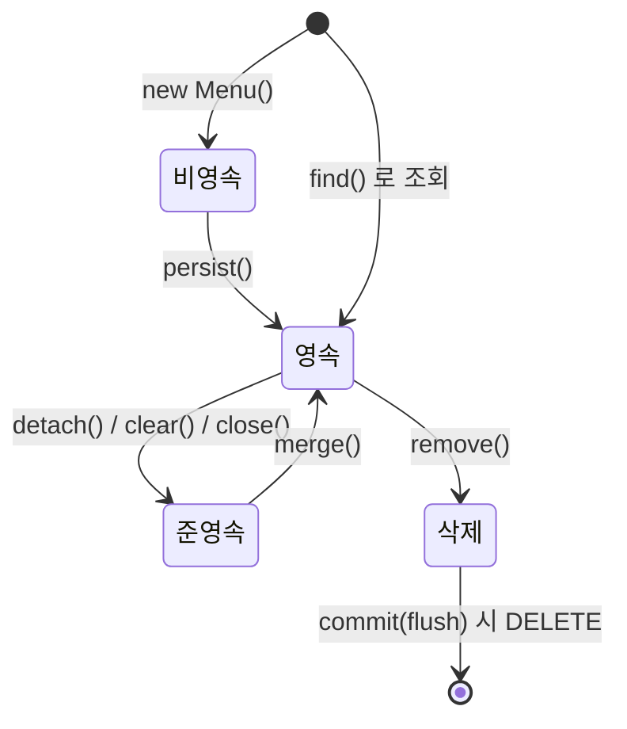
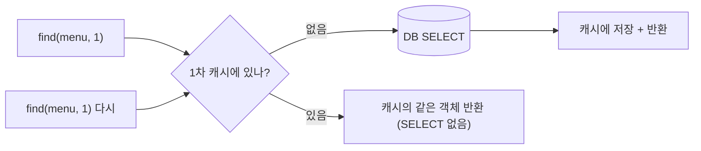
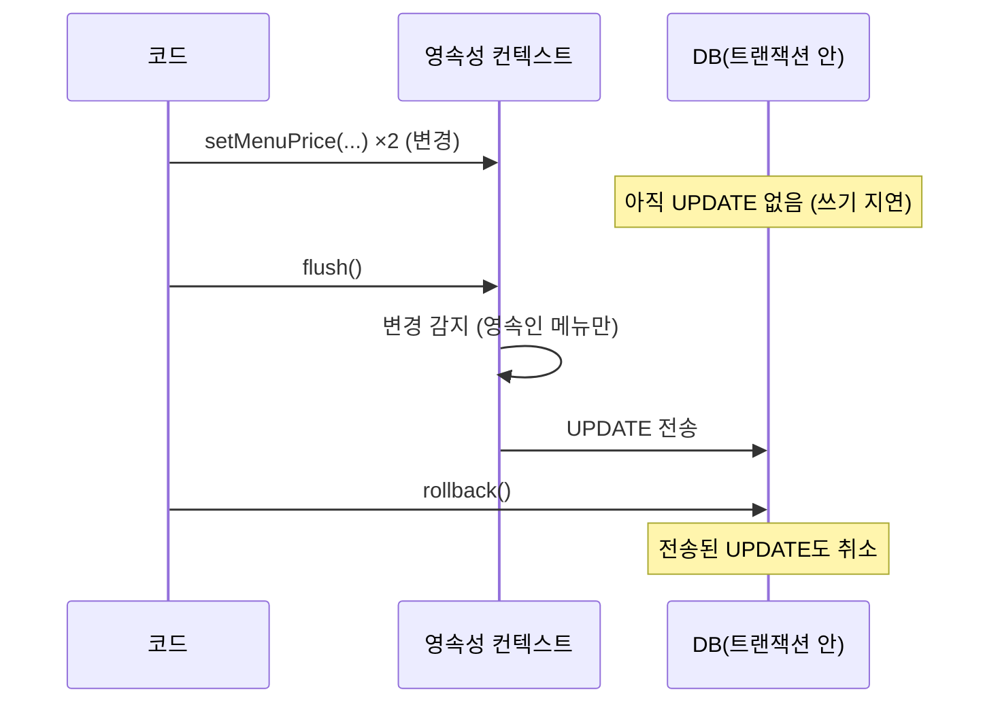
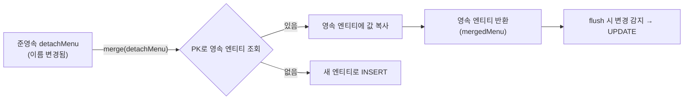

## 들어가며 (Situation)

앞 글에서 "변경 감지는 **영속 상태**의 엔티티에만 동작한다"고 했다. 그렇다면 영속 상태란 무엇이고 그 밖에 어떤 상태가 있을까? `chap02-persistence-context`의 `section02.lifecycle`은 **엔티티의 생명주기**를 다섯 개 실험으로 하나씩 확인한다.

식당 비유로 정리한다. 영속성 컨텍스트는 **주문 메모장**, 엔티티는 **주문 한 건**이다.

| 상태 | 비유 | JPA 용어 |
|---|---|---|
| 메모장에 적기 전, 손님이 입으로만 말한 주문 | **비영속** (new/transient) |
| 메모장에 적혀 있는 주문 | **영속** (managed) |
| 메모장에서 **뜯어낸** 주문 (복사본은 남아 있지만 이제 추적 안 함) | **준영속** (detached) |
| 메모장에 "취소"로 표시된 주문 | **삭제** (removed) |



실험용 `Menu` 엔티티는 앞 글과 같고, 수업 주석대로 **데이터를 바꾸는 실험은 마지막에 `rollback`** 해서 실습 데이터를 지킨다.

## 문제 상황 (Task)

1. 같은 값을 가진 객체인데 어떤 것은 변경 감지가 되고 어떤 것은 안 된다. **무엇이 다른가?**
2. `flush()`는 무엇이고 `commit()`과 어떻게 다른가?
3. 준영속 상태에서 바꾼 값을 DB에 반영하려면 어떻게 하나?

## 해결 과정 (Action)

### 1. 비영속 — `new`로 만든 객체

```java
Menu foundMenu = manager.find(Menu.class, menuCode);     // DB에서 조회 → 영속

Menu newMenu = new Menu();                                // 값을 똑같이 복사했지만...
newMenu.setMenuCode(foundMenu.getMenuCode());
newMenu.setMenuName(foundMenu.getMenuName());
// ... (모든 필드 복사)

foundMenu == newMenu                  // false
manager.contains(foundMenu)           // true  (영속)
manager.contains(newMenu)             // false (비영속)
```

자료형도 같고 **값도 똑같은** 두 객체인데 `foundMenu`는 영속성 컨텍스트가 관리하고 `newMenu`는 전혀 관련이 없다. **값이 같은지가 아니라 영속성 컨텍스트가 관리하느냐**가 상태를 결정한다. `newMenu`의 값을 바꿔도 DB에는 아무 영향이 없다.

`contains(엔티티)`는 "이 엔티티가 지금 영속성 컨텍스트에서 관리되고 있는가?"를 확인하는 메소드로, 이 챕터 전체에서 상태 확인용으로 쓰인다.

### 2. 영속 — 1차 캐시와 동일성

```java
System.out.println("===== 첫 번째 조회 =====");
Menu foundMenu = manager.find(Menu.class, menuCode);
System.out.println("===== 두 번째 조회 =====");
Menu newMenu = manager.find(Menu.class, menuCode);

foundMenu == newMenu      // true
```

`find()`로 조회한 엔티티는 영속성 컨텍스트 안의 **1차 캐시**에 저장된다. 같은 PK로 다시 `find`하면 DB를 가지 않고 **캐시의 같은 객체**를 돌려준다. 그래서:

- SELECT는 **첫 번째 조회 아래에서만** 출력될 것으로 예상된다 (두 번째 아래에는 없음)
- 같은 `EntityManager` 안에서는 **동일성(`==`)이 보장**된다

앞 글에서 본 JDBC의 "같은 행인데 다른 객체" 문제가 해결되는 원리가 바로 이 1차 캐시다.



### 3. 준영속 — `detach`와 flush

```java
Menu foundMenu1 = manager.find(Menu.class, menuCode1);
Menu foundMenu2 = manager.find(Menu.class, menuCode2);

manager.detach(foundMenu2);                 // 2번을 영속성 컨텍스트에서 분리

foundMenu1.setMenuPrice(foundMenu1.getMenuPrice() + 1000);
foundMenu2.setMenuPrice(foundMenu2.getMenuPrice() + 1000);   // 둘 다 가격을 바꾼다

manager.contains(foundMenu1)   // true
manager.contains(foundMenu2)   // false

System.out.println("===== flush =====");
manager.flush();
transaction.rollback();
```

두 엔티티의 가격을 모두 바꿨지만 **영속 상태인 메뉴의 UPDATE만** 나간다. 준영속 엔티티는 값을 바꿔도 변경 감지 대상이 아니다.

준영속 상태로 만드는 방법은 세 가지다.

| 메소드 | 범위 |
|---|---|
| `detach(엔티티)` | **특정 엔티티 하나** |
| `clear()` | 컨텍스트를 **초기화** — 관리하던 모든 엔티티 |
| `close()` | 컨텍스트를 **종료** — 관리하던 모든 엔티티 |

#### flush란?

주석이 길게 정리한 부분이다.

| 질문 | 답 |
|---|---|
| flush가 하는 일 | ① 변경 감지(스냅샷 비교) → ② UPDATE를 쓰기 지연 저장소에 등록 → ③ 저장소의 SQL(INSERT/UPDATE/DELETE)을 DB로 전송 |
| flush가 호출되는 시점 | `commit()` 시 자동 / `manager.flush()` 직접 호출 / **JPQL 실행 직전** 자동 |
| flush는 영속성 컨텍스트를 비우는가? | **아니다.** 1차 캐시는 그대로 유지된다 |
| flush는 commit인가? | **아니다.** SQL을 DB에 전송할 뿐이다. flush 후 rollback하면 전송된 SQL도 취소된다 |

JPQL 실행 직전에 flush가 자동으로 일어나는 이유는, JPQL은 DB에서 조회하므로 **아직 DB에 안 간 변경 내용을 먼저 반영**해야 결과가 맞기 때문이다.



주석의 "확인해보기"가 알려 주는 관찰 포인트다. 가격을 바꾼 코드는 `"===== flush ====="` 출력보다 **먼저** 실행되지만 콘솔의 UPDATE는 그 **아래**에 찍힌다(쓰기 지연). 그리고 UPDATE는 한 번만 찍힌다. 직접 실행해 확인해 보자.

### 4. 삭제 — `remove`

```java
manager.remove(foundMenu);                              // 삭제 상태로

Menu refoundMenu = manager.find(Menu.class, menuCode);  // 다시 조회 → null
manager.contains(foundMenu)                             // false

System.out.println("===== flush =====");
manager.flush();                                        // 이때 DELETE 전송
transaction.rollback();
```

`remove()`를 호출하면 엔티티는 **즉시 삭제 상태**가 되어 다시 조회해도 `null`이다. 하지만 DELETE는 쓰기 지연 저장소에 쌓였다가 flush 때 전송된다. 마지막에 `rollback`하므로 실제 DB 행은 삭제되지 않는다.

### 5. 병합 — `merge`

준영속 상태의 변경을 DB에 반영하려면 `merge`를 쓴다.

```java
Menu detachMenu = manager.find(Menu.class, menuCode);
manager.detach(detachMenu);                    // 준영속

detachMenu.setMenuName(menuName);              // 값 변경 → 변경 감지 대상 아님

Menu mergedMenu = manager.merge(detachMenu);   // 병합

detachMenu == mergedMenu                       // false
manager.contains(detachMenu)                   // false  ← 여전히 준영속
manager.contains(mergedMenu)                   // true   ← 반환된 객체가 영속
```

수업 주석이 정리한 `merge`의 동작이다.

1. 파라미터 엔티티의 **PK로 1차 캐시에서 영속 엔티티를 찾는다**. (없으면 DB에서 SELECT)
2. 찾은 **영속 엔티티에 준영속 엔티티의 값을 복사**한다.
3. 값이 복사된 **영속 엔티티를 반환**한다.
4. PK로 조회되는 엔티티가 없으면 **새 엔티티로 보고 INSERT**한다.



가장 중요한 주의점은 주석에 느낌표와 함께 적혀 있다. **"파라미터로 전달한 객체가 영속 상태가 되는 것이 아니다!"** `merge` 이후 계속 수정해야 하는 객체는 `detachMenu`가 아니라 **반환값 `mergedMenu`** 다. 실수로 `detachMenu`를 계속 쓰면 변경 감지가 되지 않는다.

또 한 가지, `merge`는 **모든 필드를 덮어쓴다**. 준영속 엔티티에서 일부 필드가 `null`이거나 기본값이면 그 값으로 DB가 바뀔 수 있다. 값 일부만 바꾸려면 `merge`보다 **영속 상태로 조회해서 값을 바꾸는(변경 감지)** 방식이 안전하다.

### 6. 4가지 상태 한눈에

| 상태 | 만드는 방법 | 영속성 컨텍스트가 관리? | 변경 감지 |
|---|---|---|---|
| 비영속 | `new Menu()` | X | X |
| **영속** | `persist`, `find`, `merge`의 반환값 | **O** | **O** |
| 준영속 | `detach`, `clear`, `close` | X (이전엔 관리) | X |
| 삭제 | `remove` | 삭제 예약 | — (flush 시 DELETE) |

### 7. 코드를 읽다 발견한 점

| 관찰 | 설명 |
|---|---|
| `transientState` 메소드명과 주석 | 이름은 "비영속"이지만 실제로는 `find`로 영속 엔티티를 가져온 뒤 **복사해서 비교**한다. 원래 주석("객체를 생성하면 비영속") 취지에 맞춰 `new`한 객체만 있는 예제와 비교하는 구성이다 |
| 3~5번 예제가 모두 `rollback`으로 끝남 | 실습 데이터를 지키려는 설계다. 반대로 말하면 **DB에 반영된 결과는 확인할 수 없고**, 콘솔의 SQL 출력으로만 동작을 본다 |
| `Menu`는 `@Setter`와 `@Id`만 있음 | 앞 글의 `category_code`와 달리 `int categoryCode`로 값 그대로 매핑한다. 연관관계 매핑은 이 챕터의 주제가 아니다 |
| `@Entity` 주석 | 같은 이름 엔티티(`Menu`)가 여러 패키지에 있어도 **섹션별 실행 클래스가 자기 패키지만 스캔**하므로 충돌하지 않는다고 설명한다 |

## 결과 (Result)

| 질문 | 정리 |
|---|---|
| 상태를 결정하는 기준 | 값이 같은지가 아니라 **영속성 컨텍스트가 관리하는지** |
| 1차 캐시의 효과 | 같은 PK 재조회 시 SELECT 생략, 같은 객체 반환(동일성 보장) |
| 준영속 엔티티의 변경 | 변경 감지 **안 됨** → 반영하려면 `merge` |
| `flush` vs `commit` | flush: SQL을 DB에 전송, 캐시 유지, rollback 가능 / commit: 트랜잭션 확정 |
| `merge` 반환값 | **반환된 객체가 영속**, 파라미터는 준영속 그대로 |
| `remove` 직후 `find` | `null` (DELETE 전송은 flush 시) |

정량 지표는 측정하지 않았다. 이 글은 콘솔 SQL 출력의 **순서와 횟수**(쓰기 지연, SELECT 생략, UPDATE 1회)를 관찰 포인트로 삼았고, 기대 결과는 코드 주석과 JPA 동작 규칙에 따른 예상이다. 직접 실행해 확인한 출력은 아니다.

배운 점은 이렇다.

1. JPA의 편리함(변경 감지, 1차 캐시, 쓰기 지연)은 전부 **"영속 상태일 때"** 만 누릴 수 있다. 어떤 엔티티가 어떤 상태인지 항상 의식해야 한다.
2. SQL은 코드 순서가 아니라 **flush 시점**에 나간다. 디버깅할 때 `show-sql` 출력 위치가 코드와 다른 것은 정상이다.
3. `merge`는 편리하지만 **전체 덮어쓰기**와 **반환값 사용**이라는 함정이 있다.

## 더 학습하면 좋은 개념

- **영속성 컨텍스트와 스프링 트랜잭션 범위 (OSIV, `@Transactional`)** — 서비스 계층에서 트랜잭션이 끝나면 엔티티가 준영속이 되는 이유다. 지연 로딩 예외(`LazyInitializationException`)와 이어진다.
- **지연 로딩(LAZY)과 프록시 객체** — 엔티티 대신 프록시가 들어 있는 상태와 영속성 컨텍스트의 관계다.
- **JPQL과 flush 모드 (`FlushModeType`)** — "JPQL 실행 직전 flush"를 제어하는 방법이다.
- **`persist` vs `merge`와 `Persistable`/ID 전략** — Spring Data JPA의 `save()`가 내부에서 둘 중 어떤 것을 호출하는지 이해하는 열쇠다.
- **변경 감지 vs 전체 필드 UPDATE (`@DynamicUpdate`)** — 기본적으로 모든 컬럼을 UPDATE하는 이유와 최적화 옵션이다.

## 참고 자료

- [Jakarta Persistence 3.2 명세 - Entity Instance's Life Cycle](https://jakarta.ee/specifications/persistence/3.2/jakarta-persistence-spec-3.2#entity-instance-life-cycle)
- [Jakarta Persistence API - EntityManager (`detach`, `merge`, `flush`, `contains`)](https://jakarta.ee/specifications/persistence/3.2/apidocs/jakarta.persistence/jakarta/persistence/entitymanager)
- [Hibernate ORM User Guide - Persistence Context](https://docs.jboss.org/hibernate/orm/current/userguide/html_single/Hibernate_User_Guide.html#pc)
- [Hibernate ORM User Guide - Flushing](https://docs.jboss.org/hibernate/orm/current/userguide/html_single/Hibernate_User_Guide.html#flushing)
- [EntityManager CRUD 글]({{ site.baseurl }}/2026/11/02/jpa-entitymanager-crud-dirty-checking/)
