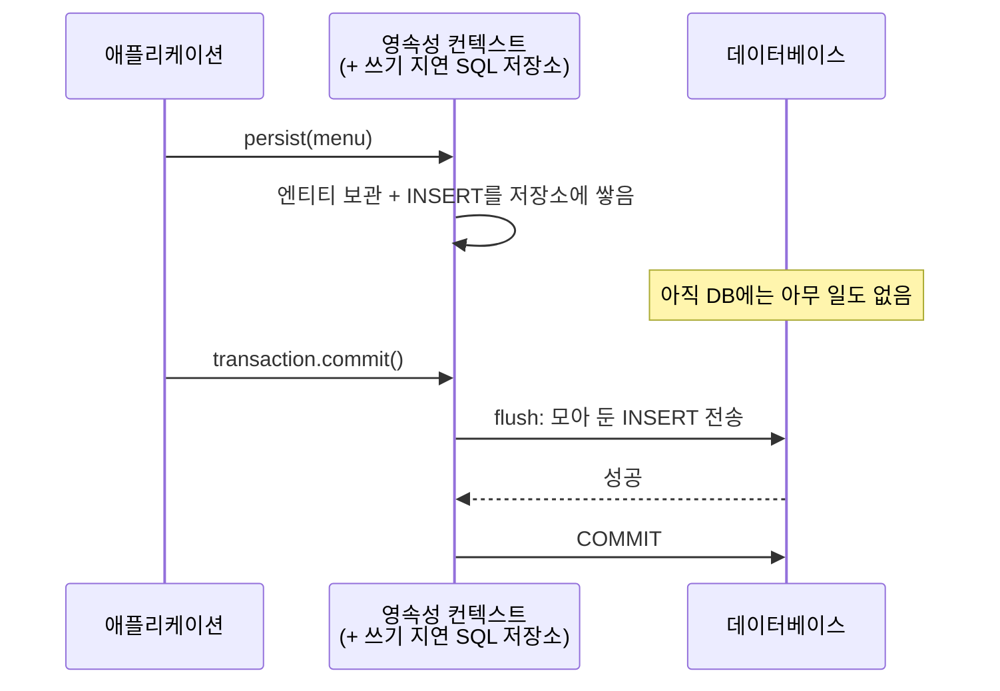
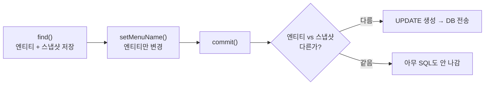

## 들어가며 (Situation)

앞 글에서 `manager.find(...)` 한 줄로 조회가 되는 것을 봤다. `chap02-persistence-context`의 `section01`은 한 걸음 더 나아가 **등록·수정·삭제까지 `EntityManager`로** 처리한다. 그런데 JDBC에 익숙한 눈으로 보면 이상한 점이 있다.

> **수정(Update)에 해당하는 메소드가 없다.** 그런데 이름은 바뀐다.

이 글은 그 이유를 **영속성 컨텍스트**라는 JPA의 핵심 개념으로 풀어 본다.

| 작업 | JDBC | JPA(`EntityManager`) |
|---|---|---|
| Create | `INSERT` SQL | `persist(엔티티)` |
| Read | `SELECT` SQL | `find(타입, PK)` |
| Update | `UPDATE` SQL | **메소드 없음** — 값만 바꾸면 반영(변경 감지) |
| Delete | `DELETE` SQL | `remove(엔티티)` |

식당 비유를 이어 가면, 영속성 컨텍스트는 **주문 메모장**이다. 점원(EntityManager)은 손님이 말한 주문을 일단 **메모장에 적어 두었다가**, 계산 시점(commit)에 주방(DB)에 한꺼번에 넘긴다.

## 문제 상황 (Task)

1. `persist()`를 호출했는데 콘솔에 INSERT가 **바로** 안 찍힌다. 언제 DB에 반영되는가?
2. 수정용 메소드(`update()`)가 없는데 `setMenuName(...)`만 했을 뿐인데 UPDATE가 나가는 이유는?
3. `EntityManager`를 필드로 하나 두면 안 되나? 왜 요청마다 만드는가?

## 해결 과정 (Action)

### 1. 엔티티 매니저를 어떻게 만들까

```java
@Component
public class EntityManagerCRUD {

    private final EntityManagerFactory factory;

    public EntityManagerCRUD(EntityManagerFactory factory) {   // 공장(Factory)을 주입
        this.factory = factory;
    }

    public void findMenuByMenuCode(int menuCode) {
        EntityManager manager = factory.createEntityManager();  // 요청마다 새로 만든다
        Menu foundMenu = manager.find(Menu.class, menuCode);
        System.out.println("foundMenu = " + foundMenu);
        manager.close();                                        // 다 쓰면 닫는다
    }
}
```

| 객체 | 역할 | 수명 |
|---|---|---|
| `EntityManagerFactory` | `EntityManager`를 **만드는 공장**. 만드는 비용이 커서 앱 전체에서 하나를 공유 | 앱 전체 |
| `EntityManager` | 한 번의 작업을 위한 **창구**. 자기만의 영속성 컨텍스트를 가진다 | **요청 1개** |

수업 주석: *"엔티티 매니저는 기능 1개당 1개의 매니저를 별도로 생성해야 한다. 필드에서 매니저를 공유하는 것이 아니라 1개의 요청 시 1개의 매니저만 존재해야 한다."* `EntityManager`는 여러 스레드가 동시에 쓰도록 만들어지지 않았다. 앞 글에서 본 **싱글톤 Bean의 상태 공유 문제**와 같은 이유다.

(앞 글의 `@PersistenceContext private EntityManager manager;`는 스프링이 대신 안전하게 관리해 주는 프록시를 주입하는 방식이라 필드로 둘 수 있다. 이 챕터는 동작 원리를 눈으로 보려고 **직접 만들고 닫는** 방식을 택했다. 그래서 주석 처리된 `@PersistenceContext` 코드가 남아 있다.)

### 2. Create — `persist`와 쓰기 지연

```java
public void registMenu(Menu menu) {

    EntityManager manager = factory.createEntityManager();
    EntityTransaction transaction = manager.getTransaction();
    transaction.begin();                       // 트랜잭션 시작

    try {
        manager.persist(menu);                 // 영속성 컨텍스트에 등록
        transaction.commit();                  // 이때 DB로 SQL 전송
        System.out.println("등록 된 메뉴 : " + menu);
    } catch (Exception e) {
        transaction.rollback();
    } finally {
        manager.close();
    }
}
```

수업 주석이 핵심을 설명한다.

> 엔티티 매니저는 CUD 작업 시 SQL을 DB에 바로 반영하지 않는다. **"쓰기 지연 SQL 저장소"** 에 SQL을 모아 두었다가 **flush 시점**에 DB로 보내준다. `commit()`이 호출되면 flush가 자동 실행된다.



DML(INSERT·UPDATE·DELETE)은 **트랜잭션이 필수**다. 중간에 오류가 나면 롤백해야 하기 때문이다. 조회(`find`)는 트랜잭션 없이도 된다.

왜 바로 안 보낼까? 여러 변경을 **모아서 한 번에** 보내면 DB 왕복 횟수를 줄이고, 도중에 실패해도 한 번에 되돌릴 수 있다. (JDBC 배치 처리와 비슷한 장점이다.)

### 3. Update — 메소드가 없는 이유: 변경 감지

```java
public void modifyMenuName(int menuCode, String menuName) {

    EntityManager manager = factory.createEntityManager();
    Menu foundMenu = manager.find(Menu.class, menuCode);          // ① 조회 → 영속성 컨텍스트가 스냅샷 보관

    EntityTransaction transaction = manager.getTransaction();
    transaction.begin();

    try {
        foundMenu.setMenuName(menuName);                          // ② 값만 바꿈. update() 호출 없음
        System.out.println("=======commit 하기 전=========");
        transaction.commit();                                     // ③ commit 시 변경 감지 → UPDATE 전송
    } catch (Exception e) {
        transaction.rollback();
    }
    ...
}
```

주석이 설명하는 **변경 감지(Dirty Checking)** 의 과정이다.

1. 엔티티를 처음 조회(`find`)하는 순간 영속성 컨텍스트가 **그 시점의 상태(스냅샷)** 를 보관한다.
2. 개발자는 `setMenuName(...)`으로 필드만 바꾼다.
3. `commit` 시점에 **보관된 스냅샷과 현재 엔티티를 비교**한다.
4. 다른 부분이 있으면 **UPDATE 쿼리를 만들어** 쓰기 지연 저장소에 넣고 DB로 전송한다.



그래서 콘솔에서는 `=======commit 하기 전=========` 출력 **다음에** UPDATE가 찍힐 것으로 예상된다(쓰기 지연). 직접 실행해 순서를 확인해 보자.

변경 감지 덕분에 얻는 것은 두 가지다.

| 장점 | 설명 |
|---|---|
| 코드가 객체지향적 | "수정 SQL을 실행한다"가 아니라 "**객체의 값을 바꾼다**" |
| 실수 방지 | 일부 컬럼만 바꿔도 JPA가 알아서 맞는 UPDATE를 만든다 |

### 4. Delete — `remove`

```java
public void removeMenu(int menuCode) {
    EntityManager manager = factory.createEntityManager();
    Menu removeMenu = manager.find(Menu.class, menuCode);       // 먼저 조회해서 영속 상태로

    EntityTransaction transaction = manager.getTransaction();
    transaction.begin();
    try {
        manager.remove(removeMenu);                              // 삭제 예약
        transaction.commit();                                    // 이때 DELETE 전송
    } catch (Exception e) {
        transaction.rollback();
    }

    Menu removedMenu = manager.find(Menu.class, menuCode);       // 삭제 확인 → null
    manager.close();
}
```

삭제도 **영속성 컨텍스트가 관리하는 엔티티**여야 하므로 먼저 `find`한다. `remove()`를 호출해도 DELETE는 commit 시점에 전송된다.

### 5. 한눈에 정리

| 작업 | 메소드 | SQL 전송 시점 | 특징 |
|---|---|---|---|
| 조회 | `find(타입, PK)` | 즉시 (캐시에 없으면) | 조회한 엔티티는 컨텍스트가 관리 |
| 등록 | `persist(엔티티)` | commit(flush) 시 | 쓰기 지연 |
| 수정 | (메소드 없음) `setXxx()` | commit(flush) 시 | **변경 감지**가 UPDATE 생성 |
| 삭제 | `remove(엔티티)` | commit(flush) 시 | 먼저 조회 필요 |

### 6. 코드를 읽다 발견한 점

아래는 코드를 읽고 추론한 것이며 직접 실행해 확인한 것은 아니다.

| # | 관찰 | 설명 / 개선 |
|---|---|---|
| 1 | `catch (Exception e) { transaction.rollback(); }`에서 **예외를 출력하지 않는다** | 실패해도 원인이 보이지 않는다. 최소 `e.printStackTrace()`나 로그를 남기자 |
| 2 | `registMenu`에서 `menuCode`를 입력받지 않고 `@Id`에 `@GeneratedValue`도 없다 | `Menu.menuCode`는 `int`라 값을 안 넣으면 `0`이다. 이 값으로 INSERT가 나갈 가능성이 크다. DB의 `menu_code`가 `AUTO_INCREMENT`이면 MySQL이 새 번호를 부여할 수 있지만, 방금 `persist`한 **자바 객체의 `menuCode`는 0으로 남을 가능성**이 있다. PK 자동 생성 전략(`@GeneratedValue`)이 필요한 이유다 |
| 3 | `removeMenu`에서 `find`가 `null`이면 `remove(null)` 호출 | `IllegalArgumentException`이 나고 `catch`에서 `rollback`되지만 안내 메시지가 없다. `null` 검사가 먼저 필요하다 |
| 4 | `modifyMenuName`에서 마지막에 `manager.find(...)` | commit 이후 같은 `EntityManager` 안에서 다시 조회하므로 DB가 아니라 **1차 캐시에서** 바로 돌려줄 것으로 보인다. SELECT가 다시 나가는지 확인해 보자 |
| 5 | `Section01Application`의 메뉴 제목이 "section02"라고 적힘 | 복사하며 남은 문구로 보인다 |

## 결과 (Result)

| 질문 | 정리 |
|---|---|
| `EntityManager`는 어떻게 얻나 | `EntityManagerFactory.createEntityManager()` — 요청마다 만들고 `close()` |
| 등록 | `persist` — INSERT는 flush 시점에 전송 (쓰기 지연) |
| 수정 | 값만 변경 → commit 시 **변경 감지**가 UPDATE 생성 |
| 삭제 | 조회한 엔티티를 `remove` → commit 시 DELETE |
| DML의 필수 조건 | 트랜잭션 (실패 시 rollback) |

정량 지표는 측정하지 않았다. 구조 면에서는 JDBC에서 필요했던 **INSERT/UPDATE/DELETE SQL 문자열 3종과 `PreparedStatement` 파라미터 바인딩**이 사라지고, 코드는 `persist`, `setXxx`, `remove` 같은 **객체 조작**만 남았다.

배운 점은 이렇다.

1. "수정 메소드가 없다"는 JPA를 이해하는 좋은 질문이다. 답은 **영속성 컨텍스트가 스냅샷으로 변경을 감지**하기 때문이다.
2. DB 반영 시점은 **코드를 호출한 시점이 아니라 flush(보통 commit) 시점**이다. 콘솔의 SQL 출력 순서가 코드 순서와 다를 수 있다.
3. 변경 감지는 **영속 상태 엔티티**에만 동작한다. 영속 상태가 무엇인지가 다음 글의 주제다.

## 더 학습하면 좋은 개념

- **엔티티의 생명주기 (비영속·영속·준영속·삭제)** — 변경 감지가 되는 엔티티와 안 되는 엔티티를 구분하는 기준이다. 바로 다음 글에서 다룬다.
- **`@GeneratedValue`와 기본키 생성 전략 (IDENTITY, SEQUENCE)** — 위 관찰 2번의 해결책이다. 전략에 따라 `persist` 시점의 INSERT 시점도 달라진다.
- **스프링의 `@Transactional`과 공유 `EntityManager`** — 이 글처럼 직접 트랜잭션을 열고 닫는 대신, 스프링이 트랜잭션과 `EntityManager`를 관리해 주는 방식이다. 실무에서 쓰는 형태다.
- **플러시(flush) 모드와 JPQL 실행 시 자동 flush** — "언제 SQL이 나가는가"를 정확히 이해하게 해 준다.
- **낙관적 락(`@Version`)** — 변경 감지로 동시에 같은 엔티티를 수정할 때 덮어쓰기를 막는 방법이다.

## 참고 자료

- [Jakarta Persistence 3.2 명세 - EntityManager](https://jakarta.ee/specifications/persistence/3.2/apidocs/jakarta.persistence/jakarta/persistence/entitymanager)
- [Jakarta Persistence 명세 - EntityTransaction](https://jakarta.ee/specifications/persistence/3.2/apidocs/jakarta.persistence/jakarta/persistence/entitytransaction)
- [Hibernate ORM User Guide - Persistence Context](https://docs.jboss.org/hibernate/orm/current/userguide/html_single/Hibernate_User_Guide.html#pc)
- [Hibernate ORM User Guide - Flushing](https://docs.jboss.org/hibernate/orm/current/userguide/html_single/Hibernate_User_Guide.html#flushing)
- [Spring Data JPA 공식 문서](https://docs.spring.io/spring-data/jpa/reference/)
- [JPA 입문 글 - JDBC의 4가지 문제]({{ site.baseurl }}/2026/11/02/jpa-intro-jdbc-problems/)
