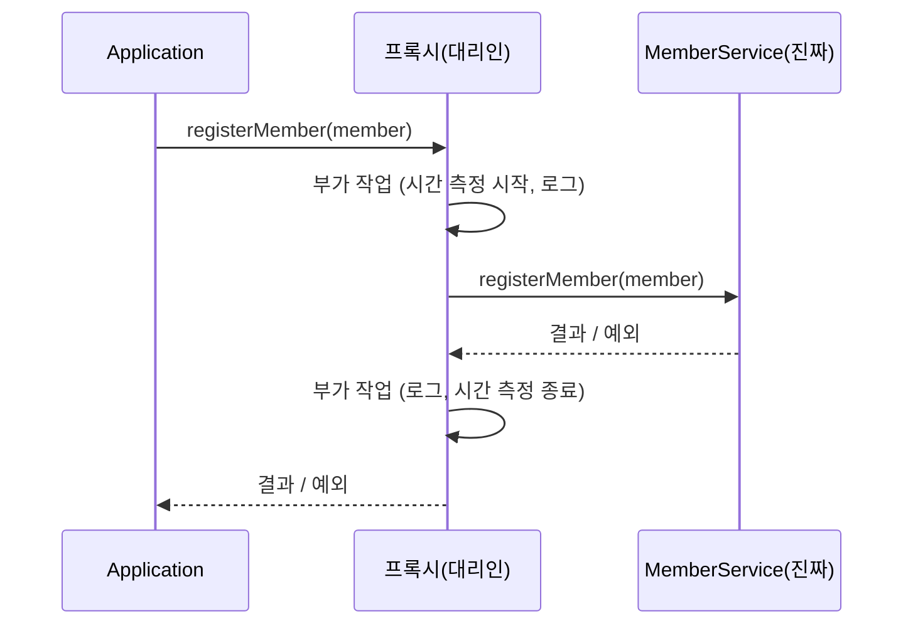
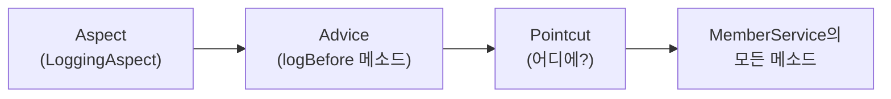
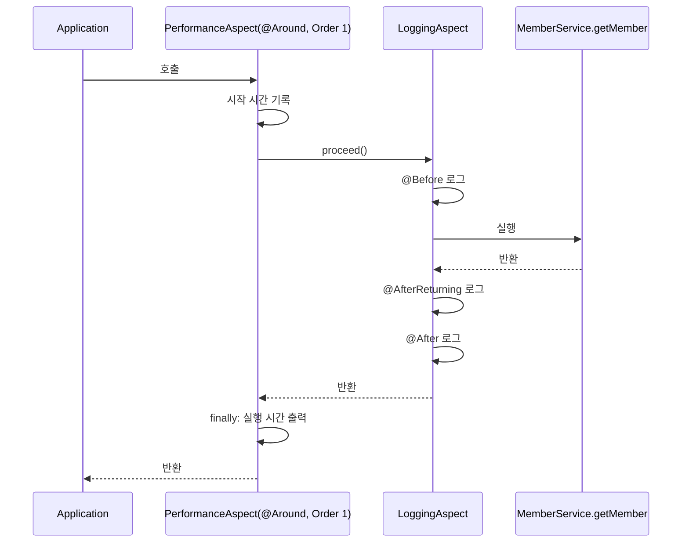

## 들어가며 (Situation)

`07_Spring-Core/chap03-aop`는 **회원 관리 프로그램**(회원가입·조회·비밀번호 변경·탈퇴)에 로깅과 성능 측정을 붙이는 과정을 다룬다. 두 단계로 되어 있다.

| 단계 | 패키지 | 내용 |
|---|---|---|
| 1 | `section01` | AOP **적용 전** — 모든 메소드에 로그·시간 측정 코드를 직접 작성 |
| 2 | `section02` | AOP **적용 후** — `@Aspect` 클래스로 분리 |

먼저 용어를 쉬운 말로 풀어 보자.

| 용어 | 뜻 | 비유 (식당) |
|---|---|---|
| **핵심 관심사** | 이 메소드가 **진짜 하려는 일** (회원 저장) | 요리 |
| **횡단 관심사** | 여러 메소드에 **공통으로 끼어드는 일** (로그, 시간 측정, 트랜잭션) | 모든 요리마다 하는 "주문 기록"과 "조리 시간 재기" |
| **AOP** | 횡단 관심사를 **핵심 코드 밖**에 따로 모아 두고, 필요한 지점에 끼워 넣는 기법 | 주방 입구에 **기록 담당 직원**을 따로 두기 |

## 문제 상황 (Task)

`section01/MemberService`의 모든 메소드는 이런 모양이다.

```java
public void registerMember(MemberDTO member) {
    long startTime = System.currentTimeMillis();                 // 성능 측정 시작 (횡단 관심사 #1)
    try {
        System.out.println("[로그] 회원 가입 시작: " + ...);       // 로깅 (횡단 관심사 #2)
        // beginTransaction();                                    // 트랜잭션 (횡단 관심사 #3, 의사코드)

        // ----- 핵심 비즈니스 로직 -----
        // 검증, 중복 확인, 저장 ...

        // commitTransaction();
        System.out.println("[로그] 회원 가입 성공: " + ...);
    } catch (Exception e) {
        // rollbackTransaction();
        System.out.println("[로그] 회원 가입 실패: " + e.getMessage());
        throw e;
    } finally {
        long endTime = System.currentTimeMillis();
        System.out.println("[성능] 회원 가입 처리 시간: " + (endTime - startTime) + "ms");
    }
}
```

핵심 로직은 몇 줄뿐이고 나머지가 **로그와 시간 측정**이다. 이런 코드가 메소드 4개에 똑같이 복사되어 있다. 수업 주석이 정리한 문제는 세 가지다.

| 문제 | 구체적으로 |
|---|---|
| **코드 중복** | 모든 메소드에 로깅·성능·트랜잭션 코드가 반복 |
| **낮은 응집도** | 한 메소드가 핵심 로직 + 부가 작업을 함께 한다 |
| **유지보수 어려움** | 로그 양식이나 측정 기준을 바꾸면 **모든 메소드**를 고쳐야 한다 |

## 해결 과정 (Action)

### 1. 어떻게 끼워 넣을까: 프록시

AOP의 핵심 아이디어는 **내 객체 앞에 대리인(프록시)을 세우는 것**이다. 호출하는 쪽은 진짜 객체인 줄 알고 부르지만, 사실은 프록시를 거친다.



`section02`에서 `MemberService`를 보면 **로그·시간 측정 코드가 모두 사라지고** 핵심 로직만 남았다.

```java
@Service
public class MemberService {

    public MemberDTO getMember(String email) {
        if (email == null || email.isEmpty()) {
            throw new IllegalArgumentException("이메일은 필수입니다.");
        }
        MemberDTO member = memberRepository.get(email);
        if (member == null) {
            throw new IllegalArgumentException("존재하지 않는 회원입니다: " + email);
        }
        return member;
    }
    ...
}
```

### 2. AOP 켜기: 설정

```java
@Configuration
@ComponentScan("com.wanted.aop.section02")
@EnableAspectJAutoProxy          // @Aspect 가 붙은 Bean을 찾아 프록시를 만들어 준다
public class AppConfig { }
```

| 항목 | 의미 |
|---|---|
| `@EnableAspectJAutoProxy` | AOP 기능 활성화. 이것이 없으면 `@Aspect` 클래스가 있어도 동작하지 않는다 |
| `@ComponentScan` | Aspect 클래스(`@Component` + `@Aspect`)와 `MemberService`를 Bean으로 등록 |
| 의존성 | `spring-aop`, `aspectjrt`, `aspectjweaver`(`build.gradle`). 스프링 AOP는 **AspectJ의 어노테이션과 포인트컷 표현식**을 빌려 쓴다 |

`MemberService`는 인터페이스가 없는 클래스다. 이런 경우 스프링은 CGLIB 방식으로 **클래스를 상속한 프록시**를 만든다. 그래서 `context.getBean(MemberService.class)`로 꺼낼 수 있다. (동작 방식은 [공식 문서](https://docs.spring.io/spring-framework/reference/core/aop/proxying.html)를 참고했으며 직접 확인한 것은 아니다.)

### 3. AOP 용어 4가지: Aspect, Advice, Pointcut, JoinPoint

`LoggingAspect`의 주석이 이 용어들을 정리한다.

| 용어 | 뜻 | 코드에서 |
|---|---|---|
| **Aspect** | "관점" — 횡단 관심사를 모은 **클래스** | `@Aspect` 가 붙은 `LoggingAspect` |
| **Advice** | **무엇을, 언제** 할지 (메소드) | `@Before`, `@After` 등이 붙은 메소드 |
| **Pointcut** | **어디에** 적용할지 (표현식) | `execution(* com.wanted...MemberService.*(..))` |
| **JoinPoint** | Advice가 끼어든 지점의 정보 (메소드 이름, 인자 등) | `JoinPoint joinPoint` 매개변수 |



#### Pointcut 표현식 읽는 법

```text
execution( * com.wanted.aop.section02.MemberService . * ( .. ) )
           │  └──────── 클래스 ─────────────────────┘ │  │  └ 매개변수: 0개 이상
           │                                            │  └ 메소드: 전부
           └ 반환 타입: 아무거나
```

| 표현 | 의미 |
|---|---|
| `클래스.*(..)` | 클래스의 모든 메소드 |
| `(..)` | 매개변수 0개 이상 |
| `()` | 매개변수 없는 메소드 |
| `(String)` | `String` 매개변수 1개 |
| `(String, ..)` | 첫 매개변수는 `String`, 나머지는 상관없음 |

### 4. Advice 5종류

`LoggingAspect`에 4가지, `PerformanceAspect`에 1가지가 구현되어 있다.

| Advice | 실행 시점 | 수업 코드 |
|---|---|---|
| `@Before` | 대상 메소드 **실행 전** | 메소드 이름과 인자를 로그 출력 |
| `@After` | 대상 메소드 **끝난 후** (성공/예외 상관없이, `finally`처럼) | "메서드 실행 완료" 로그 |
| `@AfterReturning` | **정상 종료**했을 때. `returning`으로 반환값을 받는다 | 반환값 로그 |
| `@AfterThrowing` | **예외 발생** 시. `throwing`으로 예외를 받는다 | 예외 메시지 로그 |
| `@Around` | 메소드 **앞뒤 모두**. 가장 강력하다 | 실행 시간 측정 |

```java
@Before("execution(* com.wanted.aop.section02.MemberService.*(..))")
public void logBefore(JoinPoint joinPoint) {
    String methodName = joinPoint.getSignature().getName();   // 호출된 메소드 이름
    Object[] args = joinPoint.getArgs();                      // 넘어온 인자들
    ...
}

@AfterReturning(pointcut = "execution(* ...MemberService.*(..))", returning = "result")
public void logAfterReturning(JoinPoint joinPoint, Object result) { ... }   // result 에 반환값

@AfterThrowing(pointcut = "execution(* ...MemberService.*(..))", throwing = "exception")
public void logAfterThrowing(JoinPoint joinPoint, Exception exception) { ... }
```

`@Around`는 진짜 메소드를 **직접 호출해 줘야** 한다.

```java
@Around("execution(* com.wanted.aop.section02.MemberService.*(..))")
public Object performance(ProceedingJoinPoint joinPoint) {
    long startTime = System.currentTimeMillis();
    try {
        Object result = joinPoint.proceed();     // ← 진짜 MemberService 메소드 실행
        return result;
    } catch (Throwable e) {
        throw new RuntimeException(e);
    } finally {
        long endTime = System.currentTimeMillis();
        System.out.println("[Around 성능 측정]" + ... + (endTime - startTime) + "(ms)");
    }
}
```

`joinPoint.proceed()`를 호출하지 않으면 **진짜 메소드가 실행되지 않는다.** 이것이 `@Around`가 "실행을 직접 제어한다"는 말의 뜻이다.

### 5. 여러 Advice가 어떤 순서로 실행될까

`@Order(1)`이 붙은 `PerformanceAspect`는 `LoggingAspect`(순서 지정 없음)보다 **바깥쪽**에서 감싼다. 숫자가 작을수록 우선순위가 높다. 같은 Aspect 안의 Advice 순서는 공식 문서에 따라 `@Around → @Before → @After → @AfterReturning → @AfterThrowing` 우선순위로 정해지며, `@After`는 `finally` 의미라서 `AfterReturning/AfterThrowing` 뒤에 실행된다.

회원 조회 성공 시 **예상되는 흐름**은 다음과 같다. (공식 문서 규칙에 따른 예상이며 실행 출력은 아니다.)



### 6. 코드를 읽다 발견한 점 (개선 포인트)

실행해 보면 좋을 부분을 코드에서 찾았다. 아래는 코드를 읽고 추론한 것이다.

| # | 관찰 | 왜 문제인가 / 개선 |
|---|---|---|
| 1 | `PerformanceAspect`가 `catch (Throwable e) { throw new RuntimeException(e); }`로 **예외를 감싼다** | 테스트 5(없는 회원 조회)에서 `Application`이 받는 예외는 `IllegalArgumentException`이 아니라 그것을 감싼 `RuntimeException`이 된다. `e.getMessage()`가 `"java.lang.IllegalArgumentException: 존재하지 않는 회원입니다..."`처럼 앞에 클래스 이름이 붙을 것으로 예상된다. `performance` 메소드에 `throws Throwable`을 선언하고 그대로 던지는 편이 낫다 |
| 2 | `@Order(1)`인 `PerformanceAspect`가 바깥, `LoggingAspect`가 안쪽 | 그래서 `@AfterThrowing`은 감싸지기 **전의 원래 예외**를 받는다. 두 Aspect가 보는 예외가 다를 수 있다 |
| 3 | `logBefore`가 **모든 인자를 그대로 출력** | `updatePassword("...", "pass0123", "pass0234")`를 호출하면 **비밀번호가 로그에 평문으로** 남는다. `MemberDTO.toString()`(`@ToString`)에도 `password`가 포함된다. 로그에는 민감 정보를 빼야 한다 |
| 4 | Aspect가 `MemberService.*(..)`에만 적용 | 같은 클래스 **내부 호출**(`this.xxx()`)은 프록시를 거치지 않아 Advice가 적용되지 않는다. 지금 코드에는 내부 호출이 없어서 문제가 없다 |
| 5 | 메소드 위 Javadoc에 "성능 측정, 로깅 코드가 섞여있다" | `section02`로 복사하면서 **설명이 그대로 남은 것**이다. 지금은 사실과 다르다 |

## 결과 (Result)

변화를 코드 구조로 비교한다. (직접 측정한 값이 아니라 소스 파일의 구성을 비교한 것이다.)

| 항목 | section01 (적용 전) | section02 (적용 후) |
|---|---|---|
| 로깅·성능 측정 코드 위치 | `MemberService` 메소드 4개에 각각 복사 | `LoggingAspect`, `PerformanceAspect` 각 1곳 |
| `MemberService` 메소드 본문 | 핵심 로직 + try/catch/finally + 로그 | **핵심 로직만** |
| 로그 양식 변경 시 | 메소드 4개 수정 | Aspect 1곳 수정 |
| 새 메소드 추가 시 | 로그·측정 코드를 또 복사 | Pointcut(`MemberService.*(..)`)에 **자동 적용** |

| 질문 | 정리 |
|---|---|
| AOP는 왜 쓰나? | 횡단 관심사를 핵심 로직에서 분리해 중복을 없애고 응집도를 높인다 |
| 어떻게 동작하나? | 프록시가 대상 객체를 감싸서 Advice를 끼워 넣는다 |
| 켜는 법 | `@EnableAspectJAutoProxy` + `@Aspect` + `@Component` |
| 시간 측정에 적합한 Advice | `@Around` (`proceed()` 앞뒤를 모두 다루기 때문) |

배운 점은 이렇다.

1. **"복붙이 늘어난다"는 신호**를 만나면 AOP 같은 분리 기법을 떠올릴 수 있어야 한다.
2. AOP는 마법이 아니라 **프록시**다. 그래서 내부 호출, 예외 감싸기 같은 한계와 함정이 생긴다.
3. 편한 도구일수록 **로그에 무엇이 찍히는지**(비밀번호 등)를 의식해야 한다.

이 챕터에서 `MemberService`의 `// beginTransaction();` 의사코드로만 남아 있던 **트랜잭션**도 대표적인 AOP 활용 사례다. 스프링의 `@Transactional`이 바로 이 프록시 방식으로 동작한다.

## 더 학습하면 좋은 개념

- **`@Transactional`과 프록시 동작 원리** — 이 글에서 의사코드로만 있던 `begin/commit/rollback`을 AOP가 대신 해 주는 방식이다. 내부 호출에서 트랜잭션이 안 먹는 이유도 같은 프록시 한계에서 나온다.
- **JDK 동적 프록시 vs CGLIB** — 인터페이스가 있으면 인터페이스 기반, 없으면 클래스 상속 기반으로 프록시가 만들어진다. `final` 클래스·메소드에서 문제가 생기는 이유를 이해하게 된다.
- **Pointcut 표현식 심화 (`within`, `@annotation`, `bean`)** — 클래스·어노테이션 단위로 대상을 고르는 방법이다. 커스텀 어노테이션(예: `@LogExecutionTime`)으로 필요한 메소드에만 적용할 수 있다.
- **Aspect 우선순위(`@Order`)와 Advice 실행 순서** — 여러 관점이 겹칠 때 실행 순서를 의도대로 제어하는 방법이다. 로그 → 트랜잭션 순서가 바뀌면 결과가 달라지는 이유를 알 수 있다.
- **로깅 모범 사례(SLF4J)와 민감 정보 마스킹** — `System.out.println` 대신 로깅 프레임워크를 쓰는 이유와, 비밀번호 같은 값을 로그에서 가리는 방법이다.

## 참고 자료

- [Spring Framework 공식 문서 - AOP 개념](https://docs.spring.io/spring-framework/reference/core/aop/introduction-defn.html)
- [Spring Framework 공식 문서 - @AspectJ 지원 활성화](https://docs.spring.io/spring-framework/reference/core/aop/ataspectj/aspectj-support.html)
- [Spring Framework 공식 문서 - Advice 선언](https://docs.spring.io/spring-framework/reference/core/aop/ataspectj/advice.html)
- [Spring Framework 공식 문서 - Pointcut 선언](https://docs.spring.io/spring-framework/reference/core/aop/ataspectj/pointcuts.html)
- [Spring Framework 공식 문서 - AOP 프록시 메커니즘](https://docs.spring.io/spring-framework/reference/core/aop/proxying.html)
- [AspectJ 공식 사이트](https://eclipse.dev/aspectj/)
