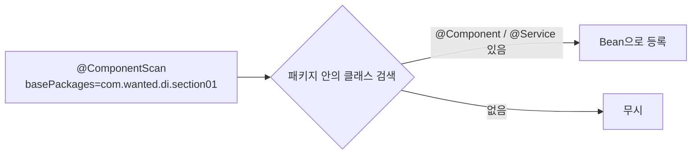
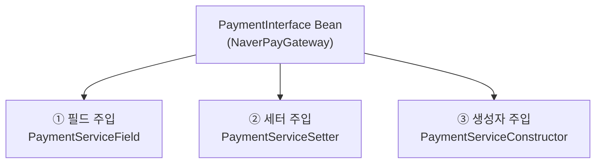
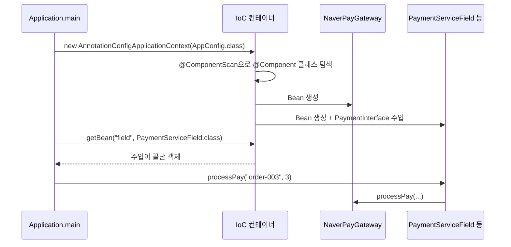

## 들어가며 (Situation)

[앞 글]({{ site.baseurl }}/2026/11/02/spring-ioc-container-bean-scope/)에서는 `AppConfig`에 `@Bean` 메소드를 적어 Bean을 등록했다. `07_Spring-Core/chap02-dependency-injection`은 거기서 생긴 불편함에서 출발한다.

> 문제 제기: 만약 Bean이 100개라면? (`section01/Application`의 주석)

`@Bean` 메소드를 100개 적고, 그 사이의 연결(`new PaymentService(kakaoPayGateway())`)도 전부 손으로 이어야 한다. 이 챕터는 두 가지를 해결한다.

| 단계 | 패키지 | 해결하는 것 |
|---|---|---|
| 1 | `section01` | **Bean 등록 자동화** — `@ComponentScan` |
| 2 | `section02` | **Bean 연결 자동화** — `@Autowired`, 의존성 주입 3가지 방식 |

비유하자면 이렇다.

| 방식 | 비유 |
|---|---|
| `@Bean` 직접 등록 | 직원 이름을 **하나씩 명부에 적는다** |
| `@ComponentScan` | "이 건물에서 **사원증 단 사람은 전부** 직원"이라고 선언한다 |
| DI(`@Autowired`) | 필요한 직원을 내가 데려오지 않고 **인사팀이 배정해 준다** |

## 문제 상황 (Task)

1. Bean이 늘어날 때마다 `AppConfig`를 고치지 않고 등록하고 싶다.
2. 서비스가 쓸 결제 객체를 `new`나 `getBean`으로 찾지 않고 **자동으로 받고** 싶다.
3. 그렇다면 "받는 방법"은 하나뿐인가? 필드, 세터, 생성자 중 **무엇을 써야** 하는가?

## 해결 과정 (Action)

### 1. section01: `@ComponentScan`으로 등록 자동화

```java
@Configuration
@ComponentScan(basePackages = "com.wanted.di.section01")
public class AppConfig { }          // @Bean 메소드가 하나도 없다
```

대신 Bean이 될 클래스 자체에 표시를 붙인다.

```java
@Component
public class NaverPayGateway implements PaymentInterface { ... }

@Service                              // @Component의 특수한 형태 (Service 계층 표시)
public class PaymentService { ... }
```

`@ComponentScan`은 지정한 패키지를 뒤져서 `@Component` 계열 어노테이션이 붙은 클래스를 **자동으로 Bean 등록**한다.



| 항목 | 설명 |
|---|---|
| Bean 이름 기본값 | 클래스 이름의 첫 글자를 소문자로 (`PaymentService` → `paymentService`). 그래서 `getBean("paymentService", ...)`이 동작한다 |
| `@Service("field")`처럼 이름 지정 | 이름을 직접 정할 수 있다 |
| `basePackages` 생략 | `@ComponentScan`이 붙은 클래스의 **패키지(와 그 하위)** 부터 스캔한다. 수업 주석의 "같은 레벨까지만"이란 이 뜻이다 |
| `config/Test` | `@Component`가 붙어 있어서 **`test`라는 Bean으로 같이 등록**된다. 스캔 범위 안이면 의도하지 않은 클래스도 등록된다는 예시다 |

`@Component`의 종류는 의미를 구분하려고 나뉜다. (공식 문서의 스테레오타입 어노테이션)

| 어노테이션 | 보통 붙이는 곳 |
|---|---|
| `@Component` | 일반 Bean |
| `@Service` | 비즈니스 로직 계층 |
| `@Repository` | DAO/DB 접근 계층 |
| `@Controller` | 웹 요청 처리 계층 |

#### 스캔에서 빼기: `excludeFilters`

`AppConfig`의 `excludeFilters`에는 세 가지 제외 방법이 **주석으로** 적혀 있다.

| `FilterType` | 의미 | 수업 코드의 예 |
|---|---|---|
| `ASSIGNABLE_TYPE` | 특정 **클래스(타입)** 제외 | `classes = {PaymentService.class}` |
| `ANNOTATION` | 특정 **어노테이션**이 붙은 것 제외 | `Service.class` |
| `REGEX` | **정규표현식**으로 패턴 제외 | `"com.wanted.di.section01.service.*"` |

실제 코드에서는 세 줄 모두 주석이라 `excludeFilters`가 비어 있고, 아무것도 제외되지 않는다. 각각을 켜 보면 해당 Bean이 사라져서 `getBean`이 `NoSuchBeanDefinitionException`을 던질 것으로 예상된다. (직접 실행해 확인한 것은 아니다.)

#### 그런데 `PaymentService`는 `PaymentInterface`를 어떻게 받았나?

```java
@Service
public class PaymentService {
    private final PaymentInterface paymentInterface;

    public PaymentService(PaymentInterface paymentInterface) {   // @Autowired 없음!
        this.paymentInterface = paymentInterface;
    }
}
```

`@Autowired`가 없는데도 동작한다. 이유는 **생성자가 1개뿐이면 `@Autowired`를 생략해도 스프링이 생성자 주입을 한다**는 규칙 때문이다. `PaymentInterface` 타입의 Bean은 `NaverPayGateway` 하나뿐이라 그것이 선택된다. 이것이 DI다.

### 2. section02: 의존성 주입(DI) 3가지 방식

**DI(Dependency Injection)** 는 수업 주석의 정의대로, 객체 간의 결합을 개발자가 `new`로 만드는 것이 아니라 **IoC 컨테이너가 자동으로 넣어 주는 것**이다. `section02`는 같은 일을 세 가지 방식으로 구현해 비교한다.



#### ① 필드 주입

```java
@Service("field")
public class PaymentServiceField {

    @Autowired
    private PaymentInterface paymentInterface;     // 필드에 바로 붙인다
    ...
}
```

가장 간단해 보이지만 단점이 가장 많다.

- `final`을 쓸 수 없다. (필드에 값이 나중에 들어오기 때문)
- `private` 필드인데 `new PaymentServiceField()`로 만들면 의존 객체가 **`null`** 이다. 스프링 밖(예: 단위 테스트)에서는 넣을 방법이 마땅치 않다.
- 수업 주석 지적처럼 필드에 직접 `new`로 대입해도 컴파일 에러가 나지 않는다.

#### ② 세터 주입

```java
@Service("setter")
public class PaymentServiceSetter {

    private PaymentInterface paymentInterface;

    @Autowired
    public void setPaymentInterface(PaymentInterface paymentInterface) {
        this.paymentInterface = paymentInterface;
    }
}
```

- 장점: **선택적** 의존관계를 만들 수 있다. (`@Autowired(required = false)` 등으로 없어도 되는 의존성)
- 단점: `final` 불가. 세터가 호출되지 않으면 `null`인 채로 객체가 존재할 수 있다. (스프링 컨테이너 안에서 `@Autowired` 필수 의존성이라면 Bean이 없을 때 시작 단계에서 오류가 나지만, 컨테이너 밖에서 직접 `new`하면 `null`이다.)

#### ③ 생성자 주입

```java
@Service("constructor")
public class PaymentServiceConstructor {

    private final PaymentInterface paymentInterface;      // final 가능

    @Autowired                                            // 생성자가 1개면 생략 가능
    public PaymentServiceConstructor(PaymentInterface paymentInterface) {
        this.paymentInterface = paymentInterface;
    }
}
```

| 장점 | 설명 |
|---|---|
| **불변성** | `final`이라서 한 번 주입되면 바뀌지 않는다. 메소드 안에서 `paymentInterface = new ...`로 재대입하면 컴파일 에러가 난다 |
| **필수 의존성 강제** | 생성자 인자를 안 넣으면 객체를 아예 만들 수 없다. `null` 상태의 객체가 생길 수 없다 |
| **테스트 용이** | 스프링 없이 `new PaymentServiceConstructor(가짜객체)`로 만들 수 있다 |

#### 한눈에 비교

| 비교 | 필드 | 세터 | 생성자 |
|---|---|---|---|
| `final` 사용 | 불가 | 불가 | **가능** |
| 필수 의존성 강제 | X | X | **O** |
| 선택적 의존성 | 가능 | **적합** | 부적합 |
| 스프링 없이 테스트 | 어려움 | 가능 | **쉬움** |
| 코드 양 | 적음 | 보통 | 보통 |
| 스프링 권장 | 비권장 | 선택적일 때 | **기본 권장** |

수업 주석은 "생성자 주입이 **Spring 공식 권장 방식**"이라고 정리한다. 공식 문서도 필수 의존성에는 생성자 주입, 선택적 의존성에는 세터 주입을 쓰라고 안내한다. ([Spring - Dependency Injection](https://docs.spring.io/spring-framework/reference/core/beans/dependencies/factory-collaborators.html))

### 3. 실행 흐름 정리



`Application`은 `"field"`와 `"setter"` 두 Bean을 꺼내 `processPay("order-003", 3)`을 호출한다. 어느 쪽이든 내부적으로는 `NaverPayGateway.processPay`가 실행되어 "네이버페이로 결제 시작 ..."이 출력될 것으로 예상된다. (직접 실행한 출력은 아니다.)

### 4. 코드를 읽다 발견한 점

| 관찰 | 설명 |
|---|---|
| 구현체가 `NaverPayGateway` **하나뿐** | 지금은 타입으로 찾으면 하나라서 문제없다. `KakaoPayGateway`도 `@Component`가 되면 `PaymentInterface` 후보가 둘이 되어 `NoUniqueBeanDefinitionException`이 날 수 있다. 이때 `@Primary`나 `@Qualifier`로 고른다 |
| `section02`의 `PaymentService`도 `@Service` | 이 클래스에도 `String orderId` **상태 필드**가 남아 있다. 앞 글에서 본 싱글톤 상태 공유 문제와 같다 |
| 사용하지 않는 `import` | 생성자·필드 클래스에 `NaverPayGateway`가 import되어 있다. 구체 클래스에 의존하지 않으려고 인터페이스를 쓰는 것이므로 정리하면 좋다 |

## 결과 (Result)

| 질문 | 정리 |
|---|---|
| Bean이 많아질 때 등록은? | `@ComponentScan` + `@Component/@Service`로 자동 등록 |
| 스캔 범위는? | `basePackages` 지정, 없으면 설정 클래스의 패키지부터 |
| 스캔에서 빼려면? | `excludeFilters` (클래스/어노테이션/정규식) |
| 의존성은 어떻게 받나? | 필드·세터·**생성자** 주입 (`@Autowired`) |
| 무엇을 쓰나? | 기본은 **생성자 주입**. 선택적이면 세터 |
| 생성자가 1개면? | `@Autowired` 생략 가능 |

정량 지표는 측정하지 않았다. 구조 변화로 정리하면 `AppConfig`가 **Bean 메소드 N개에서 어노테이션 한 줄(`@ComponentScan`)** 이 되었다.

배운 점은 이렇다.

1. 스프링의 편리함은 "등록 자동화(스캔)"와 "연결 자동화(DI)", 두 축으로 나뉜다.
2. 같은 DI라도 **주입 위치**에 따라 불변성·테스트·안전성이 달라진다. 편한 순서가 아니라 **안전한 순서**(생성자)로 고른다.
3. 스캔은 편한 만큼 **의도하지 않은 Bean 등록**(`Test` 클래스)도 일으킨다. 범위를 좁게 지정하자.

## 더 학습하면 좋은 개념

- **`@Primary`, `@Qualifier`와 같은 타입의 Bean이 여러 개일 때** — 구현체가 둘 이상이 되는 순간 반드시 만나는 문제다. "어느 Bean을 넣을까"를 지정하는 방법을 알게 된다.
- **순환 참조(Circular Dependency)** — A가 B를, B가 A를 필요로 하는 상황이다. 생성자 주입에서는 시작 시점에 바로 드러나는 이유를 이해하면 설계 점검에 도움이 된다.
- **Lombok `@RequiredArgsConstructor`** — `final` 필드의 생성자를 자동 생성해 생성자 주입의 코드량을 줄여 준다. 이 프로젝트의 AOP 챕터에서 이미 Lombok을 쓰고 있다.
- **Spring Boot의 `@SpringBootApplication`** — 내부에 `@ComponentScan`이 포함되어 있다. 지금 배운 스캔 개념이 Boot에서 그대로 쓰인다.
- **단위 테스트에서의 DI (Mockito)** — 생성자 주입 덕분에 스프링 없이 가짜 객체를 넣을 수 있다. 이 글에서 말한 "테스트 용이"를 실제로 체감하게 된다.

## 참고 자료

- [Spring Framework 공식 문서 - 클래스패스 스캐닝과 관리되는 컴포넌트](https://docs.spring.io/spring-framework/reference/core/beans/classpath-scanning.html)
- [Spring Framework 공식 문서 - 의존성 주입](https://docs.spring.io/spring-framework/reference/core/beans/dependencies/factory-collaborators.html)
- [Spring Framework 공식 문서 - `@Autowired` 사용](https://docs.spring.io/spring-framework/reference/core/beans/annotation-config/autowired.html)
- [Spring Framework 공식 문서 - `@Primary`로 어노테이션 기반 자동 주입 세밀하게 조정하기](https://docs.spring.io/spring-framework/reference/core/beans/annotation-config/autowired-primary.html)
