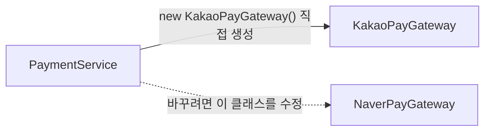
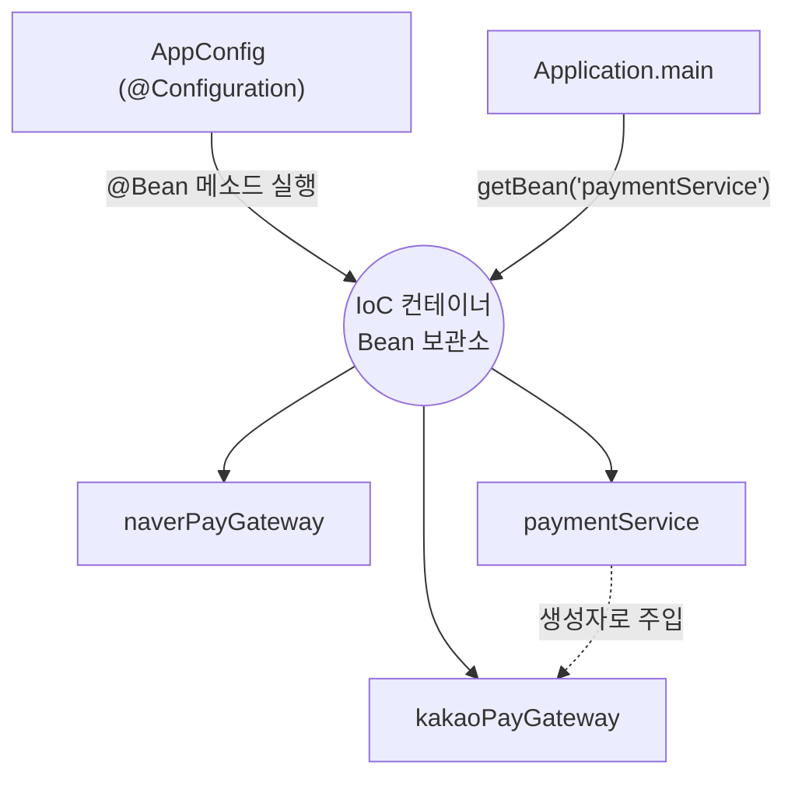
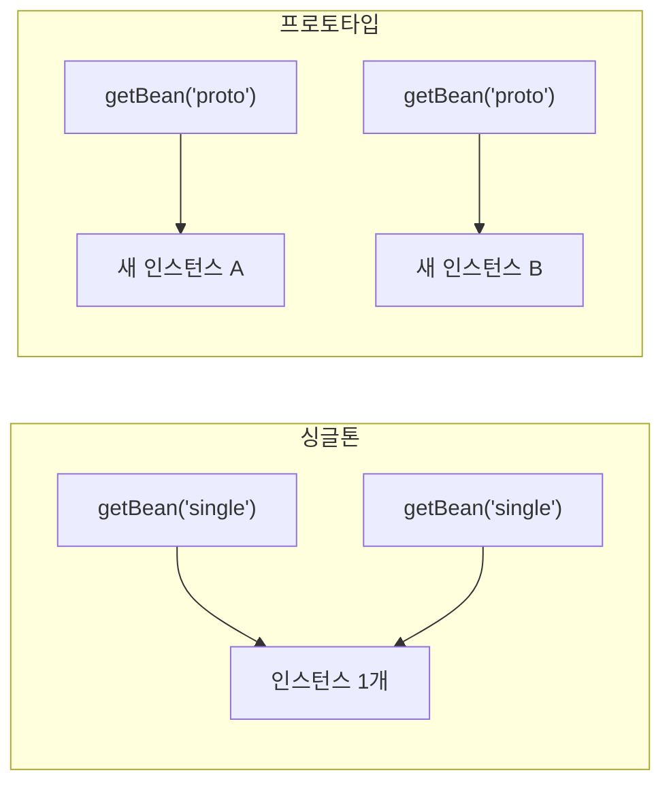

## 들어가며 (Situation)

`07_Spring-Core/chap01-loC-container`는 결제 시스템(카카오페이, 네이버페이)을 예제로 **"객체를 내가 `new`로 만들지 않고 스프링에게 맡긴다"** 는 것이 왜 필요한지 보여 준다. 세 단계로 구성되어 있다.

| 단계 | 패키지 | 주제 |
|---|---|---|
| 1 | `section01` | 스프링 없이 `new`로 직접 만들었을 때의 문제 |
| 2 | `section02` | 인터페이스 + IoC 컨테이너(`@Configuration`, `@Bean`)로 해결 |
| 3 | `section03` | Bean 스코프: 싱글톤 vs 프로토타입 |

사용한 의존성은 `build.gradle`의 `org.springframework:spring-context:7.0.8` 하나다. (Spring Framework 7은 최소 JDK 버전 요구가 있으므로 JDK 버전은 [공식 문서](https://docs.spring.io/spring-framework/reference/)에서 확인하자.)

먼저 비유로 감을 잡자.

| 상황 | 비유 |
|---|---|
| 내가 `new`로 직접 만든다 | **내가 직접 장을 보고 요리까지** 한다. 재료(결제 수단)가 바뀌면 요리법을 고친다 |
| IoC 컨테이너가 만들어 준다 | **식당 주방장**이 재료를 준비해 주고, 나는 "오늘은 이 재료로"만 정한다 |

## 문제 상황 (Task)

요구사항: *"네이버페이를 쓰던 시스템을 카카오페이로 바꾸자."* 코드는 몇 군데를 고쳐야 할까? 이상적인 답은 **한 곳**이다.

## 해결 과정 (Action)

### 1. section01: `new`로 직접 만들면 생기는 일

```java
public class PaymentService {

    private KakaoPayGateway kakaoPayGateway;          // ← 구체 클래스에 직접 의존

    public PaymentService() {
        this.kakaoPayGateway = new KakaoPayGateway(); // ← 내가 직접 new
    }

    public boolean processPay(String orderId, int amount) {
        boolean result = kakaoPayGateway.pay(orderId, amount);   // ← 메소드 이름도 구현체에 의존
        ...
    }
}
```

주석 처리된 줄(`naverPayGateway`)이 보인다. 결제 수단을 바꾸려고 **주석을 풀었다 닫았다** 한 흔적이다. 더 큰 문제는 두 구현체의 메소드 모양이 서로 다르다는 점이다.

| 구현체 | 메소드 시그니처 |
|---|---|
| `KakaoPayGateway` | `boolean pay(String orderId, int amount)` |
| `NaverPayGateway` | `boolean pay(String orderId, double amount)` |

수량의 타입이 `int`와 `double`로 다르다. 메소드 이름이나 매개변수가 다른 결제 수단이 하나 더 생기면 `PaymentService` 안의 호출 코드를 **전부** 고쳐야 한다.

수업 주석은 이를 SOLID의 **개방-폐쇄 원칙(OCP)** 위반으로 설명한다.

> 소프트웨어는 **확장에는 열려** 있고 **변경에는 닫혀** 있어야 한다.



### 2. section02: 인터페이스로 모양을 맞추고, 만드는 일은 컨테이너에게

**① 인터페이스로 "결제는 이렇게 부른다"를 통일한다.**

```java
public interface PaymentInterface {
    boolean processPay(String orderId, int amount);
}

public class KakaoPayGateway implements PaymentInterface { ... }
public class NaverPayGateway implements PaymentInterface { ... }
```

이제 메소드 이름·매개변수가 구현체와 상관없이 하나로 고정된다. 그러면 `PaymentService`는 구체 클래스를 몰라도 된다.

```java
public class PaymentService {

    private final PaymentInterface paymentInterface;     // 인터페이스에만 의존

    public PaymentService(PaymentInterface paymentInterface) {   // 밖에서 받는다
        this.paymentInterface = paymentInterface;
    }
    ...
}
```

`new KakaoPayGateway()`가 사라졌다. **누가 만들어서 넣어 주는가?** 그 일을 IoC 컨테이너가 한다.

**② 설정 클래스에 "어떤 객체를 만들지" 적는다.**

```java
@Configuration
public class AppConfig {

    @Bean
    public KakaoPayGateway kakaoPayGateway() { return new KakaoPayGateway(); }

    @Bean
    public NaverPayGateway naverPayGateway() { return new NaverPayGateway(); }

    @Bean
    public PaymentService paymentService() {
        return new PaymentService(kakaoPayGateway());   // ← 이 한 줄만 바꾸면 결제 수단 교체
    }
}
```

**③ 컨테이너를 만들고 꺼내 쓴다.**

```java
ApplicationContext context = new AnnotationConfigApplicationContext(AppConfig.class);
PaymentService paymentService = context.getBean("paymentService", PaymentService.class);
paymentService.processPay("order-001", 3);
```



용어를 표로 정리한다.

| 용어 | 뜻 |
|---|---|
| **Bean** | 스프링 컨테이너가 관리하는 객체 |
| **IoC (제어의 역전)** | 객체 생성·연결의 **제어권이 개발자 → 컨테이너**로 넘어간 것 |
| **IoC 컨테이너 = `ApplicationContext` = (넓게) Bean Factory** | Bean을 만들고 보관·제공하는 곳. 수업 주석은 셋을 같은 뜻으로 소개한다 |
| `@Configuration` | "이 클래스는 Bean 설정 클래스"라는 표시 |
| `@Bean` | 이 메소드의 **반환 객체를 Bean으로 등록**한다. Bean 이름의 기본값은 **메소드 이름** |
| `getBean(이름, 타입)` | 컨테이너에서 Bean 꺼내기 |

> 엄밀히는 `BeanFactory`가 기본 컨테이너 인터페이스이고, `ApplicationContext`는 그 위에 기능을 더한 하위 인터페이스다. 수업에서는 같은 의미로 쓰였지만 구분해서 알아 두면 좋다. ([Spring - BeanFactory or ApplicationContext?](https://docs.spring.io/spring-framework/reference/core/beans/introduction.html))

결과적으로 요구사항 변경은 이렇게 줄었다.

| | section01 | section02 |
|---|---|---|
| 결제 수단 교체 시 수정 위치 | `PaymentService` 안의 필드·생성자·호출부 | `AppConfig`의 `new PaymentService(...)` 인자 **한 곳** |
| `PaymentService`가 아는 것 | 구체 클래스 | 인터페이스뿐 |

#### `kakaoPayGateway()`를 부르는데 왜 매번 새로 안 만들어질까?

`paymentService()`는 `kakaoPayGateway()`라는 **자바 메소드를 그냥 호출**한다. 평범한 클래스라면 호출할 때마다 `new KakaoPayGateway()`가 실행된다. 하지만 `@Configuration` 클래스는 스프링이 프록시로 감싸서, `@Bean` 메소드 호출을 **컨테이너에 이미 있는 Bean 반환**으로 바꿔 준다. 그래서 같은 Bean 하나가 공유된다. (`@Configuration`의 동작에 대해서는 [공식 문서](https://docs.spring.io/spring-framework/reference/core/beans/java/configuration-annotation.html)를 참고했다. 이 글에서는 직접 실행해 확인하지는 않았다.)

### 3. section03: Bean은 몇 개 만들어질까 - 스코프

같은 `PaymentService`를 두 가지 스코프로 등록한다.

```java
@Bean("single")                 // 이름을 직접 지정 (기본값은 메소드명)
@Scope("singleton")             // 기본값이므로 생략해도 같다
public PaymentService paymentService() { return new PaymentService(kakaoPayGateway()); }

@Bean("proto")
@Scope("prototype")             // 꺼낼 때마다 새 인스턴스
public PaymentService paymentService2() { return new PaymentService(kakaoPayGateway()); }
```

`PaymentService`에는 일부러 **상태(필드)** 를 넣었다.

```java
private String orderId;          // 필드에 값을 저장

public boolean processPay(String orderId, int amount) {
    this.orderId = orderId;      // 요청이 올 때마다 필드에 기록
    ...
}
```

실행 코드는 두 번씩 `getBean`을 하고 `orderId`를 비교한다.

```java
PaymentService single  = context.getBean("single", PaymentService.class);
single.processPay("order-001", 3);
PaymentService single2 = context.getBean("single", PaymentService.class);
// single.getOrderId() 와 single2.getOrderId() 비교

PaymentService proto  = context.getBean("proto", PaymentService.class);
proto.processPay("order=002", 3);
PaymentService proto2 = context.getBean("proto", PaymentService.class);
// proto.getOrderId() 와 proto2.getOrderId() 비교
```

스코프 규칙에 따라 예상되는 결과는 다음과 같다. (코드의 의도와 스프링 명세에 따른 예상이며, 이 글을 쓰며 직접 실행한 출력은 아니다.)

| 꺼낸 객체 | 같은 인스턴스? | `getOrderId()` 예상 |
|---|---|---|
| `single`, `single2` | **같다** (싱글톤) | 둘 다 `order-001` |
| `proto` | 새 인스턴스 | `order=002` |
| `proto2` | `proto`와 **다른** 새 인스턴스 | `null` (한 번도 `processPay` 안 불렀으니까) |



| 비교 | singleton (기본) | prototype |
|---|---|---|
| 인스턴스 수 | 컨테이너당 1개 | 요청(`getBean`)마다 1개 |
| 메모리 | 효율적 | 많이 쓸 수 있음 |
| 상태(필드) 공유 | **모든 사용자가 공유** | 각자 따로 |
| 생성 시점 | 컨테이너 시작 시(기본) | 꺼낼 때 |
| 소멸 관리 | 컨테이너가 관리 | 만든 뒤에는 컨테이너가 관리하지 않음 |

#### 이 단계의 핵심 교훈: Bean에 상태를 두지 마라

수업 주석이 "가장 주의!!!"라고 강조한 부분이다.

> Bean이 상태(필드) 값을 가지면 모든 요청이 해당 필드 값을 공유하게 된다. 필드에는 행위 위주의 클래스(service, dao)만 두고, 데이터는 요청별로 DTO에 담아라.

웹 서비스에서 싱글톤 `PaymentService`를 여러 사용자가 동시에 쓴다고 해 보자. A가 `processPay("A주문")`을 호출해 `orderId`에 "A주문"을 넣고, 곧바로 B가 "B주문"으로 덮어쓰면, A 쪽에서 `getOrderId()`를 읽으면 "B주문"이 나올 수 있다. 서블릿 객체를 여러 요청이 공유한다는 이전 글의 이야기와 **똑같은 원리**다. ([웹 서버와 WAS, 프로세스와 스레드 글]({{ site.baseurl }}/2026/10/21/web-server-was-process-thread/) 참고)

## 결과 (Result)

| 질문 | 정리 |
|---|---|
| IoC란? | 객체 생성·연결의 제어권을 개발자가 아닌 컨테이너가 갖는 것 |
| 왜 인터페이스를 쓰나? | 구현체마다 다른 메소드 모양을 통일해 OCP를 지키기 위해 |
| Bean 등록 방법(여기서) | `@Configuration` 클래스 + `@Bean` 메소드 |
| Bean 이름 기본값 | `@Bean` 메소드 이름 (`@Bean("이름")`으로 지정 가능) |
| 스코프 기본값 | singleton. 필요하면 `@Scope("prototype")` |
| 가장 큰 주의점 | 싱글톤 Bean에 요청별 데이터를 필드로 저장하지 않는다 |

정량 지표(응답 시간 등)는 측정하지 않았다. 대신 구조의 변화로 정리한다. **결제 수단 교체 시 수정해야 하는 위치가 `PaymentService` 내부 여러 곳에서 `AppConfig` 한 줄로** 줄었다.

배운 점은 이렇다.

1. 좋은 구조는 "바꾸고 싶은 것"을 **한 곳**으로 몰아 준다. 인터페이스가 모양을 고정하고, 컨테이너가 연결을 맡는다.
2. `new`가 코드 곳곳에 퍼져 있다는 것은 **결합도가 높다**는 신호다.
3. 스프링의 기본 스코프가 싱글톤이라는 사실은 **"Bean은 무상태로 설계"** 라는 규칙으로 이어진다.

다음 글에서는 `AppConfig`에 Bean을 일일이 적는 방식의 한계(Bean이 100개라면?)와 그 해결책인 컴포넌트 스캔과 의존성 주입(DI)을 다룬다.

## 더 학습하면 좋은 개념

- **의존성 역전 원칙(DIP)과 SOLID** — "구체 클래스가 아니라 추상(인터페이스)에 의존하라". 이 글의 `PaymentInterface`가 바로 그 예이며, 설계 판단의 기준이 된다.
- **`BeanFactory` vs `ApplicationContext`** — 수업에서 같은 것으로 소개한 두 용어의 차이다. 이벤트·메시지 소스 등 `ApplicationContext`가 추가로 제공하는 기능을 알게 된다.
- **Bean 생명주기 (`@PostConstruct`, `@PreDestroy`)** — Bean이 만들어지고 사라질 때 코드를 실행하는 방법이다. 싱글톤과 프로토타입이 소멸 관리에서 왜 다른지 이해하게 된다.
- **웹 스코프 (request, session)** — 웹 요청마다/세션마다 Bean을 만드는 스코프다. "상태가 필요하면 어떻게 하나?"의 스프링식 해답 중 하나다.
- **`@Configuration`의 프록시 동작 (CGLIB)** — `kakaoPayGateway()`를 직접 호출해도 같은 Bean이 반환되는 원리다. 프록시는 다음 글의 AOP와도 연결된다.

## 참고 자료

- [Spring Framework 공식 문서 - IoC 컨테이너 소개](https://docs.spring.io/spring-framework/reference/core/beans/introduction.html)
- [Spring Framework 공식 문서 - Bean 스코프](https://docs.spring.io/spring-framework/reference/core/beans/factory-scopes.html)
- [Spring Framework 공식 문서 - `@Configuration`과 `@Bean`](https://docs.spring.io/spring-framework/reference/core/beans/java/configuration-annotation.html)
- [Spring Framework 공식 문서 - Java 기반 컨테이너 설정](https://docs.spring.io/spring-framework/reference/core/beans/java.html)
