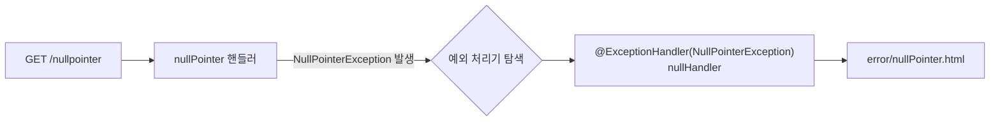
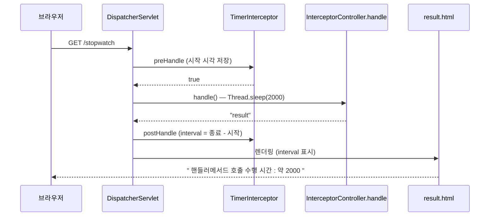
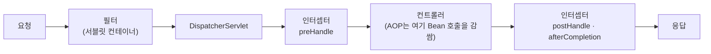

## 들어가며 (Situation)

서블릿 수업에서는 **에러 페이지**(`web.xml`의 `<error-page>`)와 **필터**(`LoginFilter`, `PerformanceFilter`)로 공통 처리를 했다. 스프링 MVC에서는 같은 목적에 이런 도구를 쓴다.

| 챕터 | 도구 | 서블릿 시절의 대응 |
|---|---|---|
| `chap04-exception-handler` | `@ExceptionHandler`, `@ControllerAdvice` | `<error-page>` + `ExceptionServlet` |
| `chap05-interceptor` | `HandlerInterceptor` + `WebMvcConfigurer` | `Filter` |

두 챕터의 공통점은 **컨트롤러 메소드마다 반복하던 코드를 컨트롤러 바깥으로 빼는 것**이다. AOP 때 본 횡단 관심사 분리와 같은 발상이다.

## 문제 상황 (Task)

1. 컨트롤러 메소드마다 `try/catch`를 쓰면 코드가 지저분해진다. 예외가 터졌을 때 **사용자에게 보여줄 화면**을 한곳에서 정하고 싶다.
2. 어떤 예외는 이 컨트롤러에서만, 어떤 예외는 **모든 컨트롤러에 공통**으로 처리하고 싶다.
3. 요청마다 **처리 시간 측정** 같은 작업을 컨트롤러 코드를 건드리지 않고 하고 싶다.

## 해결 과정 (Action)

### 1. chap04: `@ExceptionHandler` — 이 컨트롤러 안의 예외

```java
@Controller
public class ExceptionTestController {

    @GetMapping("nullpointer")
    public String nullPointer() {
        String str = null;
        System.out.println(str.toLowerCase(Locale.ROOT));   // NullPointerException 고의 발생
        return "/";
    }

    @ExceptionHandler(NullPointerException.class)           // 이 클래스에서 NPE가 나면 여기로
    public String nullHandler(Model model, NullPointerException e) {
        model.addAttribute("key", e.getMessage());
        return "error/nullPointer";                          // 에러 전용 화면
    }
}
```

`@ExceptionHandler(예외 클래스)`가 붙은 메소드는 **그 컨트롤러에서 해당 예외가 던져졌을 때 흐름을 가로채** 실행된다. 반환값은 일반 핸들러 메소드처럼 뷰 이름이다.



| 서블릿 시절 | 스프링 |
|---|---|
| `web.xml`에 에러 코드 → 처리 서블릿 연결 | 예외 **클래스** → 처리 메소드 연결 |
| `jakarta.servlet.error.message` 같은 속성을 꺼냄 | 예외 객체 `e`를 **매개변수로 직접** 받음 |

### 2. 한계: 다른 컨트롤러에서는 안 먹는다

```java
@Controller
public class GlobalTestController {
    @GetMapping("global-nullpointer")
    public String globalNull() {
        String str = null;
        System.out.println(str.toLowerCase(Locale.ROOT));    // 여기서도 NPE
        return "/";
    }
}
```

수업 주석: *"`ExceptionTestController`에서 작성해둔 NullPointer 예외 핸들러가 동작하지 않는다. 다른 클래스 내부에 있는 메소드는 알 수 없다."* `@ExceptionHandler`는 **선언된 컨트롤러 안에서만** 유효하다. 컨트롤러가 20개면 같은 핸들러를 20번 써야 할까? 그래서 전역 처리가 필요하다.

### 3. `@ControllerAdvice` — 모든 컨트롤러 공통

```java
@ControllerAdvice
public class GlobalExceptionHandler {

    @ExceptionHandler(NullPointerException.class)
    public String nullHandler(Model model, NullPointerException e) {
        System.out.println("전역 예외처리 핸들러 동작 !!");
        model.addAttribute("key", e.getMessage());
        return "error/nullPointer";
    }

    @ExceptionHandler(Exception.class)               // 나머지 모든 예외의 기본 처리
    public String defaultException(Model model, Exception e) {
        model.addAttribute("class", e.getClass());
        model.addAttribute("message", e.getMessage());
        return "error/default";
    }
}
```

주석의 "Advice"는 AOP에서 배운 그 단어다. **공통으로 적용되는 코드 묶음**이라는 뜻이다. `@ControllerAdvice`가 붙은 클래스는 모든 컨트롤러에 적용되는 공통 예외 처리기가 된다.

| 구분 | `@ExceptionHandler` (컨트롤러 안) | `@ControllerAdvice` + `@ExceptionHandler` |
|---|---|---|
| 적용 범위 | 선언한 컨트롤러 | **모든 컨트롤러** |
| 용도 | 이 컨트롤러만의 특수 처리 | 공통 에러 화면, 기본 처리 |
| 우선순위 | **높음** | 낮음 |

우선순위 규칙은 **같은 클래스 안의 핸들러 > 전역 핸들러**다. 그래서 `/nullpointer`는 컨트롤러 안의 `nullHandler`가, `/global-nullpointer`는 전역 `nullHandler`가 처리한다. 전역 쪽에서만 "전역 예외처리 핸들러 동작 !!"이 콘솔에 출력될 것으로 예상된다.

`Exception.class` 핸들러는 **그물망**이다. 구체적인 예외 핸들러가 없는 예외는 모두 여기로 온다. `/global-default`는 `new int[0]`의 `[1]`을 읽어 `ArrayIndexOutOfBoundsException`을 일으키고, `default.html`이 예외 클래스 이름과 메시지를 보여 준다.

```mermaid
flowchart TD
    E[예외 발생] --> A{같은 컨트롤러에<br/>맞는 @ExceptionHandler?}
    A -->|있음| L[로컬 핸들러]
    A -->|없음| B{@ControllerAdvice에<br/>구체적인 핸들러?}
    B -->|있음| G[전역 구체 핸들러]
    B -->|없음| D["전역 Exception 핸들러<br/>(기본 처리)"]
```

#### 에러 화면의 HTTP 상태 코드

핸들러 메소드가 **뷰 이름만 반환**하면 응답 상태는 보통 **200 OK**다. 사용자에게는 에러 화면이 보이지만 HTTP 레벨에서는 "성공"이다. 상태 코드를 에러로 내려야 하면 `@ResponseStatus`나 `HttpServletResponse`로 지정한다. 이 프로젝트에서는 설정하지 않았고, 브라우저 개발자 도구의 네트워크 탭에서 직접 확인해 볼 만하다.

#### 코드를 읽다 발견한 점

| 관찰 | 설명 |
|---|---|
| `MemberNotFoundException extends Throwable` | 보통 사용자 정의 예외는 `Exception`(또는 `RuntimeException`)을 상속한다. `Throwable`을 직접 상속하면 `throws`를 반드시 선언해야 하고, `Exception.class`를 처리하는 전역 기본 핸들러의 대상에서 **벗어난다.** 게다가 `Error`와 같은 계층이다. 이 글에서는 실행해 확인하지 않았으니 `/userexception` 동작을 직접 확인하고, 필요하면 `extends Exception`으로 바꿔 보자 |
| `index.html`의 `global-userexception` 버튼 | 대응하는 컨트롤러 메소드가 없다. 누르면 404가 날 것으로 보인다 |
| `MemberNotFoundException`의 생성자 매개변수명 `아프지_말자_우리` | 자바에서 허용되지만 관례에 맞게 `message`로 바꾸는 것이 좋다 |
| 핸들러가 `return "/"` | 예외가 터지므로 도달하지 않는 코드다. 앞 글에서 본 대로 뷰 이름 앞 `/`는 피하자 |
| NPE 메시지(`e.getMessage()`)를 화면에 그대로 노출 | 개발 중에는 편하지만 운영에서는 내부 정보 노출이다. 사용자 화면에는 안내 문구만, 상세는 로그에 남기는 것이 안전하다 |

### 4. chap05: `HandlerInterceptor` — 컨트롤러 앞뒤에 끼어들기

예외가 터졌을 때가 아니라 **모든 요청의 앞뒤**에 공통 작업을 하고 싶을 때 인터셉터를 쓴다.

```java
@Component
public class TimerInterceptor implements HandlerInterceptor {

    @Override                                           // ① 컨트롤러 도달 전
    public boolean preHandle(HttpServletRequest request, HttpServletResponse response, Object handler) {
        long startTime = System.currentTimeMillis();
        request.setAttribute("startTime", startTime);   // 요청에 시작 시각 보관
        return true;                                    // true: 계속 진행
    }

    @Override                                           // ② 컨트롤러 실행 후
    public void postHandle(HttpServletRequest request, HttpServletResponse response,
                           Object handler, @Nullable ModelAndView modelAndView) {
        long endTime = System.currentTimeMillis();
        long startTime = (long) request.getAttribute("startTime");
        modelAndView.addObject("interval", endTime - startTime);   // 뷰에 걸린 시간 전달
    }
}
```

| 메소드 | 호출 시점 | 용도 |
|---|---|---|
| `preHandle` | 컨트롤러 **전** | 인증 검사, 시작 시간 기록. `false`를 반환하면 컨트롤러로 안 간다 |
| `postHandle` | 컨트롤러 **후**, 뷰 렌더링 전 | Model에 공통 데이터 추가 |
| `afterCompletion` | 뷰 렌더링까지 **모두 끝난 후** | 자원 정리, 최종 로그 (예외가 나도 호출) |

`preHandle`의 `true`는 서블릿 필터의 `chain.doFilter(...)`에 해당하는 "통과" 신호다.

#### 등록: `WebMvcConfigurer`

```java
@Configuration
public class WebConfig implements WebMvcConfigurer {

    private final TimerInterceptor timerInterceptor;

    @Autowired
    public WebConfig(TimerInterceptor timerInterceptor) {       // 생성자 주입
        this.timerInterceptor = timerInterceptor;
    }

    @Override
    public void addInterceptors(InterceptorRegistry registry) {
        registry.addInterceptor(timerInterceptor)
                .addPathPatterns("/*")                           // 적용할 경로
                .excludePathPatterns("/css/**")                  // 정적 리소스는 제외
                .excludePathPatterns("/images/**")
                .excludePathPatterns("/js/**")
                .excludePathPatterns("/video/**");
    }
}
```

`WebMvcConfigurer`는 스프링 MVC의 **기본 설정은 유지하면서 일부만 커스터마이징**할 때 구현하는 인터페이스다. 인터셉터 추가 외에 CORS, 정적 리소스 처리(다음 글의 `addResourceHandlers`)도 여기서 한다.

경로 패턴 표기를 구분해서 알아 두자.

| 패턴 | 의미 |
|---|---|
| `/*` | **한 단계** 경로만. `/stopwatch`는 일치, `/a/b`는 불일치 |
| `/**` | 하위 **모든** 경로 포함 |

`/*`로 등록했으므로 `/stopwatch`에는 적용된다. 하지만 `/lecture/x` 같은 2단계 이상 경로에는 적용되지 않는다. 모든 요청에 적용하려면 `/**`를 써야 한다. 이 프로젝트는 `/stopwatch` 하나뿐이라 동작에는 문제가 없지만, 제외 경로를 `/css/**`로 쓰면서 포함은 `/*`로 쓴 것은 짝이 맞지 않는다.

#### 실행 흐름



핸들러에서 `Thread.sleep(2000)`을 하므로 표시되는 `interval`은 **2000ms를 조금 넘는 값**이 될 것으로 예상된다. (직접 실행한 값은 아니다.) `postHandle`은 뷰 렌더링 **전**에 호출되므로 이 값에는 렌더링 시간이 포함되지 않는다. 전체 시간을 재려면 `afterCompletion`에서 계산해야 한다.

#### 코드를 읽다 발견한 점

| 관찰 | 설명 |
|---|---|
| `postHandle`의 `modelAndView`가 `@Nullable`인데 `null` 검사 없이 `addObject` | `@ResponseBody`나 `void` 응답 등으로 `ModelAndView`가 `null`이면 `NullPointerException`이 난다. `if (modelAndView != null)`을 먼저 확인해야 한다 |
| `addPathPatterns("/*")` | 위에서 본 대로 1단계 경로만 매칭된다 |
| `@Component`로 등록 후 생성자 주입 | 스프링 Bean으로 만든 인터셉터를 주입받아 쓰는 올바른 방식이다 |

### 5. 필터 vs 인터셉터 vs AOP

같은 "공통 처리"지만 일하는 위치가 다르다.



| 비교 | 필터(Filter) | 인터셉터(Interceptor) | AOP |
|---|---|---|---|
| 속한 곳 | 서블릿 컨테이너(스프링 이전) | 스프링 MVC | 스프링 Bean 호출 |
| 동작 시점 | DispatcherServlet **앞** | 컨트롤러 **앞뒤** | **메소드** 앞뒤 |
| 알 수 있는 정보 | 요청/응답 | 요청/응답 + **어떤 핸들러인지**(`handler`) | 메소드·인자·반환값 |
| 적합한 일 | 인코딩, 보안 필터 | 로그인 체크, 요청 시간 측정 | 트랜잭션, 서비스 로깅 |

([서블릿 필터 글]({{ site.baseurl }}/2026/10/23/servlet-cookie-session-filter/), [AOP 글]({{ site.baseurl }}/2026/11/02/spring-aop-logging-performance/)과 비교하며 읽으면 이해가 쉽다.)

## 결과 (Result)

| 질문 | 정리 |
|---|---|
| 컨트롤러 안 예외 처리 | `@ExceptionHandler(예외.class)` 메소드 |
| 전체 컨트롤러 공통 예외 처리 | `@ControllerAdvice` 클래스 안의 `@ExceptionHandler` |
| 어느 핸들러가 먼저? | 같은 컨트롤러 안 > 전역 |
| 모든 예외의 기본 처리 | 전역에 `Exception.class` 핸들러 |
| 컨트롤러 앞뒤 공통 작업 | `HandlerInterceptor` + `WebMvcConfigurer.addInterceptors` |
| 인터셉터 경로 주의 | `/*`는 1단계, 전체는 `/**` |

정량 지표는 측정하지 않았다. 구조 면에서는 컨트롤러 메소드마다 필요했던 `try/catch`와 시간 측정 코드가 **핸들러 클래스·인터셉터 클래스 각 1곳**으로 모였다.

배운 점은 이렇다.

1. 예외 처리도 AOP처럼 **"공통은 바깥으로"** 가 원칙이다. 구체적 예외 → 전역 구체 → 전역 `Exception` 순으로 좁은 것을 먼저 잡는다.
2. 사용자 정의 예외는 `Exception`/`RuntimeException` 계열로 만든다. `Throwable` 직접 상속은 피한다.
3. 인터셉터를 쓸 때는 `ModelAndView`가 `null`일 수 있음, 경로 패턴(`/*` vs `/**`)을 반드시 점검한다.

## 더 학습하면 좋은 개념

- **`@RestControllerAdvice`와 에러 응답 표준화** — 화면이 아니라 JSON 에러 응답을 전역으로 처리한다. REST API 개발에서 필수다.
- **`@ResponseStatus`와 `ResponseStatusException`** — 예외에 HTTP 상태 코드를 연결하는 방법이다. 에러 화면이 200으로 내려가는 문제를 해결한다.
- **인터셉터 `afterCompletion`과 인증/인가 처리** — 로그인 검사를 인터셉터로 구현하는 대표 사례다. 이후 Spring Security와 비교하면 책임 구분이 선명해진다.
- **Filter와 Interceptor의 실행 순서, `OncePerRequestFilter`** — 둘의 동작 순서와 필터를 스프링 Bean으로 등록하는 방법이다.
- **로깅 프레임워크(SLF4J)와 MDC** — 요청별 추적 ID를 로그에 남기는 방식이다. 인터셉터 `preHandle`에서 설정하는 대표적 사용처다.

## 참고 자료

- [Spring Framework 공식 문서 - Exceptions (`@ExceptionHandler`)](https://docs.spring.io/spring-framework/reference/web/webmvc/mvc-controller/ann-exceptionhandler.html)
- [Spring Framework 공식 문서 - Controller Advice](https://docs.spring.io/spring-framework/reference/web/webmvc/mvc-controller/ann-advice.html)
- [Spring Framework 공식 문서 - Interception (`HandlerInterceptor`)](https://docs.spring.io/spring-framework/reference/web/webmvc/mvc-servlet/handlermapping-interceptor.html)
- [Spring Framework 공식 문서 - MVC Config](https://docs.spring.io/spring-framework/reference/web/webmvc/mvc-config.html)
- [Jakarta Servlet API - Filter](https://jakarta.ee/specifications/servlet/6.1/apidocs/jakarta.servlet/jakarta/servlet/filter)
