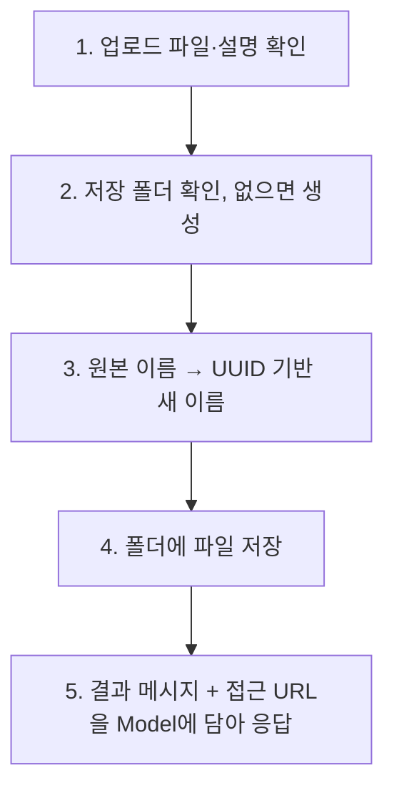
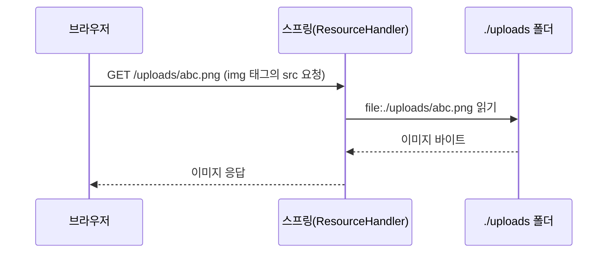

## 들어가며 (Situation)

`chap06-file-upload`는 폼으로 올린 **이미지 파일을 서버 폴더에 저장하고, 저장한 이미지를 다시 화면에 보여주는** 기능을 만든다. 파일 하나(`single-file`)와 여러 개(`multi-file`) 두 가지다.

식당 비유로는 **택배 접수**와 같다.

| 택배 | 파일 업로드 |
|---|---|
| 상자(물건 + 송장)를 접수대에 올린다 | 브라우저가 파일 + 설명을 한 요청으로 보낸다 |
| 접수대가 중복 없는 **송장 번호**를 붙인다 | 서버가 원본 이름 대신 **UUID 이름**을 붙인다 |
| 창고 선반에 보관한다 | `./uploads` 폴더에 저장한다 |
| 고객이 조회 번호로 물건을 본다 | `/uploads/xxx.png` URL로 이미지를 본다 |

수업 `main.html`의 안내 문구도 중요하다.

> 이 챕터의 파일 처리는 추후에는 권장하지 않는 방식이다. 다만 현재 기술 스택에서는 최선이니 이 부분만 알고 넘어가자.

서버 로컬 디스크에 저장하는 방식은 학습용이고, 실무에서는 클라우드 스토리지 등을 쓰는 경우가 많다. 이 글 끝에서 이유를 정리한다.

## 문제 상황 (Task)

1. 브라우저는 파일을 어떤 형태로 보내고, 스프링은 그것을 **어떤 객체**로 받는가?
2. 사용자가 `스크린샷.png`를 올렸다. **같은 이름의 파일이 이미 있으면** 덮어쓰이지 않는가?
3. 저장한 파일을 ``로 보여주려면 URL을 **어떻게 폴더와 연결**하는가?
4. 여러 파일 중 하나만 저장에 실패하면 **나머지는 어떻게** 할 것인가?

## 해결 과정 (Action)

### 1. 파일을 보내려면 폼부터 달라진다

```html
<form action="single-file" method="post" enctype="multipart/form-data">
    파일 : <input type="file" name="singleFile"> <br>
    파일 설명 : <input type="text" name="description"><br>
    <input type="submit">
</form>
```

| 속성 | 의미 |
|---|---|
| `method="post"` | 파일은 크기가 크므로 POST (Body에 담는다) |
| `enctype="multipart/form-data"` | 요청 본문을 **여러 부분(part)으로 나눠** 텍스트와 파일을 함께 싣는 형식 |
| `type="file"` | 파일 선택 입력칸 |
| `multiple` (다중 업로드) | 파일을 여러 개 선택 가능 |

수업 주석: *"encoding을 맞춰주어야 spring에서도 알맞은 타입으로 전달 받을 수 있다."* `enctype`을 생략하면 파일 내용이 아니라 **파일 이름 문자열만** 전송되어 서버가 파일을 받지 못한다. ([MDN - enctype](https://developer.mozilla.org/en-US/docs/Web/HTML/Reference/Elements/form#enctype))

### 2. 업로드 크기 제한 설정

```yaml
spring:
  servlet:
    multipart:
      max-file-size: 200MB         # 파일 1개 최대
      max-request-size: 1000MB     # 한 요청의 합계 최대

file:
  upload-dir: ./uploads            # 직접 정의한 설정: 저장 폴더
```

`spring.servlet.multipart.*`는 스프링 부트가 정한 설정 이름이다. 이 한도를 넘으면 업로드가 거부된다. 반면 `file.upload-dir`는 **우리가 이름을 정한** 값이다. 이 값은 코드에서 `@Value`로 읽는다.

```java
@Value("${file.upload-dir}")
private String uploadDir;           // "./uploads"
```

경로를 코드에 박아 넣지 않고 설정 파일에 두면, 배포 환경마다 저장 위치를 **코드 수정 없이** 바꿀 수 있다.

### 3. 파일 받기: `MultipartFile`

```java
@PostMapping("single-file")
public ModelAndView single(@RequestParam MultipartFile singleFile,
                           @RequestParam String description,
                           ModelAndView mv) { ... }
```

`@RequestParam MultipartFile singleFile`은 폼의 `name="singleFile"` 파일 부분을 받는다. 이름 규칙은 일반 `@RequestParam`과 같다.

| `MultipartFile` 메소드 | 의미 |
|---|---|
| `getOriginalFilename()` | 사용자가 올린 **원본 파일 이름** |
| `transferTo(File)` | 업로드된 내용을 지정한 파일로 저장 |
| (그 밖) `getSize()`, `getContentType()`, `isEmpty()` | 크기, 파일 형식, 비어 있는지 |

### 4. 저장 5단계 (`save`)

수업 주석이 정리한 순서를 코드와 함께 본다.



```java
private String save(MultipartFile file) throws IOException {

    String originName = file.getOriginalFilename();                         // test.png
    String ext = originName.substring(originName.lastIndexOf(".")).toLowerCase();   // .png (소문자)

    String savedName = UUID.randomUUID().toString() + ext;                  // 382311...-...png

    File dir = new File(uploadDir).getAbsoluteFile();
    dir.mkdirs();                                                           // 폴더 없으면 생성

    file.transferTo(new File(dir, savedName));                              // 저장
    return savedName;
}
```

#### 왜 UUID로 이름을 바꿀까?

| 문제 | 원본 이름을 그대로 쓰면 | UUID 이름 |
|---|---|---|
| 같은 이름 | `스크린샷.png`가 **덮어써진다** | 사실상 겹치지 않음 |
| 한글·공백·특수문자 | 파일 시스템·URL에서 문제 가능 | 영문·숫자·하이픈만 |
| 경로 조작 (`../../x`) | 위험 | 서버가 만든 이름이라 안전 |

확장자는 `lastIndexOf(".")`로 분리해 **소문자**로 통일한다(`.PNG` → `.png`). 이 프로젝트의 `uploads/` 폴더에는 실제로 `25403099-3266-...png` 같은 UUID 이름의 파일들이 저장되어 있다.

### 5. 저장한 파일을 화면에 보여주기: 정적 리소스 핸들러

파일을 `./uploads`에 저장했다고 해서 브라우저가 `http://.../uploads/abc.png`로 접근할 수 있는 것은 아니다. 스프링은 기본적으로 `static/` 폴더 같은 **정해진 곳**만 URL로 열어 준다. 그래서 `WebConfig`가 URL과 폴더를 직접 연결한다.

```java
@Configuration
public class WebConfig implements WebMvcConfigurer {

    @Value("${file.upload-dir}")
    private String uploadDir;

    @Override
    public void addResourceHandlers(ResourceHandlerRegistry registry) {
        registry.addResourceHandler("/uploads/**")                       // 이 URL 요청이 오면
                .addResourceLocations("file:" + uploadDir + "/");        // 이 폴더에서 찾아라
    }
}
```



수업 주석의 표현처럼 ``는 브라우저가 "**이미지 내놔**"라고 서버에 별도 요청을 보내는 것이다. 이 요청을 폴더에 연결해 두어야 이미지가 보인다. `file:`은 클래스패스가 아니라 **실제 파일 시스템 경로**라는 뜻이다. (`./uploads`는 앱을 실행한 **작업 디렉터리 기준**의 상대 경로다. IDE와 터미널에서 실행 위치가 다르면 저장 위치가 달라질 수 있다.)

결과 화면은 Model에 담긴 URL 목록을 `th:each`로 반복하며 이미지를 출력한다.

```html
<h3 th:text="${message}"></h3>
<div th:each="file : ${files}">
    
</div>
```

`th:each`는 자바의 향상된 for문과 같다. (자세한 문법은 다음 글에서 다룬다.) 단일 업로드는 `files`에 **문자열 하나**를, 다중 업로드는 **리스트**를 담는데, `th:each`는 단일 값도 요소 1개짜리 목록처럼 반복하므로 같은 `result.html`을 재사용한다.

### 6. 다중 업로드와 "롤백"

```java
@PostMapping("multi-file")
public ModelAndView multiFileUpload(@RequestParam("multiFile") List<MultipartFile> multipartFile,
                                    String description, ModelAndView mv) {

    List<FileDTO> files = new ArrayList<>();       // 저장 성공한 파일 기록
    List<String> savedFiles = new ArrayList<>();   // 화면용 URL

    try {
        for (MultipartFile file : multipartFile) {
            String savedName = save(file);
            files.add(new FileDTO(file.getOriginalFilename(), savedName, uploadDir, description));
            savedFiles.add("/uploads/" + savedName);
        }
        mv.addObject("message", "멀티 파일 업로드 성공!");
        mv.addObject("files", savedFiles);
    } catch (Exception e) {
        // 이미 저장된 파일을 삭제 (롤백 흉내)
        for (FileDTO file : files) {
            new File(new File(uploadDir).getAbsoluteFile(), file.getSavedName()).delete();
        }
        mv.addObject("message", "멀티 파일 업로드 실패!");
    }
    ...
}
```

주석의 질문 "5개 중 4개는 저장되고 1개만 실패하면?"에 대한 답이 **트랜잭션 롤백과 같은 원리**다. 중간에 하나라도 실패하면 **이미 저장된 파일을 지워서** "전부 성공 또는 전부 실패"를 맞춘다. 파일은 DB 트랜잭션 대상이 아니라 `@Transactional`로 되돌릴 수 없으므로 직접 삭제 코드가 필요하다. 이를 위해 성공한 파일 정보를 `FileDTO` 리스트에 모아 둔다.


`String description`은 `@RequestParam`을 생략했는데, 단순 타입 매개변수는 생략해도 요청 파라미터로 받는다.

### 7. 코드를 읽다 발견한 점

실행해 보면 좋을 부분을 코드에서 찾았다. 아래는 코드를 읽고 추론한 것이다.

| # | 관찰 | 왜 문제인가 / 개선 |
|---|---|---|
| 1 | 확장자 추출이 `originName.substring(originName.lastIndexOf("."))` | 파일 이름에 `.`이 없으면 `lastIndexOf`가 `-1`이라 `StringIndexOutOfBoundsException`이 난다. 파일을 선택하지 않고 전송해도 원본 이름이 빈 문자열이라 같은 문제가 생길 수 있다. 저장 전에 `isEmpty()`와 확장자 존재 여부를 검사해야 한다 |
| 2 | `single()`은 `IOException`만 `catch` | 위 예외는 잡히지 않아 500 오류 화면이 뜰 수 있다. (`multi`는 `catch (Exception e)`라 실패 메시지로 처리된다) |
| 3 | **확장자·형식 검증이 없다** | 이미지 업로드라고 해도 `.html`, `.svg`, `.jsp` 같은 파일이 올라가 `/uploads/...`로 열리면 악성 스크립트가 실행되는 **저장형 XSS** 위험이 있다. 허용 확장자를 화이트리스트로 제한하고 `getContentType()`도 확인한다 |
| 4 | `catch (Exception e)`에서 예외를 **출력하지 않음** | 실패 원인을 알 수 없다. 최소한 로그를 남겨야 한다 |
| 5 | `single-file`은 `files`에 문자열 하나를 담고, 화면은 `th:each` | Thymeleaf 문서에 따르면 컬렉션이 아닌 단일 객체는 **요소 1개짜리 목록**처럼 반복되므로 같은 `result.html`을 재사용할 수 있다. 다만 의도가 드러나도록 리스트 하나에 담는 편이 읽기 쉽다 |
| 6 | `FileDTO.filePath`에 `uploadDir`(설정값)를 그대로 저장 | 상대 경로(`./uploads`)라 실제 위치를 알기 어렵다 |

## 결과 (Result)

| 질문 | 정리 |
|---|---|
| 파일 전송 폼 | `method="post"` + `enctype="multipart/form-data"` |
| 서버에서 받는 타입 | `MultipartFile` (`@RequestParam`, 다중은 `List<MultipartFile>`) |
| 크기 제한 | `spring.servlet.multipart.max-file-size`, `max-request-size` |
| 저장 경로 관리 | 설정 파일(`file.upload-dir`) + `@Value` |
| 저장 이름 | UUID + 소문자 확장자 (중복·한글·경로 조작 방지) |
| 이미지 URL 연결 | `WebMvcConfigurer.addResourceHandlers` (`/uploads/**` → `file:./uploads/`) |
| 일부 실패 시 | 저장된 파일 삭제로 롤백 흉내 |

정량 지표는 측정하지 않았다. `uploads/` 폴더에는 UUID 이름의 PNG 8개가 남아 있고, 이는 여러 번 시험 업로드가 성공했음을 보여 주지만 속도나 용량 같은 수치는 측정하지 않았다.

배운 점은 이렇다.

1. 파일 업로드는 **폼 형식(multipart) → 받는 타입(MultipartFile) → 저장 → URL 연결**의 4단계다. 하나라도 빠지면 이미지가 안 보인다.
2. 사용자가 준 파일 **이름과 형식은 믿지 않는다.** 이름은 서버가 정하고, 형식은 검증한다.
3. 여러 작업이 "전부 성공 또는 전부 실패"여야 할 때는 직접 **보상(삭제)** 로직이 필요하다. 트랜잭션이 자동으로 해 주지 않는 영역이다.

## 더 학습하면 좋은 개념

- **파일 업로드 보안 (확장자 화이트리스트, Content-Type, 크기, 바이러스 검사)** — 이 글의 3번 관찰이 가리키는 가장 중요한 주제다.
- **클라우드 객체 스토리지 (AWS S3 등)와 Presigned URL** — 서버 디스크 저장이 권장되지 않는 이유(서버 여러 대, 재배포 시 유실, 용량)를 해결하는 방식이다.
- **`MultipartResolver`와 업로드 내부 동작** — 스프링이 multipart 요청을 어떻게 `MultipartFile`로 변환하는지 이해한다.
- **파일 다운로드 (`ResponseEntity<Resource>`, `Content-Disposition`)** — 업로드의 반대 방향이며 정적 리소스 노출과의 차이를 배운다.
- **`@Transactional`과 보상 트랜잭션** — DB는 롤백되지만 파일은 안 되는 문제를 설계 수준에서 다루는 방법이다.

## 참고 자료

- [Spring Framework 공식 문서 - Multipart Resolver](https://docs.spring.io/spring-framework/reference/web/webmvc/mvc-servlet/multipart.html)
- [Spring Framework 공식 문서 - `MultipartFile` 인자](https://docs.spring.io/spring-framework/reference/web/webmvc/mvc-controller/ann-methods/multipart-forms.html)
- [Spring Framework 공식 문서 - 정적 리소스](https://docs.spring.io/spring-framework/reference/web/webmvc/mvc-config/static-resources.html)
- [Spring Boot 공식 문서 - Multipart 설정 (`spring.servlet.multipart`)](https://docs.spring.io/spring-boot/reference/web/servlet.html)
- [MDN - `<input type="file">`](https://developer.mozilla.org/en-US/docs/Web/HTML/Reference/Elements/input/file)
- [OWASP - Unrestricted File Upload](https://owasp.org/www-community/vulnerabilities/Unrestricted_File_Upload)
