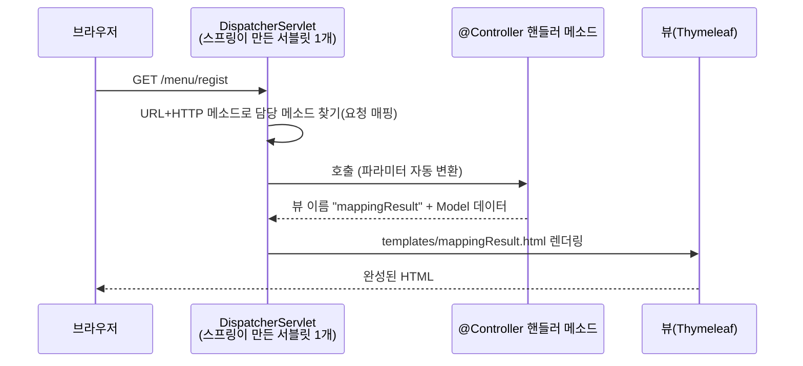
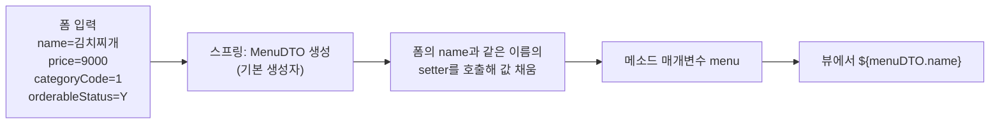

## 들어가며 (Situation)

서블릿 수업에서는 URL마다 `HttpServlet`을 상속한 클래스를 만들고 `req.getParameter("name")`으로 값을 꺼냈다. `08_Spring-Web-MVC`는 같은 일을 **스프링 MVC**로 다시 한다. 이 글은 그중 앞의 두 챕터를 다룬다.

| 챕터 | 주제 | 한 줄 요약 |
|---|---|---|
| `chap01-request--mapping` | 요청 매핑 | "이 URL, 이 방식(GET/POST)은 **이 메소드**가 처리한다" |
| `chap02-handler-method` | 핸들러 메소드의 파라미터 | 요청 값을 **서블릿보다 쉽게** 꺼내는 방법 |

프로젝트 설정은 챕터 전체가 같다. (`build.gradle` 기준)

| 항목 | 내용 |
|---|---|
| 프레임워크 | Spring Boot `4.1.2` (`spring-boot-starter-webmvc`, `spring-boot-starter-thymeleaf`) |
| Java | toolchain 21 |
| 서버 | **내장 Tomcat** (별도 설치·`.war` 배포 없이 `main()` 실행) |
| 화면 | `resources/templates/*.html` (Thymeleaf) |

식당 비유로 이어 보자. 서블릿 때는 **주문서를 내가 직접 읽고** 요리했다면, 스프링은 **홀 매니저(DispatcherServlet)** 가 주문서를 읽어서 "이 주문은 3번 요리사에게"라고 배정하고 재료 손질(타입 변환)까지 해 준다.

## 문제 상황 (Task)

1. 서블릿은 URL 하나에 클래스 하나였다. 메뉴 등록·수정·삭제처럼 **관련 요청을 한 클래스에 모으고** 싶다.
2. `Integer.parseInt(req.getParameter("age"))`처럼 **꺼내고 변환하는 반복 코드**를 줄이고 싶다.
3. 입력칸이 4개, 10개로 늘어나면 변수도 4개, 10개가 되는데 이걸 **객체 하나로** 받을 수 없을까?

## 해결 과정 (Action)

### 1. 스프링 MVC 요청 흐름 먼저 잡기



`MethodController`의 주석이 핵심을 짚는다. **서블릿은 사라진 게 아니다.** 스프링이 `DispatcherServlet`이라는 서블릿 하나를 두고, 요청을 받는 즉시 `@Controller` 클래스의 메소드로 위임한다. 우리가 서블릿을 만들던 부분이 "메소드 하나"로 줄어든 것이다.

### 2. chap01: 요청 매핑

#### 2-1. 메소드에 매핑하기

```java
@Controller
public class MethodController {

    @RequestMapping("/menu/regist")                                   // 방식 구분 없이 /menu/regist 전부
    public String RegistMenu(Model model) { ... }

    @RequestMapping(value = "/menu/regist", method = RequestMethod.POST)   // POST만
    public String postRegistMenu(Model model) { ... }

    @GetMapping("/menu/modify")                                        // GET만
    public String getModifyMenu(Model model) { ... }

    @PostMapping("/menu/modify")                                       // POST만
    public String postModifyMenu(Model model) { ... }
}
```

| 어노테이션 | 의미 |
|---|---|
| `@RequestMapping("/경로")` | HTTP 메소드와 관계없이 매핑 (서블릿의 `service()`와 비슷) |
| `@RequestMapping(value, method = ...)` | 특정 메소드만 |
| `@GetMapping` / `@PostMapping` | 위 줄임 표현. 보통 이쪽을 쓴다 |

같은 URL이라도 **방식에 따라 다른 메소드**가 호출된다. 서블릿 때 `doGet`/`doPost`로 나누던 일을 URL마다 메소드 단위로 더 잘게 나눈 셈이다.

> 한 가지 눈여겨볼 점. `/menu/regist`를 `@RequestMapping`(방식 무제한)과 `@RequestMapping(method = POST)` 두 개로 매핑했다. 둘 다 조건에 맞는 POST 요청은 **더 구체적인 쪽**(POST 전용)이 선택되는 것이 스프링의 매핑 규칙이다. 이 글에서는 직접 실행해 확인하지는 않았으니 `index.html`의 POST 버튼으로 어느 메시지가 나오는지 확인해 보자.

#### 2-2. 클래스에 공통 경로 매핑하기

```java
@Controller
@RequestMapping("/order/*")
public class ClassController {

    @GetMapping("/regist")                              // → /order/regist
    public String registOrder(Model model) { ... }

    @GetMapping("/detail/{orderNo}")                    // → /order/detail/3
    public String pathVariable(Model model, @PathVariable("orderNo") int no) {
        model.addAttribute("message", no + "번 주문 상세 조회");
        return "mappingResult";
    }
}
```

클래스에 붙인 경로가 **앞부분(접두사)** 이 되고, 메소드 경로가 뒤에 이어진다. 공통 경로를 클래스에 한 번만 쓰면 되니 중복이 줄어든다.

#### 2-3. `@PathVariable` — 주소의 일부가 값

`/order/detail/3`의 `3`은 `?no=3` 같은 쿼리스트링이 아니라 **주소 자체에 들어간 값**이다. 중괄호 `{orderNo}`가 자리표시자고, `@PathVariable`이 그 값을 꺼낸다. 타입이 `int`이면 `"3"` → `3` 변환도 스프링이 해 준다. (서블릿에서는 `Integer.parseInt`를 직접 썼다.)

| 방식 | 예시 | 어울리는 곳 |
|---|---|---|
| 쿼리스트링 (`@RequestParam`) | `/order/detail?no=3` | 검색 조건, 필터 |
| 경로 변수 (`@PathVariable`) | `/order/detail/3` | **특정 자원 하나를 가리킬 때** |

#### 2-4. 뷰 이름을 return하면 화면이 열린다

```java
model.addAttribute("message", "GET 방식의 주문 등록 핸들러 메서드 동작");
return "mappingResult";        // → templates/mappingResult.html
```

- `Model`: 서버에서 만든 값을 뷰로 보내는 **쪽지 상자**. `req.setAttribute`와 같은 역할이다. (수업 주석: "Request 객체", key-value 형태)
- `String` 반환값: 접두사 `templates/`와 접미사 `.html`이 자동으로 붙는다. 주석의 `servlet -> forward(req, res)`가 이 뜻이다. 내부적으로 forward처럼 동작한다.
- 뷰 쪽에서는 `<h3 th:text="${message}">`로 꺼낸다. (`th:`는 Thymeleaf 문법이며 마지막 글에서 다룬다.)

#### 2-5. 코드를 읽다 발견한 점

| 관찰 | 설명 |
|---|---|
| `index.html`에 `/order/modify`, `/order/delete`, POST `/order/regist` 버튼이 있지만 컨트롤러에는 해당 핸들러가 **없다** | 매핑이 없는 경로는 404, 경로는 있는데 방식이 맞지 않으면(예: GET만 있는 곳에 POST) 405가 날 것으로 예상된다. 구현하지 않은 버튼은 의도적으로 실패를 확인하는 용도로 보인다 |
| `getModifyMenu`, `postModifyMenu`의 메시지가 "메뉴 **등록**" | 등록 메소드를 복사하면서 문구를 못 바꾼 것으로 보인다. 어느 메소드가 호출됐는지 헷갈리므로 "수정"으로 바꾸는 게 좋다 |
| `Test` 클래스에 `@Component`만 붙어 있음 | 빈 Bean이다. 컴포넌트 스캔 실습의 흔적으로 보인다 |
| 메소드 이름 `RegistMenu` | 자바 관례상 메소드는 소문자로 시작한다 (`registMenu`) |

### 3. chap02: 핸들러 메소드의 파라미터 받기

`RequestController`는 **같은 "값 받기"를 세 가지 방법**으로 구현해 비교한다.

```java
@Controller
@RequestMapping("/request/*")
public class RequestController { ... }
```

#### 3-1. 뷰를 반환하는 두 가지 방법 (`void`)

```java
@GetMapping("regist")
public void regist() {}          // 반환 타입 void
```

반환 타입이 `void`이면 **요청 경로가 곧 뷰 경로**가 된다. `/request/regist` 요청 → `templates/request/regist.html`. 폼 화면을 열어 주기만 하는 메소드에 편하다. (`String`을 반환하면 그 문자열이 뷰 경로가 된다.)

#### 3-2. 방법 ① `WebRequest` — 서블릿 방식과 거의 같다

```java
@PostMapping("regist")
public String registMenu(Model model, WebRequest request) {
    String menuName = request.getParameter("name");
    int menuPrice = Integer.parseInt(request.getParameter("price"));
    int categoryCode = Integer.parseInt(request.getParameter("categoryCode"));
    ...
}
```

`WebRequest`는 서블릿의 `HttpServletRequest`를 서블릿 API에 직접 의존하지 않게 감싼 객체다. 쓰는 모양은 서블릿과 같아서 **꺼내기 + 형변환을 직접** 해야 한다. 폼에서 `price`를 비우고 전송하면 `NumberFormatException`이 날 것으로 예상된다. (서블릿 글에서 본 것과 같은 함정이다.)

#### 3-3. 방법 ② `@RequestParam` — 꺼내기와 형변환을 스프링이

```java
@PostMapping("modify")
public String modifyMenu(Model model,
                         @RequestParam("modifyName") String name,
                         @RequestParam int modifyPrice) {
    ...
}
```

| 부분 | 설명 |
|---|---|
| `@RequestParam("modifyName") String name` | 파라미터 `modifyName`을 **변수 `name`** 에 넣는다. 이름이 다를 때는 괄호에 지정 |
| `@RequestParam int modifyPrice` | 이름 생략 → **변수명 `modifyPrice` = 폼의 `name` 속성**이어야 한다. 타입이 `int`라 변환도 자동 |

수업 주석의 경고가 중요하다.

> View 쪽 input의 `name` 속성과 변수명을 일치시키지 않으면 **400 Bad Request**가 발생한다.

`@RequestParam`은 기본적으로 **필수(required=true)** 이기 때문이다. 값이 없거나 숫자 변환이 안 되면 400이 난다. `required = false`나 `defaultValue`로 완화할 수 있다. (변수명으로 이름을 추측하는 기능은 컴파일 시 `-parameters` 옵션이 필요하며, 스프링 부트 Gradle 플러그인이 이 설정을 해 준다.)

`modify.html`의 둘째 폼(`modifyAll`, `modifyName2`, `modifyPrice2`)은 이에 대응하는 컨트롤러 메소드가 없다. 다음 단계에서 `Map`으로 한 번에 받는 실습을 하려던 것으로 보인다. 현재는 누르면 오류 페이지가 나올 것이다.

#### 3-4. 방법 ③ `@ModelAttribute` — 객체 하나로 받기

```java
@PostMapping("search")
public String searchMenu(@ModelAttribute MenuDTO menu) {
    System.out.println("menu = " + menu);
    return "request/searchResult";
}
```

```java
public class MenuDTO {
    private String name;
    private int price;
    private int categoryCode;
    private String orderableStatus;
    // + Lombok: @NoArgsConstructor @AllArgsConstructor @Getter @Setter @ToString
}
```



동작 규칙은 이렇다.

1. 폼의 **`name` 속성 = DTO의 필드(setter) 이름**이어야 한다. (`search.html`의 `name`, `price`, `categoryCode`, `orderableStatus`가 `MenuDTO` 필드와 같다.)
2. 기본 생성자로 객체를 만들고, 일치하는 필드에 값을 넣는다. (여기서는 Lombok `@NoArgsConstructor`, `@Setter`가 이 역할을 한다.)
3. 이 객체는 **자동으로 Model에도 담긴다.** 이름은 클래스 이름의 첫 글자를 소문자로 한 `menuDTO`. 그래서 `searchResult.html`에서 `${menuDTO.getName()}`으로 바로 쓴다. `model.addAttribute`를 따로 쓸 필요가 없다. (수업 주석의 설명)

> `@ModelAttribute`는 생략해도 단순 타입이 아닌 객체 매개변수는 같은 방식으로 바인딩된다. 수업에서는 개념을 보여 주려고 명시했다. ([Spring - Model Attributes](https://docs.spring.io/spring-framework/reference/web/webmvc/mvc-controller/ann-methods/modelattrib-method-args.html))

#### 3-5. 세 방법 비교

| 비교 | `WebRequest` | `@RequestParam` | `@ModelAttribute` |
|---|---|---|---|
| 값 꺼내기 | 직접 `getParameter` | 어노테이션 | 객체에 자동 |
| 형변환 | **직접** (`parseInt`) | 자동 | 자동 |
| 값 5개 이상 | 변수·코드 증가 | 매개변수 증가 | **DTO 하나** |
| 이름 규칙 | 문자열 키 | 변수명/지정 이름 = 폼 `name` | 필드명 = 폼 `name` |
| 어울리는 곳 | 요청 정보를 세밀하게 볼 때 | 값 1~3개 | 폼 전체 |
| 뷰로 전달 | `model.addAttribute` | `model.addAttribute` | **자동으로 Model에 담김** |

`index.html`의 4번 항목(`@RequestBody`, `/request/body`)은 컨트롤러에 구현이 없다. `@RequestBody`는 JSON 같은 **요청 본문 전체**를 객체로 받을 때 쓰며, 보통 REST API에서 만난다.

## 결과 (Result)

서블릿 방식과 같은 일을 하는 코드를 비교하면 이렇다. (직접 측정한 수치가 아니라 이번 소스의 구조를 비교한 것이다.)

| 항목 | 서블릿 | Spring MVC |
|---|---|---|
| URL 매핑 | URL마다 클래스 + `@WebServlet` | 메소드에 `@GetMapping("/경로")` |
| GET/POST 분기 | `doGet`/`doPost` 오버라이드 | `@GetMapping`/`@PostMapping` |
| 값 꺼내기+변환 | `getParameter` + `parseInt` | `@RequestParam int x` |
| 폼 전체 받기 | 필드마다 `getParameter` | `@ModelAttribute MenuDTO` |
| 화면 응답 | `PrintWriter`로 HTML 조립 | 뷰 이름 반환 |
| 값 전달 | `req.setAttribute` | `Model.addAttribute` |
| 서버 | 외부 Tomcat에 war 배포 | 내장 Tomcat, `main()` 실행 |

배운 점은 이렇다.

1. 스프링 MVC는 서블릿을 **없앤 것이 아니라 감싼 것**이다. 서블릿 개념(forward, `req`, 파라미터)을 알면 그대로 연결된다.
2. 편한 어노테이션일수록 **이름 규칙**(폼 `name` = 변수/필드명)이 중요하다. 어긋나면 400이 난다.
3. 입력 값이 많아질수록 `@RequestParam`보다 **DTO(`@ModelAttribute`)** 가 읽기 쉽다.

## 더 학습하면 좋은 개념

- **`DispatcherServlet`과 HandlerMapping/HandlerAdapter** — "URL에 맞는 메소드를 어떻게 찾고 어떻게 호출하는가"의 내부 구조다. 매핑 충돌이나 400/405 에러가 왜 나는지 설명할 수 있게 된다.
- **`@RequestBody`와 `@ResponseBody`, `@RestController`** — 화면 대신 **JSON 데이터**를 주고받는 방식이다. 수업의 `index.html`이 예고한 4번 항목이며 REST API의 출발점이다.
- **데이터 바인딩과 검증 (`@Valid`, `BindingResult`)** — 숫자 칸에 빈 값을 보냈을 때 400으로 끝내지 않고 사용자에게 안내하는 방법이다.
- **HTTP 메소드와 REST URL 설계 (`PUT`, `DELETE`)** — `@PathVariable`로 `/orders/3`처럼 자원을 가리키는 설계로 이어진다.
- **Spring Boot 자동 설정(Auto-configuration)** — `@SpringBootApplication` 한 줄로 내장 Tomcat, DispatcherServlet, Thymeleaf가 준비되는 원리다.

## 참고 자료

- [Spring Framework 공식 문서 - Request Mapping](https://docs.spring.io/spring-framework/reference/web/webmvc/mvc-controller/ann-requestmapping.html)
- [Spring Framework 공식 문서 - Handler Method의 인자(Method Arguments)](https://docs.spring.io/spring-framework/reference/web/webmvc/mvc-controller/ann-methods/arguments.html)
- [Spring Framework 공식 문서 - `@RequestParam`](https://docs.spring.io/spring-framework/reference/web/webmvc/mvc-controller/ann-methods/requestparam.html)
- [Spring Framework 공식 문서 - `@ModelAttribute`](https://docs.spring.io/spring-framework/reference/web/webmvc/mvc-controller/ann-methods/modelattrib-method-args.html)
- [Spring Framework 공식 문서 - DispatcherServlet](https://docs.spring.io/spring-framework/reference/web/webmvc/mvc-servlet.html)
- [서블릿 요청 파라미터·응답·에러 페이지 글]({{ site.baseurl }}/2026/10/23/servlet-request-response-error-page/)
