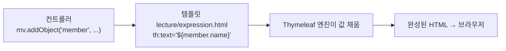
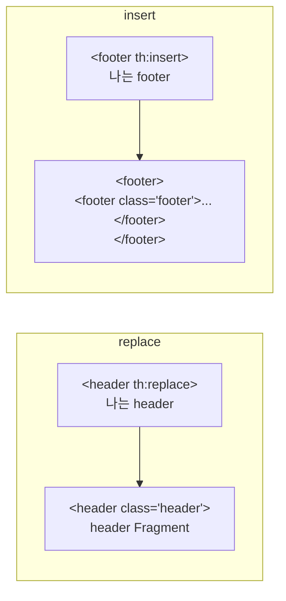

## 들어가며 (Situation)

앞의 챕터에서 `th:text="${message}"` 같은 코드를 계속 봤다. 서블릿 시절에는 `StringBuilder`로 HTML 문자열을 직접 조립했고, 그 불편함을 덜어 주는 것이 **템플릿 엔진**이다. `chap07-thymeleaf`는 스프링 부트에서 기본으로 쓰는 템플릿 엔진 **Thymeleaf** 문법을 네 개 화면으로 정리한다.

| 요청 | 화면 | 주제 |
|---|---|---|
| `/lecture/expression` | `expression.html` | 표현식 6종, `th:text`/`th:utext`, 인라인, 리터럴 치환 |
| `/lecture/conditional` | `conditional.html` | `th:if`, `th:unless`, `th:switch`, `th:each` |
| `/lecture/etc` | `etc.html` | `th:with`, SpringEL(객체·List·Map 접근) |
| `/lecture/fragment` | `fragment.html` | 공통 영역 재사용(`th:replace`, `th:insert`) |

비유하면 이렇다. **편지 양식(템플릿)** 에 빈칸이 있고, 서버가 **이름·주소(Model 데이터)** 를 채워서 완성된 편지(HTML)를 내보낸다.



## 문제 상황 (Task)

1. 컨트롤러가 넘긴 객체, 리스트, 맵을 **HTML 안에서 어떻게 꺼내 쓰는가?**
2. 조건에 따라 보이는 영역을 다르게 하거나(**if/switch**) 목록을 표로 만들려면(**each**)?
3. 헤더·푸터처럼 **모든 페이지에 반복되는 영역**을 한 번만 만들고 재사용하려면?

## 해결 과정 (Action)

### 0. 준비: 설정과 컨트롤러

```java
@Controller
@RequestMapping("/lecture")
public class LectureController {

    @GetMapping("/expression")
    public ModelAndView expression(ModelAndView mv) {
        mv.addObject("member", new MemberDTO("홍길동", 20, '남', "서울시 서초구"));
        mv.addObject("hello", "hello!<h3>Thymeleaf</h3>");     // 태그가 섞인 문자열
        mv.setViewName("lecture/expression");                    // templates/lecture/expression.html
        return mv;
    }
    ...
}
```

| 항목 | 내용 |
|---|---|
| 의존성 | `spring-boot-starter-thymeleaf` (접두사 `classpath:/templates/`, 접미사 `.html`이 기본값 — `application.yaml`에 주석으로 정리) |
| 네임스페이스 | `<html xmlns:th="http://www.thymeleaf.org">` — `th:` 속성을 쓰기 위한 선언 (쓰지 않는 페이지는 생략 가능) |
| 값 전달 | `mv.addObject("키", 값)` → 템플릿의 `${키}` |
| `mv.addObject(selectCriteria)` | 키 없이 객체만 넣으면 **클래스명의 첫 글자를 소문자로 한 이름**(`selectCriteria`)이 키 |

`ContextConfiguration`도 눈여겨볼 만하다. `@SpringBootApplication`이 있는 `Chap07ThymeleafApplication`은 `com.wanted.thymeleaf.config` 패키지에 있어서, 기본 컴포넌트 스캔은 **그 패키지 하위만** 본다. 컨트롤러는 `com.wanted.thymeleaf.controller`에 있으니 스캔에서 빠진다. 그래서 `@ComponentScan(basePackages = "com.wanted.thymeleaf")`를 따로 선언했다. (메인 클래스를 최상위 패키지로 옮기면 이 설정이 필요 없다.)

### 1. 표현식 6종

주석에 정리된 표현식 종류를 한 장으로 보자.

| 표현식 | 문법 | 용도 | 예 |
|---|---|---|---|
| 변수 | `${...}` | Model 값, 파라미터, 세션 | `${member.name}` |
| 선택 변수 | `*{...}` | `th:object`로 고른 객체의 필드 | `*{age}` |
| 메시지 | `#{...}` | `messages.properties`의 문구 | `#{message.value}` |
| 링크 | `@{...}` | URL 생성 (context path 자동) | `@{/css/common.css}` |
| 조각 | `~{...}` | Fragment 지정 | `~{common/header :: headerFragment}` |
| 인라인 | `[[...]]`, `[(...)]` | 텍스트 안에 값 삽입 | `[[${hello}]]` |

#### 1-1. 값의 출처에 따라 꺼내는 법이 다르다

```html
<p th:text="${ param.title }"></p>         <!-- 요청 파라미터(쿼리스트링) -->
<p th:text="${ param.no[0] }"></p>         <!-- 같은 이름이 여러 개면 배열처럼 -->
<p th:text="${ session.이름 }"></p>         <!-- 세션 attribute -->
<p th:text="${ member.name }"></p>         <!-- Model(ModelAndView)에 담은 값: 접두어 없음 -->
```

`index.html`은 `/lecture/expression?title=표현식&no=5&no=6`으로 접근한다. 같은 이름 `no`가 두 번 들어가므로 `param.no[0]`, `param.no[1]`로 꺼낸다. 서블릿의 `getParameterValues`와 같은 개념이다. 주소창에 `/lecture/expression`만 입력하면 `param.no`가 없어서 `[0]`에서 오류가 난다고 주석이 설명한다.

#### 1-2. 메시지 `#{}` — 문구를 파일로 분리

```properties
# resources/messages.properties
message.value=hello world
```

```html
<p th:text="#{ message.value }"></p>     <!-- hello world -->
```

같은 문구를 여러 페이지에서 쓰거나 **다국어 처리**를 할 때 쓴다. 스프링 부트는 기본적으로 `messages.properties`를 읽는다.

#### 1-3. 링크 `@{}` — URL은 이걸로

```html
<link rel="stylesheet" th:href="@{/css/common.css}" />
<a th:href="@{/}">메인으로</a>
<a th:href="@{/lecture/expression(title='링크', no=1)}">파라미터를 포함한 링크</a>
```

`/`로 시작하는 경로에 **context path가 자동으로 붙는다.** 앱이 `/myapp` 아래 배포되어도 링크가 깨지지 않는다. 괄호 안은 쿼리스트링(`?title=링크&no=1`)이 된다.

#### 1-4. 선택 변수 `*{}` — 객체 반복 입력 줄이기

```html
<div th:object="${ member }">
    <p th:text="*{ address }"></p>          <!-- ${member.address} 와 같다 -->
</div>
```

`th:object`로 객체를 정해 두면 그 범위 안에서는 `member.`을 반복해서 쓸 필요가 없다.

#### 1-5. `th:text` vs `th:utext` — 보안 포인트

```java
mv.addObject("hello", "hello!<h3>Thymeleaf</h3>");
```

```html
<li th:text="${ hello }"></li>       <!-- 태그가 글자 그대로 화면에 보임 (escape) -->
<li th:utext="${ hello }"></li>      <!-- <h3>가 실제 제목 태그로 렌더링 (unescaped) -->
```

| | `th:text` | `th:utext` |
|---|---|---|
| 처리 | **escape** (`<` → `&lt;`) | escape 안 함 |
| 결과 | 태그가 문자 그대로 | 태그가 동작 |
| 안전성 | **안전** (기본) | **XSS 위험** |

주석의 경고가 핵심이다. 사용자가 입력한 값을 `th:utext`로 그대로 출력하면 `<script>` 같은 악성 코드가 실행될 수 있다(XSS). **신뢰할 수 있는 값에만** 쓰고 기본은 `th:text`다.

#### 1-6. 인라인 `[[...]]`와 JavaScript에서 값 쓰기

| 표기 | 의미 |
|---|---|
| `[[${hello}]]` | `th:text`와 같음 (escape) |
| `[(${hello})]` | `th:utext`와 같음 |
| `th:inline="none"` | 인라인을 끄고 그대로 문자열로 |

자바스크립트에서 서버 값을 쓸 때는 `<script th:inline="javascript">`가 필요하다. 주석이 세 가지 방식을 비교한다.

```javascript
// 1) let hello = [[${ hello }]];
//    동적 페이지: 정상. 하지만 html을 그냥 열면(정적) 문법 오류
// 2) let hello = "[[${ hello }]]";
//    동적 페이지에서 따옴표가 중복되어 문법 오류  → ""hello!...""
// 3) 내추럴 템플릿 (권장)
let hello = /*[[${ hello }]]*/ '기본값';
```

3번은 **파일을 브라우저로 직접 열어도(정적) 문법이 깨지지 않고**, 서버를 거치면(동적) 서버 값으로 바뀐다. Thymeleaf가 내세우는 **내추럴 템플릿**의 장점이다. 자바스크립트 모드의 `[[...]]`는 값 타입에 맞게 따옴표와 이스케이프를 알아서 붙여 준다.

#### 1-7. 리터럴 치환 `|...|` 와 주석 두 종류

```html
<p th:object="${ member }" th:text="|name = '*{ name }'|"></p>    <!-- name = '홍길동' -->
```

`+`로 문자열을 이어 붙이는 대신 `|...|` 안에 문장을 쓰고 `${}`/`*{}`를 끼워 넣는다. 가독성이 훨씬 좋다. 링크 경로 중간에 변수를 넣을 때도 쓴다(`@{|/numbering/${numStat.count}|}`).

| 주석 | 문법 | 특징 |
|---|---|---|
| parser-level | `<!--/* ... */-->` | 정적 페이지에선 주석, **Thymeleaf 처리 때 제거**되어 클라이언트에 노출 안 됨 |
| prototype-only | `<!--/*/ ... /*/-->` | 정적 페이지에선 주석, **처리 후에는 화면에 보임** |

### 2. 제어문 (`conditional.html`)

#### 2-1. `th:if` / `th:unless` / `th:switch`

```html
<p th:if="${ num > 0 }">넘어온 값은 0보다 크다.</p>
<p th:unless="${ num < 0 }">넘어온 값은 0보다 작지 않다.</p>
<p th:if="${ num > 0 and num <= 10 }">1부터 10까지의 양수</p>

<th:block th:switch="${ str }">
    <span th:case="사과">사과가 선택되었습니다</span>
    <span th:case="바나나">바나나가 선택되었습니다</span>
    <span th:case="*">사과도 바나나도 아닙니다</span>      <!-- default -->
</th:block>
```

| 문법 | 의미 |
|---|---|
| `th:if` | 조건이 **참**일 때 태그 출력 |
| `th:unless` | 조건이 **거짓**일 때 태그 출력 |
| `th:switch` / `th:case="값"` | 값에 맞는 case 하나 출력 |
| `th:case="*"` | 어느 case도 아닐 때 (switch의 default) |
| `and`, `or`, `!` | 다중 조건. 비교는 `eq ne gt lt ge le`도 가능 |

`th:block`은 **화면에는 나타나지 않는 투명한 묶음 태그**다. 별도 HTML 태그를 만들고 싶지 않을 때 범위를 지정하는 용도로 쓴다.

`#strings.isEmpty(str)`처럼 `#`로 시작하는 것은 **유틸리티 객체**다. 문자열(`#strings`), 숫자(`#numbers`), 리스트(`#lists`), 날짜(`#dates`) 등 편의 기능을 제공한다. ([Thymeleaf - Expression Utility Objects](https://www.thymeleaf.org/doc/tutorials/3.1/usingthymeleaf.html#appendix-b-expression-utility-objects))

#### 2-2. `th:each` — 반복

```html
<tr th:each="member : ${ memberList }">
    <td th:text="${ member.name }"></td>
    <td th:text="${ member.age }"></td>
    ...
</tr>
```

`th:each="변수 : ${컬렉션}"`는 **자바의 향상된 for문**과 같다. **반복되는 태그 자체가 복제**된다(`<tr>` 4개가 만들어짐).

반복 상태를 알고 싶으면 두 번째 변수(`stat`)를 쓴다.

```html
<tr th:each="member, stat : ${ memberList }"> ... ${ stat.index } ... </tr>
```

| 속성 | 의미 |
|---|---|
| `index` | 0부터 시작하는 번호 |
| `count` | 1부터 시작하는 번호 |
| `size` | 전체 개수 |
| `current` | 현재 객체 |
| `even` / `odd` | 짝수/홀수 번째인지 |
| `first` / `last` | 처음/마지막인지 |

`stat`을 **생략하면** `변수명 + Stat`(`memberStat`)으로 자동 제공된다. 예를 들어 `th:each="num : ..."`이면 `numStat`이다. 마지막 예제 `@{|/numbering/${numStat.count}|}`가 바로 이 규칙이다.

`#numbers.sequence(5, 10)`은 5부터 10까지 숫자 리스트를 만들어 `for (int i=5; i<=10; i++)`처럼 반복한다. (주석대로 `/numbering/...` 컨트롤러는 없어서 링크를 누르면 404다. 링크 생성 문법을 보여 주는 예제다.)

### 3. 기타 (`etc.html`)

#### 3-1. `th:with` — 지역 변수

```html
<th:block th:with="start = ${ selectCriteria.startPage }, last = ${ selectCriteria.endPage }">
    <th:block th:each="p : ${ #numbers.sequence(start, last) }">
        <th:block th:if="${ selectCriteria.pageNo eq p }"><button th:text="${p}" disabled></button></th:block>
        <th:block th:if="${ selectCriteria.pageNo ne p }"><button th:text="${p}"></button></th:block>
    </th:block>
</th:block>
```

게시판 **페이징 버튼**을 만드는 코드다. `SelectCriteria(1, 10, 3)`이면 1~10번 버튼이 만들어지고, 현재 페이지(3번)만 `disabled`가 된다. `th:with`로 긴 식을 짧은 이름(`start`, `last`)에 담아 가독성을 높였다.

#### 3-2. SpringEL로 객체·List·Map 꺼내기

`${...}` 안의 식은 **SpringEL**이다. 단순 변수가 아니라 객체를 탐색할 수 있다.

| 대상 | 접근 방법 (모두 같은 값을 꺼낸다) |
|---|---|
| 객체 | `${member.name}`, `${member['age']}`, `${member.getGender()}` |
| List | `${memberList[1].name}`, `${memberList.get(1).address}` |
| Map | `${memberMap['m03'].name}`, `${memberMap['m03']['age']}` |

주석에 중요한 설명이 있다. `.필드명`, `['필드명']`, `.getter()` 세 방식 모두 내부적으로 **getter를 호출**한다. 필드가 `private`인데 getter가 없으면 세 방식 모두 오류가 난다. 그래서 `MemberDTO`에는 getter가 있다.

`Map`을 `th:each`로 돌리면 각 요소는 `Map.Entry`라서 `entry.key`, `entry.value`로 꺼낸다. 컨트롤러가 `LinkedHashMap`을 쓴 이유는 `HashMap`이 순서를 보장하지 않아서, **넣은 순서대로 출력**하려는 것이다.

#### 3-3. Spring Security 연동 (참고)

`sec:authorize="isAuthenticated()"`로 로그인 여부에 따라 영역을 나누는 문법이 있지만, 이 프로젝트에는 Spring Security 의존성이 없어서 **주석 처리**되어 있다. (두 줄이 모두 출력되기 때문이다.) 사용하려면 `spring-boot-starter-security`와 `thymeleaf-extras-springsecurity6` 의존성, 그리고 `xmlns:sec` 네임스페이스가 필요하다고 주석이 안내한다.

### 4. Fragment — 공통 영역 재사용

헤더·푸터·사이드바처럼 **모든 페이지에 반복되는 영역**을 페이지마다 복사하면, 메뉴가 바뀔 때 페이지 수만큼 고쳐야 한다. 주석이 말하는 이 문제를 **Fragment**로 해결한다. 이는 AOP나 필터처럼 "공통은 한곳에"라는 같은 철학이다.

**① 조각 정의** (`common/header.html`)

```html
<header th:fragment="headerFragment" class="header">
    <h1> header Fragment</h1>
</header>
```

**② 조각 사용** (`lecture/fragment.html`)

```html
<header th:replace="~{common/header :: headerFragment}">
    <h1>나는 header</h1>
</header>
```

문법은 `~{ 템플릿 경로 :: Fragment 이름 }`이다. 경로는 `templates/` 기준이며 `.html`은 생략하고, 앞에 `/`를 붙이지 않는다.

#### `th:replace` vs `th:insert`



| | `th:replace` | `th:insert` |
|---|---|---|
| 동작 | 태그**까지 통째로 교체** | 태그는 **유지**하고 안쪽에 삽입 |
| 결과 | `<header class="header">…</header>` | `<footer><footer class="footer">…</footer></footer>` |
| 원래 내용("나는 header") | 사라짐 | 사라짐 (안쪽이 Fragment로 바뀜) |

(결과 모양은 템플릿 주석에 적힌 내용이다. 직접 렌더링해 확인한 것은 아니다.) 주석의 정리: **`th:replace` → 태그까지 통째로 교체, `th:insert` → 태그는 유지, 안쪽에 삽입.** 태그가 이중으로 중첩되는 것을 피하려고 보통 `th:replace`를 쓴다.

#### 매개변수가 있는 Fragment

```html
<!-- common/aside.html -->
<aside th:fragment="asideFragment(parameter, parameter1)" class="aside">
    <ul>
        <li th:text="${parameter}"></li>
        <li th:text="${parameter1}"></li>
    </ul>
</aside>

<!-- lecture/fragment.html : 값을 넘겨서 호출 -->
<aside th:replace="~{common/aside :: asideFragment(${test1}, ${test2})}"></aside>
```

컨트롤러가 넣은 `test1`, `test2` 값이 Fragment의 `parameter`, `parameter1`로 전달되어 UI를 **동적으로** 꾸밀 수 있다. 함수 호출과 같은 구조다.

## 결과 (Result)

| 질문 | 정리 |
|---|---|
| 서버 값을 HTML에 넣는 법 | `th:text="${값}"` (Model 값), `${param.x}`, `${session.x}` |
| 객체 필드 꺼내기 | `${member.name}` / `*{name}` (`th:object` 안) — getter 호출 |
| 안전한 출력 | `th:text` (escape). `th:utext`는 신뢰 값만 |
| 조건·반복 | `th:if/unless/switch/each`, `stat`(index·count·first·last…) |
| 문자열 합치기 | `\|...\|` 리터럴 치환 |
| URL 만들기 | `@{/경로(파라미터)}` |
| JS에서 서버 값 | `th:inline="javascript"` + 내추럴 템플릿 |
| 공통 영역 재사용 | `th:fragment` + `th:replace` / `th:insert`, 매개변수 가능 |

정량 지표는 측정하지 않았다. 구조 면에서는 서블릿 시절 `StringBuilder.append("<h1>")...`로 HTML을 조립하던 코드가 **HTML 파일 + `th:` 속성**으로 분리되어 디자이너도 파일을 브라우저로 열어 볼 수 있는 형태(내추럴 템플릿)가 되었다.

배운 점은 이렇다.

1. 템플릿 엔진의 핵심은 **"HTML은 HTML답게, 값만 서버가 채운다"** 이다. 화면 모양과 서버 로직이 분리된다.
2. 편한 기능일수록 보안 설정이 따라온다. 기본(`th:text`)은 안전하고, `th:utext`는 **내가 책임질 때만** 쓴다.
3. Fragment, 필터, AOP, 인터셉터까지 이번 모듈의 공통 주제는 **반복을 한곳으로 모으는 것**이다.

## 더 학습하면 좋은 개념

- **XSS와 출력 이스케이프** — `th:text`가 기본으로 막아 주는 공격이 정확히 무엇인지, `th:utext`와 JS 모드에서 왜 위험한지를 알게 된다.
- **Thymeleaf Layout (Layout Dialect)** — Fragment보다 한 단계 위인 **페이지 레이아웃 상속**이다. 헤더/푸터를 한 번 정의하고 페이지가 내용만 채운다.
- **폼 바인딩 (`th:field`, `th:object`와 `BindingResult`)** — 입력 폼과 `@ModelAttribute` DTO를 양방향으로 연결하고 검증 오류를 표시하는 방법이다. 이전 글의 `@ModelAttribute`와 이어진다.
- **국제화(i18n)와 `MessageSource`** — `#{}` 메시지 표현식을 언어별 파일(`messages_en.properties`)로 확장하는 방법이다.
- **JSP vs Thymeleaf vs 프론트엔드 프레임워크** — 서버 사이드 렌더링을 쓰는 이유와 React/Vue 같은 클라이언트 렌더링과의 구조적 차이다.

## 참고 자료

- [Thymeleaf 공식 문서 - Using Thymeleaf 3.1](https://www.thymeleaf.org/doc/tutorials/3.1/usingthymeleaf.html)
- [Thymeleaf 공식 문서 - Thymeleaf + Spring](https://www.thymeleaf.org/doc/tutorials/3.1/thymeleafspring.html)
- [Thymeleaf 공식 문서 - Expression Utility Objects](https://www.thymeleaf.org/doc/tutorials/3.1/usingthymeleaf.html#appendix-b-expression-utility-objects)
- [Spring Boot 공식 문서 - Template Engines](https://docs.spring.io/spring-boot/reference/web/servlet.html#web.servlet.spring-mvc.template-engines)
- [Spring Framework 공식 문서 - Spring Expression Language (SpEL)](https://docs.spring.io/spring-framework/reference/core/expressions.html)
- [OWASP - Cross Site Scripting (XSS)](https://owasp.org/www-community/attacks/xss/)
