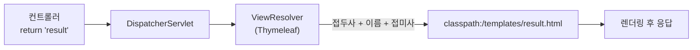
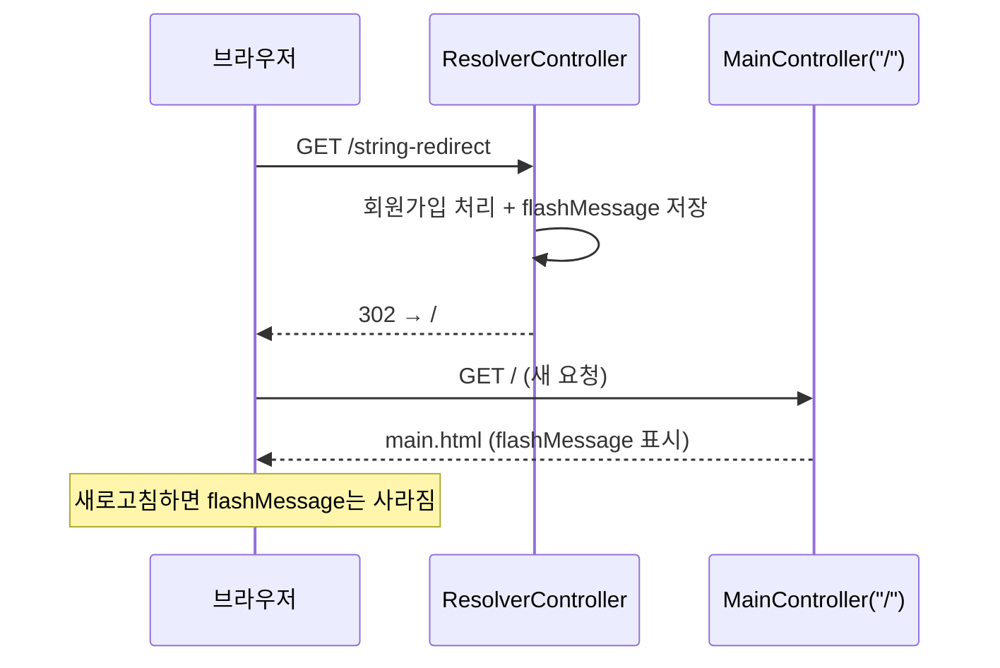

## 들어가며 (Situation)

앞 글에서 컨트롤러가 `return "mappingResult";`처럼 **문자열만 반환**하면 화면이 열렸다. `chap03-view-resolver`는 이 마법의 정체와, 화면을 돌려주는 세 가지 방법, 그리고 서블릿 때의 **forward / redirect**가 스프링에서는 어떻게 바뀌는지 다룬다.

| 주제 | 서블릿 시절 | 스프링 MVC |
|---|---|---|
| 뷰 지정 | `req.getRequestDispatcher("/x.jsp")` | `return "x"` |
| forward | `rd.forward(req, resp)` | **기본 동작** (`return "x"`) |
| redirect | `resp.sendRedirect("/x")` | `return "redirect:/x"` |
| redirect 후 값 유지 | 세션·쿠키 | `RedirectAttributes.addFlashAttribute` |

> forward와 redirect의 차이, redirect 후 `req` 값이 사라지는 문제는 [서블릿 forward/redirect 글]({{ site.baseurl }}/2026/10/23/servlet-forward-redirect/)에서 다뤘다. 이 글은 그 개념을 스프링 문법으로 옮긴 것이다.

## 문제 상황 (Task)

1. `return "result"`의 `"result"`가 어떻게 `templates/result.html`이 되는가?
2. 화면을 반환하는 방법은 몇 가지이고 언제 무엇을 쓰는가?
3. 회원가입 후 새로고침해도 중복 가입이 안 되도록 **redirect**하면서, "가입 완료" 메시지는 **한 번만** 보여주려면?

## 해결 과정 (Action)

### 1. ViewResolver: 뷰 이름 → 실제 파일

컨트롤러의 마지막 임무는 "**어떤 화면으로 응답할지**" 정하는 것이다. 컨트롤러는 파일 경로가 아니라 **뷰 이름(문자열)** 만 돌려주고, 이름을 실제 파일로 바꾸는 일은 **ViewResolver**가 맡는다.



| 구성 | 기본값 |
|---|---|
| 접두사(prefix) | `classpath:/templates/` (= `src/main/resources/templates/`) |
| 뷰 이름 | 컨트롤러가 반환한 문자열 |
| 접미사(suffix) | `.html` |

스프링 부트에서는 `spring-boot-starter-thymeleaf`가 이 설정을 자동으로 해 준다. 이번 챕터의 `application.yaml`에는 관련 설정이 없다. (Thymeleaf 챕터에서 같은 기본값이 주석으로 정리되어 있다.) 그래서 `"result"` → `templates/result.html`이다.

> 뷰 이름 앞에 `/`를 붙이면(`"/result"`) 경로가 `templates//result`처럼 되어 jar로 배포했을 때 템플릿을 못 찾을 수 있다고 Thymeleaf 챕터의 주석이 경고한다. 뷰 이름은 `/` 없이 쓰는 습관을 들이자.

### 2. 화면을 반환하는 3가지 방법

`ResolverController`의 주석이 정리한 목록이다.

| 반환 타입 | 뷰가 정해지는 방식 | 예 |
|---|---|---|
| `void` | **요청 URL**이 곧 뷰 경로 | `@GetMapping("regist") public void regist(){}` → `request/regist` |
| `String` | **문자열**이 곧 뷰 이름 | `return "result";` |
| `ModelAndView` | `setViewName("...")`로 직접 지정 | 아래 코드 |

```java
@GetMapping("modelAndView")
public ModelAndView modelAndView(ModelAndView mv) {

    mv.addObject("forwardMessage", "MV 활용 뷰와 데이터 !");    // Model 역할
    mv.setViewName("result");                                    // View 역할

    return mv;
}
```

`ModelAndView`는 이름 그대로 **데이터(Model)와 화면(View)을 한 객체에 담아** 반환한다. 반면 `String` 방식은 `Model` 매개변수와 반환 문자열이 따로다.

| 비교 | `String` + `Model` | `ModelAndView` |
|---|---|---|
| 모양 | 데이터와 화면이 분리 | 한 객체 |
| 코드 | 짧고 흔하게 쓴다 | 길지만 한 곳에 모인다 |
| 화면 지정 | `return "result"` | `mv.setViewName("result")` |

두 방법의 결과는 같다. 이 프로젝트의 `/string`과 `/modelAndView`는 둘 다 `result.html`을 열고, `result.html`은 `${forwardMessage}`를 출력한다.

### 3. 기본은 forward, redirect는 접두사

```java
@GetMapping("/string")
public String stringView(Model model) {
    model.addAttribute("forwardMessage", "문자열로 뷰 반환");
    System.out.println("회원가입 완료");           // service.registMember(); 가정
    return "result";                               // forward
}
```

주석대로 **뷰를 반환할 때의 기본 방식은 forward**다. URL은 `/string` 그대로이고, 모델 값(`forwardMessage`)이 같은 요청 안에서 뷰로 전달된다.

redirect는 문자열 앞에 `redirect:`를 붙인다.

```java
@GetMapping("/string-redirect")
public String redirect(RedirectAttributes rttr) {
    System.out.println("회원가입 완료");
    rttr.addFlashAttribute("flashMessage", "리다이랙트 된 페이지에서도 유지되는 값");
    return "redirect:/";                           // 브라우저에게 "/ 로 다시 요청하라"
}
```



| 비교 | forward (`return "x"`) | redirect (`return "redirect:/x"`) |
|---|---|---|
| 요청 횟수 | 1번 | 2번 |
| URL | 그대로 | 바뀜 |
| Model 값 | 뷰에서 사용 가능 | **사라짐** |
| 용도 | 조회 결과 화면 | DB를 바꾼 뒤(가입·수정·삭제) |

### 4. redirect하면 값이 사라지는 문제와 Flash

수업 주석의 논리는 이렇다.

1. redirect는 요청이 **2번** 일어난다.
2. 첫 요청에서 `model`에 담은 값은 두 번째 요청에서 **소멸**한다.
3. 서블릿 때는 세션·쿠키를 썼다.
4. 스프링은 **`RedirectAttributes`** 를 제공한다.

```java
rttr.addFlashAttribute("flashMessage", "...");
```

주석: *"`addFlashAttribute`는 값을 session에 잠시 저장했다가 redirect된 요청에서 **한 번** 꺼내 쓰면 제거한다."* 그래서 `main.html`의 `<h3 th:text="${flashMessage}">`는 redirect 직후 한 번만 메시지가 나오고, F5로 새로고침하면 사라질 것으로 예상된다. (직접 실행해 확인한 것은 아니다.)

| 방법 | 값이 사는 곳 | 수명 | 쓰임새 |
|---|---|---|---|
| `model.addAttribute` | 요청 | 요청 1번 | forward 화면 |
| `addFlashAttribute` | 세션(잠깐) | **redirect 후 1번** | "저장되었습니다" 같은 일회성 알림 |
| 세션 | 서버 | 만료/무효화까지 | 로그인 상태 |
| 쿠키 | 브라우저 | `maxAge`까지 | 아이디 저장 등 |

> 값이 URL 쿼리스트링(`?msg=...`)으로 붙게 하는 `addAttribute`도 있다. 이 프로젝트는 flash 방식만 사용한다.

### 5. 코드를 읽다 발견한 점

| 관찰 | 설명 |
|---|---|
| `/string-redirect`와 `/string-redirect-attr`의 코드가 **완전히 같다** | 두 버튼 모두 `addFlashAttribute` + `redirect:/`를 한다. `index`의 설명은 "redirect만" vs "redirect + flash"로 구분하려 했던 것으로 보인다. 첫 번째는 `addFlashAttribute`를 빼야 대비가 생긴다 |
| `MainController`가 `@RequestMapping(value = {"/", "/main"})` | 중괄호로 **여러 경로를 한 메소드에 매핑**한 예다 |
| `main.html`의 링크가 `location.href='string'` (슬래시 없음) | 상대 경로다. 현재 주소 기준으로 해석되므로 `/main`이든 `/`든 같은 곳(`/string`)이 되지만, 나중에 하위 경로 페이지에서 쓰면 어긋날 수 있다. `/string`처럼 절대 경로가 안전하다 |
| 회원가입 로직은 `System.out.println("회원가입 완료")`로 대체 | DB 연동은 이후 챕터의 몫이다 |

## 결과 (Result)

| 질문 | 정리 |
|---|---|
| 뷰 이름이 파일이 되는 원리 | ViewResolver가 `classpath:/templates/` + 이름 + `.html`로 변환 |
| 화면 반환 방법 | `void`(URL=뷰), `String`(문자열=뷰), `ModelAndView`(`setViewName`) |
| 기본 이동 방식 | forward (`redirect:` 접두사가 있으면 redirect) |
| redirect 후 값 전달 | `RedirectAttributes.addFlashAttribute` (세션에 잠깐 저장, 1회용) |
| 언제 redirect? | DB를 바꾸는 요청(가입·수정·삭제) 이후 |

정량 지표는 측정하지 않았다. 대신 서블릿 때 `sendRedirect` + 세션으로 직접 구현하던 "일회성 메시지"가 **`addFlashAttribute` 한 줄**로 줄어든 구조적 변화를 정리했다.

배운 점은 이렇다.

1. 컨트롤러는 **화면 파일 경로를 모른다.** "어떤 뷰인가"만 말하고 해석은 ViewResolver에 맡긴다. 그래서 화면 기술(Thymeleaf, JSP)을 바꿔도 컨트롤러는 거의 그대로다.
2. 서블릿에서 배운 forward/redirect 개념이 스프링에서는 **문자열 접두사 하나**의 차이로 표현된다.
3. redirect 뒤 일회성 메시지는 세션을 직접 만지지 말고 **Flash 속성**을 쓴다.

## 더 학습하면 좋은 개념

- **PRG(Post-Redirect-Get) 패턴** — POST 처리 후 redirect로 새로고침 중복 제출을 막는 패턴이다. Flash 속성은 PRG에서 메시지를 전달하는 표준 도구다.
- **`ViewResolver` 종류와 커스터마이징** — Thymeleaf 외에 JSP, JSON 응답을 위한 `ContentNegotiatingViewResolver` 등이 있다. 접두사·접미사를 바꾸는 방법(`spring.thymeleaf.prefix`)도 같이 배운다.
- **`@ResponseBody`와 뷰 없는 응답** — 뷰를 거치지 않고 데이터를 바로 돌려주는 방식이다. 뷰 이름 반환과 어떻게 구분되는지 이해하면 REST API로 넘어가기 쉽다.
- **HTTP 상태 코드 302/303/307** — `redirect:`가 보내는 응답 코드와 메소드 유지 여부의 차이다.
- **세션 스코프와 `@SessionAttributes`** — Flash가 쓰는 세션의 구조와 스프링이 제공하는 세션 관리 도구다.

## 참고 자료

- [Spring Framework 공식 문서 - View Resolution](https://docs.spring.io/spring-framework/reference/web/webmvc/mvc-servlet/viewresolver.html)
- [Spring Framework 공식 문서 - Redirecting](https://docs.spring.io/spring-framework/reference/web/webmvc/mvc-servlet/viewresolver.html#mvc-redirecting-redirect-prefix)
- [Spring Framework 공식 문서 - Flash Attributes](https://docs.spring.io/spring-framework/reference/web/webmvc/mvc-controller/ann-methods/flash-attributes.html)
- [Spring Framework 공식 문서 - Return Values](https://docs.spring.io/spring-framework/reference/web/webmvc/mvc-controller/ann-methods/return-types.html)
- [Spring Boot 공식 문서 - Spring Web MVC 프레임워크](https://docs.spring.io/spring-boot/reference/web/servlet.html)
