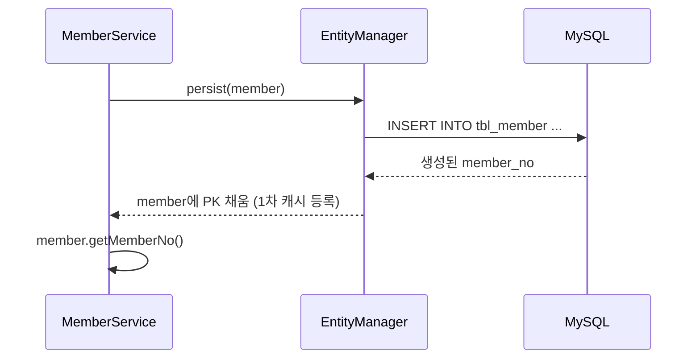

## 들어가며 (Situation)

앞선 글들에서는 `Menu` 엔티티로 영속성 컨텍스트의 동작을 실험했다. `chap03-entity-mapping`은 한 걸음 물러나서 **"클래스를 테이블에 어떻게 대응시키는가"** 를 다룬다. 실습 대상은 `menudb`의 `tbl_member` 테이블과 이에 대응하는 `Member` 엔티티다.

구성은 `Controller → Service → Repository(EntityManager)` 3계층이고, `Scanner`로 회원 등록(`persist`)과 번호 조회(`find`)를 직접 실행해 본다.

```mermaid
flowchart LR
    A[Section01Application<br/>Scanner 입력] --> B[MemberController]
    B -->|MemberRegistDTO| C[MemberService<br/>@Transactional]
    C -->|DTO → Entity| D[MemberRepository<br/>EntityManager]
    D -->|persist / find| E[(tbl_member)]
```

## 문제 상황 (Task)

1. 클래스 필드와 컬럼 이름이 다르다. (`memberId` ↔ `member_id`)
2. PK를 DB가 만들어 주는데, 객체는 `persist()` 직후 PK를 알아야 한다.
3. `enum`(`ROLE_MEMBER`, `ROLE_ADMIN`)을 컬럼에 어떻게 저장할지 정해야 한다.
4. 제약조건(NOT NULL, UNIQUE, 길이, 기본값)을 코드에 어디까지 표현할 수 있는가?

## 해결 과정 (Action)

### 1. 클래스와 컬럼 연결: @Entity, @Table, @Column

```java
@Entity
@Table(name = "tbl_member")
public class Member {

    @Id
    @Column(name = "member_no")
    @GeneratedValue(strategy = GenerationType.IDENTITY)
    private int memberNo;

    @Column(name = "member_id", nullable = false,
            unique = true, columnDefinition = "varchar(10)")
    private String memberId;

    @Column(name = "address", length = 900)
    private String address;
    ...
}
```

`@Column`의 주요 속성은 수업 주석대로 다음과 같이 정리된다.

| 속성 | 의미 | 기본값 |
|---|---|---|
| `name` | 매핑할 컬럼 이름 | 필드 이름 |
| `nullable` | `false`면 `NOT NULL` | `true` |
| `unique` | `UNIQUE` 제약조건 | `false` |
| `length` | 문자열 컬럼 길이 | 255 |
| `columnDefinition` | 자료형·기본값 등 DDL 조각을 직접 작성 | 없음 |

여기서 중요한 점은 **이 속성들은 JPA가 DDL을 생성할 때 쓰인다**는 것이다. 이미 만들어진 테이블에 붙여 쓸 때는 실제 제약조건을 바꾸지 않는다. 그리고 `ddl-auto: create`로 실행하면 앱을 켤 때마다 테이블이 **새로 생성**되므로 기존 데이터가 사라진다.

| `ddl-auto` | 동작 | 용도 |
|---|---|---|
| `create` | 실행 시 테이블 새로 생성 | 학습·초기 개발 |
| `create-drop` | 생성 후 종료 시 삭제 | 테스트 |
| `update` | 변경된 구조만 반영 | 개발 중 |
| `none` | 아무것도 하지 않음 | 운영 |

### 2. PK 생성 전략: @GeneratedValue

| 전략 | PK 생성 주체 | `persist()` 시점의 SQL |
|---|---|---|
| `IDENTITY` | DB (MySQL `AUTO_INCREMENT`) | **바로 INSERT** (쓰기 지연 불가) |
| `SEQUENCE` | DB 시퀀스 | 시퀀스 조회만, INSERT는 flush 시점 |
| `TABLE` | 키 생성 전용 테이블 | 테이블로 키 조회 |
| `AUTO` | DB에 맞춰 자동 선택 (기본값) | 선택된 전략에 따름 |

MySQL은 시퀀스가 없고 `AUTO_INCREMENT`를 쓰므로 `IDENTITY`를 선택했다. 이유는 **PK는 INSERT를 실행해야만 알 수 있기 때문**이다. 영속성 컨텍스트는 엔티티를 PK로 관리하는데 PK를 모르면 1차 캐시에 넣을 수 없으니, `persist()` 즉시 INSERT를 보내 PK를 받아 온다. 그래서 `MemberService`에서 아래 코드가 가능하다.

```java
memberRepository.save(member);   // persist() → 이 시점에 INSERT 실행
return member.getMemberNo();     // 이미 PK가 채워져 있다
```



대가는 쓰기 지연의 이점(여러 INSERT를 모아서 전송)을 `IDENTITY`에서는 쓸 수 없다는 점이다.

### 3. enum 매핑: @Enumerated

`MemberRole`은 `ROLE_MEMBER`, `ROLE_ADMIN` 두 값만 허용하는 enum이다. 저장 방식은 두 가지다.

| 항목 | `ORDINAL` | `STRING` |
|---|---|---|
| 저장 값 | 순서 번호 (0, 1) | 이름 (`ROLE_ADMIN`) |
| 가독성 | 낮음 | 높음 |
| enum 순서 변경·값 추가 | **기존 데이터 의미가 틀어짐** | 영향 없음 |
| 저장 크기 | 작음 | 큼 (큰 단점은 아님) |

```java
@Column(name = "member_role")
@Enumerated(EnumType.STRING)
private MemberRole memberRole;
```

`ORDINAL`의 위험은 enum 중간에 값을 끼워 넣는 순간 이미 저장된 `1`이 가리키는 값이 바뀐다는 점이다. 그래서 `STRING`을 쓴다.

**시행착오 포인트:** 수업 주석에 따르면 Hibernate 6 + MySQL에서 `STRING`으로 매핑하면 컬럼이 `varchar`가 아니라 MySQL의 `enum('ROLE_ADMIN','ROLE_MEMBER')` 타입으로 생성된다. `varchar`가 필요하면 `columnDefinition = "varchar(20)"`처럼 직접 지정한다. 직접 `ORDINAL`로 바꿔서 DDL과 저장 값을 비교해 보면 차이가 바로 보인다.

### 4. 기본값 처리와 날짜 타입

```java
@Column(name = "status", columnDefinition = "char(1) default 'Y'")
private String status;

@Column(name = "enroll_date")
private LocalDateTime enrollDate;
```

- `columnDefinition`의 `default 'Y'`는 **DDL의 기본값**이다. 엔티티에서 `status`를 `null`로 넣으면 JPA는 `NULL`을 INSERT하므로 기본값이 적용되지 않는다. 이 실습에서는 `inputMember()`에서 `"Y"`를 직접 세팅한다.
- `LocalDate`는 날짜만, `LocalDateTime`은 날짜와 시간을 저장하며 Hibernate 5 이상에서 `java.time`을 자동 지원한다.

### 5. 엔티티와 DTO 분리

`Controller`는 `Member`가 아니라 `MemberRegistDTO`를 받고, `MemberService`가 DTO를 엔티티로 변환한다. 조회 때도 엔티티를 그대로 내보내지 않고 DTO로 바꿔 반환한다.

| 이유 | 설명 |
|---|---|
| 계층 분리 | 화면/요청 형태가 바뀌어도 엔티티는 영향을 받지 않는다 |
| 영속 상태 노출 방지 | 트랜잭션 밖에서 엔티티가 변경 감지 대상이 되는 혼란을 막는다 |
| 필요한 값만 전달 | 비밀번호 같은 필드를 선택해서 내보낼 수 있다 |

참고로 `findByMemberNo`는 `@Transactional(readOnly = true)`다. 수업 주석대로 읽기 전용 트랜잭션은 불필요한 변경 감지를 하지 않는다.

## 결과 (Result)

| 질문 | 정리 |
|---|---|
| 필드와 컬럼 이름이 다르면? | `@Column(name = ...)`으로 지정 |
| MySQL에서 PK 전략은? | `IDENTITY` (`persist()` 즉시 INSERT) |
| enum은 어떻게 저장? | `EnumType.STRING` (순서 변경에 안전) |
| 제약조건은 어디서 적용? | JPA의 DDL 생성 시점 (`ddl-auto`) |

배운 점은 이렇다.

1. 매핑 어노테이션은 단순한 이름표가 아니라 **DDL 생성과 쓰기 시점의 SQL 동작까지 결정**한다. (`IDENTITY` → 즉시 INSERT)
2. enum은 기본값(`ORDINAL`)이 아니라 `STRING`을 **명시적으로** 선택해야 한다.
3. `ddl-auto: create`는 데이터를 지우므로, 운영에서는 `none`이어야 한다.

이 글에서 정리하지 못한 것은 앞 글에서 다룬 변경 감지와 `@Transactional`의 세부 동작이다. 다음 두 글에서 `MemberService`에 달린 `@Transactional`을 파고든다. (예외와 롤백 규칙, 전파)

## 더 학습하면 좋은 개념

- **`@GeneratedValue(strategy = SEQUENCE)`와 `allocationSize`** — `IDENTITY`가 쓰기 지연을 막는 이유를 이해했다면, 시퀀스가 INSERT를 모아서 보내는 최적화를 어떻게 지원하는지 비교해 볼 만하다.
- **`@Embeddable`과 값 타입** — 주소처럼 여러 필드를 하나의 객체로 묶는 매핑으로, 엔티티 설계를 한 단계 객체지향적으로 만든다.
- **`@Convert`(AttributeConverter)** — `status`의 `"Y"/"N"`을 `boolean`으로 바꾸는 등, 타입 변환 규칙을 직접 정의하는 방법이다.
- **Flyway/Liquibase 같은 DB 마이그레이션 도구** — `ddl-auto`에 의존하지 않고 스키마를 버전 관리하는 운영 방식이다.
- **Spring Data JPA 리포지토리** — 이 글의 `EntityManager` 기반 Repository를 인터페이스 하나로 대체하는 다음 단계다.

## 참고 자료

- [Jakarta Persistence 3.2 명세](https://jakarta.ee/specifications/persistence/3.2/)
- [Hibernate ORM 공식 문서 - Basic types (enum 매핑)](https://docs.jboss.org/hibernate/orm/6.6/userguide/html_single/Hibernate_User_Guide.html#basic)
- [Hibernate ORM 공식 문서 - Identifiers (`@GeneratedValue`)](https://docs.jboss.org/hibernate/orm/6.6/userguide/html_single/Hibernate_User_Guide.html#identifiers)
- [Spring Boot 공식 문서 - SQL Databases (`ddl-auto`)](https://docs.spring.io/spring-boot/reference/data/sql.html)
- [엔티티 생명주기 글]({{ site.baseurl }}/2026/11/02/jpa-entity-lifecycle-flush-merge/)
