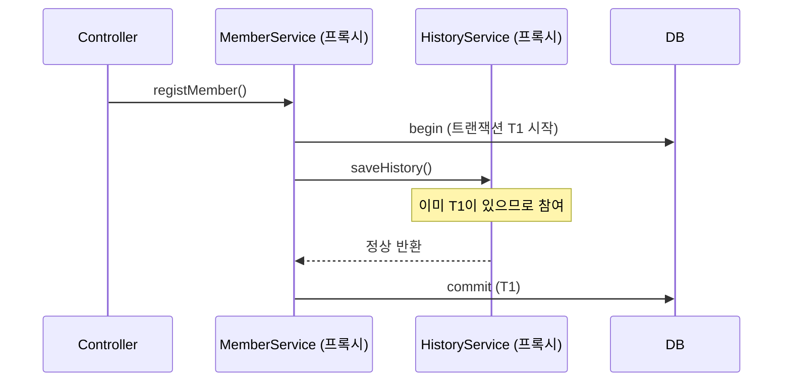
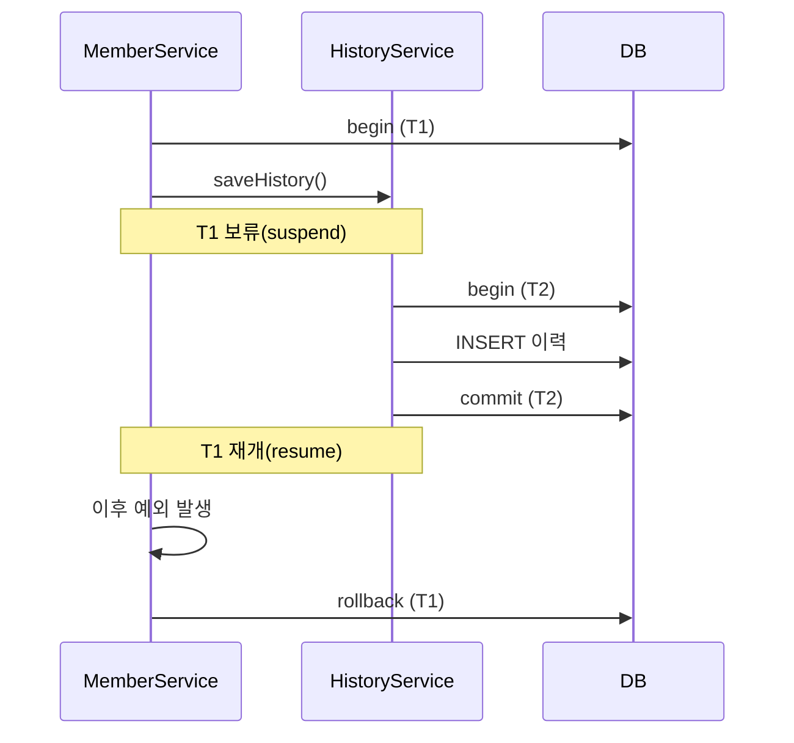
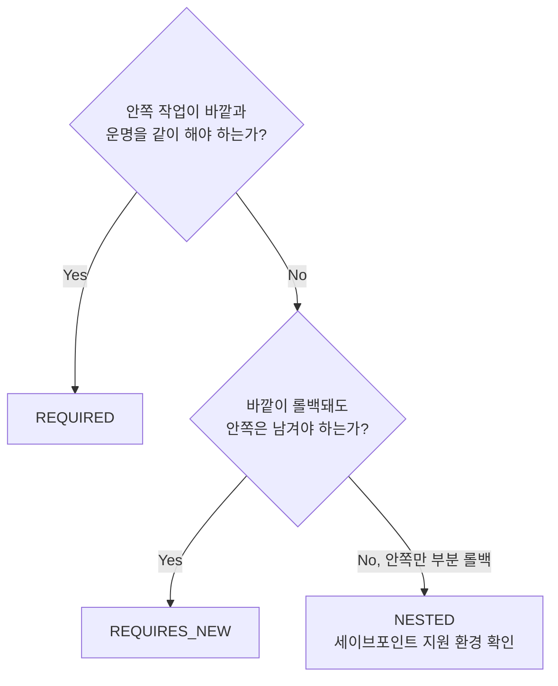

## 들어가며 (Situation)

`chap03-entity-mapping`의 `MemberService`에는 `@Transactional`이 붙은 메서드가 둘이다. 하나는 쓰기(`registMember`), 하나는 읽기 전용(`findByMemberNo`)이다. 지금은 `Controller → Service` 호출 한 번에 트랜잭션도 하나라서 단순하다.

그런데 실제 서비스에서는 `@Transactional` 메서드가 **다른 `@Transactional` 메서드를 호출**한다. 수업 코드의 "블로그 작성 키워드" 두 번째, **`@Transactional`의 전파**를 정리한다.

## 문제 상황 (Task)

예를 들어 "회원 가입 시 가입 이력도 함께 남긴다"는 요구가 생겼다고 하자. (예시 상황)

```mermaid
flowchart LR
    A[MemberService.registMember<br/>@Transactional] --> B[HistoryService.saveHistory<br/>@Transactional]
```

1. 바깥과 안쪽 메서드는 **같은 트랜잭션**인가, **다른 트랜잭션**인가?
2. 이력 저장이 실패하면 회원 가입도 취소되어야 하는가?
3. 반대로 이력은 회원 가입이 롤백되더라도 남겨야 한다면?

## 해결 과정 (Action)

### 1. 전파란

**전파(Propagation)** 는 "트랜잭션이 이미 진행 중일 때(또는 없을 때) `@Transactional` 메서드가 어떻게 트랜잭션에 참여할지"를 정하는 속성이다.

```java
@Transactional(propagation = Propagation.REQUIRES_NEW)
```

기본값은 `REQUIRED`다.

### 2. 전파 옵션 비교

| 옵션 | 기존 트랜잭션 **있음** | 기존 트랜잭션 **없음** |
|---|---|---|
| `REQUIRED` (기본) | 기존에 **참여** | 새로 생성 |
| `REQUIRES_NEW` | 기존을 보류하고 **새로 생성** | 새로 생성 |
| `SUPPORTS` | 기존에 참여 | 트랜잭션 없이 실행 |
| `NOT_SUPPORTED` | 기존을 보류하고 트랜잭션 없이 실행 | 트랜잭션 없이 실행 |
| `MANDATORY` | 기존에 참여 | **예외 발생** |
| `NEVER` | **예외 발생** | 트랜잭션 없이 실행 |
| `NESTED` | 기존 안에 **세이브포인트**로 중첩 | 새로 생성 (`REQUIRED`처럼) |

실무에서 가장 자주 만나는 것은 `REQUIRED`와 `REQUIRES_NEW`다.

### 3. REQUIRED — 하나의 트랜잭션으로 묶인다

```java
// 예시 코드
@Service
public class MemberService {
    private final HistoryService historyService;
    ...
    @Transactional                          // REQUIRED (기본)
    public int registMember(MemberRegistDTO dto) {
        memberRepository.save(member);
        historyService.saveHistory(member); // 같은 트랜잭션에 참여
        return member.getMemberNo();
    }
}

@Service
public class HistoryService {
    @Transactional                          // REQUIRED (기본)
    public void saveHistory(Member member) { ... }
}
```



둘은 **물리적으로 하나의 트랜잭션(T1)** 이다. 따라서 어느 쪽에서든 롤백 대상 예외가 나면 둘 다 롤백된다. 요구사항 2번("이력 실패 시 가입도 취소")은 기본값으로 충족된다.

### 4. REQUIRES_NEW — 독립된 트랜잭션

가입이 롤백되더라도 이력은 남겨야 한다면 안쪽을 `REQUIRES_NEW`로 바꾼다.

```java
// 예시 코드
@Transactional(propagation = Propagation.REQUIRES_NEW)
public void saveHistory(Member member) { ... }
```



결과적으로 T2의 이력은 **이미 커밋**되어 있어 T1이 롤백되어도 남는다. 대신 대가가 있다.

| 영향 | 설명 |
|---|---|
| DB 커넥션 | T1이 커넥션을 쥔 채 T2가 **추가 커넥션**을 사용한다. 부하가 높으면 풀 고갈 위험이 있다 |
| 가시성 | T2는 T1이 아직 커밋하지 않은 데이터를 보지 못한다 |
| 일관성 | 이력은 있는데 회원은 없는 상태가 정상인지 요구사항으로 확인해야 한다 |

### 5. 내부 예외를 바깥이 잡으면: rollback-only

`REQUIRED`로 참여한 안쪽에서 롤백 대상 예외가 발생하면, 같은 트랜잭션이므로 전체가 **rollback-only**로 표시된다. 바깥에서 예외를 `catch`해서 정상 종료해도 커밋할 수 없다.

```java
// 예시 코드 — 흔한 오해
@Transactional
public void registMember(...) {
    memberRepository.save(member);
    try {
        historyService.saveHistory(member);   // REQUIRED, 여기서 RuntimeException
    } catch (RuntimeException e) {
        // "이력은 실패해도 가입은 되겠지?" → 아니다
    }
}   // 커밋 시도 시 UnexpectedRollbackException 발생
```

스프링 공식 문서도 참여하는 쪽이 rollback-only를 표시하면 바깥에서 커밋을 시도할 때 `UnexpectedRollbackException`이 발생한다고 설명한다. "이력은 실패해도 가입은 유지"하고 싶다면 안쪽을 `REQUIRES_NEW`로 분리해야 한다.

### 6. 전파가 동작하지 않는 함정: 같은 클래스 내부 호출

```java
// 예시 코드
@Service
public class MemberService {
    @Transactional
    public void a() {
        this.b();   // 프록시를 거치지 않는다
    }

    @Transactional(propagation = Propagation.REQUIRES_NEW)
    public void b() { ... }   // REQUIRES_NEW가 적용되지 않는다
}
```

`@Transactional`은 **프록시**가 가로채서 동작하므로 `this.b()` 호출은 프록시를 통과하지 않아 어노테이션이 무시된다. 해결은 `b()`를 **별도 빈으로 분리**하는 것이 가장 단순하다.

### 7. 선택 가이드



`NESTED`는 JDBC 세이브포인트에 기반하며 사용하는 트랜잭션 매니저와 환경이 이를 지원해야 한다. 쓰기 전에 공식 문서의 지원 조건을 확인하자.

## 결과 (Result)

| 질문 | 정리 |
|---|---|
| 기본 전파 속성은? | `REQUIRED` (있으면 참여, 없으면 생성) |
| 바깥 롤백과 무관하게 남기려면? | 안쪽에 `REQUIRES_NEW` |
| 안쪽 예외를 바깥이 잡으면? | `REQUIRED`는 rollback-only → `UnexpectedRollbackException` |
| 같은 클래스 내부 호출은? | 프록시를 거치지 않아 전파 설정 무시 |

배운 점은 이렇다.

1. 중첩된 `@Transactional`이 항상 별개의 트랜잭션은 아니다. 기본은 **하나로 합쳐진다**.
2. `REQUIRES_NEW`는 편리하지만 **커넥션을 추가로** 쓰고 일관성 판단이 필요하다.
3. 전파 속성은 프록시 기반이므로 **빈 경계를 넘는 호출**에서만 동작한다.

이 글의 요구 시나리오(`HistoryService`)는 학습을 위한 가정이며, 수업 프로젝트에는 아직 없다. 직접 만들어서 로그(`logging.level.org.springframework.transaction=TRACE`)로 트랜잭션의 시작과 참여를 확인해 보기를 권한다.

## 더 학습하면 좋은 개념

- **Spring AOP와 프록시 방식(JDK 동적 프록시 vs CGLIB)** — 전파가 "빈 경계에서만" 동작하는 이유와 self-invocation 문제의 뿌리다.
- **`PlatformTransactionManager`와 `JpaTransactionManager`** — begin/commit/rollback, 보류(suspend)와 재개(resume)를 실제로 수행하는 객체다.
- **격리 수준(Isolation)과 동시성 문제** — `REQUIRES_NEW`로 트랜잭션이 갈라질 때 서로의 데이터가 보이는 범위를 결정한다.
- **`TransactionSynchronization`과 `@TransactionalEventListener`** — 커밋 이후에 이력·알림 같은 후처리를 실행하는 다른 해법이다.
- **커넥션 풀(HikariCP)** — `REQUIRES_NEW`의 커넥션 소비가 장애로 이어지는 과정을 이해하게 한다.

## 참고 자료

- [Spring Framework 공식 문서 - Transaction Propagation](https://docs.spring.io/spring-framework/reference/data-access/transaction/declarative/tx-propagation.html)
- [Spring Framework 공식 문서 - Using `@Transactional`](https://docs.spring.io/spring-framework/reference/data-access/transaction/declarative/annotations.html)
- [Spring Framework 공식 문서 - Understanding the Spring Framework's Declarative Transaction Implementation](https://docs.spring.io/spring-framework/reference/data-access/transaction/declarative/tx-decl-explained.html)
- [Checked/Unchecked 예외와 롤백 글]({{ site.baseurl }}/2026/11/03/spring-transactional-checked-unchecked-rollback/)
