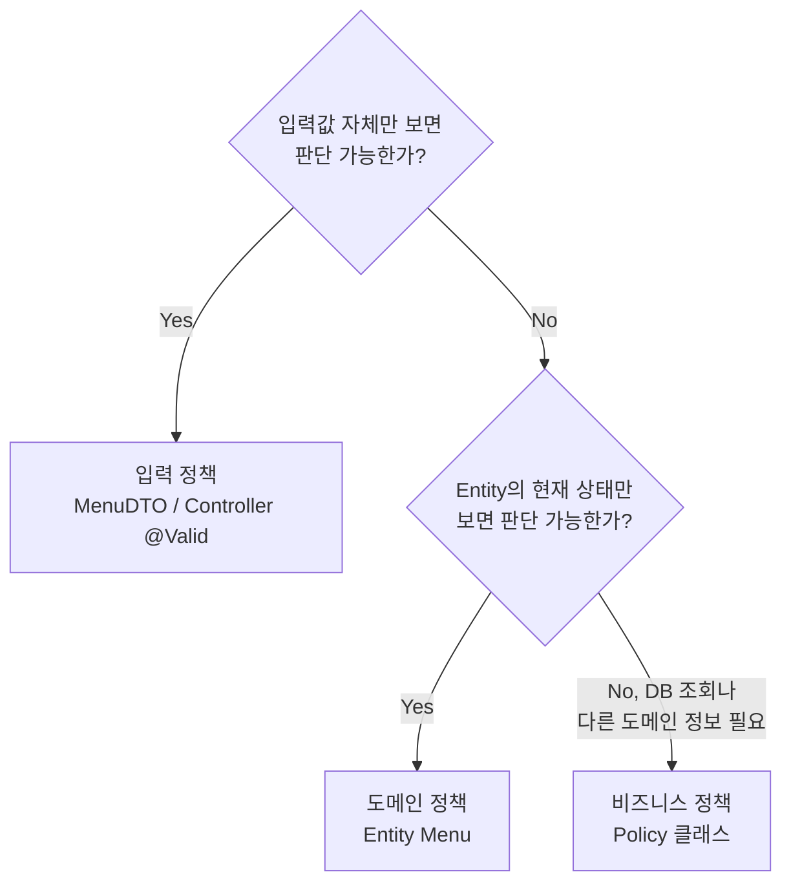
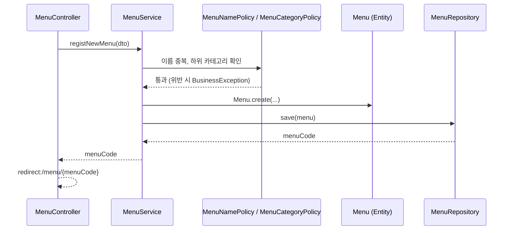

## 들어가며 (Situation)

앞 글에서 `module07-jpa-mini-project`의 PRD와 계층 구조를 정리했다. 이 글은 그중 가장 설계 판단이 많이 들어간 부분, **정책 11개를 어느 코드에 둘 것인가**와 **위반했을 때 어떻게 응답할 것인가**를 다룬다.

> 현재 상태: 제공된 코드는 TODO가 남은 뼈대다. 아래의 `Menu`, `Policy` 코드는 **PRD와 뼈대의 주석을 바탕으로 한 구현 예시**이며, 수업의 최종 정답 코드가 아니다.

## 문제 상황 (Task)

메뉴 서비스에는 규칙이 많다.

| 예 | 규칙 |
|---|---|
| 이름이 비어 있다 | 이름은 필수이며 30자 이하 |
| 이미 판매중지된 메뉴를 또 판매중지한다 | 허용하지 않음 |
| 같은 이름이 이미 있다 | 허용하지 않음 |
| 주문 이력이 있는 메뉴를 삭제한다 | 허용하지 않음 |

모두 `if`로 막을 수 있지만, **전부 Service에 쌓으면** Service는 규칙 덩어리가 되고 어떤 규칙이 어디 있는지 찾기 어려워진다. 반대로 규칙마다 위치가 제각각이면 같은 규칙이 두 곳에서 어긋난다.

## 해결 과정 (Action)

### 1. 판단 기준: "무엇을 알아야 판단할 수 있는가?"

PRD가 제시한 기준은 하나의 질문이다. **이 규칙은 무엇을 알아야 판단할 수 있는가?**



| 종류 | 판단에 필요한 것 | 위치 | 예 |
|---|---|---|---|
| 입력 | 입력값뿐 | `MenuDTO`, Controller | POL-01 이름 필수·30자 이하, POL-02 가격 0 이상, POL-03 카테고리 선택 |
| 도메인 | 자기 자신의 현재 상태 | `Menu` Entity | POL-05 이미 판매중지된 메뉴는 중지 불가, POL-07 판매중 메뉴 삭제 불가 |
| 비즈니스 | **다른 데이터** 조회 | Policy 클래스 | POL-08 이름 중복, POL-09 하위 카테고리만, POL-10 주문 이력 |

### 2. 입력 정책: Bean Validation은 "선언"만 한다

DTO에 규칙을 선언하고 Controller에서 `@Valid`로 켠다. 뼈대의 TODO가 가리키는 방향이다.

```java
// 예시 코드 — MenuDTO 의 검증 선언
@NotBlank(message = "메뉴 이름은 필수입니다.")
@Size(max = 30, message = "메뉴 이름은 30자 이하로 입력해주세요.")
private String menuName;

@Min(value = 0, message = "메뉴 가격은 0원 이상이어야 합니다.")
private int menuPrice;

@Positive(message = "카테고리를 선택해주세요.")
private int categoryCode;
```

`@Size(max = 30)`의 30은 임의의 수가 아니라 `tbl_menu.menu_name`이 `VARCHAR(30)`이기 때문이다. **DB 제약과 입력 검증을 맞춰** 두면 DB 오류가 나기 전에 사용자에게 친절한 메시지를 줄 수 있다.

수업 코드의 `MenuController` 주석은 프런트 검증만으로는 부족한 이유를 이렇게 적는다.

> 유효성 검사는 front(js)에서도 진행할 수 있다. 다만 front에서만 진행하면 url 조작, body 조작 시에는 막을 수 없다. 따라서 백엔드에서도 진행해야 한다.

PRD의 POL-09 보충도 같은 논리다. 등록 화면이 하위 카테고리만 보여 주더라도 서버가 **다시 검사**한다. 화면 제한은 편의 기능이고, 요청은 화면을 거치지 않고도 보낼 수 있다.

검증 대상에 따라 실패 시 예외가 다르다는 점이 중요하다.

| 검증 위치 | 방식 | 실패 시 예외 |
|---|---|---|
| 등록 DTO (`@Valid @ModelAttribute`) | 필드 어노테이션 | `MethodArgumentNotValidException` (`BindException`의 하위) |
| `@RequestParam`에 직접 (`@Min`) | 파라미터 어노테이션 | `HandlerMethodValidationException` |

그래서 `GlobalExceptionHandler`에 `BindException`용과 `HandlerMethodValidationException`용 핸들러가 **따로** 있다. (Spring 6.1 이상의 메서드 검증 동작이며, 쓰는 버전을 공식 문서에서 확인하자.)

### 3. 도메인 정책: Entity가 스스로 답한다

판매중지 여부는 **저장된 현재 상태**를 봐야 안다. DTO는 화면에서 넘어온 값만 알 뿐 DB에 저장된 현재 상태를 모르므로 `@Valid`로는 검사할 수 없다. 이 규칙은 Entity의 몫이다.

```java
// 예시 코드 — Menu 의 도메인 규칙
public static Menu create(String menuName, int menuPrice, int categoryCode) {
    return new Menu(0, menuName, menuPrice, categoryCode, "Y");   // POL-04: 항상 판매중으로 시작
}

public void stopSelling() {
    if ("N".equals(orderableStatus)) {
        throw new BusinessException(ErrorCode.ALREADY_STOPPED_MENU);   // POL-05
    }
    this.orderableStatus = "N";
}

public void validateDeletable() {
    if ("Y".equals(orderableStatus)) {
        throw new BusinessException(ErrorCode.ON_SALE_MENU_CANNOT_DELETE);   // POL-07
    }
}
```

Service는 이렇게 얇아진다.

```java
// 예시 코드
@Transactional
public void stopSelling(int menuCode) {
    Menu menu = menuRepository.findById(menuCode)
            .orElseThrow(() -> new BusinessException(ErrorCode.MENU_NOT_FOUND));
    menu.stopSelling();      // 상태 확인과 변경은 Menu에게
}                            // save() 없이도 변경 감지로 UPDATE
```

| 비교 | Service에 `if`를 쓸 때 | Entity에 규칙을 둘 때 |
|---|---|---|
| 규칙 위치 | 여러 Service 메서드에 흩어짐 | `Menu` 한 곳 |
| 상태 우회 | setter로 아무 데서나 변경 가능 | setter가 없어 **규칙을 거쳐야 변경** |
| 요구 변경(품절 추가 등) | 여러 곳 수정 | `Menu` 중심으로 수정 |

setter를 열지 않은 이유가 여기서 이어진다. `setOrderableStatus("N")`이 열려 있으면 POL-05를 건너뛸 수 있다.

### 4. 비즈니스 정책: 조회가 필요하면 Policy

Entity는 Repository를 주입받지 않는다. 이름 중복은 **다른 메뉴를 조회해야** 알 수 있으니 Entity가 판단할 수 없다. 그래서 별도 `@Component`인 Policy가 맡는다.

```java
// 예시 코드 — MenuNamePolicy
@Component
@RequiredArgsConstructor
public class MenuNamePolicy {

    private final MenuRepository menuRepository;

    public void validateNewName(String menuName) {
        if (menuRepository.existsByMenuName(menuName)) {
            throw new BusinessException(ErrorCode.DUPLICATE_MENU_NAME);
        }
    }

    public void validateRename(int menuCode, String newMenuName) {   // 자기 자신은 제외
        if (menuRepository.existsByMenuNameAndMenuCodeNot(newMenuName, menuCode)) {
            throw new BusinessException(ErrorCode.DUPLICATE_MENU_NAME);
        }
    }
}
```

Policy의 약속은 뼈대 주석에 명시되어 있다.

- **된다/안 된다만 판단한다.** 위반하면 예외를 던지고, 통과하면 아무것도 하지 않는다.
- **상태를 바꾸지 않는다.** `save`, Entity 값 변경, DTO 반환은 Service의 일이다.
- 하위 카테고리 판단은 Policy가 `refCategoryCode == null`을 직접 해석하지 않고 **`Category.isSubCategory()`에게 묻는다.** 내부 구조를 Entity가 숨긴다.

이름 수정 시 자기 자신을 제외하는 이유는 `validateRename`의 `NotMenuCode` 조건이다. 자기 이름 그대로 저장하는 것은 중복이 아니다.

### 5. Service는 순서만 안다



삭제는 PRD가 **검사 순서까지** 못 박았다. 판매중 여부(자기 상태)를 먼저, 주문 이력(다른 팀에 질문)을 나중에 본다. 비용이 싼 검사를 먼저 하고, 외부에 묻는 일은 뒤로 미루는 합리적인 순서다.

### 6. 위반을 어떻게 알릴까: ErrorCode + 전역 핸들러

비즈니스 예외마다 클래스를 만드는 대신 `ErrorCode` enum 하나에 상태코드와 메시지를 모았다.

| ErrorCode | 상태 | 의미 |
|---|---|---|
| `MENU_NOT_FOUND`, `CATEGORY_NOT_FOUND` | 404 | 대상 없음 |
| `ALREADY_STOPPED_MENU`, `ALREADY_ON_SALE_MENU` | 409 | 현재 상태와 충돌 |
| `DUPLICATE_MENU_NAME`, `ORDERED_MENU_CANNOT_DELETE` | 409 | 다른 데이터와 충돌 |
| `NOT_SUB_CATEGORY` | 400 | 잘못된 요청 |

`BusinessException`은 `ErrorCode` 하나를 들고 다니는 예외이고, 화면을 만드는 일은 `@ControllerAdvice`의 `GlobalExceptionHandler`가 한다.

```java
@ExceptionHandler(BusinessException.class)
public ModelAndView handleBusinessException(BusinessException e) {
    return errorPage(e.getErrorCode().getStatus(), e.getMessage());   // 제공 코드
}
```

핸들러가 처리하는 예외는 PRD 7장에 모두 정의되어 있다.

| 상황 | 예외 | 상태 |
|---|---|---|
| 정책 위반 | `BusinessException` | ErrorCode의 상태 |
| 등록 입력 검증 실패 | `BindException` | 400 |
| `@RequestParam` 검증 실패 | `HandlerMethodValidationException` | 400 |
| 필수값 누락, `/menu/abc` | `MissingServletRequestParameterException`, `MethodArgumentTypeMismatchException` | 400 |
| 정책이 막지 못한 DB 제약 위반 | `DataIntegrityViolationException` | 409 |
| 없는 URL | `NoResourceFoundException` | 404 |
| 그 외 | `Exception` | 500 (`log.error`로 기록, 스택트레이스는 화면에 노출하지 않음) |

이렇게 하면 Controller에는 `try-catch`가 없고 정상 흐름만 남는다.

### 7. BusinessException은 왜 RuntimeException인가

뼈대 주석이 직접 이유를 적었다. **unchecked이므로 `throws` 선언 없이 전파되고, `@Transactional` 안에서 발생하면 롤백된다.** 앞서 정리한 [Checked/Unchecked 예외와 롤백 규칙]({{ site.baseurl }}/2026/11/03/spring-transactional-checked-unchecked-rollback/)이 그대로 설계에 쓰인 지점이다. Checked 예외였다면 기본 설정에서는 커밋되어, 정책을 위반했는데도 일부 변경이 저장될 수 있다.

## 결과 (Result)

정책 11개를 위치로 분류한 결과다.

| 종류 | 개수 | 위치 |
|---|---|---|
| 입력 | 3 (POL-01~03) | `MenuDTO` / Controller |
| 도메인 | 4 (POL-04~07) | `Menu` |
| 비즈니스 | 3 (POL-08~10) | `policy` 패키지 |
| 공통 | 1 (POL-11) | `MenuService` |

배운 점은 이렇다.

1. 규칙의 위치는 취향이 아니라 **"판단에 무엇이 필요한가"** 로 정해진다. 같은 질문 하나로 11개가 분류된다.
2. setter를 닫으면 규칙이 **우회 불가능**해진다. 캡슐화가 곧 정책 보장이다.
3. 예외를 전역에서 처리하면 Controller와 Service가 **정상 흐름만** 표현한다.
4. 화면에서 막았다고 안심하지 않는다. **서버는 항상 다시 검사한다.**

미해결로 남는 질문이 있다. 판매중 여부 검사(`Menu.validateDeletable`)와 주문 이력 검사(`MenuDeletionPolicy`)가 서로 다른 객체에서 일어나는데, 두 검사를 **한 트랜잭션 안에서** 보는 것이 맞는지는 구현해 보며 확인해야 한다.

## 더 학습하면 좋은 개념

- **Bean Validation (Jakarta Validation) 표준과 그룹/커스텀 제약** — `@NotBlank`, `@Size`가 어떻게 동작하는지, 직접 제약을 만들려면 무엇이 필요한지 이해하게 해 준다.
- **`@RestControllerAdvice`와 `ProblemDetail` (RFC 9457)** — 이 프로젝트는 화면을 응답하지만 REST API로 확장하면 표준 에러 응답 형식이 필요하다.
- **도메인 모델 vs 트랜잭션 스크립트** — Entity가 규칙을 갖는 설계가 Service 중심 설계와 어떻게 다른지 비교하는 관점이다.
- **Spring Data JPA 변경 감지와 `save()`** — 판매중지 구현이 왜 `save()` 없이 UPDATE되는지를 영속성 컨텍스트 수준에서 설명한다.
- **HTTP 상태 코드 (400 / 404 / 409)의 의미** — `ErrorCode`가 각 오류에 왜 그 상태를 붙였는지 판단하는 기준이다.

## 참고 자료

- [Spring Framework 공식 문서 - Validation (Bean Validation)](https://docs.spring.io/spring-framework/reference/core/validation/beanvalidation.html)
- [Spring Framework 공식 문서 - Controller Advice](https://docs.spring.io/spring-framework/reference/web/webmvc/mvc-controller/ann-advice.html)
- [Spring Framework 공식 문서 - Exceptions (`@ExceptionHandler`)](https://docs.spring.io/spring-framework/reference/web/webmvc/mvc-controller/ann-exceptionhandler.html)
- [Jakarta Bean Validation 명세](https://jakarta.ee/specifications/bean-validation/)
- [MDN - HTTP 응답 상태 코드](https://developer.mozilla.org/ko/docs/Web/HTTP/Status)
- [프로젝트 뼈대 글]({{ site.baseurl }}/2026/11/04/jpa-mini-project-prd-layered-architecture/)
