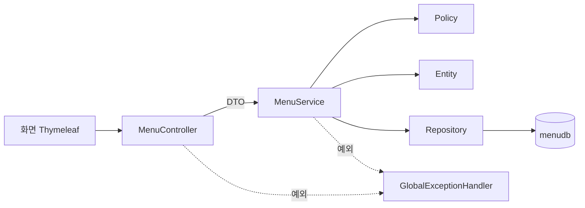

## 들어가며 (Situation)

JPA 수업의 마지막 `module07-jpa-mini-project`는 **레스토랑 메뉴 관리 웹 서비스**를 만드는 미니 프로젝트다. 앞선 실습(`chap01`~`chap03`)은 개념 하나를 확인하는 짧은 코드였다. 이번에는 처음으로 **여러 개념을 한 프로젝트에 조립**한다.

프로젝트 루트의 `README.md`는 설명서가 아니라 **PRD(제품 요구사항 문서)** 다. 첫머리의 문장이 인상적이었다.

> 이 문서 하나만 보고 개발할 수 있어야 한다. … 코드를 짜다가 막히면 코드가 아니라 이 문서를 먼저 본다.

이 글은 그 PRD와 제공된 뼈대 코드를 읽고, **프로젝트의 틀이 어떻게 짜여 있는지** 정리한 기록이다. 정책, 에러 처리, 팀 간 계약은 다음 글에서 이어간다.

> 현재 상태: 제공된 코드는 완성본이 아니라 **TODO가 남아 있는 뼈대**다. 이 글은 구현 결과가 아니라 **설계를 읽은 내용**이다. 구현하면서 이 글을 갱신할 계획이다.

## 문제 상황 (Task)

| 요구 | 내용 |
|---|---|
| 기능 | 메뉴 조회 / 목록 / 가격 검색 / 등록 / 이름 수정 / 판매중지·재개 / 삭제 (**7개**) |
| 제약 | 테이블은 SQL 스크립트로 만들고 JPA는 만들지 않는다 (`ddl-auto: none`) |
| 제약 | 주문 데이터는 **다른 팀(Order 팀)** 소유다 |
| 기술 | Java 21, Spring Boot 3.5, Spring Data JPA, Thymeleaf, MySQL 8 |

기능 7개는 적어 보이지만, 코드를 막 짜기 시작하면 금방 이런 질문이 쏟아진다.

1. "이름은 30자 이하여야 한다"는 검사는 **어디에** 둘까?
2. "판매중인 메뉴는 삭제할 수 없다"는 어디에?
3. 실패하면 어떤 화면과 상태코드를 보여줄까?
4. 남의 팀 데이터가 필요하면?

이 질문들의 답을 **코드 전에 문서로 정해 두는 것**이 이 프로젝트의 출발점이다.

## 해결 과정 (Action)

### 1. PRD의 각 장은 코드의 한 계층에 대응한다

PRD는 10개 장으로 구성되고, 각 장이 코드의 어디로 옮겨질지 미리 정해져 있다.

| PRD 장 | 내용 | 코드로 옮겨지는 곳 |
|---|---|---|
| 4. 화면 설계 | 화면 9개, Model 이름 | `templates/**.html`, View 이름 |
| 5. API 명세 | API 14개 | `MenuController`의 `@GetMapping` / `@PostMapping` |
| 6. 정책 정의 | 정책 11개 | `MenuDTO`, `Menu`, `policy` 패키지 |
| 7. 에러 정의 | 에러 코드 8개 + 그 밖의 예외 | `ErrorCode`, `GlobalExceptionHandler` |
| 8. 데이터베이스 | ERD, 매핑 | `Menu`, `Category`, Repository |
| 9. 팀 간 계약 | 인터페이스 합의 | `MenuOrderHistoryChecker` |

그래서 기능 하나를 구현하는 순서가 기계적이다. PRD가 든 예시인 **F-06 판매중지**를 따라가 보면 이렇다.

| 순서 | PRD에서 읽는 것 | 결정되는 코드 |
|---|---|---|
| 1 | API-13: `POST /menu/stop`, 성공 시 `/menu/{menuCode}`로 redirect | `MenuController.stopSelling()` |
| 2 | POL-11: 없는 메뉴면 `MENU_NOT_FOUND` | `MenuService`에서 조회 |
| 3 | POL-05: **현재 상태**가 판매중지면 안 된다 | `Menu.stopSelling()` |
| 4 | DB: `orderable_status`를 `N`으로 | 변경 감지로 UPDATE (`save` 불필요) |
| 5 | 에러: `ALREADY_STOPPED_MENU` = 409 | `GlobalExceptionHandler`가 에러 화면 응답 |

세 번째 줄의 "변경 감지로 UPDATE"가 반가운 부분이다. 앞선 글에서 배운 영속 상태의 변경 감지가 여기서는 `save()`를 호출하지 않는 판매중지 구현으로 이어진다.

### 2. 패키지 구조: 도메인 우선, 그 안에서 계층

```
com.wanted.project
├─ domain
│  ├─ menu
│  │  ├─ controller   MenuController
│  │  └─ model
│  │     ├─ dao       MenuRepository, CategoryRepository
│  │     ├─ dto       MenuDTO, CategoryDTO
│  │     ├─ entity    Menu, Category
│  │     ├─ policy    MenuNamePolicy, MenuCategoryPolicy, MenuDeletionPolicy,
│  │     │            MenuOrderHistoryChecker (인터페이스)
│  │     └─ service   MenuService
│  └─ order           FakeMenuOrderHistoryChecker   ← Order 팀 영역
└─ global
   ├─ config          ContextConfig, JpaConfig, IndexController, Application
   └─ exception       BusinessException, ErrorCode, GlobalExceptionHandler
```

`controller/service/repository`를 최상위에 두는 방식(계층 우선)과 비교하면 이렇다.

| 항목 | 계층 우선 | 도메인 우선 (이 프로젝트) |
|---|---|---|
| 구조 | `controller/` 안에 모든 도메인 | `menu/` 안에 모든 계층 |
| 팀 분업 | 같은 폴더를 여러 팀이 수정 | 팀(도메인)별로 폴더가 나뉨 |
| 경계 | 도메인 간 경계가 흐림 | 도메인 간 접근이 눈에 띔 |

PRD에 "Menu 팀"과 "Order 팀"이 나뉘어 있으므로 도메인 우선 구조가 자연스럽다. 공통 설정과 예외는 `global`에 모았다.

### 3. 계층별 책임 — 뼈대 코드의 주석이 곧 설계서

제공된 모든 클래스 맨 위에는 **역할**과 **책임**이 주석으로 적혀 있다. 이를 표로 모으면 이 프로젝트의 규칙이 된다.



| 계층 | 맡는 일 | 하지 않는 일 |
|---|---|---|
| Controller | 요청 받기, 입력 검증 **선언**, View/redirect 결정 | 비즈니스 로직, 트랜잭션, Entity 다루기, `try-catch` |
| Service | 트랜잭션 경계, 조회 → 규칙 확인 → 변경 → 저장 → DTO 변환의 **순서** | 규칙을 `if`로 직접 판단하기 |
| Entity | 만드는 규칙, 바꾸는 규칙, 자신의 현재 상태로 하는 판단 | Repository 등 Bean 주입, DTO 알기 |
| Policy | 조회가 필요한 비즈니스 규칙 판단 | 상태 변경, `save` 호출, DTO 반환 |
| Repository | 무엇을 조회/저장할지 **선언** | DTO 변환, 규칙 판단 |
| DTO | 값 운반, 입력 **형식** 검증 규칙 선언, `Entity → DTO` 변환 | 비즈니스 로직, DB 접근 |

특히 눈에 띈 부분은 Service에 대한 문장이다.

> 규칙을 직접 판단하지 않는다. (`if` 문으로 규칙을 검사하고 있다면 Entity나 Policy로 옮길 대상)

Service가 비대해지는 전형적인 실패(Fat Service)를 문서 차원에서 막는 규칙이다. 정책을 어디에 두는지는 다음 글에서 자세히 다룬다.

### 4. 틀을 이루는 설계 결정 6가지

| 결정 | 이유 |
|---|---|
| `ddl-auto: none` | 테이블은 `menudb-script.sql`이 만든다. 수업 주석대로 Entity를 추가·변경해도 테이블이 바뀌지 않는다 |
| Entity에 setter 없음, 생성자 `private` | 값을 바꾸는 길을 `create()`, `changeMenuName()` 같은 **이름 있는 메서드**로만 열어 규칙을 우회하지 못하게 한다 |
| `Menu.categoryCode`를 `@ManyToOne`이 아닌 `int`로 | 다른 도메인은 객체가 아닌 **ID로 참조**하는 규칙이다. 연관관계 매핑은 이 단계에서 쓰지 않는다 |
| `Category.refCategoryCode`는 `Integer` | 최상위 카테고리는 `NULL`이다. `int`는 `null`을 담지 못하므로 래퍼 타입을 쓴다 |
| 성공 후 **redirect** (PRG 패턴) | 등록 후 새로고침해도 POST가 반복되지 않게 한다 |
| 화면에 전달하는 Model 이름을 PRD로 고정 (`result`, `menuList`, `price`) | 템플릿(HTML)은 이미 제공되므로, 개발자는 **이름만 지키면** 화면이 붙는다 |

여기서 `Integer` 결정은 앞의 `chap03` 글과 연결된다. 매핑의 의미를 알아야 "왜 래퍼 타입인가"가 보인다. 엔티티 매핑은 [엔티티 매핑 글]({{ site.baseurl }}/2026/11/03/jpa-entity-mapping-column-enumerated-generatedvalue/)에서 정리했다.

### 5. 쿼리 방식 선택: 어떤 조회에 무엇을 썼나

| 용도 | 방식 | 이유 |
|---|---|---|
| 전체 목록 (번호 오름차순) | `findAll(Sort)` | 기본 제공 |
| 가격 초과 검색 | **쿼리 메서드** `findByMenuPriceGreaterThanOrderByMenuPrice` | 조건이 하나라 메서드 이름으로 충분 |
| 하위 카테고리 목록 | **`@Query` native query** | 쿼리 메서드로 쓰기엔 `IS NOT NULL` 조건과 정렬이 뒤섞인다 |
| 이름 중복 확인 | `existsBy~` 쿼리 메서드 | 존재 여부만 필요하면 엔티티를 가져올 필요가 없다 |

수업 주석에 따르면 쿼리 메서드는 조건이 적을 때 장점이고, 조건이 많거나 Join이 걸리면 가독성이 떨어진다. 그때 `@Query`로 JPQL(엔티티 대상) 또는 native query(실제 DB의 SQL)를 직접 쓴다. 뼈대 코드는 후자를 선택했다.

### 6. 시행착오가 될 법한 지점 (미리 짚기)

아직 구현 전이라 직접 겪은 시행착오는 아니고, **문서와 코드를 대조하며 발견한 불일치**다.

| 항목 | PRD | 코드 주석 | 판단 |
|---|---|---|---|
| 가격 검색 조건 | 입력 가격 **초과** | Controller 주석: "menuPrice **이상**" | 메서드가 `GreaterThan`이므로 PRD(초과)가 맞다. 주석을 고쳐야 한다 |
| 가격 검증 메시지 | "가격은 0원 이상으로 입력해주세요." | `@Min(message = "가격은 0 이상 입력!")` | 메시지도 PRD와 맞춰야 한다 |

PRD의 첫 문장대로라면 이런 불일치를 발견했을 때 **문서를 기준으로 코드를 고친다.**

## 결과 (Result)

아직 구현이 끝나지 않았으므로 성능 지표는 없다. 대신 이 단계의 결과를 숫자와 규칙으로 정리한다.

| 항목 | 수 |
|---|---|
| 기능 | 7 |
| 화면 | 9 |
| API | 14 |
| 정책 | 11 |
| 에러 코드 | 8 |

배운 점은 이렇다.

1. 좋은 PRD는 **"어디에 무엇을 짤지"** 에 대한 고민을 미리 없애 준다. 구현 중 막히면 코드가 아니라 문서를 먼저 본다.
2. 계층을 나누는 이유는 이름이 아니라 **"하지 않는 일"** 을 정하는 데 있다. 책임 표의 오른쪽 열이 중요하다.
3. 요구가 바뀌면 코드보다 **PRD를 먼저 고친다.** (PRD의 예: 판매상태에 품절 `S` 추가 → 정책, 에러 코드, DB 허용 값 순서로 문서 수정 후 코드 수정)

다음 글에서는 11개 정책을 **입력 / 도메인 / 비즈니스** 세 종류로 나누는 기준을 다룬다.

## 더 학습하면 좋은 개념

- **도메인 주도 설계(DDD)의 풍부한 도메인 모델** — `Menu.stopSelling()`처럼 Entity가 규칙을 가지는 구조가 이론적으로 어디서 왔는지 보여 준다. 서비스 계층 중심 설계(트랜잭션 스크립트)와의 차이를 이해할 수 있다.
- **PRG(Post-Redirect-Get) 패턴** — 새로고침 중복 제출을 막는 이유를 HTTP 관점에서 이해하는 개념이다.
- **Spring Data JPA 쿼리 메서드 키워드와 `@Query`(JPQL, native)** — 이 프로젝트의 조회 방식 선택 기준을 더 넓게 판단하게 해 준다.
- **패키지 구조 전략 (계층 우선 vs 도메인 우선 vs 헥사고날)** — 프로젝트가 커졌을 때 구조를 어떻게 바꿔야 하는지 판단하는 기준이다.
- **PRD / API 명세 / 화면 설계서 작성법** — 이 프로젝트에서 문서가 코드를 이끄는 방식을 실무 협업으로 확장해 준다.

## 참고 자료

- [Spring Data JPA 공식 문서 - Query Methods](https://docs.spring.io/spring-data/jpa/reference/jpa/query-methods.html)
- [Spring Data JPA 공식 문서 - Using `@Query`](https://docs.spring.io/spring-data/jpa/reference/jpa/query-methods.html#jpa.query-methods.at-query)
- [Spring Boot 공식 문서 - SQL Databases](https://docs.spring.io/spring-boot/reference/data/sql.html)
- [Spring Framework 공식 문서 - Spring MVC](https://docs.spring.io/spring-framework/reference/web/webmvc.html)
- [엔티티 매핑 글]({{ site.baseurl }}/2026/11/03/jpa-entity-mapping-column-enumerated-generatedvalue/)
