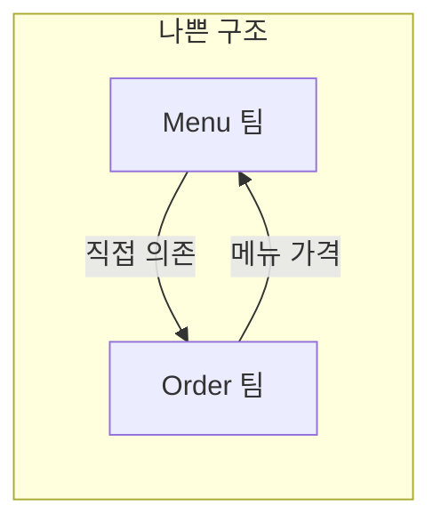
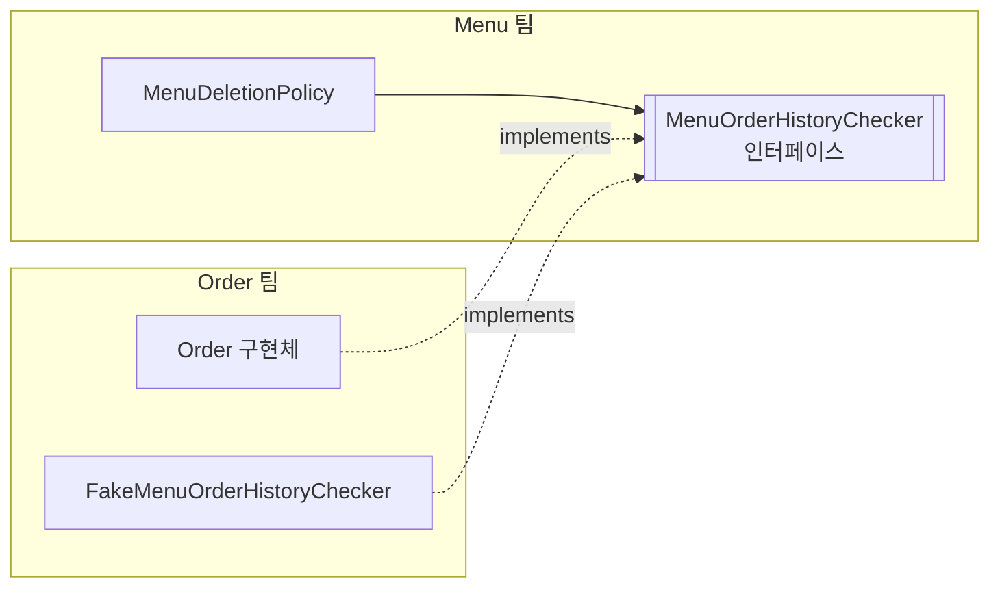

## 들어가며 (Situation)

`module07-jpa-mini-project`의 삭제 기능에는 이런 정책이 있다.

> **POL-10** 주문 이력이 있는 메뉴는 삭제할 수 없다.

문제는 **주문 이력은 Order 팀의 데이터**라는 점이다. Menu 팀은 `tbl_order_menu`를 조회해야 하지만, Order 팀의 구현은 아직 없다. 이 글은 프로젝트가 이 상황을 어떻게 풀었는지, 그리고 그 안에 담긴 **의존성 역전** 원리를 정리한다.

> 현재 상태: 뼈대의 `MenuDeletionPolicy`는 TODO이다. 아래 `MenuDeletionPolicy` 코드는 PRD와 주석을 따른 **예시 구현**이다.

## 문제 상황 (Task)

| 질문 | 내용 |
|---|---|
| 상대 구현이 없다 | Order 팀을 기다리면 Menu 팀의 삭제 기능이 멈춘다 |
| 직접 접근하면? | Order의 Repository/Entity를 import하면 두 팀의 코드가 엉킨다 |
| 의존 방향 | Order는 메뉴 가격이 필요해 **이미 Menu에 의존**한다. Menu가 Order에 의존하면 **순환 의존**이 된다 |



## 해결 과정 (Action)

### 1. 검토한 대안

| 대안 | 장점 | 단점 |
|---|---|---|
| 1. Menu 팀이 `tbl_order_menu`를 직접 조회 | 가장 빠름 | Order 테이블 구조를 알게 됨. Order 팀이 바꾸면 Menu가 깨짐 |
| 2. Order 팀의 Service/Repository를 호출 | 데이터는 정확 | 순환 의존, 팀 간 강한 결합 |
| 3. Order 팀 완성까지 기다림 | 단순 | 일정 지연 |
| 4. **Menu 팀이 인터페이스를 정의하고 Order 팀이 구현** | 의존 방향 단방향, 병렬 개발 가능 | 계약을 처음에 합의해야 함 |

프로젝트는 4번을 선택했다.

### 2. 계약: 메서드 하나

```java
// 제공 코드 — domain/menu/model/policy/MenuOrderHistoryChecker.java
public interface MenuOrderHistoryChecker {
    boolean hasOrdered(int menuCode);
}
```

인터페이스는 **Menu 팀 패키지**에 있다. 이것이 핵심이다.

| 항목 | 내용 |
|---|---|
| 정의 | Menu 팀 (필요한 쪽) |
| 구현 | Order 팀 (정보를 가진 쪽) |
| 주고받는 값 | 기본형 `int`, `boolean` (Entity가 아님) |
| Menu가 아는 것 | 이 메서드 하나 |

### 3. 의존성 역전(DIP): 화살표 방향이 뒤집힌다



`MenuDeletionPolicy`가 필요로 하는 능력(주문 이력 여부)을 **자기가 인터페이스로 정의**하고, 구현은 바깥이 맞춰 온다. 기존에는 "상위 모듈(Menu)이 하위 모듈(Order)의 구현에 의존"하지만, 여기서는 **둘 다 인터페이스에 의존**한다. 프로젝트 코드의 주석 표현대로 의존 방향은 Order → Menu **한 방향**으로 유지된다. 순환 의존이 사라진다.

### 4. Policy는 인터페이스 타입만 주입받는다

```java
// 예시 구현
@Component
@RequiredArgsConstructor
public class MenuDeletionPolicy {

    private final MenuOrderHistoryChecker orderHistoryChecker;   // 구현체가 아닌 인터페이스 타입

    public void validateDeletable(int menuCode) {
        if (orderHistoryChecker.hasOrdered(menuCode)) {
            throw new BusinessException(ErrorCode.ORDERED_MENU_CANNOT_DELETE);
        }
    }
}
```

주입받는 타입이 인터페이스이므로 `Policy`는 구현이 Fake인지 진짜인지 모른다. 어떤 구현체가 들어올지는 스프링 컨테이너가 정한다.

### 5. Order 팀이 없을 때: Fake

```java
// 제공 코드 — domain/order/FakeMenuOrderHistoryChecker.java
@Component
public class FakeMenuOrderHistoryChecker implements MenuOrderHistoryChecker {

    private static final Set<Integer> ORDERED_MENU_CODES = Set.of(1, 2, 3);

    @Override
    public boolean hasOrdered(int menuCode) {
        return ORDERED_MENU_CODES.contains(menuCode);
    }
}
```

1, 2, 3번 메뉴는 주문 이력이 있다고 **가정**하는 가짜 구현이다. 덕분에 Menu 팀은 다음을 바로 확인할 수 있다.

| 시나리오 | 기대 결과 |
|---|---|
| 판매중지된 1번 메뉴 삭제 | `ORDERED_MENU_CANNOT_DELETE` (409) |
| 판매중지된 13번 메뉴 삭제 | 삭제 성공 |
| 판매중인 13번 메뉴 삭제 | `ON_SALE_MENU_CANNOT_DELETE` (409) — 검사 순서상 이력 조회 전에 막힘 |

세 번째 줄은 PRD의 검사 순서(판매중 여부 → 주문 이력) 덕분에 Fake에 **질문하기도 전에** 걸러진다. (위 표는 PRD와 Fake 코드에서 도출한 **예상 동작**이며, 실제 구현 후 직접 확인이 필요하다.)

### 6. 교체 시나리오와 주의점

Order 팀이 진짜 구현을 만들면 **Fake 클래스만 삭제**한다. `MenuDeletionPolicy`는 한 줄도 바뀌지 않는다.

주의할 점이 하나 있다. 스프링은 인터페이스 타입 주입 시 후보 Bean이 **둘 이상이면** 어느 것인지 결정하지 못한다. Fake를 지우지 않고 진짜 구현을 추가하면 같은 타입의 Bean이 두 개가 되어 시작 시 실패한다. (`NoUniqueBeanDefinitionException`) 그래서 PRD도 "교체 시 Fake를 삭제한다"고 명시한다. 둘 다 두고 싶다면 `@Primary`나 프로필(`@Profile`)로 구분하는 방법이 있다.

| 방법 | 용도 |
|---|---|
| Fake 삭제 (이 프로젝트) | 단순하게 교체 |
| `@Primary` | 둘 다 두되 기본값 지정 |
| `@Profile("dev")` / `@Profile("prod")` | 환경별 구현 선택 |

### 7. 협업 규칙 5가지

PRD가 정리한 규칙을 그대로 옮기면 팀 개발의 체크리스트가 된다.

1. 다른 팀의 Repository / Entity를 `import`하지 않는다.
2. 값은 Entity가 아닌 기본형 / DTO로 주고받는다.
3. **필요한 쪽이 인터페이스를 정의**하고, 정보를 가진 쪽이 구현한다.
4. 상대 구현이 없으면 Fake로 먼저 개발한다.
5. 계약을 바꿔야 하면 상대 팀과 **합의한 뒤** 바꾼다.

## 결과 (Result)

| 비교 | 직접 의존 | 인터페이스 + Fake |
|---|---|---|
| 의존 방향 | 순환 가능 | 단방향 (Order → Menu) |
| Order 팀 대기 | 필요 | 불필요 |
| 테스트 | Order 데이터 필요 | Fake로 즉시 가능 |
| 구현 교체 시 Menu 팀 코드 | 수정 | **변경 없음** |

(수치 대신 구조 비교로 정리했다. 구현 후 실제 테스트 결과를 덧붙일 예정이다.)

배운 점은 이렇다.

1. "누가 누구에게 의존하는가"는 **인터페이스를 어느 패키지에 두느냐**로 정해진다.
2. Fake는 단순한 목(mock)이 아니라 **팀 간 병렬 개발을 가능하게 하는 계약의 일부**다.
3. 이 설계가 가능한 것은 스프링의 **DI** 덕분이다. 구현체 선택을 코드가 아니라 컨테이너에 맡긴다. 이 프로젝트의 `@ComponentScan`이 `com.wanted.project` 전체를 스캔하도록 `ContextConfig`를 둔 것도 `domain.order` 아래의 Fake까지 Bean으로 등록하기 위해서다.

## 더 학습하면 좋은 개념

- **SOLID의 D, 의존성 역전 원칙(DIP)과 IoC/DI의 관계** — DIP는 설계 원칙이고 DI는 그것을 구현하는 기법이다. 둘을 구분하면 "왜 인터페이스를 쓰는가"가 명확해진다. 앞서 정리한 [IoC 컨테이너와 Bean 글]({{ site.baseurl }}/2026/11/02/spring-ioc-container-bean-scope/)과 이어진다.
- **헥사고날 아키텍처 (Ports & Adapters)** — `MenuOrderHistoryChecker`는 Port, 구현체는 Adapter에 해당한다. 이 프로젝트 구조의 확장판이다.
- **`@Primary`, `@Qualifier`, `@Profile`** — 같은 타입의 Bean이 여럿일 때 선택하는 스프링의 방법이다.
- **Test Double (Dummy, Stub, Fake, Mock, Spy)** — Fake와 Mock의 차이를 구분하면 테스트 전략을 세울 수 있다.
- **소비자 주도 계약 테스트 (Consumer-Driven Contract)** — 팀 간 계약이 어긋나지 않는지 자동으로 검증하는 방법이다.

## 참고 자료

- [Spring Framework 공식 문서 - Dependency Injection](https://docs.spring.io/spring-framework/reference/core/beans/dependencies/factory-collaborators.html)
- [Spring Framework 공식 문서 - Fine-tuning Annotation-based Autowiring with `@Primary`](https://docs.spring.io/spring-framework/reference/core/beans/annotation-config/autowired-primary.html)
- [Spring Framework 공식 문서 - Using `@Profile`](https://docs.spring.io/spring-framework/reference/core/beans/environment.html#beans-definition-profiles-java)
- [Spring Framework 공식 문서 - Classpath Scanning and Managed Components](https://docs.spring.io/spring-framework/reference/core/beans/classpath-scanning.html)
- [프로젝트 뼈대 글]({{ site.baseurl }}/2026/11/04/jpa-mini-project-prd-layered-architecture/)
- [정책 분리와 전역 예외 처리 글]({{ site.baseurl }}/2026/11/04/jpa-mini-project-policy-exception-handling/)
