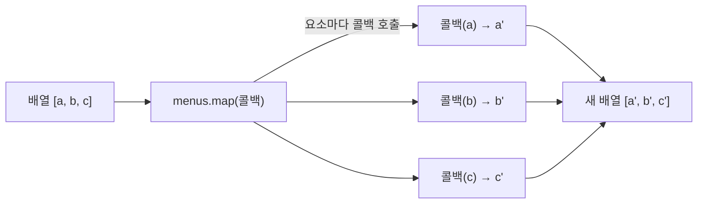
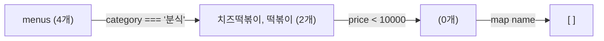

## 들어가며 (Situation)

`01_Core`의 마지막 두 파일은 `05_array.js`(배열)와 `06_higher-order-method.js`(고차함수)다. 앞선 글에서 **함수는 값**이고 화살표 함수로 짧게 쓸 수 있다는 것을 정리했다. 이 글에서는 그 둘이 만나는 지점, **배열의 고차함수**를 정리한다.

배경은 "메뉴 목록에서 조건에 맞는 것을 골라 이름만 뽑는" 식당 데이터 처리다.

## 문제 상황 (Task)

```js
const menus = [
    {name : '치즈떡볶이', category : '분식', price: 14000},
    {name : '떡볶이',     category : '분식', price: 10000},
    {name : '파스타',     category : '양식', price: 18000},
    {name : '김치찜',     category : '한식', price: 8000}
];
```

1. Java 배열과 달리 JS 배열에는 **무엇이든** 들어간다. 어떻게 다뤄야 하나?
2. `for` 문을 쓰지 않고 순회, 변환, 선별을 하려면?
3. "분식 중 가격이 1만 원 미만인 메뉴의 이름 목록"은 어떻게 구하나?

## 해결 과정 (Action)

### 1. 배열은 타입이 자유롭다

```js
const menus = ['제육', '떡볶이', '순대', 1, {name : 'hi'}, function() {}];

for(let i = 0; i < menus.length; i++) {
    console.log(menus[i]);
}
// 제육, 떡볶이, 순대, 1, { name: 'hi' }, [Function (anonymous)]
```

| 항목 | Java 배열 | JS 배열 |
|---|---|---|
| 요소 타입 | **같은 자료형만** | 무엇이든 (문자열, 숫자, 객체, 함수 모두) |
| 크기 | 생성 시 고정 | 동적으로 늘어남 |
| 길이 | `arr.length` (프로퍼티) | `arr.length` (프로퍼티) |

실행 결과에서 함수까지 배열 요소로 출력되는 것을 확인했다. 함수가 값이기 때문이다. 유연한 만큼 첫 글에서 본 동적 타입의 위험이 그대로 따라온다. 같은 종류의 값을 담는 것이 일반적인 규칙이다.

### 2. 고차함수란

> 함수를 인자로 전달받거나, 함수를 반환하는 함수. 배열의 고차함수는 콜백 함수를 인자로 받아 배열의 요소를 순회하며 처리한다.



`for` 문은 **어떻게** 순회할지(인덱스, 조건, 증가)를 쓴다. 고차함수는 **각 요소에 무엇을 할지**만 쓴다.

### 3. 세 가지 기본 메서드 비교

| 메서드 | 콜백이 하는 일 | 반환값 | 원본 배열 |
|---|---|---|---|
| `forEach` | 각 요소 처리 | **없음** (`undefined`) | 변경 안 함 |
| `map` | 각 요소를 **변환** | 변환 결과의 **새 배열** (길이 동일) | 변경 안 함 |
| `filter` | 각 요소가 조건에 맞는지 판단 (`true`/`false`) | 조건이 `true`인 요소만의 **새 배열** (길이 ≤ 원본) | 변경 안 함 |

```js
menus.forEach(menu => console.log(menu));          // 출력만, 반환값 없음

const names = menus.map( menu => menu.name );
console.log(names);   // [ '치즈떡볶이', '떡볶이', '파스타', '김치찜' ]

const snacks = menus.filter( menu => menu.category === '분식');
// [ { 치즈떡볶이 ... }, { 떡볶이 ... } ]
```

| 하고 싶은 일 | 고를 메서드 |
|---|---|
| 출력, 저장 등 **부수효과**만 | `forEach` |
| 요소를 다른 형태로 **바꿔서** 새 배열 | `map` |
| 조건에 맞는 요소만 **골라서** 새 배열 | `filter` |

Java의 `Stream`과 비교하면 `map`, `filter`는 이름과 의미가 같다. 다만 Java `Stream`은 **지연 평가**되고 `collect`로 마무리해야 하지만, JS 배열 메서드는 호출 즉시 **새 배열을 만든다**는 차이가 있다.

### 4. 함정: `==`와 `===`

필터 조건에 `category === '분식'`을 쓴 이유를 수업은 이렇게 짚었다.

```js
console.log(`1 == '1' : ${1 == '1'}`);    // true
console.log(`1 === '1' : ${1 === '1'}`);  // false
```

| 연산자 | 이름 | 동작 |
|---|---|---|
| `==` | 동등 비교 | **암묵적 타입 변환** 후 값 비교 |
| `===` | 일치 비교 | **타입과 값**이 모두 같아야 `true` |

동적 타입 언어에서 `==`는 의도하지 않은 변환 때문에 예측하기 어렵다. 그래서 **기본은 `===`를 쓴다.** (`null == undefined`가 `true`인 점 등 MDN의 변환 규칙표가 방대하다.) Java의 `==`(참조/기본값 비교)와는 전혀 다른 감각이다.

### 5. 조합: filter → filter → map

```js
const result = menus
    .filter(menu => menu.category === '분식')     // 분식만
    .filter(menu => menu.price < 10000)           // 1만 원 미만만
    .map(menu => menu.name)                       // 이름만

console.log(result)
```



각 메서드가 **새 배열을 반환**하기 때문에 `.`으로 이어 쓸 수 있다. (메서드 체이닝) 앞 단계의 결과 배열이 다음 단계의 입력이 된다.

### 6. 직접 돌려 보고 놀란 결과: 빈 배열

이 코드를 실행했더니 결과가 `[]`였다.

| 단계 | 결과 |
|---|---|
| 원본 | 치즈떡볶이(14000), 떡볶이(10000), 파스타(18000), 김치찜(8000) |
| 분식만 | 치즈떡볶이(14000), 떡볶이(10000) |
| 1만 원 **미만** | 둘 다 14000, 10000이므로 **0개** |
| 이름 추출 | `[]` |

에러가 아니라 **조건 설계의 문제**다. 분식 중 가장 싼 `떡볶이`가 정확히 10000원이라 `<`(미만)에서 탈락한다.

| 조건 | 결과 |
|---|---|
| `price < 10000` | `[]` |
| `price <= 10000` | `['떡볶이']` |

비교 연산자 하나의 경계값이 결과를 바꾼다. 메서드 체인은 중간 단계를 한눈에 못 보니, **단계별로 `console.log`를 찍어 보는 습관**이 필요하다. 이번에 `filter`가 빈 배열을 정상 반환할 뿐 에러를 내지 않는 것을 확인했다. Java라면 `Optional`이나 예외로 다루었을 상황이 조용히 지나간다는 점도 인상 깊었다.

또 하나, 코드 주석은 "5개의 메뉴 중"이라고 쓰여 있지만 실제 데이터는 **4개**다. 주석이 데이터 변경을 따라가지 못한 흔적이라, 주석은 코드와 함께 고쳐야 한다는 교훈이다.

### 7. 선택 기준 요약

| 상황 | 쓸 것 |
|---|---|
| 요소 변환 후 새 배열이 필요 | `map` |
| 조건으로 골라내기 | `filter` |
| 반환값이 필요 없고 출력 등만 | `forEach` |
| 조건 만족 요소 **하나**만 필요 | `find` (더 학습) |
| 합계 등 **하나의 값**으로 모으기 | `reduce` (더 학습) |

## 결과 (Result)

| 질문 | 정리 |
|---|---|
| JS 배열의 특징 | 타입 제약이 없고 길이가 동적이다 |
| `for` 없이 순회·변환·선별 | `forEach`, `map`, `filter` |
| 체이닝이 가능한 이유 | `map`, `filter`가 **새 배열**을 반환하기 때문 |
| 비교는 어떻게? | 기본은 `===` |

실행으로 확인한 사실은 이렇다.

- `map` 결과는 입력과 같은 길이(4개)이고, `filter` 결과는 같거나 짧아진다. (4개 → 2개 → 0개)
- 원본 `menus`는 어떤 단계에서도 바뀌지 않았다.

배운 점은 이렇다.

1. 고차함수는 "함수는 값이다"라는 JS의 성질을 가장 실용적으로 쓰는 곳이다.
2. 반복문의 **절차**를 쓰던 방식에서 **의도**(변환/선별)를 쓰는 방식으로 읽기가 바뀐다.
3. 체이닝은 간결하지만 중간값이 안 보이므로 **경계 조건**을 의심하고 단계별로 확인한다.

여기까지가 `01_Core`의 내용이다. 변수와 객체 → 함수 → 배열과 고차함수의 순서로, 각 글이 앞 글의 개념(함수는 값)에 기대고 있다는 흐름이 보였다.

## 더 학습하면 좋은 개념

- **`reduce`, `find`, `some`, `every`, `sort`** — 이 글에서 다루지 않은 나머지 배열 고차함수로, 실무 데이터 가공의 대부분이 여기서 해결된다.
- **전개 연산자(`...`)와 구조 분해 할당** — 배열과 객체를 복사·분해하는 현대 JS 문법으로, 고차함수와 항상 함께 쓰인다.
- **불변성(immutability)과 얕은 복사/깊은 복사** — `map`/`filter`가 원본을 건드리지 않는 설계의 의미이며, 반대로 `sort`, `push` 등은 원본을 바꾼다는 점이 중요하다.
- **동등 비교 알고리즘 (`==`, `===`, `Object.is`)** — 암묵적 타입 변환 규칙을 정리하면 `==`를 피하는 이유가 분명해진다.
- **Java Stream API** — `map`, `filter`가 Java에서는 어떻게 동작하는지 비교하면 두 언어의 함수형 스타일을 모두 이해할 수 있다.

## 참고 자료

- [MDN - Array](https://developer.mozilla.org/ko/docs/Web/JavaScript/Reference/Global_Objects/Array)
- [MDN - `Array.prototype.forEach()`](https://developer.mozilla.org/ko/docs/Web/JavaScript/Reference/Global_Objects/Array/forEach)
- [MDN - `Array.prototype.map()`](https://developer.mozilla.org/ko/docs/Web/JavaScript/Reference/Global_Objects/Array/map)
- [MDN - `Array.prototype.filter()`](https://developer.mozilla.org/ko/docs/Web/JavaScript/Reference/Global_Objects/Array/filter)
- [MDN - 동등 비교와 동일성](https://developer.mozilla.org/ko/docs/Web/JavaScript/Guide/Equality_comparisons_and_sameness)
- [함수·호이스팅·화살표 함수 글]({{ site.baseurl }}/2026/11/17/javascript-function-hoisting-arrow-function/)
