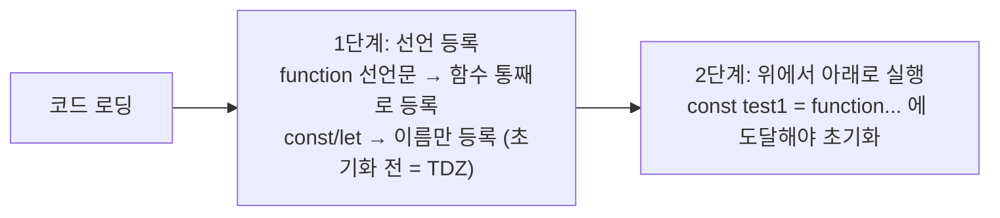

## 들어가며 (Situation)

수업 주석은 JavaScript에서 함수가 왜 중요한지 이렇게 말한다.

> Java는 Class 기반의 객체지향 언어라고 한다면, JS는 Function 기반의 객체지향 언어라고 할 수 있다.

`03_function.js`와 `04_arrow-function.js`는 함수를 만드는 방법(선언문, 표현식, 화살표)과 그 사이의 **동작 차이**를 다룬다. 그 차이는 파일 마지막에서 실제 에러로 드러난다.

## 문제 상황 (Task)

1. 같은 일을 하는 함수가 왜 이렇게 여러 가지 문법인가?
2. 아래 두 호출 중 하나는 되고 하나는 에러다. **왜?**

```js
console.log(cook('떡볶이'));    // 떡볶이 조리 시작 !   (정상)
console.log(test1("떡볶이"));   // ReferenceError!
```

3. 화살표 함수는 단순한 줄임 문법인가?

## 해결 과정 (Action)

### 1. 함수를 만드는 세 가지 방법

```js
// 1) 함수 선언문
function welcome(name) {
    return `${name}님 , 반갑습니다 ~~~~!`
}

// 2) 함수 표현식 : 함수를 값으로 만들어 변수에 담는다
const welcome2 = function (name) { return `${name}님 , 반갑습니다 ~~~~!` }

// 3) 화살표 함수
const welcome3 = name => `${name}님 , 반갑습니다 ~~~~!`
```

| 구분 | 형태 | 변수에 담기는가 | 호이스팅 |
|---|---|---|---|
| 선언문 | `function f() {}` | 아니오 (함수 이름이 곧 식별자) | **함수 전체가** 끌어올려짐 |
| 표현식 | `const f = function() {}` | 예 | 변수 규칙을 따름 (`const`면 TDZ) |
| 화살표 | `const f = () => {}` | 예 | 표현식과 같음 |

함수 표현식이 가능한 이유는 앞 글에서 본 `typeof function(){}`가 `"function"`이라는 사실, 즉 **함수도 값**이기 때문이다. 값이니 변수에 담고, 인자로 넘기고, 반환할 수 있다. (고차함수의 토대다.)

### 2. 이름 붙은 함수 표현식의 비밀

```js
const welcome3 = function hello(name) { return `${name}님 , 반갑습니다`; }

console.log(welcome3("조평훈"));   // 정상
// console.log(hello("조평훈"));   // ReferenceError — 주석 처리되어 있던 이유
```

`hello`라는 이름은 **함수 내부에서만** 보이는 이름이다. 바깥에서는 변수 `welcome3`으로만 호출한다. (재귀 호출이나 스택 트레이스에서 이름을 보여 줄 때 쓴다.)

### 3. 호이스팅: JS 엔진은 코드를 두 번 읽는다

수업 주석:

> 함수 선언문은 런타임 이전에 JS 엔진에 의해 먼저 실행된다(인식). 따라서 함수 선언문 이전에 해당 함수를 참조하거나 호출할 수 있게 된다.



직접 실행한 결과다.

```js
console.log(cook('떡볶이'));      // 떡볶이 조리 시작 !
function cook(menuName) { return `${menuName} 조리 시작 !` }

console.log(test1("떡볶이"))      // ReferenceError: Cannot access 'test1' before initialization
const test1 = function (menuName) { return `${menuName} 조리 시작 !` }
```

| 호출 | 결과 | 이유 |
|---|---|---|
| `cook(...)` (선언문, 선언 앞에서 호출) | 정상 | 1단계에서 함수가 통째로 등록됨 |
| `test1(...)` (`const` 표현식, 선언 앞에서 호출) | **ReferenceError** | 이름은 등록됐지만 **초기화 전**이라 접근 불가 (TDZ) |

주의할 점이 둘 있다.

- **수업 주석의 "호이스팅 불가능"은 정확히는 "초기화 전에 접근 불가"다.** `const`/`let`도 이름은 1단계에 등록된다. 다만 초기화 전에 접근하면 `ReferenceError`가 난다. (`var`로 선언한 함수 표현식이라면 `undefined`가 되어 `TypeError: test1 is not a function`이 난다.)
- 이 파일은 `test1` 줄에서 **에러로 종료**되므로 그 아래 코드는 실행되지 않는다. 의도된 학습용 에러다.

### 4. 오늘의 미션 — Java와 JS의 동작 원리 비교

`03_function.js`에는 이런 미션이 적혀 있다.

> Java 언어의 동작 원리와 JavaScript 언어의 동작 원리를 비교하고, 서로에게 이해시킬 수 있는 자료를 구성하기

호이스팅을 이해하려면 이 비교가 필요하다. 아래는 공식 문서 수준에서 확인 가능한 범위의 정리이며, 내부 구현 세부는 엔진마다 다르다.

| 항목 | Java | JavaScript |
|---|---|---|
| 실행 전 | `javac`로 **컴파일** → 바이트코드 | 별도 빌드 없이 엔진이 소스를 받음 |
| 실행 환경 | JVM | 브라우저/Node.js의 JS 엔진 (V8 등) |
| 타입 검사 | 컴파일 시점 | 실행 시점 |
| 오류 발견 | 문법·타입 오류는 컴파일에서 | 대부분 **실행 중** 발견 |
| 실행 전 준비 | 클래스 로딩 | 선언 등록(호이스팅) 후 실행 |

(JS 엔진도 내부적으로 파싱과 JIT 최적화를 하므로 "순수 해석 언어"로 단정하면 부정확하다. 이 표는 학습용 단순화다.)

### 5. 화살표 함수: 줄이는 규칙

```js
message = function() { return '주문 접수 ok !' }       // 표현식
message = () => { return '주문 접수 ok !' }            // 화살표
message = () => '주문 접수 ok !'                        // return과 {} 생략
message = (menuName, menuPrice) => `${menuName}의 가격 ${menuPrice}`
message = menuName => `${menuName}`                     // 매개변수 1개면 () 생략
```

| 규칙 | 설명 |
|---|---|
| `function` 키워드 생략 | `=>`로 대체 |
| 본문이 **식 하나**면 `{}`와 `return` 생략 | 식의 값이 곧 반환값 |
| 매개변수가 1개면 `()` 생략 | 0개 또는 2개 이상이면 필수 |
| 본문에 `{ }`를 쓰면 `return` 필요 | 문장이 여러 줄이면 생략 불가 |

수업 주석의 "중괄호 블럭 내에 코드가 많으면 생략할 수 없다"는 이 규칙을 말한 것이다. 한 가지 함정이 더 있다. **객체 리터럴을 반환**하려면 소괄호가 필요하다.

```js
const f = () => { name: 'a' }     // 객체가 아니라 코드 블록 → undefined 반환
const g = () => ({ name: 'a' })   // 객체 반환
```

### 6. 화살표 함수는 줄임 문법만이 아니다

수업 주석은 화살표 함수가 "function 키워드와 중괄호 블럭, return 키워드를 생략하는 문법"이라고 정리한다. 여기에 MDN 기준으로 하나를 더하자면 **`this`를 다루는 방식이 다르다.** 앞 글의 `store.getInfo`를 화살표 함수로 바꿔 실행했을 때 `this.name`이 `undefined`로 나온 이유다.

| 항목 | 일반 함수 | 화살표 함수 |
|---|---|---|
| `this` | **호출한 객체**에 따라 결정 | 자신의 `this`가 없고 **바깥 스코프의 `this`** 사용 |
| 객체 메서드로 | 적합 | 부적합 (`this`가 객체를 가리키지 않음) |
| 생성자(`new`) | 가능 | 불가 |
| 용도 | 메서드, 생성자 | **짧은 콜백**, 고차함수 |

그래서 객체의 메서드는 `function`(또는 메서드 축약 문법)으로, 배열 고차함수에 넘기는 콜백은 화살표로 쓰는 것이 일반적이다.

### 7. 화살표 함수가 빛나는 곳: 고차함수

```js
const menuPriceList = [4000, 5000, 14000];
console.log(menuPriceList.map( function(price) {return price * 0.9}))  // [ 3600, 4500, 12600 ]
console.log(menuPriceList.map( price => price * 0.9 ))                 // [ 3600, 4500, 12600 ]
```

두 줄의 결과가 같다. 수업 주석처럼 화살표 함수는 고차함수에서 많이 쓰이고, Java의 람다 표현식도 이 문법에서 영감을 받았다고 설명된다. (`price -> price * 0.9`와 비교해 보면 닮았다.) 이 부분은 다음 글에서 `map`, `filter`로 이어진다.

## 결과 (Result)

| 질문 | 정리 |
|---|---|
| `cook()`은 되고 `test1()`은 안 되는 이유 | 선언문은 함수 전체가 호이스팅, `const` 표현식은 초기화 전 접근 시 TDZ 에러 |
| 선언문 vs 표현식 | 표현식은 함수를 **값**으로 다루는 방식 |
| 화살표 함수 | 줄임 문법 + `this` 처리 방식이 다름 |
| 언제 화살표? | 짧은 콜백. 객체 메서드는 일반 함수 |

배운 점은 이렇다.

1. 함수 호이스팅은 **"먼저 실행된다"가 아니라 "먼저 등록된다"**다. 값이 정해지는 시점은 코드가 그 줄에 도달했을 때다.
2. 에러 메시지(`Cannot access 'test1' before initialization`)에 원인이 그대로 쓰여 있다. 읽는 습관이 필요하다.
3. 문법이 짧아졌다고 의미까지 같은 것은 아니다. 화살표 함수의 `this`가 대표적이다.

## 더 학습하면 좋은 개념

- **실행 컨텍스트(Execution Context)와 렉시컬 환경** — 호이스팅이 "엔진이 코드를 두 번 읽는" 것으로 설명되는 실제 메커니즘이다.
- **클로저(Closure)** — 함수가 값이기에 가능한 패턴으로, 함수가 선언된 환경을 기억한다. 화살표 함수의 `this` 동작도 같은 렉시컬 스코프 개념에서 나온다.
- **`this` 바인딩 규칙 (`call`/`apply`/`bind`)** — 일반 함수의 `this`가 호출 방식에 따라 달라지는 이유와 통제 방법이다.
- **일급 객체(First-class citizen) 함수** — 함수가 값처럼 취급된다는 것이 고차함수와 콜백의 기반임을 이해하게 한다.
- **Java 람다와 함수형 인터페이스** — 이 수업의 "람다는 화살표 함수를 본땄다"는 설명을 Java의 `Stream`, `Function`과 연결해 보는 학습이다.

## 참고 자료

- [MDN - 함수](https://developer.mozilla.org/ko/docs/Web/JavaScript/Guide/Functions)
- [MDN - 호이스팅(Hoisting)](https://developer.mozilla.org/ko/docs/Glossary/Hoisting)
- [MDN - 화살표 함수 표현식](https://developer.mozilla.org/ko/docs/Web/JavaScript/Reference/Functions/Arrow_functions)
- [MDN - `let` (Temporal Dead Zone)](https://developer.mozilla.org/ko/docs/Web/JavaScript/Reference/Statements/let#일시적_사각지대)
- [MDN - `this`](https://developer.mozilla.org/ko/docs/Web/JavaScript/Reference/Operators/this)
- [변수·동적 타입·객체 글]({{ site.baseurl }}/2026/11/17/javascript-variable-dynamic-typing-object/)
