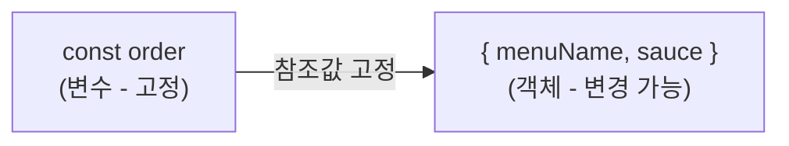

## 들어가며 (Situation)

Java, Servlet, Spring으로 서버 쪽을 배우다가 `11_JavaScript/01_Core`에서 JavaScript를 시작했다. 첫 두 파일은 `01_variable.js`(변수)와 `02_object.js`(객체)다.

수업 주석은 계속 Java와 비교한다. 이 글도 같은 방식으로, **Java와 무엇이 다르고 왜 그렇게 설계되었는지**를 중심으로 정리한다. 모든 출력은 Node.js(v24)로 직접 실행해서 확인했다.

## 문제 상황 (Task)

Java에 익숙한 눈으로 JavaScript 코드를 읽으면 다음 지점에서 막힌다.

1. 변수 선언에 자료형이 없다. `let test = 1; test = "문자열";`이 에러가 아니다.
2. `const`는 Java의 `final`이라고 배웠는데, `const` 객체의 프로퍼티는 바뀐다.
3. `typeof null`, `typeof []`가 모두 `"object"`다.
4. 클래스 없이 `{}`만으로 객체를 만든다.

## 해결 과정 (Action)

### 1. 변수 선언: Java와 비교

| 항목 | Java | JavaScript |
|---|---|---|
| 선언 형태 | `String str = "문자열";` | `let str = "문자열";` |
| 타입 | 선언 시점에 **고정** | 할당 시점에 값이 **결정** |
| 상수 | `final` | `const` |
| 재할당 | 같은 타입만 | `let`은 **다른 타입도 가능** |

```js
const shop = "원티드 식당";
// shop = 1;        // TypeError: Assignment to constant variable.

let test = 1;
test = "문자열";     // 가능
console.log(test);  // 문자열
```

수업 주석이 `const`를 `final`에 비유하는 것은 **재할당 금지**라는 점에서 맞다. 다만 아래의 객체 부분에서 한계가 나온다.

참고로 이 파일 첫 줄은 `var, let, const`를 함께 언급한다. 세 키워드의 차이는 MDN을 기준으로 하면 이렇다.

| 키워드 | 스코프 | 재선언 | 재할당 | 비고 |
|---|---|---|---|---|
| `var` | 함수 스코프 | 가능 | 가능 | 선언 전에 참조하면 `undefined` (호이스팅) |
| `let` | 블록 스코프 | 불가 | 가능 | 선언 전 참조 시 `ReferenceError` (TDZ) |
| `const` | 블록 스코프 | 불가 | **불가** | 선언과 동시에 초기화 필수 |

현대 코드에서는 **기본은 `const`, 값이 바뀔 때만 `let`, `var`는 쓰지 않는다**가 일반적인 관례다.

### 2. 동적 타입의 장단점과 `const`가 해결하는 것

수업 주석은 동적 타입의 단점을 이렇게 정리한다.

> 변수의 값이 언제든 다른 타입으로 변경될 수 있기 때문에 값을 확인하기 전에는 타입을 확신할 수 없다. … 이 코드가 끝까지 잘 동작할 것이라는 확신이 들 수 없다. → `const`로 해결(더 이상 바꾸지 마라)

주석의 예시 `test.length();`를 직접 확인했다.

```js
const s = '문자열';
try { s.length() } catch (e) { console.log(e.message) }  // s.length is not a function

let t = 10;
console.log(t.length);   // undefined (에러 없음!)
```

| 호출 | 결과 | 설명 |
|---|---|---|
| `"문자열".length` | `3` | `length`는 메서드가 아닌 **프로퍼티** (Java의 `length()`와 다름) |
| `"문자열".length()` | `TypeError` | 프로퍼티는 호출할 수 없음 |
| `(10).length` | `undefined` | **에러 없이** 조용히 `undefined` |

세 번째 줄이 동적 타입의 진짜 위험이다. 에러도 나지 않고 `undefined`가 흘러가 한참 뒤에 엉뚱한 곳에서 터진다. Java라면 컴파일 시점에 잡혔을 문제다. `const`는 "타입이 바뀌지 않게" 해 주는 것이 아니라 **재할당 자체를 막아** 이 위험의 범위를 줄인다.

### 3. `typeof`로 타입 확인하기

```js
let test1;
console.log(typeof test1);   // undefined
test1 = 1;           console.log(typeof test1);   // number
test1 = "java";      console.log(typeof test1);   // string
test1 = true;        console.log(typeof test1);   // boolean
test1 = null;        console.log(typeof test1);   // object  (!)
test1 = {};          console.log(typeof test1);   // object
test1 = [];          console.log(typeof test1);   // object  (!)
test1 = function() {}; console.log(typeof test1); // function
```

| 값 | `typeof` | 주의 |
|---|---|---|
| 초기화 안 된 변수 | `undefined` | 값이 없는 상태 |
| `null` | `"object"` | **언어 초기부터 있는 오래된 오류**로 MDN도 설명한다. `null`은 객체가 아니다 |
| `[]` | `"object"` | 배열 판별은 `Array.isArray([])`를 쓴다 |
| `function(){}` | `"function"` | 함수도 값이다. (다음 글의 핵심) |

실행 결과로 `null`과 `[]`가 `object`로 나온 것을 눈으로 확인했다. `typeof`만으로는 `null`, 배열, 일반 객체를 구분할 수 없다는 것이 이 실험의 교훈이다.

### 4. 객체: 클래스 없이 만드는 key-value 묶음

```js
const store = {
    name : '원티드 식당',
    category : '분식',
    getInfo : function() {
        return `${this.name}은 ${this.category} 전문점입니다.`;
    }
};

console.log(store.getInfo());   // 원티드 식당은 분식 전문점입니다.
```

수업 주석의 비유는 이렇다.

| Java | JavaScript 객체 |
|---|---|
| 클래스 `Store` | 객체 리터럴 `{ }` 자체 |
| 필드 `name`, `category` | 프로퍼티 (key: value) |
| 메서드 `getInfo()` | 값이 함수인 프로퍼티 |

Java는 **클래스(설계도)를 먼저 만들고** 인스턴스를 찍어 내지만, JavaScript는 **객체를 바로 리터럴로** 만들 수 있다. 프로퍼티의 key는 암묵적으로 문자열이고, value에는 어떤 타입이든 들어갈 수 있다.

### 5. 동적 프로퍼티: 선언 이후에도 바뀌는 객체

```js
const order = {menuName : '치킨'}
order.sauce = "뿌링클 시즈닝";    // 추가
order.sauce = '맛초킹 시즈닝';    // 수정
console.log(order);
// { menuName: '치킨', sauce: '맛초킹 시즈닝' }
```

여기서 앞의 질문 2번의 답이 나온다. `order`는 **`const`로 선언했는데도 프로퍼티를 추가·수정**했다.



| 대상 | `const`가 막는 것 |
|---|---|
| 변수 `order` | `order = {...}` 같은 **재할당** |
| 객체 내부 | 막지 않음 (프로퍼티 추가/수정/삭제 가능) |

Java의 `final List<String> list`도 리스트 내용은 바꿀 수 있는 것과 같은 원리다. 내용까지 막으려면 `Object.freeze()`를 쓴다. (얕은 동결이라 중첩 객체까지는 막지 못한다.)

### 6. 시행착오가 될 수 있는 지점: 메서드에서의 `this`

```js
getInfo : function() { return `${this.name}은 ...`; }
```

`this`는 **호출한 객체**(`store.getInfo()`의 `store`)를 가리킨다. 이 메서드를 화살표 함수로 바꾸면 달라진다. (화살표 함수는 자신의 `this`를 갖지 않는다.) 확인용으로 실행해 보니 `this.name`이 `undefined`로 나왔다. 이유는 다음 글에서 이어서 정리한다.

## 결과 (Result)

| 질문 | 정리 |
|---|---|
| JS의 타입은 언제 정해지나? | 선언이 아니라 **값을 할당하는 시점** (동적 타입) |
| `const`는 `final`과 같은가? | 재할당 금지는 같고, **객체 내부는 바꿀 수 있다** |
| `typeof` 신뢰해도 되나? | 원시값에는 OK, `null`과 배열은 모두 `"object"` |
| 객체는 어떻게 만드나? | 클래스 없이 `{ key: value }` 리터럴로 |

배운 점은 이렇다.

1. 동적 타입의 편리함은 **에러 없이 틀린 값이 흐르는 위험**과 한 쌍이다. 컴파일러가 해 주던 일을 이제 개발자가 해야 한다.
2. 그래서 기본을 `const`로 두어 변경 가능한 지점을 줄인다.
3. 객체는 "클래스의 인스턴스"가 아니라 **프로퍼티의 집합**이다.

## 더 학습하면 좋은 개념

- **호이스팅과 TDZ(Temporal Dead Zone)** — `var`는 `undefined`로, `let`·`const`는 `ReferenceError`로 동작하는 이유이며, 다음 글에서 함수 호이스팅으로 이어진다.
- **원시 타입과 참조 타입** — `const`가 객체 내부를 막지 못하는 이유를 메모리 관점에서 이해하게 해 준다.
- **`Object.freeze()`와 불변성(immutability)** — 객체 내용까지 고정하는 방법과 한계(얕은 동결)를 다룬다. React 같은 상태 관리에서 핵심이 된다.
- **`==`와 `===`, 타입 변환(coercion)** — 동적 타입 언어에서 비교가 왜 위험한지 이해하는 출발점이다. 3번째 글에서 다룬다.
- **TypeScript** — 동적 타입의 "확신이 없다"는 단점을 정적 타입으로 보완하는 언어다.

## 참고 자료

- [MDN - `let`](https://developer.mozilla.org/ko/docs/Web/JavaScript/Reference/Statements/let)
- [MDN - `const`](https://developer.mozilla.org/ko/docs/Web/JavaScript/Reference/Statements/const)
- [MDN - `var`](https://developer.mozilla.org/ko/docs/Web/JavaScript/Reference/Statements/var)
- [MDN - `typeof`](https://developer.mozilla.org/ko/docs/Web/JavaScript/Reference/Operators/typeof)
- [MDN - 객체 기초](https://developer.mozilla.org/ko/docs/Learn_web_development/Core/Scripting/Object_basics)
- [MDN - `Object.freeze()`](https://developer.mozilla.org/ko/docs/Web/JavaScript/Reference/Global_Objects/Object/freeze)
