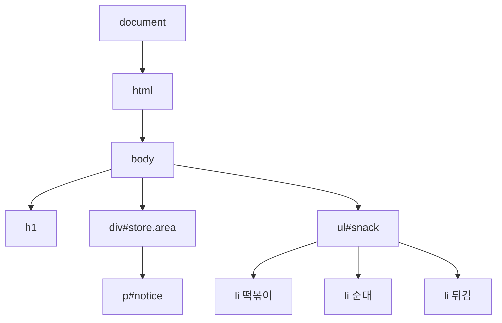
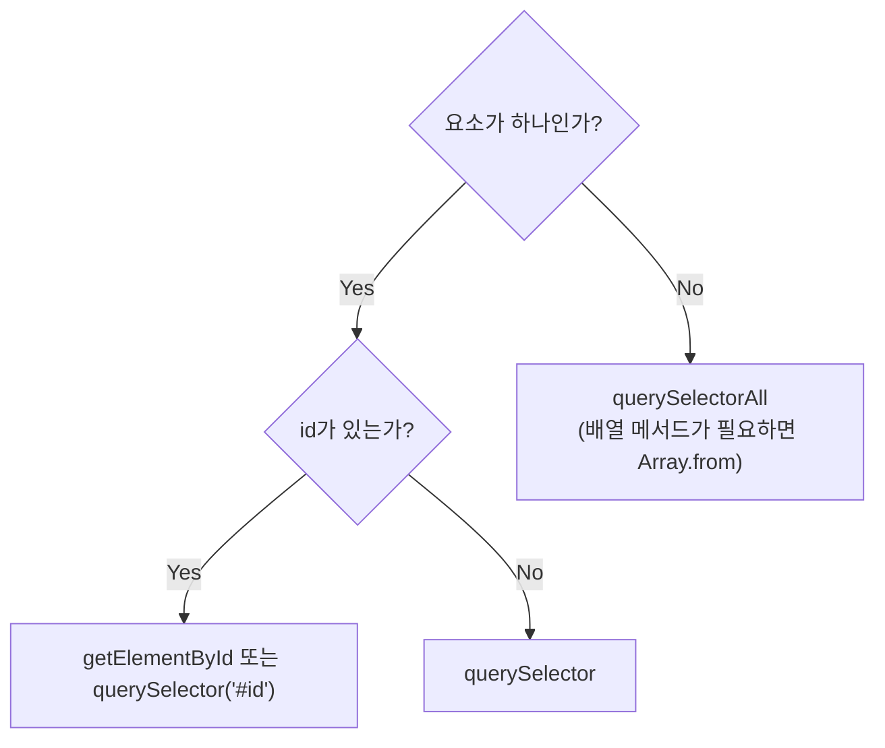

## 들어가며 (Situation)

지금까지(`01_Core`)의 JavaScript는 콘솔에서 값을 출력하는 코드였다. `02_Web`부터는 **브라우저 화면**을 다룬다. 첫 파일 `01_DOM/01_get-element.html`의 주석이 이 단원의 핵심을 한 줄로 말한다.

> JS는 HTML + CSS로 구성되어 있는 Document에 접근할 수 있는 프로그래밍 언어이다.

화면의 버튼, 목록, 글자를 JavaScript로 바꾸려면 **먼저 그 요소를 손에 넣어야** 한다. 이 글은 요소를 찾아오는(취득하는) 다섯 가지 방법을 정리한다.

> 이 파일은 브라우저에서 실행하는 코드다. 이 글에서 `console.log`가 출력하는 형태나 동작은 수업 코드와 MDN 명세를 근거로 설명하며, 직접 브라우저로 실행해 본 스크린샷이 아니다.

## 문제 상황 (Task)

수업 HTML에는 가게 정보, 메뉴 목록, 음료 목록 같은 요소가 있다. 이것들을 JavaScript로 다뤄야 한다.

1. 특정 `div` 하나의 배경색을 바꾸고 싶다.
2. `<ul id="snack">` 안의 `<li>`들만 모두 빨간 글씨로 바꾸고 싶다.
3. 같은 `class`를 가진 요소들을 한꺼번에 가져오고 싶다.
4. 방법이 여러 개인데 **어떤 것을 써야** 하는가?

## 해결 과정 (Action)

### 1. DOM이란?

브라우저는 HTML 문서를 읽어 **트리 구조의 객체**로 만든다. 이것이 **DOM(Document Object Model)** 이다. 트리의 각 칸이 **노드**, 그중 HTML 태그에 해당하는 것이 **요소 노드**다.



`document`가 이 트리의 입구이고, 요소 취득 메서드는 모두 `document`(또는 이미 얻은 요소)에서 호출한다.

### 2. 다섯 가지 취득 방법 한눈에

| 방법 | 기준 | 반환 | 개수 |
|---|---|---|---|
| `getElementById('id')` | id | 요소 1개 (없으면 `null`) | 1 |
| `getElementsByTagName('li')` | 태그 이름 | `HTMLCollection` | 여러 개 |
| `getElementsByClassName('menu')` | class | `HTMLCollection` | 여러 개 |
| `querySelector('.box')` | CSS 선택자 | 요소 1개 (**첫 번째**) | 1 |
| `querySelectorAll('.box')` | CSS 선택자 | `NodeList` | 여러 개 |

수업 파일의 제목이 "4) CSS 선택자를 이용한 요소 노드 취득 (**권장**)"인 이유는 아래에서 설명한다.

### 3. id로 취득: `getElementById`

```js
const $store = document.getElementById('store');
console.log($store);
$store.style.backgroundColor = 'yellow';
```

- `$` 접두사는 수업 주석대로 **"이 변수가 DOM 요소를 담고 있다"는 표시**다. 문법이 아니라 읽기 편하게 하려는 관례다.
- `style.backgroundColor`처럼 CSS의 `background-color`는 JavaScript에서 **카멜 케이스**로 쓴다. (`-`는 JS에서 뺄셈 연산자이기 때문이다.)

**수업 HTML의 함정: id 중복**

```html
<div id="store" class="area">냠냠분식 본점 ...</div>
<div id="store" class="area">냠냠분식 2호점 (id 중복!)</div>
```

HTML에서 `id`는 문서 안에서 **고유**해야 한다. 파일에 일부러 "(id 중복!)"을 적어 둔 것은 이 동작을 확인시키려는 의도로 보인다. 명세상 같은 id가 여럿이면 `getElementById`는 **문서 순서상 첫 번째** 요소를 반환한다. 그래서 위 코드에서는 본점 `div`만 노란색이 되고, 2호점은 바뀌지 않는다.

| 상황 | 결과 |
|---|---|
| id가 하나 | 그 요소 |
| id가 중복 | **첫 번째만** 반환 (나머지는 못 찾음) |
| id가 없음 | `null` → 이후 `.style`에서 `TypeError` |

그래서 "여러 개"가 필요하면 id가 아니라 class를 쓰고, id는 한 요소를 식별할 때만 쓴다.

### 4. 태그 이름으로 취득과 HTMLCollection

```js
const $li = document.getElementsByTagName('li');   // 문서 전체의 li (3 + 3 + 3 + 3 + 4 = 모든 li)

const $snack = document.getElementById('snack');
const $snackLiList = $snack.getElementsByTagName('li');   // snack 안의 li 3개만
```

두 가지가 중요하다.

**① 범위 좁히기**: `document.getElementsByTagName('li')`는 문서 전체에서 찾지만, **이미 얻은 요소**에서 호출하면 **그 요소의 하위**에서만 찾는다. 수업 코드는 `ul#snack` 안의 `li`만 얻기 위해 이 방법을 썼다.

**② 반환 타입이 배열이 아니다.** 수업 주석:

> HTMLCollection 타입의 li list가 반환된다. JS에서 li list를 사용하기 위해서는 배열로 변환해주어야 한다.

```js
const liList = Array.from($snackLiList);
liList.forEach(li => li.style.color = 'red');
```

| 타입 | 배열인가 | `forEach` / `map` / `filter` |
|---|---|---|
| `Array` | 예 | 사용 가능 |
| `HTMLCollection` | **아니오** (유사 배열) | `length`, 인덱스 접근만 (배열 메서드는 없음) |
| `NodeList` | 아니오 | `forEach`는 있음, `map`/`filter`는 없음 |

`Array.from()`으로 배열로 바꾸면 앞 글에서 정리한 `forEach`, `map`, `filter`를 쓸 수 있다. 수업 주석의 말처럼 "배열 전용 메서드를 쓰려면 타입 변환을 신경 써야 한다."

### 5. class로 취득

```js
const $menus = document.getElementsByClassName('menu');
```

HTML에서 `<li class="menu coffee">`처럼 **class를 여러 개** 붙일 수 있고, `getElementsByClassName('menu')`는 `menu`를 포함하는 요소를 모두 가져온다. (`ul#available`의 3개와 `ul#soldout`의 3개, 합계 6개)

### 6. CSS 선택자로 취득 (권장)

```js
const $box = document.querySelector(".box");   // class="box"인 요소 중 첫 번째 하나
console.log($box);
$box.style.backgroundColor = 'green';
```

| 메서드 | 반환 |
|---|---|
| `querySelector(선택자)` | 조건에 맞는 **첫 번째 요소 하나** |
| `querySelectorAll(선택자)` | 조건에 맞는 **모든 요소** (`NodeList`) |

이 파일의 `.box`는 두 개(오늘의 추천 메뉴, 이번 주 인기 메뉴)이지만 `querySelector`는 **첫 번째만** 반환하므로 "오늘의 추천 메뉴" 박스만 초록색이 된다. 둘 다 바꾸려면 `querySelectorAll`을 쓴다.

**CSS 선택자의 장점**은 앞서 배운 CSS 문법을 그대로 쓴다는 것이다.

```js
document.querySelector('#snack li');           // snack 안의 첫 li
document.querySelectorAll('#list .drink');     // list 안의 drink 클래스 전부 (콜라, 라떼)
document.querySelector('input[name=query]');   // 속성 선택자
```

| 하고 싶은 일 | 선택자 | 구식 방법으로 하면 |
|---|---|---|
| id가 `list`인 요소 안의 `.drink`들 | `#list .drink` | `getElementById` → `getElementsByClassName` 두 단계 |
| `<input name="query">` | `input[name=query]` | 불가능에 가까움 |

그래서 수업이 "권장"이라 한 것이다. **하나의 문법으로 모든 경우를 표현**한다. (다음 글의 폼 이벤트에서 `this.querySelector('input[name=query]')`가 실제로 쓰인다.)

### 7. 시행착오가 될 수 있는 지점

**① 스크립트 위치**

수업 파일은 `<script>`를 `</body>` 직전에 두었다. 브라우저는 HTML을 **위에서 아래로** 읽으므로, `<script>`가 `<head>`에 있으면 아직 만들어지지 않은 요소를 찾아 `null`을 얻는다. 요소가 만들어진 뒤에 실행되도록 아래에 두는 것이다. (`defer` 속성이나 `DOMContentLoaded` 이벤트로도 해결한다.)

**② HTMLCollection은 "살아 있다"**

MDN에 따르면 `getElementsBy~`가 반환하는 `HTMLCollection`은 문서가 바뀌면 **자동으로 갱신되는 live 컬렉션**이고, `querySelectorAll`의 `NodeList`는 호출 시점의 **정적 스냅숏**이다.

| 반환 | 문서가 바뀌면 |
|---|---|
| `HTMLCollection` (`getElementsBy~`) | 자동 반영 (live) |
| `NodeList` (`querySelectorAll`) | 반영 안 됨 (static) |

반복문 안에서 요소를 추가/삭제할 때 live 컬렉션은 길이가 바뀌어 예기치 않은 동작을 낳을 수 있다. 이 점도 `querySelector` 계열이 권장되는 이유다.

### 8. 선택 가이드



## 결과 (Result)

| 질문 | 정리 |
|---|---|
| DOM이란? | HTML을 객체 트리로 만든 것. `document`가 입구 |
| 요소 1개 | `getElementById`, `querySelector` |
| 요소 여러 개 | `getElementsByTagName/ClassName`(`HTMLCollection`), `querySelectorAll`(`NodeList`) |
| 권장 방법 | CSS 선택자(`querySelector`, `querySelectorAll`) |
| 배열 메서드가 필요하면 | `Array.from()`으로 변환 |

이번 파일에서 화면에 나타나는 변화는 명세상 다음과 같다.

| 코드 | 화면 변화 |
|---|---|
| `getElementById('store')` + `backgroundColor` | 본점 박스만 노란색 (id 중복의 첫 번째만) |
| `Array.from(...)` + `forEach` | 떡볶이, 순대, 튀김이 빨간 글씨 |
| `querySelector(".box")` | 첫 번째 `.box`만 초록색 |

배운 점은 이렇다.

1. 화면을 바꾸는 모든 작업의 출발점은 **요소를 정확히 찾는 것**이다. 몇 개를 반환하는지, 어떤 타입을 반환하는지를 항상 의식한다.
2. id 중복처럼 **HTML이 틀려도 에러가 나지 않고** 조용히 첫 번째만 반환한다. 눈에 보이는 결과로 확인해야 한다.
3. 유사 배열은 배열이 아니다. 이 구분이 이후 이벤트 처리에서 계속 나온다.

## 더 학습하면 좋은 개념

- **노드 탐색 (`parentElement`, `children`, `nextElementSibling`)** — 요소를 찾은 뒤 트리를 오르내리며 이동하는 방법이다. 이벤트 위임에서 필수다.
- **요소 생성과 조작 (`createElement`, `append`, `textContent` vs `innerHTML`)** — 이번 글은 "찾기"까지이고, 다음은 "바꾸기"다. `innerHTML`의 보안 문제(XSS)도 함께 학습해야 한다.
- **`classList`와 `style`** — 스타일을 직접 건드리는 대신 class를 붙였다 떼는 방식이 유지보수에 유리한 이유를 알려 준다. (다음 글 이후의 폼 예제에서 쓰인다.)
- **`DOMContentLoaded`와 `defer`** — 스크립트 위치 문제를 해결하는 정식 방법이다.
- **CSS 선택자의 우선순위와 조합자** — `querySelector`를 잘 쓰려면 CSS 선택자 문법을 정확히 알아야 한다. CSS 단원 복습의 기회다.

## 참고 자료

- [MDN - 문서 객체 모델(DOM) 소개](https://developer.mozilla.org/ko/docs/Web/API/Document_Object_Model/Introduction)
- [MDN - `Document.getElementById()`](https://developer.mozilla.org/ko/docs/Web/API/Document/getElementById)
- [MDN - `Document.querySelector()`](https://developer.mozilla.org/ko/docs/Web/API/Document/querySelector)
- [MDN - `Document.querySelectorAll()`](https://developer.mozilla.org/ko/docs/Web/API/Document/querySelectorAll)
- [MDN - `HTMLCollection`](https://developer.mozilla.org/ko/docs/Web/API/HTMLCollection)
- [MDN - `NodeList`](https://developer.mozilla.org/ko/docs/Web/API/NodeList)
- [MDN - `Array.from()`](https://developer.mozilla.org/ko/docs/Web/JavaScript/Reference/Global_Objects/Array/from)
- [스프레드·구조 분해 글]({{ site.baseurl }}/2026/11/18/javascript-spread-destructuring/)
