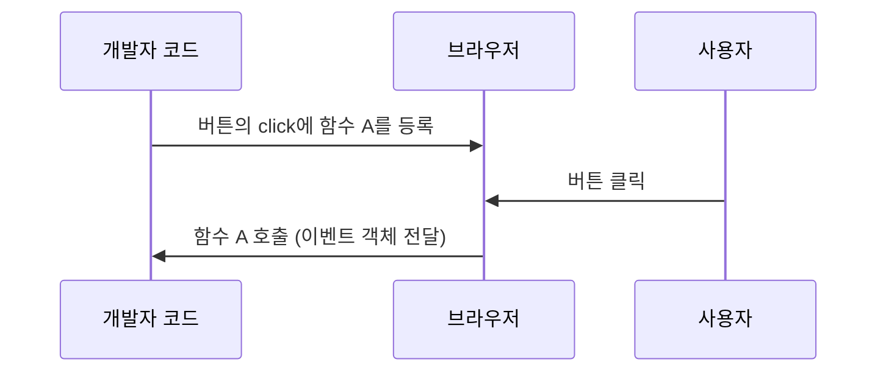
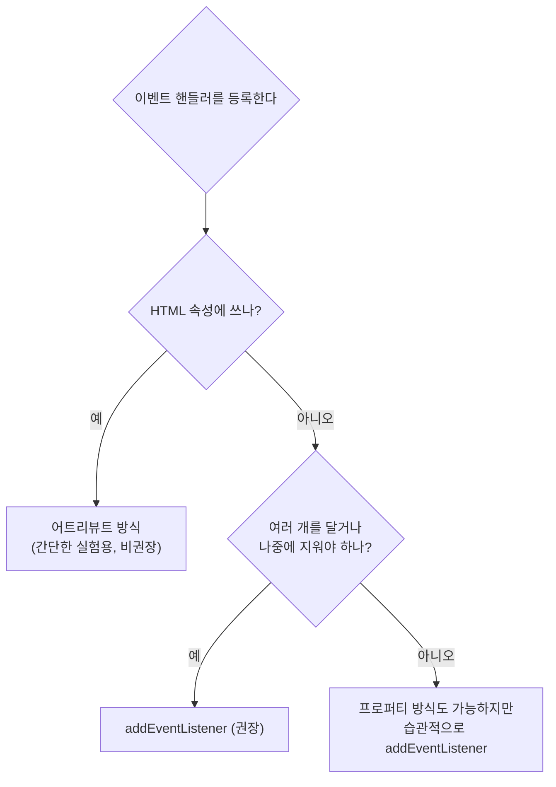

## 들어가며 (Situation)

요소를 찾는 법(DOM 취득)을 배웠으니 이제 **사용자의 행동에 반응**하게 만들 차례다. `02_EVENT`의 앞 두 파일 `01_event-handler.html`, `02_event-object.html`을 정리한다.

수업의 정의부터 보자.

> 이벤트 핸들러: 이벤트가 발생했을 때 **브라우저에 호출을 위임한 함수**

"버튼이 눌리는 순간"은 개발자가 알 수 없다. 그래서 "눌리면 이 함수를 불러 주세요"라고 브라우저에 **미리 맡겨 둔다.** 이것이 이벤트 핸들러 등록이다.



> 이 글의 동작 설명은 수업 HTML과 MDN을 근거로 한다. `alert` 창과 마우스 반응은 브라우저에서 직접 눌러 확인해야 하며, 이 글에는 실행 스크린샷이 없다.

## 문제 상황 (Task)

1. 이벤트 핸들러를 등록하는 방법이 **세 가지**나 있다. 무엇이 다르고 무엇을 써야 하는가?
2. 같은 버튼에 핸들러를 두 개 달면 어떻게 되는가?
3. 등록한 핸들러를 어떻게 지우는가?
4. 핸들러 안에서 **클릭 위치**나 **누른 버튼 자체**는 어떻게 알아내는가?

## 해결 과정 (Action)

### 1. 등록 방법 3가지 비교

| 방식 | 코드 위치 | 한 이벤트에 여러 핸들러 | 권장 |
|---|---|---|---|
| ① 어트리뷰트(HTML 속성) | HTML 태그 안 `onclick="..."` | 불가 | 아니오 |
| ② 프로퍼티 | JS: `요소.onclick = 함수` | **불가 (덮어씀)** | 아니오 |
| ③ `addEventListener` | JS: `요소.addEventListener('click', 함수)` | **가능** | **예** |

### 2. ① 어트리뷰트 방식 — HTML에 직접 쓴다

```html
<button onclick="alert('주문 완료!'); console.log('주문 완료!');">주문하기</button>
<button onmouseover="recommend('김자바');">오늘의 추천 메뉴 (마우스를 올려보세요!)</button>
```

```js
function recommend(name) {
    alert(`${name}님 , 오늘은 제육을 먹어봐요!`);
}
```

수업의 주의사항:

> (주의) 함수 **참조**가 아닌 함수 **호출문**을 할당

| 위치 | 쓰는 것 | 이유 |
|---|---|---|
| HTML 속성 | `onclick="recommend('김자바')"` (호출문) | 속성 값은 **이벤트 때 실행될 코드 문자열**이기 때문 |
| JS 프로퍼티 | `btn.onclick = recommend` (참조) | 함수 자체를 넘겨야 브라우저가 나중에 호출 |

속성에 `onclick="recommend"`처럼 괄호 없이 쓰면 함수를 **호출하지 않고 이름만 적은 것**이라 아무 일도 일어나지 않는다. 접두사 `on`이 붙은 속성은 모두 브라우저 이벤트(`onclick`, `onmouseover` 등)를 의미한다.

단점은 HTML과 JS가 섞여 유지보수가 어렵다는 점이다. 속성에서 부르려면 함수가 **전역에 있어야** 하는 제약도 있다.

### 3. ② 프로퍼티 방식 — 덮어쓰기 함정

```js
const $btnProp = document.getElementById('btn-prop');

$btnProp.onclick = function() {
    alert("프로퍼티 방식으로 이벤트 핸들러 등록!!");
}

$btnProp.onclick = () => alert("두번째 이벤트 핸들러 등록!!");
```

이 버튼을 누르면 **"두번째 이벤트 핸들러 등록!!"만** 나온다. 프로퍼티는 변수처럼 값이 하나뿐이라 두 번째 대입이 첫 번째를 **덮어쓰기** 때문이다. (수업 주석: "하나의 이벤트에 1개의 이벤트 핸들러만 등록 가능, 덮어씌워지게 된다.")

HTML 분리는 되지만, 여러 기능이 같은 이벤트를 쓰면 서로 지워 버리는 위험이 있다.

### 4. ③ addEventListener — 권장 방식

```js
const $btnListener = document.getElementById('btn-listener');

$btnListener.addEventListener('click', function() {
    alert('결제완료!')
});

$btnListener.addEventListener('click', function() {
    alert('2번째 addEvent 동작!')
});
```

| 인자 | 의미 |
|---|---|
| 1번째 | 이벤트 종류 (`'click'`, `'dblclick'`, `'mouseover'` …) — `on` 접두사 **없이** |
| 2번째 | 이벤트가 일어났을 때 호출할 함수 (**참조**) |

이 버튼을 누르면 **"결제완료!" → "2번째 addEvent 동작!"** 두 알림이 등록한 순서대로 모두 나온다. 덮어쓰기 없이 **쌓인다.**

그래서 권장 방식이다. 이유를 정리하면 이렇다.

| 이유 | 설명 |
|---|---|
| 여러 개 등록 가능 | 서로 다른 기능이 같은 이벤트를 써도 충돌하지 않음 |
| 제거 가능 | `removeEventListener`로 정확히 지울 수 있음 |
| 옵션 지원 | 세 번째 인자로 `{ once: true }` 등 지정 가능 |
| HTML/JS 분리 | 구조(HTML)와 동작(JS)이 분리됨 |

### 5. 이벤트 핸들러 제거

```js
const $btnRemove = document.getElementById('btn-remove');

const handleMouseOver = () => alert('결제 버튼에 마우스 호버!');

$btnRemove.addEventListener('mouseover', handleMouseOver);
$btnRemove.removeEventListener('mouseover', handleMouseOver);
```

**핵심 규칙: 제거할 때는 등록할 때와 "같은 함수 참조"를 넘겨야 한다.**

```js
// 안 지워지는 예
btn.addEventListener('click', () => alert('hi'));
btn.removeEventListener('click', () => alert('hi'));   // 겉모양만 같은 "다른 함수" → 제거 실패
```

수업 코드에서 함수를 `handleMouseOver`라는 변수에 담아 **외부에 정의**한 이유가 이것이다. (수업 주석: "외부에 정의한 함수를 참조")

**관찰**: 수업 코드는 등록 **바로 다음 줄에서 제거**한다. 그래서 `쿠폰 받기` 버튼에 마우스를 올려도 아무 알림이 뜨지 않는다. 제거가 동작함을 보여 주는 예시이고, 실제로는 수업 주석처럼 **조건에 따라(if 문과 함께)** 제거한다. 예를 들어 쿠폰을 한 번 받으면 더 이상 반응하지 않게 하는 경우다.

### 6. 이벤트 객체 — 이벤트에 대한 정보 꾸러미

```js
function showCoords(e) {
    console.log(e);
    $msg.textContent = `배달 위치 : ${e.clientX} , ${e.clientY}`;
}

document.onclick = showCoords;
```

수업 주석:

> 이벤트를 등록하게 되면 내부적으로 이벤트 객체가 생기게 된다. 이벤트 객체는 매개변수로 전달받을 수 있다.

핸들러 함수의 **첫 번째 매개변수**로 브라우저가 이벤트 객체를 자동으로 넘겨 준다. 이름은 관례적으로 `e`, `event`다.

| 프로퍼티 | 의미 |
|---|---|
| `e.type` | 이벤트 종류 (`'click'`) |
| `e.target` | 이벤트가 **실제로 발생한** 요소 |
| `e.currentTarget` | 핸들러가 **등록된** 요소 |
| `e.clientX`, `e.clientY` | 마우스 위치 (브라우저 **화면(뷰포트)** 기준 좌표) |

`document.onclick = showCoords`는 문서 전체에 클릭 핸들러를 달았으므로, 화면 **아무 곳이나 클릭**하면 위쪽 문구가 "배달 위치 : x , y"로 바뀐다.

HTML 속성에서는 `event`라는 이름의 변수를 직접 쓸 수 있다.

```html
<div class="map" onmouseover="showMapCoords(event)">지도 영역 내부를 클릭해 보세요!</div>
```

**관찰 두 가지**

① 이 `div`의 문구는 "**클릭**해 보세요!"이지만 실제 등록한 이벤트는 `onmouseover`(마우스를 **올릴 때**)다. 마우스를 올리는 것만으로 좌표가 바뀐다. 문구와 이벤트를 맞추거나, 의도에 맞게 `onclick`으로 바꿔야 한다.

② 수업 코드의 `e.pointerType = 'pen';` 줄은 값을 바꾸려는 시도인데, 이벤트 객체의 대부분 프로퍼티는 **읽기 전용**이라 대입해도 바뀌지 않는다. (엄격 모드에서는 `TypeError`가 나고, 일반 스크립트에서는 조용히 무시된다.) 이벤트 객체는 "정보를 읽는 용도"로 쓴다고 이해하는 것이 안전하다. (수업 주석에는 "변경"이 언급되지만, 동작 규칙은 MDN을 확인하자.)

### 7. 핸들러 안의 `this` — 어떻게 호출하느냐에 따라 다르다

```html
<button onclick="handleClick1()">떡볶이</button>
<button onclick="handleClick2(this)">순대</button>
```

```js
function handleClick1() {
    console.log('click1', this);    // window 객체
}

function handleClick2(btn) {
    console.log('click2', btn);     // 클릭된 <button> 요소
}
```

| 버튼 | 코드 | `this` / 값 | 이유 |
|---|---|---|---|
| 떡볶이 | `onclick="handleClick1()"` | **`window`** (전역 객체) | 속성 안에서 함수를 **그냥 호출**했기 때문. 일반 함수의 `this`는 호출 방식이 정한다 |
| 순대 | `onclick="handleClick2(this)"` | 클릭된 **`<button>`** | **속성 코드 안의 `this`**는 이벤트가 걸린 요소. 그것을 인자로 넘김 |

수업 주석의 활용법:

> 이벤트 대상 DOM 요소의 정보를 가지게 된다. 따라서 이벤트 발생 시 해당 DOM을 없애거나 추가적인 동작을 더 추가하고자 하면 `this`를 활용해서 작업을 할 수 있다.

예를 들어 `handleClick2(btn)` 안에서 `btn.style.color = 'red'`로 누른 버튼만 바꿀 수 있다.

### 8. 보충: 프로퍼티·addEventListener·화살표 함수의 `this`

수업 HTML에는 `김밥`, `라면`(프로퍼티/addEventListener)과 `튀김`, `어묵`(화살표 함수) 버튼이 만들어져 있지만, **이 버튼들에 연결된 스크립트는 파일에 아직 없다.** 그래서 여기는 MDN 규칙에 따른 **보충 설명**이다. (수업 파일에서 확인한 내용이 아니다.)

| 등록 방식 | 함수 종류 | `this` |
|---|---|---|
| 프로퍼티 / `addEventListener` | 일반 함수 `function() {}` | **이벤트를 건 요소** (`e.currentTarget`과 같음) |
| 프로퍼티 / `addEventListener` | **화살표 함수** `() => {}` | 요소가 **아님** (바깥 스코프의 `this`, 보통 `window`) |

```js
btn1.addEventListener('click', function(e) { console.log(this === e.currentTarget); });  // true
btn3.addEventListener('click', (e) => { console.log(this === e.currentTarget); });       // false
```

그래서 핸들러 안에서 `this`로 요소를 쓰려면 일반 함수를, 화살표 함수를 쓰려면 `this` 대신 **`e.currentTarget`(또는 `e.target`)** 을 쓰면 된다. 앞서 [화살표 함수 글]({{ site.baseurl }}/2026/11/17/javascript-function-hoisting-arrow-function/)에서 정리한 "화살표 함수는 자신의 `this`가 없다"가 이벤트에서 그대로 나타나는 지점이다.

### 9. 선택 가이드



## 결과 (Result)

| 질문 | 정리 |
|---|---|
| 핸들러란? | 이벤트 발생 시 호출을 **브라우저에 위임**한 함수 |
| 3가지 방식의 차이 | 어트리뷰트 (HTML 속성), 프로퍼티 (**덮어쓰기**), `addEventListener` (여러 개 가능, **권장**) |
| 핸들러 제거 | `removeEventListener` + **같은 함수 참조** |
| 이벤트 객체 | 핸들러의 첫 매개변수. 위치(`clientX/Y`), 대상(`target`) 등 정보를 제공 |
| `this` | 호출 방식에 따라 다름 (`window` 또는 이벤트 요소). 화살표 함수는 요소가 아님 |

배운 점은 이렇다.

1. 같은 "클릭 시 동작"이라도 등록 방식에 따라 **덮어쓰기/누적/제거 가능 여부**가 달라진다.
2. `removeEventListener`가 안 되는 가장 흔한 원인은 **함수를 새로 만들어 넘겼기 때문**이다.
3. `this`는 "어디에 쓰였나"가 아니라 **"어떻게 호출됐나"** 로 정해진다. 어렵게 느껴진다면 `e.currentTarget`을 쓰는 것이 안전하다.
4. 수업 코드에 있는 문구와 동작의 불일치(클릭 vs 마우스오버)처럼, 직접 눌러 보며 확인해야 한다.

## 더 학습하면 좋은 개념

- **이벤트 버블링과 캡처링, 이벤트 위임** — 자식에서 일어난 이벤트가 부모로 올라가는 흐름이다. `e.target`과 `e.currentTarget`의 차이가 여기서 의미를 갖고, 동적으로 생기는 요소를 다루는 핵심 패턴이다.
- **`e.preventDefault()`와 `e.stopPropagation()`** — 링크 이동과 폼 전송 같은 기본 동작을 막고 전파를 끊는 방법이다. 다음 글(폼 이벤트)에서 쓰인다.
- **`this` 바인딩 규칙 (`call`, `apply`, `bind`)** — `this`가 호출 방식으로 결정되는 원리를 체계적으로 이해하게 해 준다.
- **`addEventListener`의 옵션 (`once`, `passive`, `capture`)** — 한 번만 실행하는 핸들러 등 실무에서 자주 쓰는 기능이다.
- **키보드 이벤트와 포인터 이벤트 (`keydown`, `pointerdown`)** — 마우스뿐 아니라 터치, 펜까지 다루는 현대적인 입력 이벤트다. `pointerType`이 등장하는 맥락이기도 하다.

## 참고 자료

- [MDN - 이벤트 소개](https://developer.mozilla.org/ko/docs/Learn_web_development/Core/Scripting/Events)
- [MDN - `EventTarget.addEventListener()`](https://developer.mozilla.org/ko/docs/Web/API/EventTarget/addEventListener)
- [MDN - `EventTarget.removeEventListener()`](https://developer.mozilla.org/ko/docs/Web/API/EventTarget/removeEventListener)
- [MDN - `Event` (이벤트 객체)](https://developer.mozilla.org/ko/docs/Web/API/Event)
- [MDN - `MouseEvent.clientX`](https://developer.mozilla.org/ko/docs/Web/API/MouseEvent/clientX)
- [MDN - `this`](https://developer.mozilla.org/ko/docs/Web/JavaScript/Reference/Operators/this)
- [DOM 요소 취득 글]({{ site.baseurl }}/2026/11/18/javascript-dom-get-element/)
