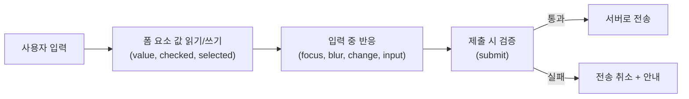
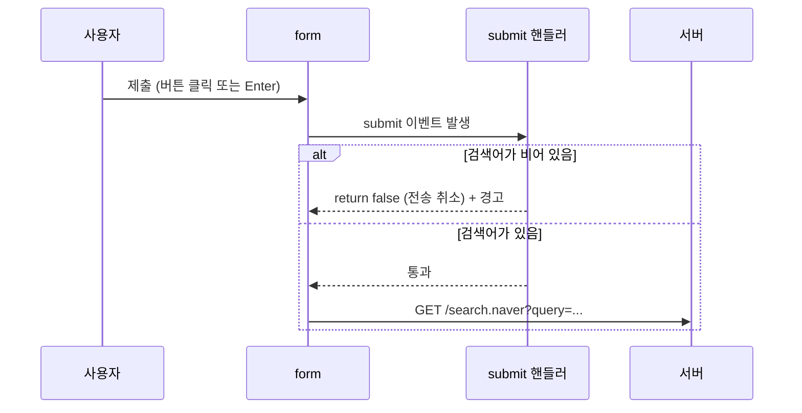

## 들어가며 (Situation)

`02_EVENT`의 마지막 파일 `03_form-event.html`은 **폼(form)** 을 다룬다. 웹 서비스에서 사용자가 서버로 정보를 보내는 거의 모든 통로가 폼이다. 이 파일은 "분식집 주문서"를 예제로, 입력 값을 읽고 쓰고, 입력 중에 반응하고, **서버로 보내기 전에 검증**하는 방법을 한꺼번에 보여 준다.



> 이 글은 수업 HTML과 MDN을 근거로 한 설명이며 브라우저 화면 스크린샷은 없다. 입력창에서의 반응(알림 창 등)은 직접 입력해 확인해야 한다.

## 문제 상황 (Task)

1. 폼의 텍스트, 라디오, 셀렉트, 텍스트 영역의 **값을 JavaScript로 어떻게 읽고 바꾸는가?**
2. 입력창에 커서가 들어가고 나갈 때 스타일을 바꾸려면?
3. `change`와 `input`은 비슷해 보이는데 뭐가 다른가?
4. 글자 수를 **입력하는 즉시** 세려면?
5. 빈 검색어는 **서버로 보내지 않고** 막으려면?

## 해결 과정 (Action)

### 1. 폼과 폼 요소 취득

```html
<form name="orderForm">
    <input type="text" name="username" id="username" value="김자바">
    <input type="radio" name="payment" id="card" value="card" checked>
    <input type="radio" name="payment" id="cash" value="cash">
    <select id="menu" name="menu"> ... </select>
    <textarea name="request" id="request"> ... </textarea>
    ...
</form>
```

앞 글의 `getElementById`, `querySelector`도 쓸 수 있지만, 폼은 **전용 접근법**이 있다.

```js
console.log(document.forms);              // 문서의 모든 form (HTMLCollection)
console.log(document.forms.orderForm);    // name 속성 값으로
console.log(document.forms[0]);           // 인덱스로

const $form = document.forms.orderForm;
console.log($form.elements);              // 폼 안의 입력 양식들 (HTMLFormControlsCollection)
console.log($form.elements.username);

const $username = $form.username;         // $form.elements.username 의 줄임
```

| 접근 | 의미 |
|---|---|
| `document.forms.폼이름` | `name`이 폼이름인 form |
| `form.elements` | 폼 안의 입력 요소 전체 |
| `form.입력이름` | 입력 요소의 `name` 속성으로 바로 접근 |

그래서 HTML의 **`name` 속성이 중요**하다. `name`은 서버로 전송될 때의 파라미터 이름(JSP·Servlet 단원의 `request.getParameter("username")`의 그 이름)이면서, JS에서 폼 요소를 찾는 이름이기도 하다.

### 2. 요소 종류별 값 읽기/쓰기

수업의 정리표를 그대로 옮기면 이렇다.

| 요소 | 읽고 쓰는 프로퍼티 |
|---|---|
| `input` (text), `textarea` | `.value` |
| `checkbox`, `radio` | `.checked` |
| `select` | `.value`(선택된 값), `.selectedIndex`(선택 번호), `.options`(option 목록) |

```js
// 텍스트
console.log($username.value);       // 김자바
$username.value = '김코틀린';          // 화면의 입력창이 바뀐다

// 라디오 (같은 name이 여러 개 → 컬렉션)
const $payment = $form.payment;
console.log($payment[1].checked);   // false (현금은 선택 안 됨)
$payment[1].checked = true;         // 현금 선택

// 셀렉트
const $menu = $form.menu;
$menu.options[2].selected = true;   // 3번째 옵션 (튀김)
$menu.selectedIndex = 3;            // 4번째 옵션 (김밥)
$menu.value = 'ramen';              // value가 ramen인 옵션 (라면)

// 텍스트 영역
console.log($request.value);        // 맵지 않게 해주세요!
$request.value = '단무지 많이 주세요!';
```

수업 코드는 셀렉트를 바꾸는 방법 세 가지를 **연달아** 실행하므로, 최종 선택은 마지막 줄의 `라면`이다. 앞의 두 줄은 방법만 보여 주고 덮어쓰인다.

| 방법 | 쓰는 상황 |
|---|---|
| `options[i].selected = true` | 순서(번호)를 아는 경우 |
| `selectedIndex = n` | 번호로 선택 |
| `value = '값'` | **값으로 선택 (가장 읽기 쉬움)** |

**중요한 함정: 코드로 값을 바꾸면 이벤트는 발생하지 않는다.** 이후에 나오는 `change`, `input` 이벤트는 **사용자가 직접 바꿨을 때** 동작하는 것이고, 위처럼 JS가 `value`를 바꾼 경우에는 MDN 기준으로 이벤트가 발생하지 않는다. (뒤에서 글자 수 카운터와 연결된다.)

### 3. focus와 blur — 커서가 들어오고 나갈 때

| 이벤트 | 발생 시점 | 버블링 |
|---|---|---|
| `focus` | 폼 요소를 클릭하거나 Tab으로 **들어왔을 때** | **안 됨** |
| `blur` | 다른 곳을 클릭하거나 Tab으로 **나갔을 때** | **안 됨** |
| `focusin` | `focus`와 같은 시점 | **됨** |
| `focusout` | `blur`와 같은 시점 | **됨** |

```js
// 입력창에 커서가 들어가면 회색, 나가면 원래대로
$username.onfocus = (e) => { e.target.classList.toggle('lightgray'); };
$username.onblur  = (e) => { e.target.classList.toggle('lightgray'); };
```

- `classList.toggle('클래스')`는 클래스가 **있으면 제거, 없으면 추가**한다. 스타일을 직접 바꾸지 않고 CSS의 `.lightgray` 규칙에 맡긴다.

```js
// 폼 전체에서 어떤 입력창이든 포커스가 오면 노란 점선
$form.addEventListener('focusin',  (e) => e.target.classList.add('focused'));
$form.addEventListener('focusout', (e) => e.target.classList.remove('focused'));
```

`focus`가 버블링되지 않아서 `$form`에 달아도 안쪽 입력창의 focus를 받지 못한다. 그래서 폼 **하나에 핸들러 하나**로 모든 입력창을 처리하려면 버블링되는 `focusin`/`focusout`을 쓴다. (수업 주석: "버블링이 필요하다면 focusin, focusout 이벤트를 사용한다.") 이것이 이벤트 위임의 기초 형태다.

| 구분 | `toggle` | `add` / `remove` |
|---|---|---|
| 동작 | 상태를 뒤집음 | 명확하게 추가 / 제거 |
| 위험 | 한 번이라도 어긋나면 **반대로 동작** | 안정적 |

수업은 개별 입력창은 `toggle`, 폼 전체는 `add/remove`를 썼다. 두 번 호출되거나 처음 상태가 다르면 `toggle`이 거꾸로 동작할 수 있으므로 `add/remove`가 더 안전하다.

### 4. change vs input — 비슷하지만 다른 두 이벤트

수업 설명을 표로 비교한다.

| 항목 | `change` | `input` |
|---|---|---|
| 발생 시점 | **변경이 끝났을 때** | **값이 바뀌는 즉시** |
| `select`, `checkbox`, `radio` | 선택이 바뀐 **직후** | 직후 |
| 텍스트 입력, `textarea` | 값을 바꾼 뒤 **포커스를 잃을 때** | 글자 하나 칠 때마다 |
| 붙여넣기, 음성 입력 | (포커스를 잃을 때) | **반응함** |
| 용도 | 최종 선택 확인 | **실시간 글자 수, 검색 자동완성** |

```js
// change : 선택이 바뀌면 알림
$menu.addEventListener('change', () => alert('메뉴 변경!'));
$request.addEventListener('change', () => alert('요청사항 변경!'));

// input : 입력할 때마다 글자 수를 센다
$request.addEventListener('input', (e) => {
    let len = e.target.value.trim().length;
    $form.querySelector('span').textContent = len;
});
```

요청사항 텍스트 영역에서 글자를 칠 때 `change`는 **칸을 벗어날 때 한 번**, `input`은 **칠 때마다** 반응한다. 그래서 글자 수 카운터는 `input`이다.

수업 주석이 `input`을 **"키보드 이벤트와 달리"** 라고 비교한 이유는, `keydown` 같은 키보드 이벤트는 마우스로 붙여 넣은 글자나 음성 입력을 잡지 못하기 때문이다.

**코드를 읽고 발견한 사실 두 가지**

① **글자 수 카운터의 초기값**: HTML의 `<span>0</span>`은 처음에 0이다. 그런데 스크립트가 `$request.value = '단무지 많이 주세요!'`로 값을 **코드로 바꾸고**, 앞서 본 대로 이 경우에는 `input`이 발생하지 않으므로 카운터는 **0 그대로**다. 텍스트 영역에는 글이 있는데 "0/200자"로 표시되는 불일치가 생긴다. 사용자가 한 글자라도 직접 입력해야 비로소 맞춰진다. 해결은 초기에 한 번 직접 계산해 넣는 것이다.

```js
$form.querySelector('span').textContent = $request.value.trim().length;
```

② **"/200자"는 표시일 뿐**: 글자 수를 세어 보여 주지만 `maxlength="200"` 같은 제한은 없어서 **201자도 입력된다.** 표시와 제한은 별개이므로 둘 다 필요하다.

`trim()`을 쓴 이유는 앞뒤 공백을 제외하고 세려는 것이다. (줄바꿈이나 중간 공백은 센다.)

### 5. submit — 서버로 보내기 전에 검증

```html
<form method="GET" action="https://search.naver.com/search.naver" name="search">
    <input type="text" name="query" placeholder="검색할 메뉴를 입력하세요 (예: 강남 떡볶이)">
    <button type="submit">네이버에서 맛집 검색하기</button>
</form>
```

수업의 설명:

> submit은 폼을 제출할 때 동작하는 이벤트로 폼을 서버로 전송하기 전 내용을 검증하여 폼 전송을 취소할 때 사용한다. 폼을 전송하는 방법으로는 (1) `input type="submit"` 클릭 (2) input 필드에서 Enter 키 누르기가 있다.



```js
const $searchForm = document.forms.search;

$searchForm.onsubmit = function() {
    let keyword = this.querySelector('input[name=query]').value;

    if(!keyword) {
        alert('검색할 메뉴를 입력하지 않았습니다!');
        return false;   // 폼 전송 취소
    }
};
```

| 부분 | 설명 |
|---|---|
| `this` | 프로퍼티 방식의 일반 함수이므로 **이벤트를 건 요소, 곧 폼** |
| `this.querySelector('input[name=query]')` | 폼 안에서 `name=query`인 입력 찾기 (앞 글의 속성 선택자) |
| `!keyword` | 빈 문자열은 `false`로 취급되어 `!`로 `true`가 됨 → 빈 값 검사 |
| `return false` | **프로퍼티 방식에서** 폼 전송을 취소 |

수업 주석: `addEventListener` 방식에서는 `return false`가 아니라 **`e.preventDefault()`**를 쓴다.

```js
$searchForm.addEventListener('submit', (e) => {
    const keyword = e.target.querySelector('input[name=query]').value;
    if (!keyword) {
        alert('검색할 메뉴를 입력하지 않았습니다!');
        e.preventDefault();   // 기본 동작(폼 전송)을 막는다
    }
});
```

| 등록 방식 | 전송 취소 방법 |
|---|---|
| 프로퍼티 (`onsubmit = function`) | `return false` |
| `addEventListener` | `e.preventDefault()` |

두 방식에서 취소 방법이 다른 이유는, 프로퍼티 핸들러의 반환값을 브라우저가 "취소 여부"로 해석하는 오래된 규칙이 있기 때문이다. `addEventListener`는 반환값을 쓰지 않고 이벤트 객체의 메서드로 제어한다.

**함정**: 공백만 입력한 `"   "`는 `!keyword`가 `false`(문자열이 비어 있지 않음)라서 **통과**한다. 공백을 걸러 내려면 `keyword.trim()`을 쓴다.

**또 하나, 서버 검증은 별개다.** 이 검증은 사용자 편의용이다. 개발자 도구로 우회할 수 있으므로 **서버에서도 반드시 다시 검증**해야 한다. 앞서 JPA 미니 프로젝트 글에서 정리한 "화면에서 막았다고 안심하지 않는다"는 원칙과 같다. ([정책·예외 처리 글]({{ site.baseurl }}/2026/11/04/jpa-mini-project-policy-exception-handling/))

### 6. 전체 흐름 정리

| 단계 | 이벤트 / 프로퍼티 | 예 (수업 코드) |
|---|---|---|
| 값 읽기·쓰기 | `value`, `checked`, `selectedIndex` | `$username.value = '김코틀린'` |
| 커서 진입·이탈 | `focus`/`blur`, `focusin`/`focusout` | 입력창 강조 |
| 선택 확정 | `change` | 메뉴 변경 알림 |
| 실시간 반응 | `input` | 글자 수 세기 |
| 제출 검증 | `submit` + 전송 취소 | 빈 검색어 막기 |

## 결과 (Result)

| 질문 | 정리 |
|---|---|
| 폼 값은 어떻게? | 폼 이름 / `name`으로 접근, 종류별로 `value`, `checked`, `selectedIndex` |
| `change` vs `input` | 확정 시점 vs 즉시. 실시간 반응은 `input` |
| `focus` vs `focusin` | `focus`는 버블링 안 됨, `focusin`은 됨 (폼 전체 처리에 유리) |
| 제출 취소 | 프로퍼티는 `return false`, `addEventListener`는 `preventDefault()` |
| 코드로 값을 바꾸면? | `change`, `input` 이벤트가 **발생하지 않는다** |

배운 점은 이렇다.

1. 폼의 **`name` 속성**은 서버 전송과 JS 접근 양쪽에 쓰이는 연결 고리다.
2. 이벤트는 **"사용자가 했을 때"** 동작한다. 코드로 값을 바꾼 경우의 화면 불일치(카운터 0)를 의식해야 한다.
3. 클라이언트 검증은 **편의**이고 서버 검증은 **보안**이다. 둘은 대체 관계가 아니다.
4. 수업 코드에서 "공백만 입력", "200자 제한 없음" 같은 **빠진 경계 조건**을 직접 찾아보는 것이 좋은 연습이 된다.

여기까지 `02_Web`의 DOM 취득 → 이벤트 핸들러/객체 → 폼 이벤트를 정리했다.

## 더 학습하면 좋은 개념

- **이벤트 위임(Event Delegation)** — `focusin`처럼 버블링되는 이벤트를 부모 하나에 달아 자식 여러 개를 처리하는 패턴이다. 동적으로 추가되는 요소에 특히 중요하다.
- **HTML 폼 검증 속성 (`required`, `minlength`, `pattern`)와 Constraint Validation API** — JavaScript 없이 브라우저가 해 주는 검증으로, 이번 수동 검증을 대체하거나 보완한다.
- **`FormData`와 `fetch`** — 폼 값을 한 번에 모아 비동기로 서버에 보내는 현대적 방식이다. 페이지 이동 없는 제출의 출발점이다.
- **Truthy / Falsy** — `!keyword`가 빈 문자열을 걸러 내는 이유이자 `"0"`, `" "` 같은 경계값에서의 함정을 이해하는 열쇠다.
- **XSS와 입력값 이스케이프** — 사용자 입력을 화면에 그대로 넣을 때(`innerHTML`)의 보안 위험으로, 서버 검증과 함께 반드시 학습할 주제다.

## 참고 자료

- [MDN - 폼 데이터 보내기](https://developer.mozilla.org/ko/docs/Learn_web_development/Extensions/Forms/Sending_and_retrieving_form_data)
- [MDN - `HTMLFormElement`](https://developer.mozilla.org/ko/docs/Web/API/HTMLFormElement)
- [MDN - `input` 이벤트](https://developer.mozilla.org/ko/docs/Web/API/HTMLElement/input_event)
- [MDN - `change` 이벤트](https://developer.mozilla.org/ko/docs/Web/API/HTMLElement/change_event)
- [MDN - `focus` 이벤트 / `focusin` 이벤트](https://developer.mozilla.org/ko/docs/Web/API/Element/focus_event)
- [MDN - `submit` 이벤트](https://developer.mozilla.org/ko/docs/Web/API/HTMLFormElement/submit_event)
- [MDN - `Event.preventDefault()`](https://developer.mozilla.org/ko/docs/Web/API/Event/preventDefault)
- [이벤트 핸들러·이벤트 객체·this 글]({{ site.baseurl }}/2026/11/18/javascript-event-handler-event-object-this/)
