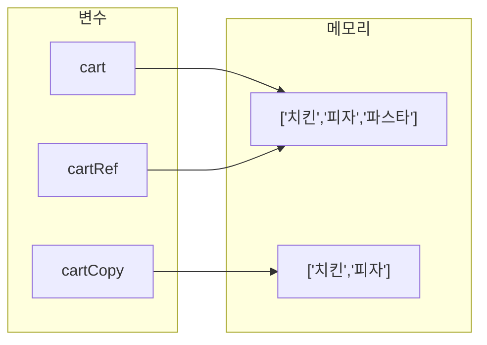
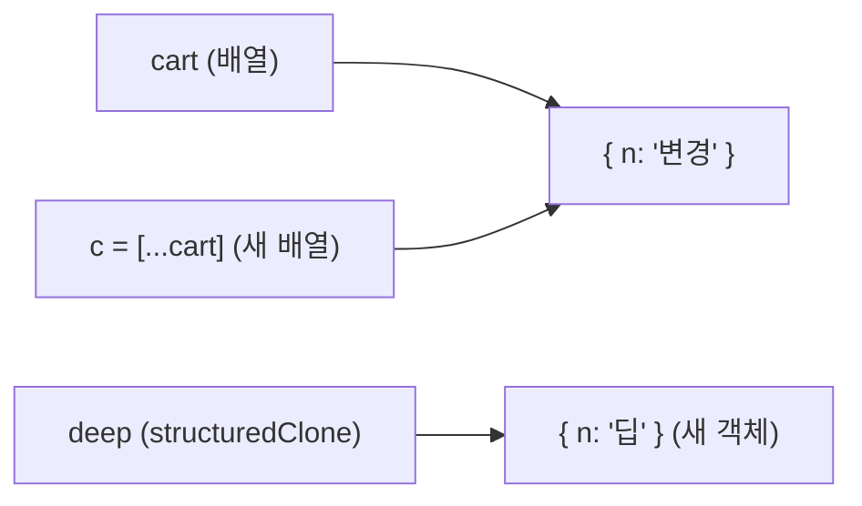

## 들어가며 (Situation)

`01_Core`의 마지막 두 파일은 `07_spread-syntax.js`와 `08_destructuring.js`다. 둘 다 `...`과 `[ ]`, `{ }`를 이용해 **배열과 객체를 편하게 다루는 문법**이다.

- **스프레드(`...`)**: 배열/객체를 **펼쳐서** 새로 만든다. (복사, 합치기)
- **구조 분해 할당**: 배열/객체에서 값을 **꺼내서** 변수에 담는다.

모든 출력은 Node.js(v24)로 직접 실행해 확인했다. 앞 글에서 배열의 `map`, `filter`를 정리했는데, 그 메서드들이 "원본을 바꾸지 않고 새 배열을 반환"하는 이유를 이 글의 **복사 개념**이 설명해 준다.

## 문제 상황 (Task)

장바구니 배열을 "복사"해서 수정했더니 원본까지 바뀌는 상황이다.

```js
const cart = ['치킨', '피자'];
const cartRef = cart;          // 복사한 것 같은데…
cartRef.push('파스타');
console.log(cart);             // [ '치킨', '피자', '파스타' ]  ← 원본이 바뀌었다!
```

1. `=`로 대입했는데 왜 복사가 안 되는가?
2. 진짜 복사는 어떻게 하는가?
3. 배열/객체에서 값을 꺼내 쓸 때 `arr[0]`, `obj.name` 반복을 줄이려면?

## 해결 과정 (Action)

### 1. 먼저 개념: 변수는 객체를 "가리킨다"

원시값(숫자, 문자열 등)은 값 자체가 변수에 담기지만, **배열과 객체는 주소(참조)가 변수에 담긴다.** Java의 참조 타입과 같은 감각이다.



- `const cartRef = cart;` → 새 배열이 만들어지지 않고 **같은 배열을 가리키는 이름이 하나 더 생길 뿐**이다.
- `const cartCopy = [...cart];` → **새 배열**이 만들어진다.

### 2. 직접 실험: 대입 vs 스프레드

```js
const cart = ['치킨', '피자'];
const cartRef = cart;
const cartCopy = [...cart];

cartRef.push('파스타');
console.log(cart, cartRef);
// [ '치킨', '피자', '파스타' ] [ '치킨', '피자', '파스타' ]   ← 둘 다 바뀜

cartCopy.push('빠네파스타');
console.log(cart, cartCopy);
// [ '치킨', '피자', '파스타' ] [ '치킨', '피자', '빠네파스타' ]  ← 원본은 그대로
```

| 방식 | 새 배열 생성 | 한쪽을 수정하면 |
|---|---|---|
| `const cartRef = cart` | 아니오 (같은 배열) | **둘 다 바뀜** |
| `const cartCopy = [...cart]` | 예 | 서로 영향 없음 |

수업 주석은 이렇게 설명한다.

> 깊은 복사의 단점: 메뉴 데이터를 이곳저곳에서 사용한다고 했을 때, 한 군데에서 수정하면 다른 곳에서는 영문도 모른 채 값이 변경된다.

**용어 보정**: 주석은 `cart`를 대입한 것을 "깊은 복사(주소값을 복사)", 스프레드를 "얕은 복사"라고 적었다. 일반적으로 쓰는 용어와는 반대에 가깝다. 정리하면 이렇다.

| 방식 | 일반적인 용어 | 설명 |
|---|---|---|
| `b = a` | **참조 복사** (복사가 아님) | 같은 객체를 공유 |
| `[...a]`, `{...a}` | **얕은 복사(shallow copy)** | 바깥 한 겹만 새로 만듦 |
| `structuredClone(a)` | **깊은 복사(deep copy)** | 안쪽 객체까지 모두 새로 만듦 |

수업이 전달하려는 핵심("주소만 복사하면 위험하다")은 맞다. 다만 용어는 위 표처럼 알아 두면 다른 자료를 볼 때 혼동이 없다.

### 3. 객체도 같다: `order === orderCopy`

```js
const order = { menuName : '뿌링클', qty : 2 }

const orderRef = order;
const orderCopy = {...order};

console.log(order === orderRef);    // true   (같은 객체)
console.log(order === orderCopy);   // false  (새 객체)
```

`===`는 객체에서는 **값이 같은지가 아니라 같은 객체인지**(주소가 같은지)를 비교한다. 앞 글에서 본 "타입과 값을 모두 비교"는 원시값의 이야기이고, 객체에서는 `{a:1} === {a:1}`도 `false`다.

스프레드는 **합치기와 덮어쓰기**에도 쓰인다. (직접 실행 결과)

```js
const menu = { name: '치즈알밥', price: 7500, category: '퓨전한식' };
console.log({ ...menu, price: 8000 });
// { name: '치즈알밥', price: 8000, category: '퓨전한식' }   ← price만 바뀐 새 객체

console.log([...[1, 2], ...[3]]);   // [ 1, 2, 3 ]
```

원본 `menu`를 건드리지 않고 **일부만 바꾼 새 객체**를 만드는 이 패턴은 React 등에서 상태를 갱신할 때 자주 쓴다.

### 4. 함정: 스프레드는 "한 겹"만 복사한다

수업은 "값만 복사해서 새로운 배열을 생성"이라고 설명하지만, 배열 안에 **객체가 들어 있으면** 그 객체는 공유된다. 직접 확인했다.

```js
const cart = [{ n: '치킨' }];
const c = [...cart];
c[0].n = '변경';

console.log(cart);                  // [ { n: '변경' } ]   ← 원본의 안쪽이 바뀜!
console.log(c === cart);            // false (바깥 배열은 다른 배열)

const deep = structuredClone(cart); // 깊은 복사
deep[0].n = '딥';
console.log(cart);                  // [ { n: '변경' } ]   ← 영향 없음
```



| 복사 방법 | 바깥 | 안쪽 객체 |
|---|---|---|
| `[...arr]`, `{...obj}` | 새로 만듦 | **공유** |
| `structuredClone()` | 새로 만듦 | 새로 만듦 |

메뉴 데이터처럼 객체 배열을 다룰 때 가장 흔한 버그가 여기서 나온다. (`structuredClone`은 함수 등 일부 값은 복사하지 못하니 공식 문서의 제한을 확인하자.)

### 5. 구조 분해 할당 — 꺼내서 변수에 담기

**배열**은 **순서(위치)** 로 꺼낸다.

```js
const menuArr = ['치킨', '피자'];

// 기존 방식
const chi = menuArr[0];
const piz = menuArr[1];

// 구조 분해 할당
const [chi1, piz1] = menuArr;
console.log(chi1, piz1);   // 치킨 피자
```

**객체**는 **프로퍼티 이름(key)** 으로 꺼낸다.

```js
const menu = { name : '치즈알밥', price : 7500, category : '퓨전한식' };

// 기존 방식
// const name = menu.name; const price = menu.price; const category = menu.category;

const { name, price, category } = menu;
console.log(name, price, category);   // 치즈알밥 7500 퓨전한식
```

| 대상 | 기준 | 변수 이름 |
|---|---|---|
| 배열 `[a, b]` | **순서** | 마음대로 |
| 객체 `{a, b}` | **key 이름** | key와 **일치해야 함** (수업 주석) |

### 6. 구조 분해의 응용 (수업 코드 + 보충)

수업 파일에는 `const {...rest} = menu;`로 객체를 복사하는 예가 있다. 같은 문법의 다른 쓰임을 직접 실행해서 정리한다. (아래 표의 보충 예시는 수업 파일에는 없는 내용이다.)

```js
const m = { name: '치즈알밥', price: 7500, category: '퓨전한식' };

const { name: menuName, price, stock = 10 } = m;
console.log(menuName, price, stock);       // 치즈알밥 7500 10

const { name, ...rest } = m;
console.log(name, rest);                   // 치즈알밥 { price: 7500, category: '퓨전한식' }

const [a, , c3] = ['치킨', '피자', '파스타'];
console.log(a, c3);                        // 치킨 파스타

let x = 1, y = 2;
[x, y] = [y, x];
console.log(x, y);                         // 2 1
```

| 문법 | 의미 | 예 |
|---|---|---|
| `{ name: menuName }` | 이름을 **바꿔서** 받기 | key는 `name`, 변수는 `menuName` |
| `{ stock = 10 }` | 값이 `undefined`면 **기본값** | 없는 프로퍼티에 10 |
| `{ name, ...rest }` | 나머지를 모아서 새 객체로 (**rest**) | `name`만 빼고 전부 |
| `[a, , c3]` | 자리 건너뛰기 | 두 번째는 무시 |
| `[x, y] = [y, x]` | 임시 변수 없이 **값 교환** | |

함수 매개변수에서도 쓸 수 있다.

```js
function f({ name, price }) { return name + price }
console.log(f(m));    // 치즈알밥7500
```

`...`가 세 군데에서 다른 일을 하는 점이 처음에는 헷갈린다.

| 위치 | 이름 | 하는 일 |
|---|---|---|
| `[...arr]`, `{...obj}` (값을 만드는 쪽) | 스프레드 | **펼쳐서** 넣기 |
| `const { a, ...rest } = obj` (꺼내는 쪽) | 나머지(rest) | 남은 것을 **모아서** 담기 |

### 7. 주의할 점

```js
const [p] = undefined;   // TypeError (분해할 대상이 undefined/null이면 에러)
const { zz } = menu;     // 에러 없음, zz === undefined (없는 key는 undefined)
```

- 분해 대상이 `undefined`나 `null`이면 **`TypeError`** 가 난다. API 응답처럼 값이 없을 수 있는 경우에는 `const { a } = obj ?? {}`처럼 방어한다.
- 없는 key는 에러 없이 `undefined`가 된다. 오타를 내도 조용히 지나가므로 주의한다. (첫 글의 동적 타입의 위험과 같은 맥락이다.)

## 결과 (Result)

| 질문 | 정리 |
|---|---|
| `b = a`는 복사인가? | 아니다. 같은 객체를 가리키는 **참조 복사** |
| 안전하게 복사하려면? | 한 겹은 `[...a]`, `{...a}` / 안쪽까지는 `structuredClone` |
| 값을 꺼낼 때 | 배열은 **순서**, 객체는 **key 이름** 기준으로 구조 분해 |
| `...`의 두 얼굴 | 스프레드(펼치기) vs 나머지(모으기) |

실행 결과로 확인한 핵심은 세 가지다.

- 대입은 두 변수 모두 바뀌었고(`[치킨, 피자, 파스타]` 두 번), 스프레드는 원본이 그대로였다.
- 스프레드 복사본의 **안쪽 객체**를 바꾸면 원본도 바뀌었다.
- `order === orderCopy`는 `false`였다.

배운 점은 이렇다.

1. 배열과 객체의 `=`는 "복사"가 아니라 **"이름 붙이기"** 다.
2. "복사했으니 안전하다"는 안쪽에 객체가 있으면 성립하지 않는다.
3. 구조 분해는 단순한 줄임이 아니라, 코드가 **무엇을 쓰는지** 첫 줄에서 드러내 준다.

## 더 학습하면 좋은 개념

- **원시 타입과 참조 타입 (값 전달 vs 참조 전달)** — 이 글의 모든 현상의 뿌리다. 함수 인자로 객체를 넘겼을 때 원본이 바뀌는 이유도 같다.
- **불변성(Immutability)과 `Object.freeze()`** — 복사해서 바꾸는 방식이 React 등에서 왜 필수인지 이해하게 해 준다.
- **`structuredClone`과 깊은 복사의 한계** — 복사되지 않는 값(함수 등)과 `JSON.parse(JSON.stringify())` 방식의 문제점을 비교하면 좋다.
- **나머지 매개변수(rest parameters)와 `arguments`** — 함수에서 `...args`로 인자를 받는 문법으로, 이 글의 rest와 같은 개념이다.
- **Java의 참조 복사와 `clone()`, 복사 생성자** — 같은 문제를 Java에서 어떻게 다루는지 비교하면 두 언어의 차이가 분명해진다.

## 참고 자료

- [MDN - 전개 구문(Spread syntax)](https://developer.mozilla.org/ko/docs/Web/JavaScript/Reference/Operators/Spread_syntax)
- [MDN - 구조 분해 할당](https://developer.mozilla.org/ko/docs/Web/JavaScript/Reference/Operators/Destructuring_assignment)
- [MDN - 나머지 매개변수](https://developer.mozilla.org/ko/docs/Web/JavaScript/Reference/Functions/rest_parameters)
- [MDN - `structuredClone()`](https://developer.mozilla.org/ko/docs/Web/API/Window/structuredClone)
- [MDN - 얕은 복사(Shallow copy)](https://developer.mozilla.org/ko/docs/Glossary/Shallow_copy)
- [MDN - 깊은 복사(Deep copy)](https://developer.mozilla.org/ko/docs/Glossary/Deep_copy)
- [배열과 고차함수 글]({{ site.baseurl }}/2026/11/17/javascript-array-higher-order-method/)
