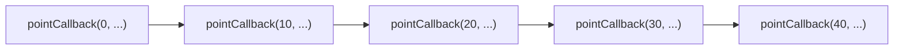
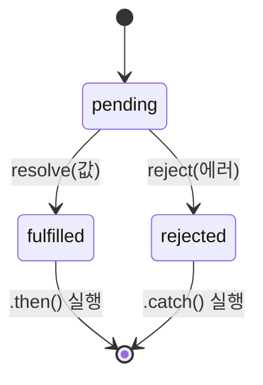
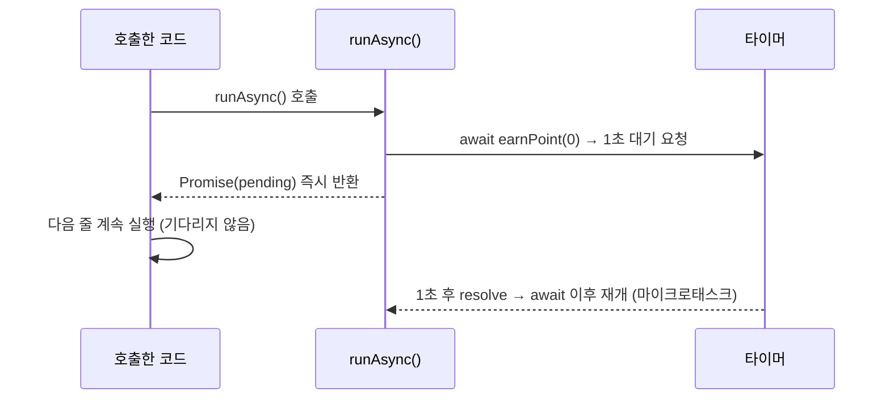

## 들어가며 (Situation)

앞 글에서 비동기 코드는 **작성한 순서가 아니라 완료된 순서**로 실행된다는 것을 확인했다. 그런데 현실의 요구사항은 종종 **"순서를 지켜야 하는 비동기"** 다. `03_promise-async-await.html`의 예제가 바로 그렇다.

> 주문할 때마다 **1초 뒤에** 포인트가 10P씩 적립된다. (적립 한도는 50P)

포인트는 앞의 결과(현재 포인트)를 받아서 더해야 하므로 **반드시 앞 작업이 끝난 뒤** 다음 작업을 해야 한다. 이 요구사항을 세 가지 방식으로 구현하며 비교하는 것이 이 파일의 내용이다.

| 방식 | 도입 시기 | 특징 |
|---|---|---|
| ① 콜백 | 초기 | 함수 안에 함수를 넣어 순서 보장 |
| ② Promise | ES6 | 성공/실패를 객체로 표현, `.then()` 체이닝 |
| ③ async/await | ES2017 | Promise를 **동기 코드처럼 읽히게** |

> 모든 출력은 수업 코드를 Node.js(v24)로 직접 실행해 시각(초)까지 측정한 결과다. 수업 코드는 브라우저의 버튼 클릭으로 실행하지만, 포인트 계산 함수는 동일하다.

## 문제 상황 (Task)

1. "1초 뒤 +10P"를 **5번 순서대로** 실행하려면 어떻게 짜야 하는가?
2. 도중에 실패(한도 초과)하면 어떻게 처리하는가?
3. 세 방식 중 무엇이 읽기 쉽고 안전한가?

## 해결 과정 (Action)

### 1. 방식 ① 콜백 — 순서는 지키지만 "지옥"

```js
function pointCallback(point, func) {
    setTimeout(() => {
        const result = point + 10;
        if(func) { func(result); }
    }, 1000)
}

function runCallback() {
    pointCallback(0, point => {
        console.log(`${point}P`) // 10P
        pointCallback(point, point => {
            console.log(`${point}P`) // 20P
            pointCallback(point, point => {
                console.log(`${point}P`)  // 30P
                pointCallback(point, point => {
                    console.log(`${point}P`)  // 40P
                    pointCallback(point, point => {
                        console.log(`${point}P`) // 50P
                    })
                });
            });
        });
    });
}
```

**왜 이렇게 써야 하나?** 이 `setTimeout`은 비동기라서 호출한 줄 바로 아래에서 결과를 쓸 수 없다. 앞의 결과가 **다 나온 뒤**에 다음을 하려면, "끝나면 이걸 해 줘"라는 **함수를 안에 넣어야** 한다. 수업 주석:

> 호출 순서를 지키기 위해 함수 내부에 함수를 누적해서 작성하는 것을 "콜백 지옥"이라고 부르며, 이는 작성하면 안 되는 코드 중 하나의 예시이다.



**콜백 지옥의 문제점**

| 문제 | 설명 |
|---|---|
| **들여쓰기가 계속 깊어짐** | 5단계가 이미 오른쪽 끝까지. 단계가 늘면 읽을 수 없음 |
| **에러 처리가 어려움** | 아래에서 직접 확인 |
| **흐름 파악 어려움** | 위→아래가 아니라 안쪽으로 파고드는 구조 |
| **재사용 어려움** | 중간 단계를 바꾸려면 괄호 구조 전체를 수정해야 함 |

**에러를 `try/catch`로 못 잡는 이유를 실험했다.**

```js
try {
    setTimeout(() => { throw new Error('콜백 안 에러') }, 10);
    console.log('try 블록 통과');
} catch(e) { console.log('잡힘', e.message) }
```

```
try 블록 통과
try/catch가 못 잡음 → 전역 uncaughtException: 콜백 안 에러
```

`try` 블록은 `setTimeout`을 **등록하고 바로 빠져나간다.** 에러는 한참 뒤 **다른 실행 흐름**(큐에서 꺼내 실행한 콜백)에서 발생하므로 이미 끝난 `try/catch`가 잡을 수 없다. (이 동작은 이벤트 루프의 결과다.) 그래서 콜백 방식에서는 "성공 콜백, 실패 콜백"을 따로 넘기는 식으로 에러를 전달해야 하고, 단계가 많아지면 지옥이 더 깊어진다.

수업의 콜백 예제는 한도(50P)를 확인하는 코드도 없다. 5번 적립하고 끝날 뿐이다.

### 2. 방식 ② Promise — 결과를 "약속 객체"에 담는다

```js
function earnPoint(point) {
    const promise = new Promise((resolve, reject) => {
        setTimeout(() => {
            const result = point + 10;

            if(result > 50) {
                return reject(new Error("적립 한도 초과"));   // 실패
            }
            return resolve(result);                          // 성공
        }, 1000)
    });
    return promise;
}
```

**Promise란?** 수업 설명을 풀면 이렇다. *"지금은 값이 없지만, 나중에 성공하거나 실패하면 그 결과를 알려 주겠다는 약속 객체."* 세 가지 상태를 가진다.

| 상태 | 의미 | 전환 |
|---|---|---|
| **pending** | 대기 중 (아직 결과 없음) | 처음 상태 |
| **fulfilled** | 성공 | `resolve(값)` 호출 시 |
| **rejected** | 실패 | `reject(에러)` 호출 시 |

한 번 fulfilled나 rejected가 되면 **상태는 바뀌지 않는다.**



사용하는 쪽은 `.then()`으로 결과를 받는다.

```js
function runPromise() {
    earnPoint(0)
        .then(point => { console.log(`${point}P`); return earnPoint(point); })
        .then(point => { console.log(`${point}P`); return earnPoint(point); })
        .then(point => { console.log(`${point}P`); return earnPoint(point); })
        .then(point => { console.log(`${point}P`); return earnPoint(point); })
        .then(point => { console.log(`${point}P`); return earnPoint(point); })
        .catch(e => console.log(e, '발생~!!!!'))
        .finally(() => console.log("포인트 적립 종료"));
}
```

| 메서드 | 실행 시점 |
|---|---|
| `.then(f)` | 성공했을 때. `f`가 **Promise를 return하면 그것이 끝날 때까지 다음 `.then`이 기다림** |
| `.catch(f)` | 체인 어디서든 실패(reject 또는 예외)가 나면 |
| `.finally(f)` | 성공/실패와 **상관없이 마지막에** |

핵심은 `return earnPoint(point)`다. `then` 안에서 **새 Promise를 반환**하면 다음 `.then`은 그 Promise가 끝난 뒤에 실행된다. 이 덕분에 **들여쓰기가 깊어지지 않고 일렬로** 순서를 지킨다.

**직접 실행한 결과 (시각 포함)**

```
1.0s 10P
2.0s 20P
3.0s 30P
4.1s 40P
5.1s 50P
6.1s 적립 한도 초과 발생~!!!!
6.1s 포인트 적립 종료
```

수업 코드는 마지막(`50P` 출력 뒤)에 `earnPoint(50)`을 한 번 더 호출한다. 이 호출은 `50 + 10 = 60 > 50`이므로 **reject**되어 `.catch`가 `Error: 적립 한도 초과`를 출력하고, 이어서 `.finally`가 실행된다. **에러가 의도된 시나리오**다. 한도 초과를 일부러 발생시켜 `.catch`/`.finally`를 보여 주는 설계다.

`.catch`는 체인 **전체의 실패를 한 곳에서** 처리한다. 콜백 방식이 단계마다 에러 처리를 따로 해야 했던 것과 큰 차이다.

### 3. 방식 ③ async/await — 읽기에는 동기 코드처럼

```js
async function runAsync() {
    try {
        let point = await earnPoint(0);
        console.log(`${point}P`);
        point = await earnPoint(point);
        console.log(`${point}P`);
        // ... 반복
        point = await earnPoint(point);      // 6번째: 한도 초과
    } catch(e) {
        console.log(e, '발생~!!')
    }
}
```

| 키워드 | 의미 |
|---|---|
| `async` | 이 함수는 **Promise를 반환**하며, 안에서 `await`를 쓸 수 있다 |
| `await` | Promise가 끝날 때까지 **이 함수만** 기다렸다가 결과값(resolve 값)을 꺼내 준다 |

수업 주석의 비교가 핵심이다.

> `.then()` → resolve 객체 사용 가능 / `await` → resolve 객체 사용 가능.
> `.then()` 절은 메서드 체이닝 방식이라 `.catch()`로 예외 처리가 가능하다. async/await 방식은 메서드 체이닝이 아니므로 예외 처리를 위해서는 `try...catch` 구문으로 감싸야 한다.

**직접 실행한 결과**

```
1.0s 10P
2.0s 20P
3.0s 30P
4.0s 40P
5.0s 50P
6.0s 적립 한도 초과 발생~!!
```

결과는 Promise 방식과 같다. 다만 **읽는 방법**이 다르다. 위에서 아래로 읽으면 곧 실행 순서이고, 중간값이 `point` 변수에 담겨 있어 이해하기 쉽다. 에러 처리는 Java에서 익숙한 `try/catch`다.

### 4. 오해 바로잡기: await는 "동기로 만드는" 것이 아니다

수업 주석에는 이런 문장이 있다.

> 비동기 처리를 동기 방식으로 동작하게 만드는 아주 중요한 문법이다.

정확히는 **"동기 코드처럼 읽히게 만든다."** 실제로는 여전히 비동기다. 직접 확인했다.

```js
console.log('runAsync 호출 전');
const pr = runAsync();
console.log('runAsync 호출 직후 (이 줄이 먼저 출력)', pr);
```

```
0.0s runAsync 호출 전
0.0s runAsync 호출 직후 (이 줄이 먼저 출력) Promise { <pending> }
1.0s 10P
...
```

`runAsync()`는 **즉시 Promise를 반환**하고(상태 `<pending>`), 호출한 쪽의 다음 줄은 **기다리지 않고** 실행된다. `await`가 멈추는 것은 **`runAsync` 함수 내부의 흐름뿐**이며, 메인 스레드는 그 사이 다른 일(클릭 처리, 화면 그리기)을 한다. 앞 글에서 `sleep`이 일꾼 전체를 붙잡던 것과 정반대다.



`await` 이후의 코드는 이벤트 루프에서 **마이크로태스크**로 재개된다. 앞 글에서 정리한 "Promise 계열이 먼저"라는 규칙이 여기에 적용된다.

### 5. 세 방식 비교 정리

같은 요구사항(1초 뒤 +10P를 5번 순서대로)을 구현한 세 코드를 비교한다.

| 항목 | ① 콜백 | ② Promise | ③ async/await |
|---|---|---|---|
| 순서 보장 | 중첩으로 | `.then` 체이닝 | `await` 한 줄씩 |
| 들여쓰기 | **계속 깊어짐** | 일렬 | 일렬 |
| 가독성 | 낮음 | 보통 | **높음** (동기 코드처럼) |
| 에러 처리 | 단계별로 직접 | `.catch` 한 곳 | `try/catch` |
| 에러 처리 쉬움 | 어려움 (`try/catch` 불가) | 쉬움 | 쉬움 |
| 반환 | 없음 | Promise | Promise (async 함수 자체가) |
| 중간값 사용 | 안쪽 함수에서만 | `then`의 매개변수 | **변수에 담아 자유롭게** |
| 실행 시간(5회) | 약 5초 | 약 5초 | 약 5초 |

실행 시간이 모두 같다는 점이 중요하다. 세 방식은 **같은 동작을 다른 문법으로 표현**한 것이다. 성능을 높이려는 것이 아니라 **읽기 쉽고 안전하게 쓰려는 것**이다.

### 6. 시행착오가 될 수 있는 지점

**① 독립적인 작업을 `await`로 줄 세우면 느려진다**

이 예제는 앞 결과를 다음이 써야 해서 순서가 필수다. 하지만 서로 **관련 없는** 요청이라면 순서대로 `await`하는 것이 낭비다. 직접 비교했다.

```js
await wait(1000); await wait(1000); await wait(1000);        // 순차: 3.0s
await Promise.all([wait(1000), wait(1000), wait(1000)]);     // 동시: 1.0s
```

| 방식 | 3개 작업(각 1초) |
|---|---|
| `await` 순차 | **3.0초** |
| `Promise.all([...])` | **1.0초** |

| 상황 | 선택 |
|---|---|
| 앞 결과가 다음에 필요 (포인트 누적) | `await` 순차 |
| 서로 독립적 (여러 API 동시 호출) | `Promise.all` |

**② `await`는 `async` 함수 안에서만 쓴다**

일반 함수에서 `await`를 쓰면 문법 오류다. (모듈 최상위에서는 가능하지만 수업 환경은 일반 `<script>`다.) 수업 주석 "async 키워드는 await를 사용하기 위해 붙인다."의 뜻이다.

**③ `.then` 안에서 `return`을 빼면 순서가 깨진다**

```js
.then(point => { console.log(point); earnPoint(point); })   // return 없음!
```

`return`이 없으면 다음 `.then`이 그 Promise를 기다리지 않고 `undefined`를 받아 바로 실행된다. 에러 없이 순서가 틀어지는 조용한 버그다.

**④ `try/catch` 없는 `await`**

reject된 Promise를 `await`했는데 `catch`가 없으면 에러가 처리되지 않은 채로 올라간다(unhandled rejection). `await`를 쓰면 반드시 호출 쪽 어딘가에서 에러를 처리해야 한다.

## 결과 (Result)

| 질문 | 정리 |
|---|---|
| 순서가 필요한 비동기 | 콜백(중첩) → Promise(체이닝) → async/await(순차 코드) |
| 콜백 지옥의 문제 | 깊은 들여쓰기 + **`try/catch`로 에러를 못 잡음** (실험 확인) |
| Promise 상태 | pending → fulfilled / rejected (한 번 정해지면 불변) |
| 에러 처리 | Promise는 `.catch`, async/await는 `try/catch` |
| await의 정체 | 동기로 만드는 것이 아니라 **동기처럼 읽히게** (호출 직후 `Promise <pending>` 확인) |

직접 측정한 값은 이렇다.

| 항목 | 값 |
|---|---|
| Promise 체이닝 5회 + 한도 초과 | 약 6.1초, 6번째에 `.catch` |
| async/await 5회 + 한도 초과 | 6.0초, 6번째에 `catch` |
| 독립 작업 3개 순차 `await` vs `Promise.all` | 3.0초 → 1.0초 |

배운 점은 이렇다.

1. 같은 비동기도 **표현 방식**에 따라 가독성과 안전성이 크게 달라진다. 기본은 `async/await`를 쓰고 `try/catch`로 에러를 처리한다.
2. `async/await`는 Promise 위의 문법이므로 **Promise를 이해해야** 에러와 병렬 처리를 제대로 다룬다.
3. 수업 주석의 "동기 방식으로 동작"은 **읽는 방식**의 이야기다. 실제로는 메인 스레드를 막지 않는 비동기다.
4. 순서가 필요 없다면 `await`를 줄 세우지 말고 `Promise.all`로 묶는다.

## 더 학습하면 좋은 개념

- **`Promise.all`, `Promise.allSettled`, `Promise.race`, `Promise.any`** — 여러 Promise를 조합하는 정적 메서드들로, 실패 시 전체가 실패할지(`all`) 각각 결과를 모을지(`allSettled`)를 선택한다.
- **Unhandled Promise Rejection** — 에러를 처리하지 않은 Promise가 일으키는 문제와 브라우저/Node의 처리 방식이다.
- **Promisification (`util.promisify`)** — 콜백 기반 옛 API를 Promise로 감싸는 방법으로, 이 글의 ①을 ②로 바꾸는 일반화다.
- **제너레이터(Generator)와 async/await의 관계** — `async/await`가 내부적으로 어떤 원리에서 나왔는지를 알려 준다.
- **재시도(retry)와 타임아웃 패턴** — 실무 비동기 코드의 필수 요소로, `AbortController`와 함께 학습하면 좋다.

## 참고 자료

- [MDN - Promise 사용하기](https://developer.mozilla.org/ko/docs/Web/JavaScript/Guide/Using_promises)
- [MDN - `Promise`](https://developer.mozilla.org/ko/docs/Web/JavaScript/Reference/Global_Objects/Promise)
- [MDN - `async function`](https://developer.mozilla.org/ko/docs/Web/JavaScript/Reference/Statements/async_function)
- [MDN - `await`](https://developer.mozilla.org/ko/docs/Web/JavaScript/Reference/Operators/await)
- [MDN - `Promise.all()`](https://developer.mozilla.org/ko/docs/Web/JavaScript/Reference/Global_Objects/Promise/all)
- [호출 스택·태스크 큐·이벤트 루프 글]({{ site.baseurl }}/2026/11/20/javascript-event-loop-task-queue/)
