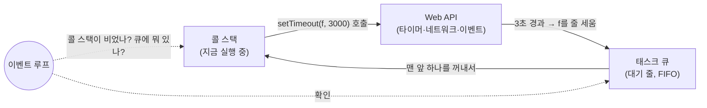
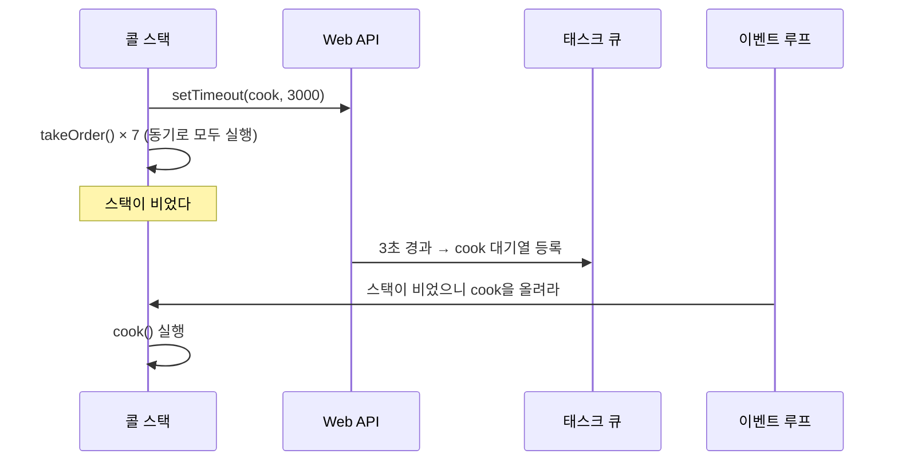
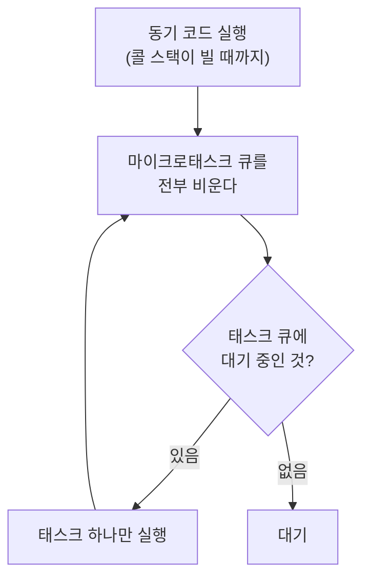

## 들어가며 (Situation)

앞 글에서 `setTimeout`은 **일꾼(메인 스레드)이 바쁘면 `0`ms여도 늦게 실행**된다는 것을 확인했다. `02_asynchronous.html`의 "동기/비동기 동작 방식 관련 CS 지식"이 바로 그 원리를 설명한다.

> **태스크 큐(task queue)**: 비동기 함수의 콜백 함수 or 이벤트 핸들러가 일시적으로 보관되는 영역
>
> **이벤트 루프(event loop)**: 콜 스택에 현재 실행 중인 실행 컨텍스트가 있는지, 태스크 큐에 대기 중인 함수가 있는지를 반복 확인한다. 콜 스택이 비어 있고 태스크 큐에 대기 중인 함수가 있다면 FIFO(선입선출) 방식으로 콜 스택으로 이동시킨다.

이 글은 이 문단 하나를 **식당 비유와 직접 실행한 실험**으로 풀어 쓴다. 그리고 수업에서 다루지 않은 **마이크로태스크 큐**까지 보충한다. Promise와 `async/await`의 실행 순서를 이해하려면 반드시 필요하기 때문이다.

> 수업의 "태스크 큐"는 `setTimeout` 같은 **태스크(매크로태스크) 큐**를 말한다. 아래 보충한 마이크로태스크 큐는 수업 파일에는 없고, MDN과 HTML 명세 기준으로 직접 실험해 확인한 내용이다. 실험은 Node.js(v24)로 했고, 브라우저에서도 같은 순서다.

## 문제 상황 (Task)

1. `setTimeout(f, 3000)`의 `f`는 3초 동안 **어디에서 기다리고**, 시간이 되면 **누가** 실행시키는가?
2. 그 사이 JavaScript는 어떻게 다른 코드를 실행하는가? (싱글 스레드인데?)
3. 다음 코드의 출력 순서를 예측할 수 있는가?

```js
console.log('A');
setTimeout(() => console.log('B'), 0);
Promise.resolve().then(() => console.log('C'));
console.log('D');
```

## 해결 과정 (Action)

### 1. 구성 요소 4가지를 식당에 대응시키기

| 구성 요소 | 하는 일 | 식당 비유 |
|---|---|---|
| **콜 스택** (Call Stack) | **지금 실행 중인** 함수들이 쌓이는 곳. 한 번에 하나만 실행 | **요리사 한 명**이 지금 만들고 있는 요리 |
| **Web API** (브라우저 기능) | `setTimeout` 타이머, 네트워크 요청 등을 **대신 처리** | **타이머와 보조 주방** (요리사 대신 시간을 세 줌) |
| **태스크 큐** (Task Queue) | 시간이 된 콜백, 이벤트 핸들러가 **줄 서서 대기**하는 곳 | **주문서가 꽂히는 줄** (순서대로) |
| **이벤트 루프** (Event Loop) | 콜 스택이 비면 큐의 **맨 앞**을 콜 스택으로 옮김 | **홀 매니저**: 요리사 손이 비면 다음 주문서를 건네줌 |



핵심은 이 한 문장이다.

> **콜 스택이 비어 있을 때만** 이벤트 루프가 태스크 큐에서 하나를 꺼내 실행시킨다.

"한 번에 하나만"이라는 규칙은 지키면서도, 오래 걸리는 **기다림은 Web API가 대신** 하기 때문에 JavaScript가 동시에 일하는 것처럼 보인다.

### 2. 수업 코드를 한 걸음씩 따라가기

```js
setTimeout(cook, 3000);
takeOrder();
takeOrder();
```

| 단계 | 콜 스택 | Web API | 태스크 큐 | 설명 |
|---|---|---|---|---|
| ① | `setTimeout(cook, 3000)` | — | — | 호출 |
| ② | (비어 가는 중) | **타이머 3초 시작** (`cook` 보관) | — | 타이머를 브라우저에 맡기고 `setTimeout` 호출은 **즉시 끝난다** |
| ③ | `takeOrder()` → 출력 → 종료 | 타이머 진행 중 | — | 다음 줄 실행. **기다리지 않음** |
| ④ | `takeOrder()` → 출력 → 종료 | 타이머 진행 중 | — | |
| ⑤ | 비어 있음 | 3초 경과! | `cook` 입장 | 타이머가 `cook`을 큐에 세운다 |
| ⑥ | `cook()` 실행 | — | 비어 있음 | 이벤트 루프가 "스택이 비었다 → 큐 맨 앞 이동" |



그래서 `cook`은 코드 맨 위에서 호출했지만 **모든 `takeOrder()`가 끝난 뒤에** 출력된다. 이 작동 방식이 앞 글의 "비동기는 작성 순서가 아니라 완료 순서로 실행된다"의 정체다.

### 3. 같은 원리로 설명되는 현상: `setTimeout(f, 0)`이 늦는 이유

앞 글의 실험이다. `sleep` 같은 3초짜리 동기 코드를 실행하면 **콜 스택이 3초 동안 비지 않는다.**

```js
setTimeout(() => console.log('setTimeout(0) 실행'), 0);
const until = Date.now() + 3000;
while (Date.now() < until);
console.log('동기 3초 끝');
```

```
동기 3초 끝: 3.0s
setTimeout(0) 실행: 3.0s
```

| 시각 | 일어난 일 |
|---|---|
| 0초 | 타이머(0ms)는 **즉시** 끝나 콜백이 태스크 큐에 입장 |
| 0~3초 | 하지만 콜 스택이 `while` 반복문으로 **가득 차 있어서** 이벤트 루프가 큐에서 꺼내지 못한다 |
| 3초 | 동기 코드가 끝나 스택이 비자 비로소 콜백 실행 |

**콜백은 시간이 되면 실행되는 것이 아니라 "시간이 되고, 스택이 비었을 때" 실행된다.** 그래서 `setTimeout`의 지연은 "최소 시간"이다. 이 3초 동안 브라우저에서는 **클릭 이벤트 핸들러도 같은 큐에서 대기**하므로 버튼이 먹통이 된다.

### 4. 이벤트 핸들러도 같은 큐를 쓴다

수업 설명의 "비동기 함수의 콜백 함수 or **이벤트 핸들러**"에서 이벤트 핸들러가 포함되는 이유다. 앞서 정리한 `addEventListener('click', handler)`에서 `handler`는 등록 시점에 실행되지 않는다.

| 시점 | 일어나는 일 |
|---|---|
| 등록 | 브라우저(Web API)에게 "클릭되면 `handler`를 불러 달라" 맡김 |
| 사용자가 클릭 | 브라우저가 `handler`를 **태스크 큐에 세움** |
| 스택이 비면 | 이벤트 루프가 꺼내 실행 |

타이머 콜백이든 클릭 핸들러든 **"나중에 불리는 함수"는 전부 이 경로**를 지난다. 그래서 이벤트 핸들러 안에서 3초짜리 동기 코드를 돌리면 그 시간만큼 다른 클릭이 처리되지 않는다. ([이벤트 핸들러 글]({{ site.baseurl }}/2026/11/18/javascript-event-handler-event-object-this/) 참고)

### 5. 보충: 큐가 하나가 아니다 — 마이크로태스크 큐

수업은 "태스크 큐"라고만 말하지만, 실제로는 **우선순위가 다른 큐가 두 종류**다. (MDN, HTML 명세 기준이며 수업에는 없는 내용이다.)

| 구분 | 태스크 큐 (매크로태스크) | **마이크로태스크 큐** |
|---|---|---|
| 들어오는 콜백 | `setTimeout`, `setInterval`, 이벤트 핸들러 | **Promise의 `.then/.catch/.finally`**, `await` 이후 코드, `queueMicrotask` |
| 처리 시점 | 스택이 비면 **하나씩** | 스택이 비면 **전부 비울 때까지** |
| 우선순위 | 낮음 | **높음** (태스크보다 항상 먼저) |



앞의 질문 3번 코드를 직접 실행해서 확인했다.

```js
console.log('1. 동기 코드 시작');
setTimeout(() => console.log('5. setTimeout 0ms (태스크 큐)'), 0);
Promise.resolve().then(() => console.log('3. Promise.then (마이크로태스크 큐)'));
queueMicrotask(() => console.log('4. queueMicrotask (마이크로태스크 큐)'));
console.log('2. 동기 코드 끝');
```

```
1. 동기 코드 시작
2. 동기 코드 끝
3. Promise.then (마이크로태스크 큐)
4. queueMicrotask (마이크로태스크 큐)
5. setTimeout 0ms (태스크 큐)
```

| 순서 | 코드 | 이유 |
|---|---|---|
| 1, 2 | 동기 `console.log` | **콜 스택에서 바로 실행** |
| 3, 4 | `Promise.then`, `queueMicrotask` | 동기가 끝나면 **마이크로태스크를 먼저** 전부 비움 |
| 5 | `setTimeout(…, 0)` | 코드상으로는 `then`보다 **앞**에 있었지만 **태스크 큐라서 가장 마지막** |

앞의 예제 `A, B, C, D`의 답은 **A → D → C → B**다. `setTimeout(…, 0)`이 항상 Promise보다 늦다는 것이 이 실험의 결론이다.

### 6. 동기 / 비동기 / 큐 — 한 표로 비교

| 구분 | 어디서 실행되나 | 실행 시점 | 예 |
|---|---|---|---|
| **동기 코드** | 콜 스택에서 즉시 | 만나는 순간 | 일반 함수 호출, `console.log` |
| **마이크로태스크** | 마이크로태스크 큐 → 콜 스택 | 현재 동기 코드가 끝난 **직후** | `.then()`, `await` 다음 줄 |
| **태스크(매크로태스크)** | 태스크 큐 → 콜 스택 | 마이크로태스크까지 비운 **다음** | `setTimeout`, 클릭 핸들러 |

### 7. 시행착오가 될 수 있는 지점

**① 마이크로태스크가 끝나지 않으면 태스크는 굶는다**

마이크로태스크 큐는 "전부 비울 때까지" 처리하므로, 마이크로태스크가 계속 새 마이크로태스크를 만들면 `setTimeout`과 클릭 이벤트까지 **영원히 실행되지 못한다.** (이것도 일꾼을 붙잡는 일이다.) 이 위험은 이론상 설명이며, 직접 무한 루프를 돌려 확인하지는 않았다.

**② 오래 걸리는 동기 코드는 화면 갱신도 막는다**

브라우저는 태스크와 마이크로태스크 처리가 끝난 틈에 화면을 그린다. 동기 코드가 스택을 오래 잡으면 **화면이 그려지지 않는다.** 무거운 계산은 쪼개거나 Web Worker로 옮긴다.

**③ `setInterval`도 큐를 지난다**

`setInterval(f, 1000)`은 정확히 1초마다 실행되는 것이 아니라 **1초마다 큐에 세워지고** 스택이 비어야 실행된다. 스택이 바쁘면 간격이 밀릴 수 있고, 다음 글의 Promise 체이닝 실험에서 `4.0s`가 아닌 `4.1s`로 약간 밀려 찍힌 것도 같은 종류의 지연이다.

## 결과 (Result)

| 질문 | 정리 |
|---|---|
| 콜백은 어디서 기다리나? | **Web API**(타이머 등)가 시간을 센 뒤 **태스크 큐**에 세운다 |
| 누가 실행시키나? | **이벤트 루프**가 콜 스택이 비면 큐 맨 앞을 스택으로 옮긴다 |
| 싱글 스레드로 동시에? | 기다림은 Web API가 맡고, JS는 **스택이 비는 대로** 하나씩 실행 |
| `setTimeout(f, 0)`이 늦는 이유 | 스택이 동기 코드로 차 있으면 큐에서 못 꺼냄 (3.0초 확인) |
| Promise vs `setTimeout` | **마이크로태스크가 먼저**, 태스크는 그다음 |

직접 확인한 출력 순서를 다시 요약한다.

| 실험 | 결과 |
|---|---|
| 동기 → `then` → `queueMicrotask` → `setTimeout(0)` | `1 → 2 → 3 → 4 → 5` |
| 동기 3초 + `setTimeout(0)` | 둘 다 **3.0초** (콜백이 3초 늦게 실행) |

배운 점은 이렇다.

1. 비동기는 "마법"이 아니라 **큐 + 이벤트 루프**라는 규칙으로 설명된다. 이 규칙을 알면 출력 순서를 **예측**할 수 있다.
2. 콜백이 실행되는 조건은 "시간이 됨"이 아니라 **"시간이 됨 + 콜 스택이 빔"** 이다.
3. 같은 비동기라도 **Promise 계열(마이크로)이 타이머/이벤트(태스크)보다 먼저** 처리된다. 다음 글의 `async/await` 실행 순서를 읽는 열쇠다.
4. 수업이 "일꾼이 한 명"인 상황을 전제로 하므로, 무거운 동기 코드는 **서비스 전체를 멈추게 한다**는 책임감이 필요하다.

## 더 학습하면 좋은 개념

- **Node.js 이벤트 루프의 단계 (libuv, `process.nextTick`, `setImmediate`)** — 이 글은 브라우저 모델 중심이다. Node는 이벤트 루프가 여러 단계로 나뉘고 `nextTick`이라는 별도 큐도 있어 서버 개발 시 함께 학습해야 한다.
- **렌더링 파이프라인과 `requestAnimationFrame`** — 화면 그리기가 이벤트 루프의 어느 지점에 끼어드는지 이해하면 끊김 없는 UI를 만들 수 있다.
- **Web Worker** — 무거운 계산을 별도 스레드로 옮겨 메인 스레드를 비우는 방법이다. "싱글 스레드의 한계"에 대한 공식 해법이다.
- **Java의 스레드 모델과 비교 (Thread, ExecutorService, CompletableFuture)** — 멀티 스레드로 동시성을 푸는 Java와, 단일 스레드 + 이벤트 루프로 푸는 JS의 철학 차이를 비교하는 학습이다.
- **Philip Roberts의 "What the heck is the event loop anyway?" 같은 시각화 자료와 Loupe 도구** — 콜 스택과 큐의 움직임을 눈으로 확인할 수 있어 이해에 큰 도움이 된다. (공식 문서는 아니므로 개념 확인용으로만 활용)

## 참고 자료

- [MDN - 동시성 모델과 이벤트 루프](https://developer.mozilla.org/ko/docs/Web/JavaScript/Event_loop)
- [MDN - 마이크로태스크 사용 가이드](https://developer.mozilla.org/ko/docs/Web/API/HTML_DOM_API/Microtask_guide)
- [MDN - `queueMicrotask()`](https://developer.mozilla.org/ko/docs/Web/API/Window/queueMicrotask)
- [HTML Standard - Event loops](https://html.spec.whatwg.org/multipage/webappapis.html#event-loops)
- [Node.js 공식 문서 - The Node.js Event Loop](https://nodejs.org/en/learn/asynchronous-work/event-loop-timers-and-nexttick)
- [동기·비동기·타이머 글]({{ site.baseurl }}/2026/11/20/javascript-sync-async-timer/)
