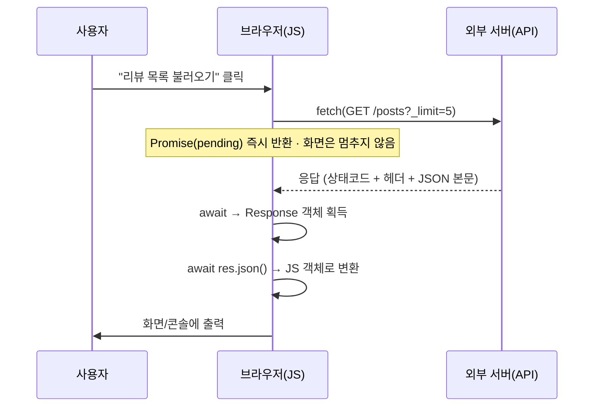

## 들어가며 (Situation)

`03_Async`의 마지막 파일 `04_fetch.html`은 이 단원이 계속 말해 온 **"가장 대표적인 비동기 처리, 외부 서버의 API 호출"** 을 실제로 해 본다.

> 가장 대표적인 비동기 처리는 외부 서버의 API를 호출하는 것이다. fetch / ajax / axios

앞의 글들에서 정리한 개념이 모두 이 파일 하나에 모인다.

| 앞 글의 개념 | 이 파일에서 만나는 곳 |
|---|---|
| 비동기 (기다리는 동안 다른 일) | 서버 응답을 기다리는 동안 화면이 멈추지 않음 |
| 이벤트 핸들러 | 버튼 클릭으로 호출 시작 |
| Promise | `fetch()`가 Promise를 반환 |
| async/await | 응답을 순서대로 꺼냄 |
| 이벤트 루프 | 응답이 도착하면 큐를 거쳐 이어서 실행 |

> 이 글의 출력은 수업의 호출 주소(`jsonplaceholder`)를 Node.js(v24)의 `fetch`로 직접 호출한 결과다. 브라우저에서는 `console.log`에 보이는 형태가 조금 다를 수 있다.

## 문제 상황 (Task)

수업 요구사항은 한 줄이다.

> 리뷰 목록 버튼을 누르면 리뷰 관련 데이터를 노출한다.

1. 외부 서버에 데이터를 달라고 요청하고, 응답이 올 때까지 **화면을 멈추지 않으려면?**
2. `fetch`가 돌려주는 값은 정확히 무엇이고, 어떻게 **실제 데이터**를 꺼내는가?
3. 서버가 에러를 주거나 네트워크가 끊기면 어떻게 되는가?

## 해결 과정 (Action)

### 1. 전체 흐름



수업 코드의 핵심이다.

```js
document.getElementById("btn-get").addEventListener('click', getReviews);

async function getReviews() {
    const data = fetch('https://jsonplaceholder.typicode.com/posts?_limit=5');
    console.log(data);

    const res = await data;
    const reviews = await res.json();

    console.log(reviews);
    console.log(reviews[0].title);
}
```

### 2. `fetch()`가 반환하는 것은 "데이터"가 아니라 Promise

```js
const data = fetch('https://jsonplaceholder.typicode.com/posts?_limit=5');
console.log(data);
```

직접 실행한 출력이다.

```
Promise { <pending> }
```

수업 주석: *"현재 data라는 변수는 promise 객체. promise 객체는 읽기 전용으로 사용할 수 없다."* 이 시점에는 서버가 응답하지 않았으므로 `data`는 **아직 값이 없는 약속**(pending)이다. `data.title` 같은 접근은 불가능하다. 앞 글의 비동기 규칙 "결과는 바로 아래 줄에서 쓸 수 없다"가 그대로 적용된다.

### 3. 두 단계로 꺼낸다: Response → JSON

`await`를 **두 번** 쓰는 것이 이 파일의 핵심이다.

```js
const res = await data;            // 1단계: 응답이 도착함 → Response 객체
const reviews = await res.json();  // 2단계: 본문을 읽어 JS 객체로 변환
```

직접 확인한 값이다.

```
Response 200 true application/json; charset=utf-8     ← res의 정체
true 5 sunt aut facere repellat provident occaecati excepturi optio reprehenderit
                                                       ← reviews: 배열, 5개, 첫 제목
```

| 단계 | 변수 | 실제 타입 | 담긴 것 |
|---|---|---|---|
| 호출 직후 | `data` | `Promise` (pending) | 아직 없음 |
| 1단계 `await data` | `res` | **`Response` 객체** | 상태코드(`200`), 헤더, 아직 읽지 않은 본문 |
| 2단계 `await res.json()` | `reviews` | **JS 배열** (객체 5개) | 파싱된 데이터 |

**용어 보정**: 수업 주석은 `res`에 "API의 호출 결과가 **문자열 json**로 되어 있다"고 적었다. 정확히는 `res`는 문자열이 아니라 **`Response` 객체**이고, 그 **본문(body)** 이 JSON 문자열이다. `res.json()`이 그 본문을 읽어서 JS 객체로 바꾼다. 위 표를 보면 `res`가 문자열이 아님을 확인할 수 있다. (`typeof res`는 `object`)

그리고 **`res.json()`도 Promise를 반환**한다. 본문을 끝까지 받아 읽는 일이 오래 걸릴 수 있기 때문이다. 그래서 `await`가 두 번 필요하다.

```js
// 같은 일을 Promise 체이닝으로 쓰면 (수업의 주석 처리된 코드)
data
    .then(res => res.json())      // 이 then이 Promise를 return → 다음 then이 기다림
    .then(json => console.log(json));
```

| 비교 | `.then` 체이닝 | `async/await` |
|---|---|---|
| 코드 | `.then(res => res.json()).then(json => ...)` | `const res = await data; const json = await res.json();` |
| 읽기 | 체인 따라 읽기 | 위에서 아래로 |
| 에러 | `.catch()` | `try/catch` |

JSON이란 **JavaScript Object Notation**의 약자로, 객체와 비슷한 모양의 **텍스트** 포맷이다. 서버와 클라이언트가 언어와 상관없이 주고받는 공용어다. Java의 DTO(앞서 정리한 Spring 글)를 서버가 JSON 문자열로 바꿔 응답하면 `res.json()`이 그것을 JS 객체로 되돌린다.

### 4. `async` 함수와 클릭 이벤트 핸들러의 결합

```js
document.getElementById("btn-get").addEventListener('click', getReviews);
async function getReviews() { ... }
```

클릭 핸들러(`getReviews`)가 **async 함수**다. 클릭 시 `getReviews`가 실행되고 `fetch`를 맡긴 채 첫 `await`에서 **함수만 일시 정지**한다. 메인 스레드는 풀려나서 다른 클릭, 스크롤, 화면 그리기를 처리한다. 응답이 도착하면 이어서 실행된다. 앞 글들에서 본 이벤트 루프와 `await`의 동작이 그대로 드러나는 장면이다.

### 5. 수업 코드에 빠진 것: 에러 처리 (직접 확인한 함정)

수업 코드에는 `try/catch`가 없다. 실제 서버 호출에서 가능한 실패 두 가지를 실험했다.

```js
// ① 서버는 응답했지만 "없는 주소"
const bad = await fetch('https://jsonplaceholder.typicode.com/posts/99999');
console.log(bad.status, bad.ok);   // 404 false   ← reject 되지 않았다!

// ② 네트워크 자체가 실패 (서버에 연결 못 함)
try { await fetch('http://localhost:1/x'); }
catch(e) { console.log(e.name, e.message); }   // TypeError fetch failed
```

| 상황 | `fetch`의 Promise | 코드로 확인하는 법 |
|---|---|---|
| 성공 (200) | fulfilled | `res.ok === true` |
| **서버가 404, 500 응답** | **fulfilled (성공!)** | **`res.ok === false`, `res.status`** |
| 네트워크 실패 (연결 불가 등) | **rejected** | `catch`에서 `TypeError` |

**가장 중요한 함정**: `fetch`는 **HTTP 404, 500에서도 reject하지 않는다.** 서버와 통신 자체가 성공했으면 fulfilled이고, 상태코드는 `res.ok`나 `res.status`로 직접 확인해야 한다. Java의 `RestTemplate`처럼 4xx에서 예외가 날 것이라 기대하면 에러를 놓친다.

그리고 404 응답에 `res.json()`을 그대로 호출하면 본문이 JSON이 아닐 때 파싱 에러가 난다. 그래서 실무 형태는 이렇게 쓴다. (**아래는 수업 코드가 아닌 개선 예시**)

```js
async function getReviews() {
    try {
        const res = await fetch('https://jsonplaceholder.typicode.com/posts?_limit=5');

        if (!res.ok) {                                   // 404, 500 등을 직접 처리
            throw new Error(`요청 실패: ${res.status}`);
        }

        const reviews = await res.json();
        console.log(reviews);
    } catch (e) {
        console.error('리뷰를 불러오지 못했습니다.', e);  // 네트워크 실패 + 위 throw 모두 여기로
    }
}
```

앞 글의 세 방식 비교에서 정리한 `async/await`의 에러 처리(`try/catch`)가 그대로 적용된다.

### 6. 요청 쪽 살펴보기: 주소와 쿼리 스트링

```
https://jsonplaceholder.typicode.com/posts?_limit=5
└─────── 서버 주소 ───────┘└ 경로 ┘ └ 쿼리 스트링 ┘
```

| 부분 | 의미 |
|---|---|
| `https://jsonplaceholder.typicode.com` | 연습용 공개 가짜 API 서버 |
| `/posts` | 게시글 자원 |
| `?_limit=5` | 쿼리 스트링: 최대 5개만 달라 (이 API의 옵션) |

`fetch(주소)`의 기본은 **GET**이다. 이 글의 데이터(`reviews`)는 "리뷰"라고 부르지만 실제로는 가짜 API의 게시글(`posts`)이다. 서버 단원에서 배운 GET 요청의 쿼리 스트링과 같은 개념이다. (POST 등 다른 방식은 옵션으로 지정한다.)

### 7. fetch / ajax / axios 비교

수업 주석이 나열한 세 가지의 위치를 정리한다. (수업은 이름만 소개했고, 아래 비교는 일반적인 특징 정리다.)

| 항목 | `fetch` | `ajax` (XMLHttpRequest, jQuery) | `axios` |
|---|---|---|---|
| 종류 | 브라우저 **내장** 표준 API | 옛 방식, 콜백 기반 | **외부 라이브러리** |
| 설치 | 불필요 | 불필요 (jQuery는 필요) | 필요 |
| 반환 | Promise | 콜백 | Promise |
| JSON 변환 | `res.json()` 직접 | 직접 | **자동** |
| 404/500 처리 | reject **안 함** | 상태 확인 | reject **함** |
| 현황 | 표준, 기본 선택 | 레거시 | 편의 기능 많아 널리 사용 |

## 결과 (Result)

| 질문 | 정리 |
|---|---|
| `fetch()`의 반환 | 데이터가 아니라 **`Promise`** (`Promise { <pending> }` 확인) |
| 데이터를 꺼내는 순서 | `await fetch()` → `Response` → `await res.json()` → JS 객체 |
| `await`가 두 번인 이유 | 응답 헤더 도착과 본문 읽기가 **각각 비동기** |
| 화면이 멈추지 않는 이유 | `await`는 함수만 멈추고 메인 스레드는 풀어 줌 |
| 404/500은? | **reject되지 않는다** → `res.ok` 확인 필수 |
| 네트워크 실패는? | reject → `catch` |

직접 호출해 확인한 값은 이렇다.

| 호출 | 결과 |
|---|---|
| `fetch(.../posts?_limit=5)` | 상태 `200`, `ok: true`, `application/json`, 배열 **5개**, 첫 `title`: `sunt aut facere repellat provident occaecati excepturi optio reprehenderit` |
| `fetch(.../posts/99999)` | 상태 **`404`**, `ok: false`, **reject 안 됨** |
| `fetch('http://localhost:1/x')` | **reject**, `TypeError: fetch failed` |

배운 점은 이렇다.

1. 이 단원 전체가 `fetch` 한 호출에 수렴한다. **비동기 → Promise → async/await → 이벤트 루프**가 왜 필요했는지 "서버 응답이 느려도 화면이 멈추면 안 된다"는 한 문장으로 연결된다.
2. `fetch`는 **"통신 성공"과 "요청 성공"을 구분**한다. `res.ok`를 확인하지 않으면 404를 정상 데이터처럼 처리하게 된다.
3. 수업 코드는 흐름을 보여 주는 최소 형태이고, 실제 서비스에서는 **에러 처리와 로딩 표시**가 반드시 필요하다.
4. `res`는 문자열이 아니라 `Response` 객체이며, 데이터는 `res.json()`으로 꺼낸다.

여기까지가 `03_Async`의 정리다. 타이머 → 동기·비동기 → 이벤트 루프 → Promise·async/await → fetch의 순서로, 각 글이 앞 글의 개념을 이어받는 구조였다.

## 더 학습하면 좋은 개념

- **HTTP 메서드와 요청 옵션 (`method`, `headers`, `body`)** — `fetch`로 POST, PUT, DELETE를 보내는 방법이다. 앞서 학습한 REST API와 Spring Controller를 이 화면에서 호출하는 것으로 이어진다.
- **CORS (Cross-Origin Resource Sharing)** — 브라우저에서 다른 도메인의 API를 호출할 때 막히는 가장 흔한 문제다. 서버(Spring)에서 허용 설정을 해야 한다.
- **`AbortController`와 요청 취소/타임아웃** — 오래 걸리는 요청을 끊는 방법으로, 사용자 경험에 직접 영향을 준다.
- **로딩 상태와 에러 UI 설계** — 응답을 기다리는 동안 스피너를 보이고, 실패하면 안내하는 화면 처리 패턴이다.
- **인증 토큰 전송 (`Authorization` 헤더, 쿠키 `credentials`)** — 방금 학습한 Spring Security와 JavaScript를 연결하는 지점이다.

## 참고 자료

- [MDN - Fetch API 사용하기](https://developer.mozilla.org/ko/docs/Web/API/Fetch_API/Using_Fetch)
- [MDN - `fetch()`](https://developer.mozilla.org/ko/docs/Web/API/Window/fetch)
- [MDN - `Response`](https://developer.mozilla.org/ko/docs/Web/API/Response)
- [MDN - `Response.ok`](https://developer.mozilla.org/ko/docs/Web/API/Response/ok)
- [MDN - JSON 다루기](https://developer.mozilla.org/ko/docs/Learn_web_development/Core/Scripting/JSON)
- [MDN - CORS](https://developer.mozilla.org/ko/docs/Web/HTTP/CORS)
- [JSONPlaceholder (연습용 API)](https://jsonplaceholder.typicode.com/)
- [콜백·Promise·async/await 글]({{ site.baseurl }}/2026/11/20/javascript-callback-hell-promise-async-await/)
