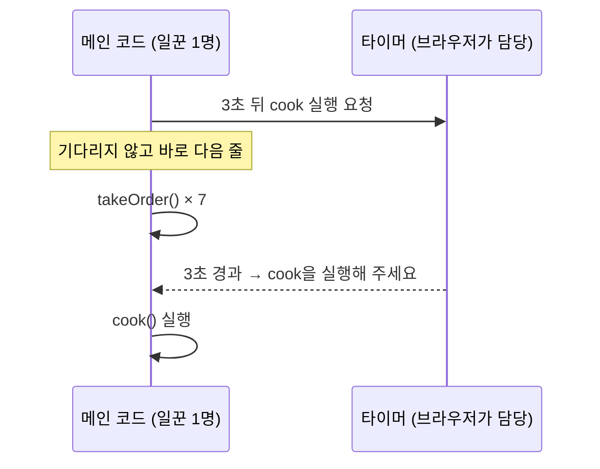

## 들어가며 (Situation)

`11_JavaScript/03_Async`는 JavaScript에서 가장 이해하기 어렵다고 알려진 **비동기** 단원이다. 파일 4개가 순서대로 한 이야기를 만든다.

| 파일 | 주제 |
|---|---|
| `01_timer.html` | `setTimeout`, `setInterval` — 시간을 두고 실행하기 |
| `02_asynchronous.html` | **동기 vs 비동기**, 태스크 큐, 이벤트 루프 |
| `03_promise-async-await.html` | 콜백 지옥 → Promise → async/await |
| `04_fetch.html` | 외부 서버 API 호출 (`fetch`) |

이 글은 1, 2번 파일의 **동기와 비동기의 차이**를 다룬다. 이벤트 루프의 내부 동작은 다음 글, Promise와 async/await는 그다음 글에서 이어간다.

> 수업 코드는 브라우저(`<script>`)에서 실행하는 코드다. 이 글의 출력은 같은 코드를 **Node.js(v24)** 로 직접 실행해 시간까지 측정한 결과다. `setTimeout`, Promise의 동작 원리는 브라우저와 Node가 같다. (브라우저 화면 스크린샷은 없다.)

## 문제 상황 (Task)

수업은 식당 비유로 시작한다.

- **동기**: 떡볶이 조리(3초)가 끝날 때까지 다음 손님 주문을 **받을 수 없다.**
- **비동기**: 떡볶이 조리(3초)를 하는 **동안** 다음 손님 주문을 **먼저 받는다.**

```mermaid
gantt
    title 동기 vs 비동기 (식당 비유)
    dateFormat  s
    axisFormat  %S초
    section 동기
    떡볶이 조리 (주방 점유)      :a1, 0, 3s
    주문 받기 (조리 끝나야 시작)   :a2, 3, 1s
    section 비동기
    떡볶이 조리 (타이머가 대신 기다림) :b1, 0, 3s
    주문 받기 (바로 진행)         :b2, 0, 1s
```



1. 코드에서 "기다림"은 어떻게 만들고, 그 기다림이 **다른 코드를 막는 경우**는 언제인가?
2. 같은 일을 동기와 비동기로 짜면 **실행 순서와 시간**이 어떻게 달라지는가?
3. 비동기 코드는 왜 "위에서 아래로" 읽으면 순서가 안 맞는가?

## 해결 과정 (Action)

### 1. 동기 vs 비동기 — 비교부터

| 항목 | 동기 (Synchronous) | 비동기 (Asynchronous) |
|---|---|---|
| 실행 방식 | 앞 작업이 **끝나야** 다음 작업 시작 | 오래 걸리는 작업을 **맡겨 두고** 다음 작업 진행 |
| 코드 읽는 순서 | 위 → 아래 = 실행 순서 | 위 → 아래 ≠ 실행 순서 |
| 대기 중 | 다른 일을 **못 함** (블로킹) | 다른 일을 **함** (논블로킹) |
| 결과를 쓰는 방법 | 다음 줄에서 바로 | **콜백/Promise**로 나중에 받음 |
| 식당 비유 | 조리 끝날 때까지 주문 중단 | 조리하는 동안 주문 접수 |
| 장점 | 단순하고 예측 쉬움 | 화면이 멈추지 않음 |
| 단점 | 오래 걸리면 **전체가 멈춤** | 순서 추적이 어렵고 에러 처리가 복잡 |

수업이 **왜 JavaScript에서 비동기가 필수인지** 설명한 부분이 핵심이다.

> 프론트 서버는 사용자의 화면을 구성하는 용도, 백엔드 서버는 사용자 화면에 표출될 데이터를 리턴하는 용도이다. 프론트에서 백엔드에 데이터를 요청하는데 응답이 느리면 사용자는 영문도 모른 채 화면이 멈추는 경험을 하게 된다. 따라서 JS 기반의 프론트는 API 호출을 모두 비동기 방식으로 진행한다.

JavaScript는 **한 번에 하나의 코드만 실행하는 싱글 스레드** 언어다. 일꾼이 한 명인 식당이라고 생각하면 된다. 그 한 명이 3초짜리 일에 매달려 있으면 클릭, 스크롤, 화면 갱신까지 모두 멈춘다.

### 2. 동기의 한계 직접 만들어 보기: `sleep`

수업 코드는 **3초 동안 아무것도 못 하는** 동기 `sleep`을 만든다.

```js
function sleep(func, delay) {
    const delayUntill = Date.now() + delay;
    while(Date.now() < delayUntill);   // 3초가 지날 때까지 빈 반복문을 계속 돈다
    func();
}
```

`while(조건);`은 본문이 없는 반복문이다. CPU가 **쉬지 않고 시계만 확인하며** 3초를 보낸다. (이런 대기를 **busy waiting**이라 한다.) 이 3초 동안 JavaScript의 유일한 일꾼은 이 반복문에 붙잡혀 있다.

```js
// 동기 처리 (수업 코드에서 주석 처리된 쪽)
sleep(cook, 3000);   // 3초 동안 점유
takeOrder();         // 3초 뒤에야 실행
```

| 시각 | 출력 |
|---|---|
| 0초 | (아무것도 안 나옴, 화면도 멈춤) |
| 3초 | `떡볶이 조리 완료 !!(3초)` |
| 3초 직후 | `다음 손님 주문 하세요` |

수업 주석 그대로 "sleep 코드가 3초 동안 시간을 점유하는 코드이기 때문에 주문은 무조건 3초 뒤에만 받을 수 있게 된다. 동기 처리의 한계."다. 브라우저에서 이 코드를 실행하면 3초 동안 **버튼 클릭, 스크롤, 텍스트 선택까지 반응하지 않는다.**

### 3. 비동기로 바꾸기: `setTimeout`

```js
setTimeout(cook, 3000);   // "3초 뒤에 cook을 실행해 주세요" 하고 맡겨 둔다
takeOrder();
takeOrder();
takeOrder();   // ... 모두 7번
```

| 시각 | 출력 |
|---|---|
| 0초 | `다음 손님 주문 하세요` × 7 (바로 출력) |
| 3초 | `떡볶이 조리 완료 !!(3초)` |

**`cook`이 가장 위에 호출되어 있지만 가장 나중에 출력된다.** 코드의 위치와 실행 순서가 다르다는 것, 이것이 비동기의 첫 번째 특징이다. 수업 주석:

> 비동기 작업은 코드가 끝나기만을 기다리며 대기하는 것이 아니라, 별도의 작업 공간에서 오래 걸리는 작업을 별도로 수행하고 메인 코드의 흐름을 이어나가는 것이다.



**누가 3초를 세는가?** 메인 코드가 아니라 **브라우저가 제공하는 타이머 기능**이다. 메인 코드는 "3초 뒤에 이것 좀 불러 줘"라고 맡기기만 하고, 시간이 되면 브라우저가 함수를 다시 넘겨준다. 이 전달 경로(태스크 큐와 이벤트 루프)는 다음 글에서 자세히 본다.

### 4. `setTimeout`의 사용법과 직접 확인한 출력

```
setTimeout( 실행시킬 함수, 지연 시간(ms), [, 함수에 전달할 인자] )
```

```js
setTimeout(() => console.log('5초 경과! 피자 조리 완료~~'), 5000);
console.log("주문 하실 분 !~~~~");
setTimeout((menuName) => console.log(`3초 경과! $(menuName)피자 조리 완료~~`), 3000, "치킨");
```

Node로 실행하면 시각과 함께 이렇게 나온다. (아래 `setInterval`과 같은 파일의 결과다.)

```
0.0s 주문 하실 분 !~~~~
3.0s 3초 경과! $(menuName)피자 조리 완료~~
5.0s 5초 경과! 피자 조리 완료~~
```

| 관찰 | 설명 |
|---|---|
| 첫 줄이 `주문 하실 분`이다 | 5초짜리를 먼저 등록했지만 **기다리지 않고** 다음 줄이 실행됨. 수업 주석의 "(위 → 아래 개념)으로는 5초 경과 메시지가 먼저일 것 같지만" 아니다 |
| 3초가 5초보다 먼저 나온다 | 등록 순서가 아니라 **시간이 먼저 도달한 순서**로 실행됨 |
| `$(menuName)`이 그대로 출력된다 | **수업 코드의 오타.** 템플릿 문자열의 치환은 `${...}`(중괄호)인데 `$(...)`(소괄호)로 썼다 |

세 번째가 눈여겨볼 지점이다. `` `$(menuName)` ``은 문법 오류가 아니라 그냥 **글자 그대로** 출력된다. 에러 없이 틀린 결과가 나오는 전형적인 사례이므로 `${menuName}`으로 고쳐야 "3초 경과! 치킨피자 조리 완료~~"가 된다.

세 번째 인자(`"치킨"`)는 콜백 함수의 매개변수(`menuName`)로 전달된다.

### 5. `setInterval` — 간격을 두고 반복

```js
let count = 1;

const interval = setInterval(() => {
    console.log(`배달 도착까지 ${5 - count} 초`);
    count++;

    if(count==5) {
        clearInterval(interval);   // 반복 중단
        console.log("배달 완료 !!");
    }
}, 1000);
```

| 함수 | 동작 | 멈추는 법 |
|---|---|---|
| `setTimeout(f, ms)` | `ms` 뒤에 **한 번** 실행 | `clearTimeout(id)` (실행 전이라면) |
| `setInterval(f, ms)` | `ms`마다 **계속** 반복 | `clearInterval(id)` **(필수)** |

수업 주석대로 "종료 조건을 달아주는 것이 중요하다." `clearInterval`을 빼면 영원히 반복한다. 반환값(`interval`)은 타이머를 가리키는 번호(Node에서는 객체)이고, 그 값을 `clearInterval`에 넘겨 멈춘다.

위 코드의 실제 실행 결과다. (`setTimeout`과 함께 실행한 시각표)

| 시각 | 출력 |
|---|---|
| 0.0초 | `주문 하실 분 !~~~~` |
| 1.0초 | `배달 도착까지 4 초` |
| 2.0초 | `배달 도착까지 3 초` |
| 3.0초 | `3초 경과! $(menuName)피자 조리 완료~~` · `배달 도착까지 2 초` |
| 4.0초 | `배달 도착까지 1 초` · `배달 완료 !!` |
| 5.0초 | `5초 경과! 피자 조리 완료~~` |

주목할 점이 두 가지 있다.

- **타이머 여러 개가 동시에 돌고 있고 서로 기다리지 않는다.** 1초 간격 반복, 3초 타이머, 5초 타이머가 한 시간축에 섞여 나온다. 비동기의 장점이다.
- **`배달 완료`가 4초에 나오는데 5초 타이머는 그 뒤에도 실행된다.** `clearInterval`은 그 `interval`만 멈출 뿐, 다른 타이머에는 영향이 없다.

그리고 "배달 도착까지 **5초**"가 아니라 **4, 3, 2, 1**로 센다. `count`가 1에서 시작해 `count==5`가 되면 멈추기 때문에, 출력은 4번(1, 2, 3, 4초)이다. 의도한 숫자와 맞는지 경계값을 확인하는 습관이 필요하다.

### 6. `setTimeout`은 "정확히 N초 뒤"가 아니다

`setTimeout(f, 0)`이라고 쓰면 바로 실행될 것 같지만, **동기 코드가 끝난 뒤에야** 실행된다. 직접 실험했다.

```js
setTimeout(() => console.log('setTimeout(0) 실행'), 0);
const until = Date.now() + 3000;
while (Date.now() < until);        // 동기로 3초 점유
console.log('동기 3초 끝');
```

| 시각 | 출력 |
|---|---|
| 3.0초 | `동기 3초 끝: 3.0s` |
| 3.0초 | `setTimeout(0) 실행: 3.0s` |

`0`ms를 요청했지만 **3초 뒤에** 나왔다. 일꾼(메인 스레드)이 동기 작업에 붙잡혀 있는 동안은 타이머가 만료되어도 콜백을 실행할 수 없기 때문이다. 즉 `setTimeout`의 시간은 **"최소 이만큼은 기다린 뒤"** 의 의미이지 정확한 시각 보장이 아니다. 이 현상이 일어나는 이유가 다음 글의 이벤트 루프다.

### 7. 동기와 비동기를 섞는 감각

| 상황 | 올바른 감각 |
|---|---|
| 오래 걸리는 계산을 동기로 | 화면이 멈춘다 → 쪼개거나 다른 방법으로 |
| `setTimeout`으로 순서를 맞추려 한다 | 시간으로 순서를 맞추면 환경에 따라 어긋남 → **Promise/async-await**로 |
| 비동기 결과를 바로 아래 줄에서 쓰려 한다 | 아직 결과가 없음 → 콜백/`await`으로 기다려야 함 |

마지막 줄이 다음 글들의 문제의식이다.

## 결과 (Result)

| 질문 | 정리 |
|---|---|
| 동기 vs 비동기 | 앞 작업이 끝나야 다음 실행 vs 맡겨 두고 먼저 다음 실행 |
| 동기 `sleep` 3초 | 그 동안 **아무것도 못 한다** (실제 `3.0s` 점유 확인) |
| `setTimeout` 3초 | 주문 7번이 **0초**에 출력, 조리 완료는 3초에 출력 |
| `setInterval` | 반복 + `clearInterval`로 종료 필수 |
| `setTimeout(f, 0)` | 동기 코드(3초)가 끝난 뒤인 3.0초에 실행 |

배운 점은 이렇다.

1. 비동기는 "기다림을 없앤다"가 아니라 **"기다리는 동안 다른 일을 하게 한다."** 기다리는 일은 타이머(브라우저) 같은 **다른 곳**이 맡는다.
2. 비동기 코드는 **작성 순서가 아니라 완료 순서**로 실행된다.
3. 오타 `$(menuName)`처럼 에러 없이 틀리는 코드가 있으니, 출력을 눈으로 확인한다.
4. `setTimeout`의 지연은 최소 시간이다. 일꾼이 바쁘면 더 늦게 실행된다.

다음 글에서는 "그 일꾼이 바쁜지 아닌지를 누가, 어떻게 판단하는가", 즉 **호출 스택, 태스크 큐, 이벤트 루프**를 정리한다.

## 더 학습하면 좋은 개념

- **싱글 스레드와 멀티 스레드** — JavaScript가 일꾼 한 명으로 어떻게 동시에 여러 일을 하는 것처럼 보이는지 이해하는 기본 개념이다. Java의 스레드와 비교하면 차이가 분명해진다.
- **블로킹과 논블로킹 I/O** — 동기/비동기와 비슷하지만 다른 축의 개념이다. 서버(Node.js, Spring WebFlux)의 성능 이야기로 이어진다.
- **Web APIs (브라우저가 제공하는 기능)** — `setTimeout`, `fetch`, 이벤트가 JavaScript 엔진이 아니라 브라우저의 기능임을 알면 비동기가 어디서 처리되는지 보인다.
- **`requestAnimationFrame`** — 화면 애니메이션에서 `setInterval` 대신 쓰는 타이머로, 렌더링 시점과 맞춰 실행된다.
- **`AbortController`와 타이머 정리 (cleanup)** — 타이머와 요청을 안전하게 취소하는 방법으로, 메모리 누수를 막는 실무 지식이다.

## 참고 자료

- [MDN - 비동기 JavaScript 소개](https://developer.mozilla.org/ko/docs/Learn_web_development/Core/Scripting/Asynchronous_JavaScript)
- [MDN - `setTimeout()`](https://developer.mozilla.org/ko/docs/Web/API/Window/setTimeout)
- [MDN - `setInterval()`](https://developer.mozilla.org/ko/docs/Web/API/Window/setInterval)
- [MDN - `clearInterval()`](https://developer.mozilla.org/ko/docs/Web/API/Window/clearInterval)
- [MDN - 템플릿 리터럴](https://developer.mozilla.org/ko/docs/Web/JavaScript/Reference/Template_literals)
- [이벤트 핸들러 글]({{ site.baseurl }}/2026/11/18/javascript-event-handler-event-object-this/)
