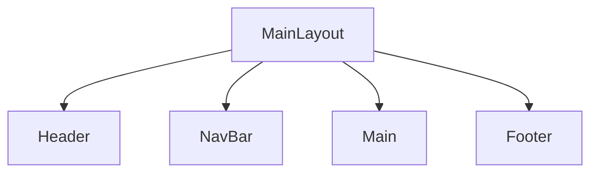
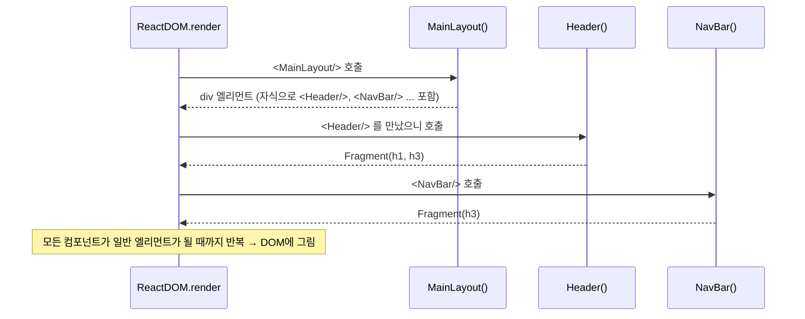

## 들어가며 (Situation)

앞의 두 글에서 **엘리먼트**(화면 설명 객체), **컴포넌트**(엘리먼트를 반환하는 함수), **JSX**(`createElement`를 HTML처럼 쓰는 문법)를 정리했다. `02_component/02_component`의 두 파일(`01_function-componenet.html`, `02_composition.html`)은 이 재료로 **실제 페이지를 조립**한다.

핵심 아이디어는 한 문장이다.

> 화면을 **작은 조각(컴포넌트)** 으로 나누고, 그 조각들을 **레고처럼 끼워 맞춰** 큰 화면을 만든다.



> 아래 출력은 수업 코드와 같은 구조의 컴포넌트를 React 18.3.1로 서버 렌더링(`renderToStaticMarkup`)해서 얻은 HTML이다. JSX는 Babel로 변환해서 확인했다. 브라우저 화면 스크린샷은 없다.

## 문제 상황 (Task)

1. 컴포넌트를 JSX에서 **어떻게 사용하는가?** (`<Header/>`)
2. 소문자로 쓰면 왜 안 되는가?
3. 컴포넌트 안에서 다른 컴포넌트를 쓰려면?
4. 헤더, 네비게이션, 메인, 푸터가 있는 페이지를 **어떻게 설계하는가?**

## 해결 과정 (Action)

### 1. 함수형 컴포넌트의 두 가지 특징

```js
function Header() {
    return (
        <>
            <h1>헤더입니다!!</h1>
            <h3>사이트 이름 ~~~~ </h3>
        </>
    );
}
```

수업 주석이 정리한 특징이다.

| 특징 | 이유 |
|---|---|
| **1. 앞글자 대문자** | JSX에서 컴포넌트와 HTML 태그를 구분하는 규칙 |
| **2. 엘리먼트를 return** | 컴포넌트의 역할 자체가 "화면 조각을 반환" |

`return` 뒤에 `( )`로 감싼 이유는 JSX를 여러 줄로 쓸 때 **자동 세미콜론 삽입**으로 `return`만 실행되고 끝나는 문제를 피하려는 것이다. (`return` 바로 뒤에서 줄이 바뀌면 `undefined`를 반환하는 JavaScript의 규칙이다.) 한 줄에서 시작하는 `(`가 이를 막는다.

### 2. `<Header/>` — 컴포넌트를 쓰는 방법

수업 주석에 이전 방식과 새 방식이 나란히 있다.

```js
ReactDOM.createRoot(document.getElementById('root'))
    // .render(React.createElement(Header));   // 이전 방식
    .render(<Header/>);                         // 함수형 컴포넌트를 쉽게 엘리먼트로 변환하는 문법
```

`<Header/>`를 Babel로 변환하면 이렇게 나온다. 직접 확인했다.

```js
const a = React.createElement(Header, null);     // <Header/>   → 함수를 넘긴다
const b = React.createElement("header", null);   // <header/>   → 문자열을 넘긴다
```

**대문자냐 소문자냐에 따라 `createElement`의 첫 인자가 달라진다.**

| JSX | 변환 | React의 해석 |
|---|---|---|
| `<Header/>` | `createElement(Header)` (변수 `Header`, **함수**) | **컴포넌트**: 함수를 호출해서 그 결과를 그린다 |
| `<header/>` | `createElement("header")` (**문자열**) | **HTML 태그** `<header>` |

수업 주석: "컴포넌트의 앞글자가 소문자면 컴포넌트로 인식하는 것이 아닌 단순 HTML 요소로 인식하게 된다."

소문자 `header`로 함수를 만들고 `<header/>`로 쓴다고 직접 렌더링해 보면 이렇게 된다.

```
<header></header>        ← 우리가 만든 컴포넌트가 아니라 빈 HTML <header> 태그
```

우리가 만든 `header()` 함수는 호출되지도 않고, 빈 `<header>` 태그만 화면에 생긴다. 에러가 없어서 원인 찾기가 어렵다. 앞 글에서 "암묵적 규칙"이던 대문자가 JSX에서는 **실제 동작을 결정하는 규칙**임을 이 실험으로 확인했다.

### 3. 컴포넌트 합성(Composition)

`02_composition.html`은 컴포넌트 여러 개를 만들어 **하나로 조립**한다.

```js
function Header() { return (<><h1>헤더입니다!!</h1><h3>사이트 이름 ~~~~ </h3></>); }
function NavBar() { return (<><h3> 네비게이션 바 입니다!!</h3></>); }
function Footer() { return (<><h3> 푸터입니다!!</h3></>); }

const user = { name : "조평훈", phone : "010-1234-5678", age : 20, gender : '남' };

function Main() {
    return(
        <>
            <h3> 이름: {user.name}</h3>
            <h3> 전화번호: {user.phone}</h3>
            <h3> 나이: {user.age}</h3>
            <h3> 성별: {user.gender}</h3>
        </>
    );
}

function MainLayout() {
    return(
        <div style={{border : '1px solid black', backgroundColor : 'green'}}>
           <Header/>
           <NavBar/>
           <Main/>
           <Footer/>
        </div>
    );
}

ReactDOM.createRoot(document.getElementById('root')).render(<MainLayout/>);
```

**합성(composition)** 이란 컴포넌트가 **다른 컴포넌트를 자신의 반환값 안에서 사용하는** 것이다. `MainLayout`이 `Header`, `NavBar`, `Main`, `Footer`를 조립한다.

| 컴포넌트 | 역할 | 비유 |
|---|---|---|
| `Header`, `NavBar`, `Main`, `Footer` | 화면의 **한 조각** | 레고 블록 |
| `MainLayout` | 블록을 **조립한 결과** | 완성된 레고 작품 |
| `render(<MainLayout/>)` | 작품을 전시 | |

`MainLayout`을 서버 렌더링해서 HTML로 바꾼 결과는 이렇다. (직접 확인한 구조를 `Header`까지 `createElement`로 옮겨 렌더링한 결과다.)

```html
<div style="border:1px solid black;background-color:green">
  <h1>헤더입니다!!</h1>
  <h3>사이트 이름 ~~~~ </h3>
  ...
</div>
```

각 컴포넌트의 Fragment(`<>...</>`)는 **DOM에 흔적을 남기지 않으므로**, `Header` 안의 `h1`, `h3`가 바깥 `div` 바로 아래 형제로 놓인다. 앞 글에서 정리한 "Fragment는 불필요한 `div`를 만들지 않는다"가 컴포넌트 조립에서도 그대로 적용된다.

### 4. 컴포넌트 트리 = 렌더링의 흐름



React는 컴포넌트(함수)를 만나면 호출하고, 그 반환값 안에 또 컴포넌트가 있으면 다시 호출하는 일을 **모든 것이 HTML 태그가 될 때까지** 반복한다. 이렇게 만들어진 **컴포넌트 트리**가 앞 글의 가상 DOM이다.

### 5. 인라인 스타일: `style={{ ... }}` 의 중괄호가 두 겹인 이유

```js
<div style={{border : '1px solid black', backgroundColor : 'green'}}>
```

| 부분 | 의미 |
|---|---|
| 바깥 `{ }` | JSX 규칙: **JavaScript 표현식을 쓴다** |
| 안쪽 `{ }` | 그 표현식이 **객체 리터럴** (`{ border: ..., backgroundColor: ... }`) |

중괄호 두 겹은 특별한 문법이 아니라 "표현식 자리에 객체를 넣은 것"이다. 속성 이름은 HTML처럼 `background-color`(하이픈)가 아니라 **`backgroundColor`**(camelCase)이고, 값은 **문자열**로 쓴다. 변환된 결과로 `background-color:green`으로 올바르게 출력되는 것을 확인했다.

| HTML | JSX |
|---|---|
| `style="background-color: green"` | `style={{ backgroundColor: 'green' }}` |

### 6. 왜 이렇게 나누는가: 합성의 장점

수업 코드는 한 파일에 모두 있지만, 실제 프로젝트는 컴포넌트마다 **파일 하나**로 만든다.

| 장점 | 설명 |
|---|---|
| **재사용** | `Footer`는 모든 페이지에서 그대로 쓴다 |
| **수정 범위 최소화** | 푸터 디자인을 바꾸려면 `Footer`만 고친다 |
| **읽기 쉬움** | `MainLayout`을 보면 페이지 구조가 한눈에 보인다 (`Header` → `NavBar` → `Main` → `Footer`) |
| **분업** | 팀원이 컴포넌트 단위로 나눠 작업 가능 |

이는 앞서 JPA 미니 프로젝트에서 정리한 **계층별 책임 분리**와 같은 사고방식이다. ([프로젝트 뼈대 글]({{ site.baseurl }}/2026/11/04/jpa-mini-project-prd-layered-architecture/)) "한 곳이 한 가지 일만 하게 나눈다"는 원칙이 서버의 Controller/Service에서 화면의 컴포넌트로 옮겨 왔다.

### 7. 수업 코드의 한계와 다음 단계

수업 예제는 한계가 분명하다. 이를 아는 것이 다음 단원의 이유가 된다.

| 한계 | 해결하는 개념 |
|---|---|
| `Main`이 전역 변수 `user`를 **직접** 읽는다 | **Props**: 부모가 자식에게 값을 **전달** (`<Main user={user}/>`) |
| 같은 컴포넌트가 항상 **같은 모양**만 그린다 | Props로 모양을 바꾼다 |
| 화면이 **한 번 그리고 끝**난다 (클릭해도 변하지 않음) | **State**: 값이 바뀌면 화면이 다시 그려진다 |
| `Header`, `NavBar`는 고정 문구뿐이다 | Props와 `children` |

예를 들어 `Main`은 어떤 `user`든 보여 줄 수 있도록 바뀌어야 재사용 가능한 컴포넌트가 된다. (아래는 수업 코드가 아닌 **예시 코드**)

```js
function Main({ user }) {                  // 구조 분해 할당으로 props 받기
    return (<>
        <h3> 이름: {user.name}</h3>
        <h3> 전화번호: {user.phone}</h3>
    </>);
}

// 사용
<Main user={user} />
```

여기서 JavaScript 단원의 **구조 분해 할당**이 매개변수에서 바로 쓰인다. ([스프레드·구조 분해 글]({{ site.baseurl }}/2026/11/18/javascript-spread-destructuring/)) 지난 시간의 문법이 React에서 어떻게 쓰이는지 연결되는 지점이다.

## 결과 (Result)

| 질문 | 정리 |
|---|---|
| 컴포넌트를 쓰는 방법 | `<Header/>` (JSX). `createElement(Header)`로 변환됨 |
| 소문자면? | `createElement("header")`로 변환 → **HTML 태그**로 인식 (빈 `<header>`가 나옴을 확인) |
| 합성이란? | 컴포넌트가 다른 컴포넌트를 반환값 안에서 사용하는 것 |
| 컴포넌트 트리 | 컴포넌트를 만나면 호출하는 일을 모든 것이 HTML 태그가 될 때까지 반복 |
| `style={{ }}` | 바깥은 JSX 표현식, 안쪽은 객체. 속성은 camelCase |

직접 확인한 결과는 이렇다.

| 확인 | 결과 |
|---|---|
| `<Header/>` 변환 | `React.createElement(Header, null)` |
| `<header/>` 변환 | `React.createElement("header", null)` |
| `style={{backgroundColor:'green'}}` 렌더 | `style="border:1px solid black;background-color:green"` |
| Fragment가 있는 컴포넌트 조립 | 감싸는 태그 없이 `h1`, `h3`가 `div` 바로 아래에 출력 |

배운 점은 이렇다.

1. React 앱은 **컴포넌트 트리**다. 큰 화면도 작은 함수들의 조합으로 만든다.
2. `<Header/>`와 `<header/>`의 차이는 **대소문자 한 글자가 `createElement`의 인자 타입(함수/문자열)을 바꾸는** 것이다.
3. 지금의 컴포넌트는 값을 **밖에서 받지 못하고**, 한 번 그리면 **바뀌지 않는다.** 이 두 한계가 곧 props와 state를 배우는 이유다.

## 더 학습하면 좋은 개념

- **Props와 `children`** — 컴포넌트를 재사용 가능하게 만드는 값 전달 방식이며, 합성의 완성이다. `<Layout>내용</Layout>`처럼 감싸는 컴포넌트를 만든다.
- **State와 `useState`** — 값이 바뀔 때 화면을 다시 그리게 하는 장치로, 정적인 화면을 동적으로 만드는 핵심이다.
- **리스트 렌더링과 `key`** — `Main`의 항목들을 배열의 `map`으로 그리는 방법이다. 앞서 배운 고차함수가 그대로 쓰인다. ([배열과 고차함수 글]({{ site.baseurl }}/2026/11/17/javascript-array-higher-order-method/))
- **컴포넌트 분리 기준과 폴더 구조** — 어떤 크기로 나누고 파일을 어떻게 배치할지 정하는 설계 감각이다.
- **상속 대신 합성(Composition over Inheritance)** — React 공식 문서가 권장하는 설계 원칙이며 Java의 상속과 비교하면 이해가 깊어진다.

## 참고 자료

- [React 공식 문서 - 첫 번째 컴포넌트](https://react.dev/learn/your-first-component)
- [React 공식 문서 - 컴포넌트 import와 export](https://react.dev/learn/importing-and-exporting-components)
- [React 공식 문서 - 컴포넌트에 props 전달하기](https://react.dev/learn/passing-props-to-a-component)
- [React 공식 문서 - 합성 vs 상속](https://legacy.reactjs.org/docs/composition-vs-inheritance.html)
- [React 공식 문서 - 스타일 적용하기 (`style`)](https://react.dev/learn#adding-styles)
- [MDN - 자동 세미콜론 삽입 (return 문)](https://developer.mozilla.org/ko/docs/Web/JavaScript/Reference/Lexical_grammar#자동_세미콜론_삽입)
- [JSX·Babel·Fragment 글]({{ site.baseurl }}/2026/11/23/react-jsx-babel-fragment/)
