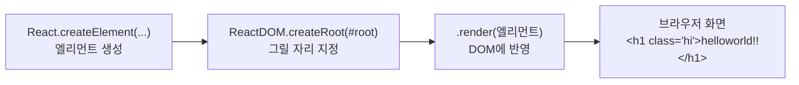
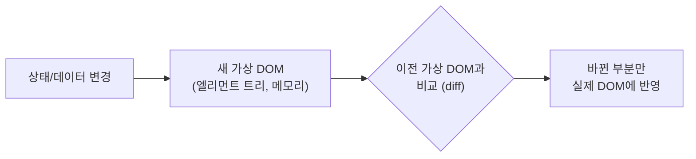
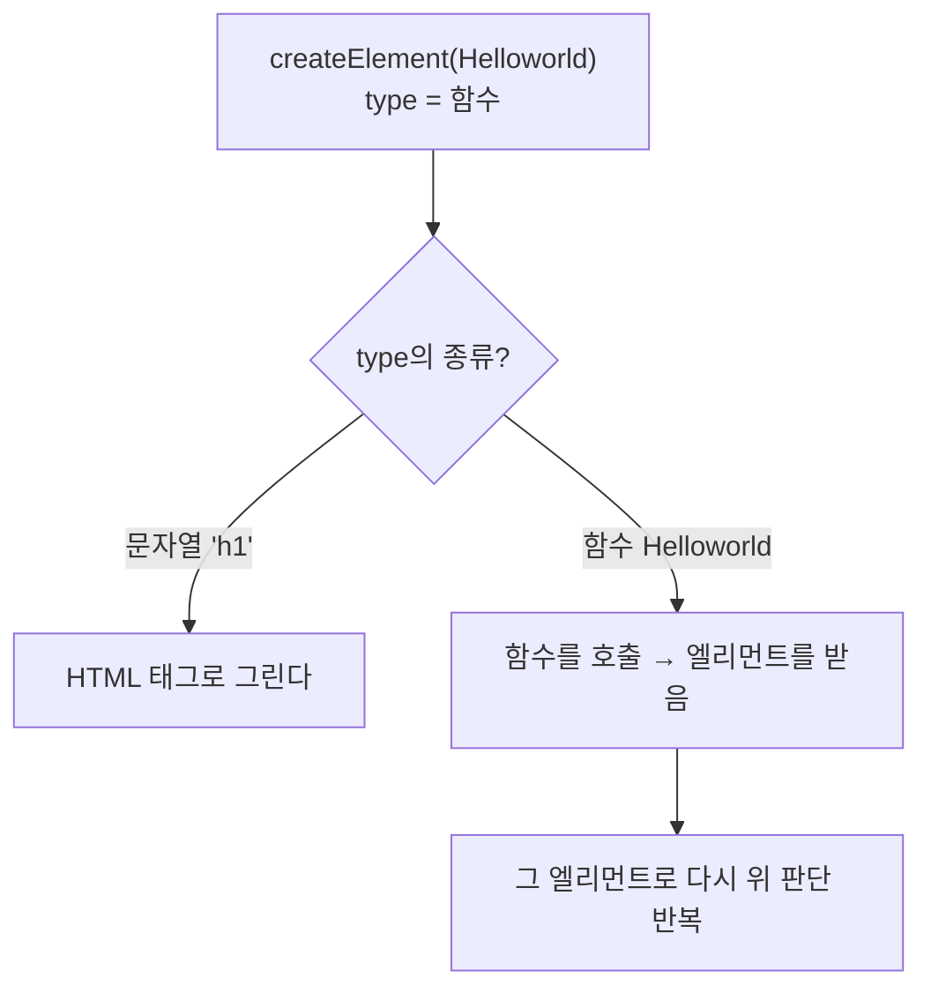

## 들어가며 (Situation)

JavaScript 단원(`11_JavaScript`)에서는 `document.getElementById`로 요소를 **직접 찾아서** `style`을 바꾸고, `addEventListener`로 이벤트를 달았다. 화면이 커지면 "어떤 요소를 언제 어떻게 바꿀지"를 일일이 명령해야 해서 코드가 금방 복잡해진다.

`12_React`는 방식을 바꾼다. **"화면이 이래야 한다"를 선언하면 React가 DOM을 알아서 맞춰 준다.** 이 글은 `01_intro`의 두 파일(`01_createElement.html`, `02_component.html`)을 정리한다. 가장 작은 React 코드로 **엘리먼트**와 **컴포넌트**가 무엇인지 확인하는 단계다.

| 명령형 (순수 JS, 지금까지) | 선언형 (React) |
|---|---|
| "이 `div`를 찾아서 글자를 바꿔라" | "화면은 이런 모양이다" |
| 요소 찾기 → 수정하기를 **개발자가** 반복 | 모양을 선언하면 React가 **DOM에 반영** |

> 수업 파일은 브라우저에서 CDN으로 React를 불러오는 HTML이다. 아래 출력은 같은 버전(React 18.3.1)을 Node.js에 설치해 `createElement`와 서버 렌더링(`renderToStaticMarkup`)으로 직접 확인한 결과이며, 브라우저 화면 스크린샷은 없다.

## 문제 상황 (Task)

1. React는 어떻게 시작하고, 수업은 왜 `<script>` 두 줄로 시작하는가?
2. `React.createElement('h1', {className:'hi'}, 'helloworld!!')`가 만드는 것은 정확히 무엇인가?
3. **엘리먼트**와 **컴포넌트**는 무엇이 다른가?
4. 함수 이름을 왜 **대문자**로 시작해야 하는가?

## 해결 과정 (Action)

### 1. React를 쓰는 두 가지 방법

수업 주석은 두 가지를 말한다.

| 방법 | 설명 | 용도 |
|---|---|---|
| ① React 앱 생성 | 프로젝트를 만들고 빌드 도구로 개발 | **실제 개발** |
| ② `<script>` 태그로 라이브러리 가져오기 | HTML 한 장에서 바로 실행 | **개념 학습** (수업이 쓰는 방식) |

```html
<script crossorigin src="https://unpkg.com/react@18.3.1/umd/react.development.js"></script>
<script crossorigin src="https://unpkg.com/react-dom@18.3.1/umd/react-dom.development.js"></script>
```

| 라이브러리 | 역할 |
|---|---|
| `react` | 엘리먼트와 컴포넌트를 **만드는** 핵심 (`React.createElement` 등) |
| `react-dom` | 만든 것을 **브라우저 DOM에 그리는** 역할 (`ReactDOM.createRoot`) |

두 개로 나뉜 이유는 React가 "무엇을 그릴지 계산하는 부분"과 "어디에 그릴지(브라우저)"를 분리했기 때문이다. 수업 주석대로 CDN 주소는 공식 사이트의 시작하기 문서에서 복사한다.

**버전 주의**: 수업은 `react@18.3.1`을 고정해서 쓴다. 이유가 있다. React 19부터는 공식적으로 UMD 빌드(`<script>`로 바로 쓰는 파일)를 제공하지 않는 것으로 알려져 있다. 이 방식으로 따라 하려면 **버전을 18로 고정**해야 한다. (버전별 지원 여부는 React 공식 블로그의 릴리스 노트로 확인하자.)

### 2. 가장 작은 React 프로그램

```html
<div id="root"> </div>

<script>
    const hiElement = React.createElement('h1', {className : 'hi'}, 'helloworld!!');

    ReactDOM.createRoot(document.getElementById('root')).render(hiElement);
</script>
```

두 줄이 전부다. 흐름은 이렇다.



| 부분 | 의미 |
|---|---|
| `<div id="root">` | React가 화면을 그릴 **빈 자리**. HTML에는 이것 하나만 있다 |
| `document.getElementById('root')` | 지난 시간의 DOM 취득. React도 결국 이 방식으로 자리를 잡는다 |
| `createRoot(...)` | 그 자리를 **React가 관리하는 루트**로 지정 (React 18의 방식) |
| `.render(엘리먼트)` | 엘리먼트를 화면에 그림 |

### 3. `createElement`의 세 인자

수업 주석:

```
1번째 인자: 만들려는 요소의 타입 (ex. h1, div, pre)
2번째 인자: 요소의 프로퍼티를 표현
3번째 인자: 자식 요소 표현
```

```js
React.createElement('h1', {className : 'hi'}, 'helloworld!!');
//                   ↑ 타입    ↑ 속성(props)      ↑ 자식(children)
```

| 인자 | HTML로 옮기면 |
|---|---|
| `'h1'` | `<h1>` 태그 |
| `{className: 'hi'}` | `class="hi"` 속성 |
| `'helloworld!!'` | 태그 안의 글자 |

**주의: 속성 이름이 `class`가 아니라 `className`이다.** `class`는 JavaScript의 예약어(클래스 문법)와 겹치기 때문이다. 이 규칙은 다음 글(JSX)에서 실제 경고로 확인한다.

### 4. 엘리먼트의 정체: 그냥 객체다

`createElement`가 돌려주는 값을 직접 출력해 봤다.

```js
const hi = React.createElement('h1', {className:'hi'}, 'helloworld!!');
console.log(JSON.stringify({type: hi.type, props: hi.props}));
// {"type":"h1","props":{"className":"hi","children":"helloworld!!"}}

console.log(Object.keys(hi).join(', '));
// $$typeof, type, key, ref, props, _owner, _store
```

**엘리먼트는 화면의 설명서를 담은 가벼운 일반 JavaScript 객체**다. 실제 DOM 요소(`document.createElement`가 만드는 것)가 아니다. 그리고 이것을 서버 렌더링으로 HTML로 바꾸면 이렇다.

```
<h1 class="hi">helloworld!!</h1>
```

| 구분 | DOM 요소 (`document.createElement`) | React 엘리먼트 (`React.createElement`) |
|---|---|---|
| 정체 | 브라우저의 **무거운** 객체 | `type`, `props`를 가진 **가벼운 일반 객체** |
| 만들면 | 화면 구조에 연결될 수 있음 | 아무 일도 안 일어남 (설명서일 뿐) |
| 그리는 주체 | 직접 `append` | `render()`가 DOM에 반영 |

수업 주석은 엘리먼트를 이렇게 정의한다.

> 엘리먼트: 요소 노드, 어트리뷰트 노드, 텍스트 노드로 구성된다. `<h1 class='test'>안녕!!</h1>`

`h1`이 요소 노드, `class`가 어트리뷰트 노드, `안녕!!`이 텍스트 노드에 해당한다. 앞 글에서 본 DOM 트리의 구성 요소를 React가 객체로 표현한 것이다.

### 5. 가상 DOM(Virtual DOM)

수업 주석:

> React는 가상돔(Virtual DOM)이라는 개념을 가지고 있다. 메모리 상에 존재하는 DOM (코드 상으로 구현)



| 항목 | 설명 |
|---|---|
| 가상 DOM | 엘리먼트 객체들로 만든 **메모리 상의 UI 설명 트리** |
| 비교(diff) | 이전 트리와 새 트리를 비교해 **달라진 곳만** 찾음 |
| 반영 | 달라진 곳만 실제 DOM을 수정 |

이점은 개발자가 "무엇을 바꿀지" 명령하지 않아도 **"최종 모양"만 선언하면 되고**, React가 필요한 최소한의 DOM 변경을 계산해 준다는 데 있다. (이 글의 예제는 한 번만 그리므로 비교 과정은 보이지 않는다. 데이터가 바뀌는 `state` 단계에서 실제로 의미를 갖는다.)

### 6. 컴포넌트: 엘리먼트를 반환하는 함수

```js
// 함수형 컴포넌트
function Helloworld() {
    return React.createElement('h1', {className : 'hi'}, 'helloworld!!');
}

ReactDOM.createRoot(document.getElementById('root'))
    .render(React.createElement(Helloworld));
```

수업 주석의 정의:

> 컴포넌트: 엘리먼트를 반환하는 개념을 가진 화면의 구성 조각 단위

| 구분 | 엘리먼트 | 컴포넌트 |
|---|---|---|
| 정체 | 객체 | **함수** (엘리먼트를 반환) |
| 비유 | 완성된 **부품 하나** | 부품을 만드는 **설계도/틀** |
| 재사용 | 같은 것을 재사용 | 호출할 때마다 새 엘리먼트 생성 |
| 예 | `<h1>helloworld!!</h1>` | `Helloworld()` |

`React.createElement(Helloworld)`의 첫 인자에 **문자열 `'h1'`이 아니라 함수**를 넘긴 것에 주목하자. 직접 확인한 결과다.

```js
const el = React.createElement(Helloworld);
console.log(typeof el.type, el.type.name);
// function Helloworld
console.log(renderToStaticMarkup(el));
// <h1 class="hi">helloworld!!</h1>
```

`type`에 문자열이 오면 HTML 태그, **함수가 오면 컴포넌트**다. React는 컴포넌트를 만나면 그 함수를 호출해서 반환된 엘리먼트로 화면을 그린다.



### 7. 왜 함수 이름이 대문자인가

수업 주석:

> 함수형 컴포넌트 → 함수 이름 앞글자 대문자!! (암묵적 규칙). 컴포넌트 함수의 경우 엘리먼트를 반환하는 함수이기 때문에 일반적인 함수와 구분하기 위해 앞글자를 대문자로 쓴다.

여기서 "암묵적 규칙"이라는 표현은 `createElement` 호출 단계에서는 맞다. 함수를 직접 `createElement(Helloworld)`로 넘기면 이름이 소문자여도 동작한다. 하지만 **다음 글에서 배우는 JSX(`<Helloworld />`)에서는 대문자가 실제 규칙**이 된다. 소문자로 쓰면 컴포넌트가 아니라 HTML 태그로 해석되기 때문이다. 처음부터 대문자로 쓰는 습관이 필요한 이유다.

### 8. 이 단계의 불편함: 다음 글로 이어지는 문제

수업 주석은 마지막에 문제를 짚는다.

> 요소를 만들 때마다 `createElement`로 만들게 되면 굉장히 복잡하고 힘들다. JSX 문법

HTML 한 줄이면 될 것을 이렇게 써야 한다.

```js
// 이 정도 구조인데도
React.createElement('div', null,
    React.createElement('h1', null, '제목'),
    React.createElement('p', null, '내용'));
```

태그가 중첩될수록 괄호가 깊어진다. 이 문제를 HTML 같은 문법으로 풀어 주는 것이 **JSX**다. 다음 글의 주제다.

## 결과 (Result)

| 질문 | 정리 |
|---|---|
| React 시작 방법 | 앱 생성(실제) / `<script>` CDN(학습) |
| `react`와 `react-dom` | 만들기 vs DOM에 그리기 |
| 엘리먼트란? | 화면을 설명하는 **가벼운 객체** (`type`, `props`) — 실제 DOM 아님 |
| 컴포넌트란? | 엘리먼트를 반환하는 **함수** |
| `createElement`의 첫 인자 | 문자열이면 HTML 태그, **함수이면 컴포넌트** |
| 가상 DOM | 엘리먼트 트리를 메모리에 두고 달라진 부분만 실제 DOM에 반영 |

직접 확인한 사실은 이렇다.

| 확인 | 결과 |
|---|---|
| 엘리먼트 구조 | `{type: 'h1', props: {className: 'hi', children: 'helloworld!!'}}` |
| 컴포넌트의 `type` | `function` (`Helloworld`) |
| 둘의 렌더 결과 | 모두 `<h1 class="hi">helloworld!!</h1>` |

배운 점은 이렇다.

1. React의 출발점은 "DOM을 만지는 코드"가 아니라 **"UI를 설명하는 객체를 만드는 코드"** 다.
2. 엘리먼트(결과물)와 컴포넌트(만드는 함수)의 구분이 이후 모든 React 개념의 기초다.
3. `createElement`만으로도 앱을 만들 수 있지만 **읽기 힘들다는 불편함**이 JSX를 낳았다.

## 더 학습하면 좋은 개념

- **선언형 vs 명령형 프로그래밍** — React가 왜 "무엇을 그릴지"만 말하게 했는지 이해하는 기본 관점이다. SQL이나 CSS도 선언형이다.
- **Virtual DOM과 재조정(Reconciliation), `key`** — 가상 DOM이 이전 트리와 비교하는 규칙으로, 리스트를 그릴 때 `key`가 중요한 이유를 알려 준다.
- **Vite로 React 프로젝트 만들기와 모듈 시스템(`import`/`export`)** — 이 글의 `<script>` 방식을 실제 개발 환경으로 확장하는 단계다.
- **React 18의 `createRoot`와 이전의 `ReactDOM.render`** — 버전별 진입점 API 차이를 알면 오래된 예제 코드를 읽을 수 있다.
- **불변 객체와 얕은 비교** — React가 변경을 감지하는 방식은 이전 글에서 배운 참조 비교와 같은 원리에 기반한다. ([스프레드와 복사 글]({{ site.baseurl }}/2026/11/18/javascript-spread-destructuring/))

## 참고 자료

- [React 공식 문서 - 시작하기 (react.dev)](https://react.dev/learn)
- [React 공식 문서 - `createElement`](https://react.dev/reference/react/createElement)
- [React 공식 문서 - `createRoot`](https://react.dev/reference/react-dom/client/createRoot)
- [React 공식 문서 - UI를 트리로 이해하기](https://react.dev/learn/understanding-your-ui-as-a-tree)
- [React 공식 문서 - 기존 프로젝트에 React 추가하기 (CDN)](https://react.dev/learn/add-react-to-an-existing-project)
- [React 공식 블로그 - React 19 릴리스 노트](https://react.dev/blog/2024/12/05/react-19)
- [MDN - 문서 객체 모델(DOM) 소개](https://developer.mozilla.org/ko/docs/Web/API/Document_Object_Model/Introduction)
- [DOM 요소 취득 글]({{ site.baseurl }}/2026/11/18/javascript-dom-get-element/)
