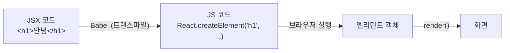
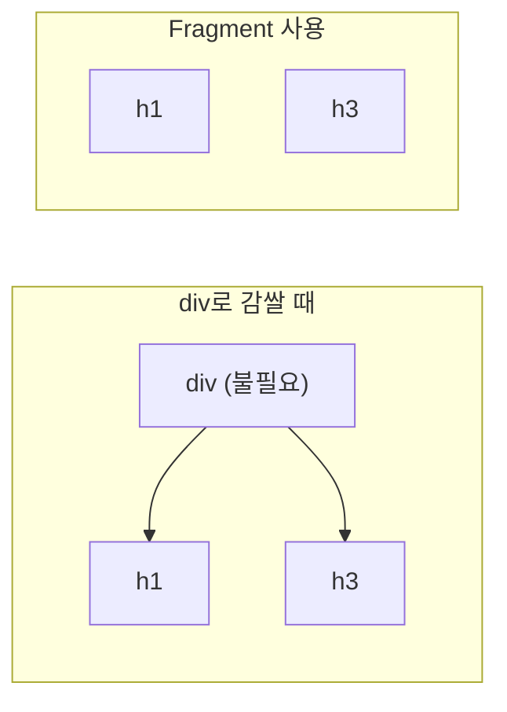

## 들어가며 (Situation)

앞 글의 마지막 문제는 `React.createElement(...)`를 중첩해서 쓰면 읽기 어렵다는 것이었다. `02_component/01_JSX`의 두 파일(`01_jsx-intro.html`, `02_fragment.html`)이 그 해결책, **JSX**를 다룬다.

> JSX (JavaScript XML): 자바스크립트 문법을 XML 방식으로 작성할 수 있게 지원하는 문법. Babel은 JSX를 JS로 변환해 주는 트랜스파일링 툴이다.

```js
// createElement
React.createElement('h1', {className: 'test'}, '안녕!! ', formatName(user));

// JSX
<h1 className="test">안녕!! {formatName(user)}</h1>
```

> 아래 출력은 React 18.3.1과 Babel(standalone 7)을 Node.js에 설치해서, 수업 코드와 같은 변환을 직접 실행한 결과다. 수업 HTML은 `@babel/standalone@8.1.3`을 쓰므로 버전 차이는 있을 수 있다. 브라우저 화면 스크린샷은 없다.

## 문제 상황 (Task)

1. 브라우저는 JSX(`<h1>` 같은 코드를 JavaScript 안에 쓴 것)를 이해하지 못한다. **어떻게 실행되는가?**
2. JSX 안에서 JavaScript 값을 어떻게 끼워 넣는가?
3. 수업 코드에는 **실행하면 이상하게 나오는 부분**이 있다. 무엇이고 왜인가?
4. 최상위 요소가 둘이면 왜 문법 에러가 나고, 어떻게 해결하는가?

## 해결 과정 (Action)

### 1. JSX는 `createElement`의 다른 모습이다

JSX를 Babel로 변환한 결과를 직접 확인했다.

```js
// 입력 (JSX)
const element = <h1 className="test">안녕!! {formatName(user)}</h1>;

// Babel 변환 결과
const element = /*#__PURE__*/React.createElement("h1", {
  className: "test"
}, "안녕!! ", formatName(user));
```

**JSX는 새로운 기능이 아니라 `createElement` 호출을 HTML처럼 쓰게 해 주는 문법**이다. 브라우저가 직접 실행하는 것은 변환된 `createElement` 코드다.



| 용어 | 의미 |
|---|---|
| **트랜스파일(transpile)** | 한 문법의 코드를 **같은 수준의 다른 문법 코드**로 변환 (컴파일의 한 종류) |
| **Babel** | 최신/확장 문법(JSX 등)을 브라우저가 실행하는 JS로 바꿔 주는 도구 |

### 2. 수업의 JSX 사용 방법 두 가지

수업 주석:

```
jsx 사용하는 방법
1. 바벨 관련 script 를 head 영역에 추가
2. script 태그에 type 속성에 text/babel 값 추가
```

```html
<script crossorigin src="https://unpkg.com/@babel/standalone@8.1.3/babel.min.js"></script>

<script type="text/babel">
    // 여기서는 JSX를 쓸 수 있다
</script>
```

| 조건 | 이유 |
|---|---|
| `@babel/standalone` 스크립트 추가 | **브라우저 안에서** 변환을 해 주는 Babel |
| `<script type="text/babel">` | 브라우저는 알 수 없는 `type`의 스크립트를 **실행하지 않고** 놔둔다. Babel이 이를 찾아서 변환 후 실행 |

`type="text/babel"`이 없으면 브라우저는 `<h1>`이 섞인 코드를 일반 JS로 읽다가 **문법 에러**를 낸다. 단, 브라우저에서 매번 변환하는 방식은 **학습용**이다. 실제 프로젝트는 빌드 단계에서 미리 변환해 둔다. (앞 글의 "앱 생성" 방식)

### 3. 중괄호 `{}` — JSX 안에서 JavaScript 쓰기

수업 주석: "JSX 내에서 중괄호를 활용하여 모든 JS **표현식**을 사용할 수 있다."

```js
function formatName(user) {
    return `${user.lastName} ${user.forstName}`;
}

const user = { firstName : '평훈', lastName : '조' };

const element = <h1 class ="test">안녕!! {formatName(user)}</h1>
```

| 중괄호에 넣을 수 있는 것 (표현식) | 넣을 수 없는 것 (문장) |
|---|---|
| 변수 `{user.name}`, 함수 호출 `{formatName(user)}` | `if`, `for` 같은 문장 |
| 연산 `{1 + 2}`, 삼항 `{a ? b : c}` | 변수 선언 `const x = 1` |
| 배열 `{list.map(...)}` | |

**표현식**은 "값이 되는 코드"라는 기준으로 기억하면 된다. 값이 되지 않는 `if`문은 중괄호 안에 직접 쓸 수 없고 삼항 연산자나 `&&`로 바꿔 쓴다. 이는 이후 조건부 렌더링 단원에서 다룬다.

### 4. 시행착오: 수업 코드를 그대로 실행하면 이렇게 나온다

이 파일에는 **오타 하나와 규칙 위반 하나**가 있다. 직접 실행해서 확인했다.

**① `forstName` 오타**

```js
function formatName(user) {
    return `${user.lastName} ${user.forstName}`;   // forstName ← firstName 오타
}
```

```
조 undefined          ← 직접 실행 결과 (기대한 값은 "조 평훈")
```

화면에는 `안녕!! 조 undefined`가 출력된다. **에러 없이** `undefined`가 글자로 나오는 것이 핵심이다. 존재하지 않는 프로퍼티를 읽으면 JavaScript는 에러가 아니라 `undefined`를 주기 때문이다. (JavaScript 첫 글의 "동적 타입의 위험"과 같은 맥락이다.) 증상은 `undefined`가 화면에 보이는 것이고, 원인은 프로퍼티 이름 오타이므로 **`firstName`으로 고치면 해결**된다.

**② `class` vs `className`**

```js
const element = <h1 class ="test">안녕!! {formatName(user)}</h1>
```

JSX는 JavaScript이므로 속성 이름이 **JavaScript 식 이름(camelCase)** 을 따른다. 앞 글에서 `createElement`에 `className`을 쓴 것과 같다. `class`로 쓰면 React가 경고를 낸다. 직접 확인했다.

```
Warning: Invalid DOM property `class`. Did you mean `className`?
→ 렌더 결과는 <h1 class="test">안녕</h1> (화면은 동작은 하지만 경고)
```

| HTML | JSX |
|---|---|
| `class` | **`className`** |
| `for` (`<label for>`) | **`htmlFor`** |
| `onclick` | **`onClick`** (camelCase) |
| `style="color:red"` | `style={{color: 'red'}}` (객체) |

동작은 하지만 콘솔 경고가 남으므로 `className`으로 써야 한다. 수업 주석에는 `React.createElemetn('hi', {class : "test"}, "안녕!")`처럼 주석 처리된 코드가 있는데, 이쪽도 `createElement` 철자(`createElemetn`)와 태그 이름(`hi`, 의도는 `h1`)에 오타가 있다. 주석이라 실행에는 영향이 없다.

### 5. JSX의 규칙 ① 최상위 요소는 하나여야 한다

`02_fragment.html`의 주석:

> JSX 문법 사용 시 주의해야 할 규칙: 동일 레벨의 요소 노드들이 연달아 정의되면 문법 에러 발생

```js
// 1. 최상위 요소가 두 개 → 문법 에러
const element = (
    <h1>{user.name}</h1>
    <h3>{user.phone}</h3>
);
```

직접 변환해서 확인한 에러 메시지다.

```
Adjacent JSX elements must be wrapped in an enclosing tag.
Did you want a JSX fragment <>...</>?
```

메시지가 해결책까지 알려 준다. **왜 안 되는가?** JSX는 `createElement(...)` 호출이 된다. 함수는 **하나의 값만 반환**할 수 있다. 앞 글에서 본 것처럼 JSX는 결국 한 번의 `createElement` 호출 = **하나의 엘리먼트**이므로, 형제 둘을 나란히 쓰면 반환값이 둘이 되어 불가능하다.

### 6. 해결 방법 두 가지: `<div>`로 감싸기 vs Fragment

```js
// 2. div로 감싸기
const element = (
    <div>
      <h1>{user.name}</h1>
      <h3>{user.phone}</h3>
    </div>
);

// 3. Fragment <></>
const element = (
    <>
      <h1>{user.name}</h1>
      <h3>{user.phone}</h3>
    </>
);
```

| 비교 | `<div>`로 감싸기 | `<>...</>` (Fragment) |
|---|---|---|
| 최상위 요소 규칙 | 만족 | 만족 |
| 실제 DOM에 남는 것 | **불필요한 `div`가 생긴다** | **아무것도 남지 않는다** |
| 레이아웃·CSS 영향 | 있음 (감싼 `div`가 CSS와 겹칠 수 있음) | 없음 |
| 용도 | 감싸는 요소가 필요할 때 | 묶기만 하면 될 때 |

수업 주석: "div를 최상위 요소로 하게 되면 불필요하게 div라는 영역이 생기게 된다."

Fragment 변환 결과와 렌더 결과를 직접 확인했다.

```js
// Babel 변환
React.createElement(React.Fragment, null,
    React.createElement("h1", null, user.name),
    React.createElement("h3", null, user.phone));
```

```
렌더 결과: <h1>a</h1><h3>b</h3>      ← 감싸는 태그 없이 형제만 출력
```

`<>`는 `React.Fragment`의 줄임 표기다. Fragment는 DOM에 흔적을 남기지 않고 **"묶음"의 역할만 한다.**



(`key`를 줘야 하는 경우는 `<React.Fragment key=...>`처럼 풀어서 쓴다. 리스트 단원에서 다룬다.)

### 7. JSX 규칙 정리

이번 두 파일과 변환 확인으로 알게 된 JSX 규칙을 한 번에 정리한다.

| 규칙 | 설명 | 어기면 |
|---|---|---|
| 최상위 요소 **하나** | 하나의 `createElement` = 하나의 값 | 문법 에러 |
| `{}`에 **표현식** | 값이 되는 코드만 | 문법 에러 |
| `className`, `htmlFor`, `onClick` | JS 식(camelCase) 속성명 | 경고 (동작은 함) |
| 모든 태그를 **닫는다** | ``, `<br />`처럼 자체 닫기 필요 | 문법 에러 |
| 컴포넌트는 **대문자** | 소문자는 HTML 태그로 해석됨 (다음 글) | 의도와 다르게 동작 |

## 결과 (Result)

| 질문 | 정리 |
|---|---|
| JSX란? | `createElement`를 HTML처럼 쓰는 문법 (변환 결과로 확인) |
| 어떻게 실행되나? | **Babel이 JS로 변환** → 브라우저 실행 (`text/babel`) |
| 값 끼워 넣기 | `{표현식}` |
| 최상위 요소 둘이면? | 에러 → `div` 또는 **Fragment(`<></>`)** |
| 불필요한 `div`를 피하려면? | Fragment (DOM에 남지 않음) |

수업 코드를 직접 확인해서 발견한 점이다.

| 항목 | 증상 | 원인 | 해결 |
|---|---|---|---|
| `조 undefined` | 에러 없이 `undefined`가 화면에 | `forstName` 오타 | `firstName` |
| `Invalid DOM property class` 경고 | 동작은 하지만 콘솔 경고 | JSX에서 `class` 사용 | `className` |

배운 점은 이렇다.

1. JSX는 마법이 아니라 **변환 규칙**이다. 에러가 나면 "이것이 어떤 `createElement` 호출로 바뀔까?"를 떠올리면 원인이 보인다. (최상위 요소 하나 규칙이 대표적이다.)
2. 오타가 **에러 없이 `undefined`로 화면에 나타나는** 경우가 많다. 화면을 눈으로 확인하는 습관이 필요하다.
3. 불필요한 `div`는 레이아웃과 CSS를 오염시킨다. 묶기만 필요하면 Fragment를 쓴다.

## 더 학습하면 좋은 개념

- **JSX의 조건부 렌더링과 리스트 렌더링 (`&&`, 삼항, `map`과 `key`)** — 중괄호 안에 `if`/`for`를 못 쓰는 제약을 푸는 표준 패턴이다. 다음 단원의 핵심이다.
- **Babel과 빌드 도구(Vite, webpack)** — 브라우저가 매번 변환하는 `text/babel` 방식을 빌드 단계로 옮기는 방법이다. 실제 프로젝트 개발의 출발점이다.
- **새 JSX 변환(automatic runtime)** — 최신 React는 `React.createElement` 호출 대신 다른 방식으로 변환하므로 `import React` 없이도 JSX를 쓸 수 있다. 이 글의 변환 결과(classic)와 어떻게 다른지 알아 두면 좋다.
- **XSS와 JSX의 자동 이스케이프** — `{}`로 넣은 값은 기본적으로 이스케이프되어 안전하다는 점과, `dangerouslySetInnerHTML`이 위험한 이유를 이해하게 한다.
- **TypeScript와 TSX** — `user.forstName` 같은 오타를 **실행 전에** 잡아 주는 정적 타입을 JSX와 함께 쓰는 방법이다. (JS 첫 글의 동적 타입 문제의 해법)

## 참고 자료

- [React 공식 문서 - JSX로 마크업 작성하기](https://react.dev/learn/writing-markup-with-jsx)
- [React 공식 문서 - JSX 중괄호로 자바스크립트 쓰기](https://react.dev/learn/javascript-in-jsx-with-curly-braces)
- [React 공식 문서 - Fragment](https://react.dev/reference/react/Fragment)
- [React 공식 문서 - 컴포넌트의 순수성 유지하기 / JSX 규칙](https://react.dev/learn/writing-markup-with-jsx#the-rules-of-jsx)
- [Babel 공식 문서 - @babel/standalone](https://babeljs.io/docs/babel-standalone)
- [Babel 공식 문서 - @babel/preset-react](https://babeljs.io/docs/babel-preset-react)
- [MDN - 표현식과 연산자 (표현식 vs 문장)](https://developer.mozilla.org/ko/docs/Web/JavaScript/Guide/Expressions_and_operators)
- [React 시작과 엘리먼트·컴포넌트 글]({{ site.baseurl }}/2026/11/23/react-intro-createelement-component/)
