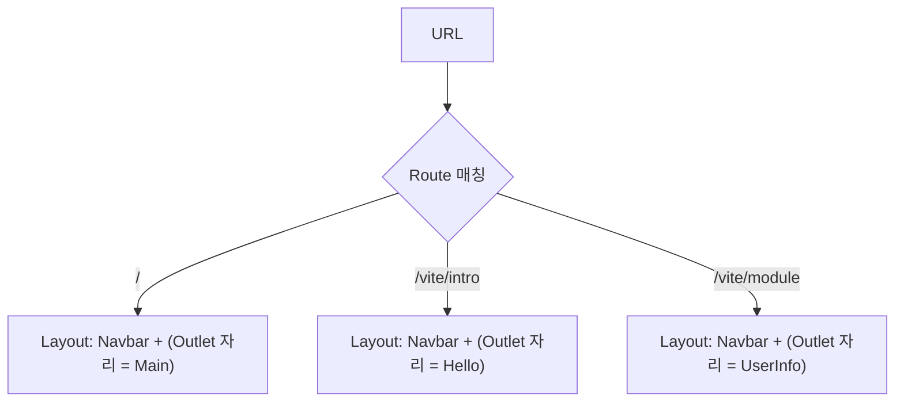

## 들어가며 (Situation)

앞 글([SSR·CSR·SPA 정리]({{ site.baseurl }}/2026/11/24/react-ssr-csr-spa-rendering/))에서 SPA는 HTML이 하나뿐이고, 화면 전환은 JS가 컴포넌트를 바꿔 끼우는 것이라고 정리했다. 이번에는 그 "바꿔 끼우는" 코드를 본다. 수업 프로젝트 `component-app`의 `App.jsx`, `layouts/Layout.jsx`, `components/Navbar.jsx`가 대상이다.

> 아래 출력은 수업 프로젝트(react-router-dom 7.18.6, React 19.3.1, Vite 8.3.8)를 scratchpad에 복사해서 서버 렌더링과 빌드로 확인한 결과다. 브라우저에서 클릭하는 동작과 새로고침 여부는 실행하지 못했고, 수업 주석과 공식 문서 설명에 의존했다.

## 문제 상황 (Task)

`UserInfo`와 `Hello`를 `App`에 한꺼번에 넣어 두면 두 컴포넌트가 항상 같이 보인다.

```jsx
// 수업 코드 (App.jsx 주석 처리된 이전 방식)
<>
  <Hello/>
  <UserInfo/>
</>
```

수업 주석에도 이렇게 적혀 있다. *"현실 세계의 프로젝트는 여러 페이지가 존재하며, 페이지별로 보여야 하는 컴포넌트, 보이면 안 되는 컴포넌트가 존재한다."*

해결해야 할 것은 세 가지였다.

1. **URL에 따라** 보여줄 컴포넌트를 바꾼다. (라우팅)
2. 메뉴(Navbar)는 **모든 페이지에 공통**으로 두고, 오른쪽 내용만 바꾼다.
3. 지금 보고 있는 메뉴가 **어디인지 표시**하고, CSS가 다른 컴포넌트와 **충돌하지 않게** 한다.

## 해결 과정 (Action)

### 1. 라우팅 3요소: BrowserRouter, Routes, Route

수업 주석에서 정리한 역할을 표로 옮겼다.

| 요소 | 역할 |
|------|------|
| `BrowserRouter` | 라우팅을 쓰는 영역을 감싸는 최상위 요소 |
| `Routes` | `Route`들을 묶는 부모 |
| `Route` | `path`(주소)와 `element`(보여줄 컴포넌트)를 연결 |

```jsx
// 수업 코드 (App.jsx)
<BrowserRouter>
  <Routes>
    <Route path="/" element={<Layout/>}>
      <Route index element = {<Main/>}/>
      <Route path="vite/intro" element = {<Hello/>}/>
      <Route path="vite/module" element = {<UserInfo/>}/>
    </Route>
  </Routes>
</BrowserRouter>
```

- `path="/"`의 `Layout`이 **부모**이고, 나머지 `Route`가 그 안에 중첩된 **자식**이다.
- `index`는 부모 주소(`/`) 그대로일 때 보여줄 자식이다.

### 2. Layout과 Outlet: 공통 틀 + 바뀌는 자리

```jsx
// 수업 코드 (Layout.jsx)
function Layout() {
    return (
        <div className={styles.layout}>
            <Navbar/>
            <main className={styles.content}>
                <Outlet/>
            </main>
        </div>
    );
}
```

`Outlet`은 수업 주석대로 **현재 주소와 일치하는 하위 Route의 컴포넌트가 렌더링되는 자리**다.



URL별로 서버에서 문자열 렌더링한 결과를 확인했다. (`Layout`과 `Navbar`는 세 번 모두 동일하고 `<main>` 안만 달라진다.)

| URL | `<main>` 안의 내용 |
|------|------|
| `/` | `<h1>React!!</h1><p>왼쪽 메뉴바에서 챕터를 선택해주세요</p>` |
| `/vite/intro` | `<h3>HelloWorld~~~</h3>` |
| `/vite/module` | `<div style="width:300px;border:1px solid black"><h1 style="color:red">조평훈</h1>…` |

> 만약 `Outlet`을 빼먹으면 자식 Route가 렌더링될 자리가 없어서 `Layout`만 보이게 된다. 이번에는 이 부분을 실험하지 않았다. 공식 문서의 `Outlet` 설명을 근거로 한 설명이다.

### 3. Link와 NavLink: 새로고침 없는 이동

수업 코드 주석의 핵심이다.

| 구분 | `<a href>` | `Link` | `NavLink` |
|------|------|------|------|
| 이동 방식 | 페이지 전체를 새로 불러옴 | 새로고침 없이 주소만 바꿔 컴포넌트 교체 | `Link`와 같음 |
| 현재 주소 표시 | 불가 | 불가 | 일치하면 `isActive`가 `true` |

```jsx
// 수업 코드 (Navbar.jsx)
const activeStyle = ({isActive}) => isActive ? {backgroundColor: 'orangered', color: 'white'} : undefined;

<NavLink to="/vite/intro" style={activeStyle}>프로젝트 생성</NavLink>
<NavLink to="/vite/module" style={activeStyle}>모듈</NavLink>
```

`style`에 객체가 아닌 **함수**를 넘기면 NavLink가 `{isActive}`를 넣어서 호출한다. 서버 렌더링 결과에서 이 동작을 확인했다.

```html
<!-- URL이 /vite/intro 일 때 -->
<a class="" href="/" ...>React 챕터</a>
<a aria-current="page" class="active" style="background-color:orangered;color:white" href="/vite/intro">프로젝트 생성</a>
<a class="" href="/vite/module">모듈</a>
```

현재 주소와 맞는 링크에만 `aria-current="page"`, `class="active"`, 주황 배경 스타일이 붙고, 나머지는 `class=""`로 비어 있다. (`/`의 `React 챕터` 링크는 `style`을 따로 주지 않아서 `/`에서도 `class="active"`만 붙는다.)

### 4. CSS Module: 클래스 이름이 겹치지 않게

```jsx
// 수업 코드 (Navbar.jsx)
import styles from './Navbar.module.css';

<nav className={styles.nav}>
```

수업 주석에는 클래스명이 `Navbar-module__nav__xxxxx` 형태로 바뀐다고 적혀 있다. 실제 빌드 결과는 달랐다.

```css
/* dist/assets/*.css (vite build 결과) */
._nav_masue_1{background-color:#f2f2f2;flex-direction:column;width:180px;padding:10px;display:flex}
._nav_masue_1 h4{margin:16px 0 4px}
._layout_1tt32_1{min-height:100vh;display:flex}
._content_1tt32_11{flex:1;padding:20px}
```

`.nav`는 `._nav_masue_1`로, `.layout`은 `._layout_1tt32_1`로 바뀌었다. **"파일마다 고유한 이름으로 바뀐다"는 원리는 같지만 정확한 형식은 도구 버전에 따라 다르다.** (이번 환경은 Vite 8.3.8이다.) 핵심은 `Navbar.module.css`의 `.nav`와 `Layout.module.css`에 `.nav`가 따로 있어도 서로 덮어쓰지 않는다는 점이다.

| 구분 | 일반 CSS (`import './style.css'`) | CSS Module (`*.module.css`) |
|------|------|------|
| 적용 범위 | 페이지 전체 | import한 컴포넌트 |
| 클래스 이름 | 작성한 그대로 | 빌드 시 고유한 이름으로 변환 |
| 사용법 | `className="nav"` | `className={styles.nav}` |

### 5. 일치하는 Route가 없으면?

`/nope`를 렌더링해 보았다.

```text
No routes matched location "/nope"
```

콘솔에 경고가 뜨고 **렌더링 결과가 비어 있었다.** `Layout`도 나오지 않았다. `path="/"` 부모가 있어도 `/nope`는 자식 Route와 맞지 않아서다. 실제 서비스에서는 "페이지를 찾을 수 없습니다" 화면용 Route를 따로 만들어야 한다는 뜻이다. (404 Route는 수업에 나오지 않아 직접 만들지는 않았다.)

### 6. 시행착오

- 처음에는 `App`을 통째로 서버 렌더링하려 했다. 그런데 `BrowserRouter`는 브라우저의 주소(`window.location`)를 읽는 라우터라 서버에서는 URL을 줄 수가 없다. 서버 렌더링용으로 만들어진 `StaticRouter`에 `location`을 넘겨서 URL별 결과를 비교했다. 이 과정에서 "라우터도 환경에 맞게 골라야 한다"는 점을 알게 됐다.
- 빌드 결과에서 CSS Module 이름을 보지 않았다면 수업 주석의 `Navbar-module__nav__xxxxx`를 그대로 믿었을 것이다. 주석은 도구의 한 시점 동작을 설명하는 것이라, 확인할 수 있으면 확인하는 편이 안전하다.

## 결과 (Result)

| 확인한 것 | 결과 |
|------|------|
| URL별 렌더링 | `/`·`/vite/intro`·`/vite/module`에서 `Layout`+`Navbar`는 동일, `<main>` 안만 교체 |
| NavLink 활성 표시 | 현재 URL의 링크에만 `aria-current="page"`, `class="active"`, 주황 스타일 |
| CSS Module | `.nav` → `._nav_masue_1` 등 고유 이름으로 변환 (수업 주석의 형식과는 다름) |
| 일치하는 Route 없음 | `No routes matched location "/nope"` 경고 + 빈 화면 |

- 라우팅 = **URL → 컴포넌트 매핑표**(`Route`)이고, 공통 틀은 **`Layout` + `Outlet`** 으로 만든다.
- 공통 메뉴는 그대로 두고 일부만 바꾸는 구조가 SPA의 체감 속도를 만드는 원리다. (실제 클릭 시 새로고침 여부는 브라우저에서 확인하지 못했다.)

## 더 학습하면 좋은 개념

- **중첩 라우팅과 `index` Route** — 이번 `Layout` 구조가 바로 중첩 라우팅이다. 부모-자식 Route를 자유롭게 설계하는 법을 알면 관리자 페이지처럼 레이아웃이 여러 개인 앱을 만들 수 있다.
- **동적 라우트 (`:id`, `useParams`)** — `/users/1`처럼 주소 일부가 값이 되는 패턴이다. 목록 → 상세 화면을 만들 때 가장 먼저 필요하다.
- **404 처리 (`path="*"`)** — 실험에서 본 "빈 화면"을 해결하는 방법이다. 서비스 배포 전에 반드시 챙겨야 한다.
- **History API** — `Link`가 새로고침 없이 주소를 바꾸는 근거가 되는 브라우저 기능이다. 라우터의 내부 동작을 이해하는 출발점이다.
- **CSS-in-JS / Tailwind와 비교** — CSS Module 외에 스타일 충돌을 피하는 다른 방법들이다. 왜 CSS Module을 먼저 배우는지 비교하면 선택 기준이 생긴다.

## 참고 자료

- [React Router 공식 문서](https://reactrouter.com/)
- [React Router - Outlet](https://reactrouter.com/en/main/components/outlet)
- [React Router - NavLink](https://reactrouter.com/en/main/components/nav-link)
- [Vite 공식 문서 - CSS Modules](https://vite.dev/guide/features#css-modules)
- [MDN - History API](https://developer.mozilla.org/en-US/docs/Web/API/History_API)
