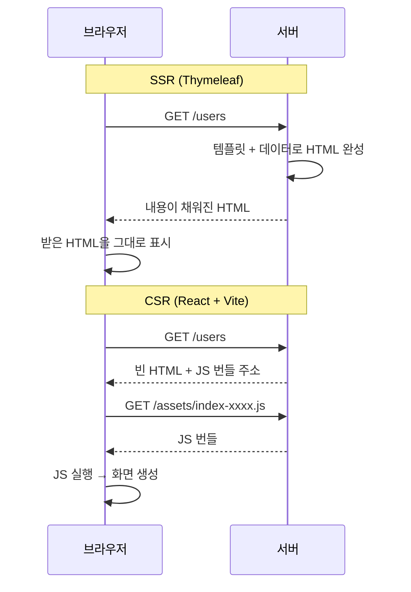
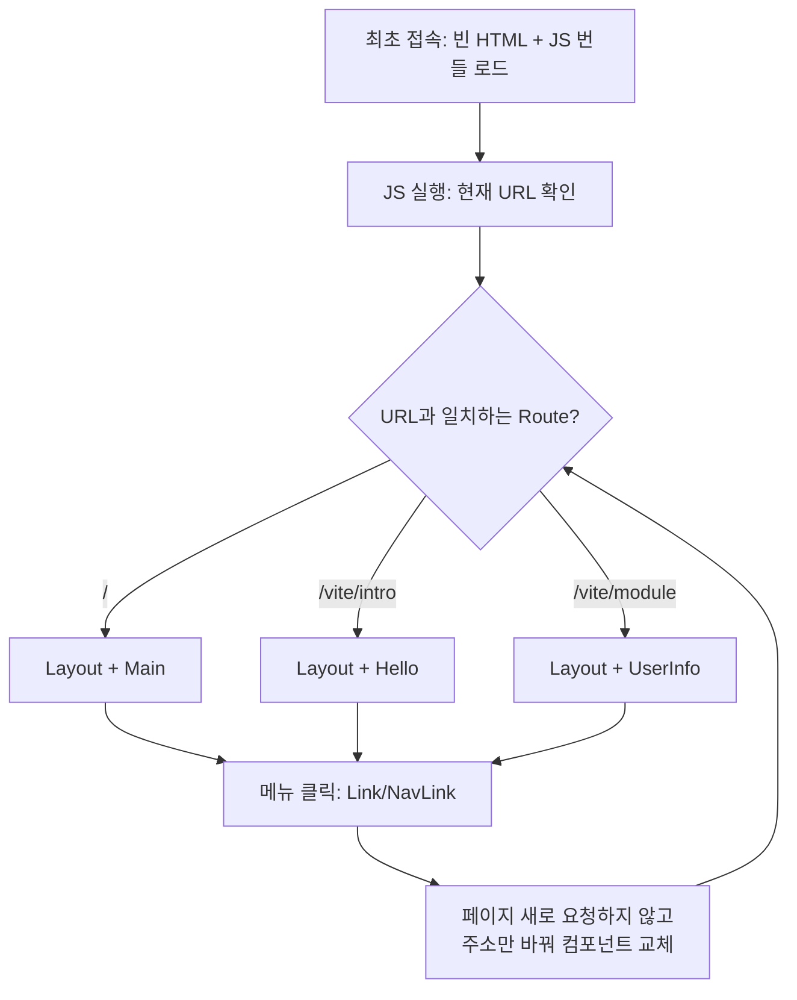
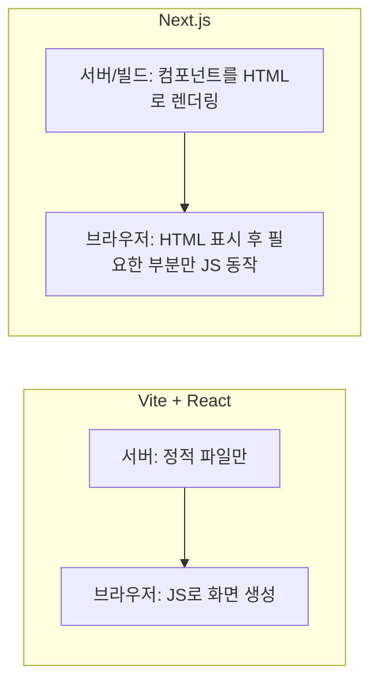

## 들어가며 (Situation)

Spring 수업에서는 **Thymeleaf**로 화면을 만들었고, 이번 챕터부터는 **React**로 화면을 만든다. 수업에서 두 방식을 이렇게 구분했다.

- Thymeleaf는 **SSR**(Server Side Rendering) 방식
- React는 **CSR**(Client Side Rendering) 방식
- React의 특징은 **SPA**(Single Page Application)
- (심화) React는 CSR, **Next**는 SSR 방식

외우기는 쉬운 문장인데, "그래서 브라우저가 받는 게 정확히 뭐가 다른데?"라는 질문에는 바로 답이 안 나왔다. 이 글은 그 질문을 **직접 확인해 본 기록**이다.

> 이 글의 실험은 수업 프로젝트 `component-app`(React 19.3.1, Vite 8.3.8, react-router-dom 7.18.6)을 scratchpad에 복사해서 실행한 결과다. Thymeleaf와 Next.js는 이번에 직접 실행하지 않았고, 해당 부분은 공식 문서를 근거로 썼다.

## 문제 상황 (Task)

"렌더링"이라는 단어가 문제였다. 화면을 그리는 것은 결국 브라우저인데, SSR과 CSR 중 무엇이 "서버가 그린다 / 브라우저가 그린다"일까?

| 풀어야 할 질문 | 확인 방법 |
|------|------|
| React 앱이 서버에서 받는 HTML에는 무엇이 들어 있나? | 빌드한 앱을 띄우고 URL별로 응답 본문 확인 |
| "서버가 HTML을 완성해서 준다"는 건 어떤 모양인가? | 같은 컴포넌트를 서버에서 문자열로 렌더링해서 비교 |
| SPA에서 페이지를 이동하면 무슨 일이 일어나나? | 라우팅 코드와 서버 응답 확인 |
| React = CSR, Next = SSR 이라는 구분은 정확한가? | Next 공식 문서 확인 |

## 해결 과정 (Action)

### 1. 큰 그림: 누가 HTML을 완성하는가



차이는 **"내용이 채워진 HTML을 누가 만드느냐"** 한 줄로 요약된다. 아래 두 실험으로 이 말을 눈으로 확인했다.

### 2. 실험 1 - React 앱이 서버에서 받는 HTML

`vite build`로 빌드하고 `vite preview`로 띄운 뒤, 세 개의 URL을 요청해서 `<body>`를 찍어 봤다.

```js
// 실험용 스크립트 (예시 코드)
const s = await preview({ preview: { port: 4173 } })
for (const u of ['/', '/vite/intro', '/vite/module']) {
  const r = await fetch('http://localhost:4173' + u)
  const t = await r.text()
  console.log(u, r.status, t.length + 'B', t.match(/<body>[\s\S]*<\/body>/)[0])
}
```

실제 출력:

```text
/             200 463B  <body><div id="root"></div></body>
/vite/intro   200 463B  <body><div id="root"></div></body>
/vite/module  200 463B  <body><div id="root"></div></body>
```

- 주소가 달라도 **응답은 같은 463바이트**다.
- `<div id="root"></div>`는 **비어 있다**. "조평훈", "HelloWorld~~~" 같은 글자는 HTML 어디에도 없다.
- 이 빈 칸을 채우는 것은 `<script type="module" src="/assets/index-….js">`로 받는 JS 번들(259.42 kB, gzip 82.55 kB)이다.

즉 CSR에서 서버는 **"앱 껍데기 하나"만 준다.** 어떤 화면을 보여줄지는 브라우저에서 JS가 URL을 보고 결정한다.

### 3. 실험 2 - 서버에서 HTML을 완성하면 어떤 모양일까

같은 컴포넌트를 브라우저가 아니라 Node에서 `renderToString`으로 렌더링해 봤다. (React도 서버에서 컴포넌트를 HTML 문자열로 만드는 API를 제공한다.)

```jsx
// 수업 코드 (UserInfo.jsx)
function UserInfo(){
    return (
        <div style = {{width : 300, border : '1px solid black'}}>
            <NameCard/>
            <AgeCard/>
            <EmailCard/>
        </div>
    );
}
```

실제 출력:

```html
<div style="width:300px;border:1px solid black"><h1 style="color:red">조평훈</h1><h2 style="color:orange">20</h2><h3 style="color:blue">raccoon@email.com</h3></div>
```

내용이 **이미 채워진 HTML**이다. 서버가 이런 문자열을 응답으로 주면 브라우저는 JS 실행을 기다리지 않고 바로 글자를 그릴 수 있다. 이것이 SSR 응답의 모양이고, Thymeleaf가 하는 일도 "템플릿에 데이터를 끼워 이런 HTML을 만들어 응답하는 것"이다.

> 정리하면 같은 `UserInfo`라도 **HTML 문자열로 만드는 시점이 서버냐 브라우저냐**의 차이다. 컴포넌트 코드가 달라지는 게 아니다.

### 4. SSR / CSR 비교표

| 항목 | SSR (Thymeleaf 등) | CSR (React + Vite) |
|------|------|------|
| 서버가 주는 HTML | 내용이 채워진 완성본 | 빈 `#root` + JS 주소 (실험 1) |
| 화면을 만드는 곳 | 서버 | 브라우저(JS) |
| 첫 화면 표시 | HTML 도착 즉시 가능 | JS 다운로드 + 실행 후 가능 |
| 페이지 이동 | 요청마다 서버가 새 HTML 응답 | 브라우저가 JS로 컴포넌트 교체 |
| 서버 부담 | 요청마다 HTML 생성 | 정적 파일 전달 위주 |
| 초기 HTML의 내용 | 있음 | 없음 (검색 엔진·크롤러 대응 시 고려 필요) |

마지막 줄의 검색 엔진 영향은 크롤러마다 JS 실행 여부가 달라서 이번에는 실험하지 않았다. "CSR은 초기 HTML에 내용이 없다"는 사실까지만 확인했고, SEO 영향의 정도는 별도로 확인이 필요하다.

### 5. SPA의 동작 방식

SPA는 이름 그대로 **HTML 페이지가 하나**뿐인 앱이다. 실험 1에서 `/`, `/vite/intro`, `/vite/module`이 모두 같은 응답이었던 것이 바로 이것이다. 그러면 URL별로 다른 화면은 어떻게 나올까? 라우팅 코드는 이렇다.

```jsx
// 수업 코드 (App.jsx 일부)
<BrowserRouter>
  <Routes>
    <Route path="/" element={<Layout/>}>
      <Route index element={<Main/>}/>
      <Route path="vite/intro" element={<Hello/>}/>
      <Route path="vite/module" element={<UserInfo/>}/>
    </Route>
  </Routes>
</BrowserRouter>
```



수업 코드의 주석도 같은 내용이다. `<a href>`는 페이지 전체를 새로 불러오지만 `Link`는 **새로고침 없이 주소만 바꿔 컴포넌트를 교체**한다. 그래서 메뉴를 눌러도 `Navbar`는 그대로 있고 `Outlet` 자리만 바뀐다. (라우팅 코드는 [다음 글]({{ site.baseurl }}/2026/11/24/react-router-layout-outlet-navlink/)에서 자세히 다룬다.)

### 6. (심화) React와 Next의 렌더링 방식 차이

수업에서는 "React는 CSR, Next는 SSR"로 정리했다. 방향은 맞지만 그대로 외우면 틀리는 지점이 있어서 공식 문서로 확인했다.

| 구분 | React (이번 프로젝트: Vite + React) | Next.js |
|------|------|------|
| 정체 | UI 라이브러리 | React 기반 프레임워크 |
| 기본 렌더링 | 브라우저에서 JS로 렌더링 (실험 1) | 서버에서 HTML을 만들 수 있음 |
| 서버에서 만드는 시점 | 직접 구성하지 않으면 없음 | 빌드 시점(정적) 또는 요청 시점(동적) |
| 라우팅 | `react-router-dom`을 직접 설치·설정 | 프레임워크가 제공 |

여기서 주의할 점이 두 가지다.

1. **"React = CSR"은 React 자체의 성질이 아니라 "Vite로 만든 React 앱"의 성질이다.** 실험 2에서 봤듯 React 컴포넌트도 서버에서 HTML 문자열로 만들 수 있다. 우리가 CSR을 쓰는 이유는 React를 쓰는 방식(Vite 프로젝트)이 그렇기 때문이다.
2. **"Next = SSR"도 단순화된 표현이다.** 검색한 Next.js 공식 문서(현재 16.3 문서 기준)에 따르면 서버 컴포넌트가 기본이고, 정적 렌더링(빌드 시점에 HTML 생성)이 기본이며, `cookies()`나 `headers()` 같은 요청 시점 정보를 쓰면 그 경로가 요청 시점 렌더링으로 바뀐다. 즉 **라우트마다 방식이 달라질 수 있다.** 이 부분은 Next 프로젝트를 직접 만들어 확인하지 못했고 문서 내용만 옮긴 것이다. 버전에 따라 다를 수 있다.



### 7. 시행착오

- 처음에는 `vite preview`를 백그라운드로 띄우고 Node 프로세스를 통째로 종료하는 명령으로 정리하려 했는데, 다른 Node 프로세스까지 종료할 수 있는 명령이라 실행이 거절됐다. 스크립트 안에서 서버를 직접 띄우고 요청이 끝나면 닫는 방식으로 바꿔서 해결했다.
- `renderToString`을 Vite 개발 서버의 `ssrLoadModule`로 불러왔더니 `ReferenceError: require is not defined`가 났다. 라이브러리(`react-dom/server`)는 Node가 직접 import하고, **소스 컴포넌트만** Vite로 불러오도록 나누니 동작했다.

## 결과 (Result)

| 확인한 것 | 결과 |
|------|------|
| `/`, `/vite/intro`, `/vite/module` 응답 크기 | 모두 463B로 동일 |
| 응답 `<body>` | 세 URL 모두 `<div id="root"></div>`(비어 있음) |
| 화면을 만드는 JS 번들 | 259.42 kB (gzip 82.55 kB) |
| 같은 `UserInfo`를 서버에서 문자열 렌더링 | 이름·나이·이메일이 채워진 HTML 생성 |

- SSR과 CSR의 차이는 **"내용이 채워진 HTML을 누가, 언제 만드는가"** 한 줄이다.
- SPA는 HTML이 하나이고, URL별 화면은 JS 라우터가 컴포넌트를 바꿔 끼워서 만든다.
- 수업의 "React=CSR, Next=SSR"은 시험용 한 줄 요약으로는 좋지만, 정확히는 "Vite 기반 React 앱은 CSR이 기본, Next는 서버에서 HTML을 만들 수 있는 구조"다.

## 더 학습하면 좋은 개념

- **SSG / ISR (정적 생성, 증분 정적 재생성)** — Next의 기본이 "빌드 시점 HTML 생성"이라는 점에서 출발한다. SSR과 어떻게 다른지(요청마다 vs 빌드 때 한 번) 구분하면 렌더링 방식을 3~4가지로 나눠 말할 수 있다.
- **Hydration** — 서버가 만든 HTML에 브라우저가 JS를 연결해 동작하게 만드는 과정이다. SSR을 쓰면서도 React의 상호작용을 유지하는 핵심 원리다.
- **React Server Components** — Next 공식 문서에서 기본값으로 등장하는 개념이다. "서버에서만 실행되는 컴포넌트"가 있다는 사실을 알면 "React = CSR"이라는 단순화의 한계가 보인다.
- **History API (`pushState`)** — SPA가 새로고침 없이 주소를 바꾸는 브라우저 기능이다. 라우터 라이브러리가 하는 일을 이해하려면 이 API부터 알아야 한다.
- **Core Web Vitals (LCP 등)** — CSR과 SSR의 "첫 화면 표시 속도" 차이를 숫자로 비교하는 기준이다. 이번 글에서는 측정하지 못했으므로 다음 단계로 좋다.

## 참고 자료

- [Next.js 공식 문서 - Server and Client Components](https://nextjs.org/docs/app/guides/server-and-client-boundary)
- [Next.js 공식 문서 - Server Components](https://nextjs.org/docs/app/building-your-application/rendering/server-components)
- [React 공식 문서 - react-dom/server](https://react.dev/reference/react-dom/server)
- [React Router 공식 문서](https://reactrouter.com/)
- [Vite 공식 문서 - Building for Production](https://vite.dev/guide/build)
- [MDN - SPA (용어집)](https://developer.mozilla.org/en-US/docs/Glossary/SPA)
- [MDN - History API](https://developer.mozilla.org/en-US/docs/Web/API/History_API)
- [Thymeleaf 공식 문서](https://www.thymeleaf.org/documentation.html)
