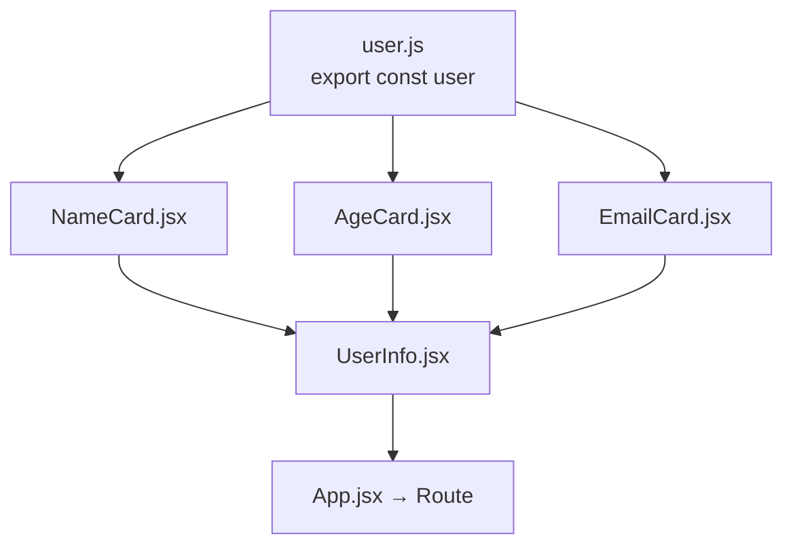

## 들어가며 (Situation)

지난 시간까지는 HTML 파일 하나에 `<script type="text/babel">`을 넣고 컴포넌트를 전부 한곳에 썼다. ([컴포넌트 합성 글]({{ site.baseurl }}/2026/11/23/react-function-component-composition/)) 이번에는 **Vite로 프로젝트를 만들고**, 컴포넌트를 파일 단위로 나눠서 `import`/`export`로 연결했다.

수업의 `component-app` 프로젝트 중 이번 글에서 다루는 부분은 `src/module/` 폴더(`01_intro`, `02_module`)다.

> 이 글의 에러 메시지와 출력은 수업 프로젝트(React 19.3.1, Vite 8.3.8)를 scratchpad에 복사해서 직접 실행한 결과다.

## 문제 상황 (Task)

파일을 나누면 "코드가 정리되는 대신" 새로운 종류의 실수가 생긴다.

- 컴포넌트를 쓰려면 **어디서 가져올지(import)** 를 직접 적어야 한다.
- 가져오려면 상대 파일에서 **내보내야(export)** 한다. 방식이 두 가지(`export default`, `export`)라 헷갈린다.
- 수업 코드 주석에는 *"import를 했는데 실제로 사용하지 않으면 오류가 발생할 수 있기 때문에, 오류 발생 시 첫 번째로 확인할 것은 import 구문"* 이라고 적혀 있었다. 이 문장이 정확한지도 확인이 필요했다.

## 해결 과정 (Action)

### 1. HTML 한 장 방식과 Vite 프로젝트 비교

| 항목 | 지난 시간 (CDN + HTML) | 이번 시간 (Vite) |
|------|------|------|
| React 가져오는 법 | `<script src="…react.js">` | `npm`으로 설치 (`package.json`) |
| JSX 변환 | 브라우저에서 Babel이 실시간 변환 | 빌드 도구가 미리 변환 (`@vitejs/plugin-react`) |
| 코드 분리 | 불가 (한 파일) | 파일마다 `import` / `export` |
| 확장자 | `.html` | `.jsx` (JSX 문법을 쓰는 파일) |
| 진입점 | 스크립트 안의 `createRoot` | `index.html` → `src/main.jsx` |

프로젝트 구조는 이렇다.

```text
component-app/
├─ index.html              ← <div id="root"> + main.jsx 로드
└─ src/
   ├─ main.jsx             ← createRoot(...).render(<App/>)
   ├─ App.jsx              ← 최상위 컴포넌트
   └─ module/
      ├─ 01_intro/01_intro.jsx
      └─ 02_module/
         ├─ user.js        ← 데이터
         ├─ NameCard.jsx
         ├─ AgeCard.jsx
         ├─ EmailCard.jsx
         └─ UserInfo.jsx   ← 위 세 컴포넌트를 묶는 상위 컴포넌트
```

```jsx
// 수업 코드 (main.jsx)
import { createRoot } from 'react-dom/client'
import App from './App.jsx'

createRoot(document.getElementById('root')).render(
    <App />
)
```

`createRoot(...).render(...)`는 CDN 때와 똑같다. 달라진 것은 **`createRoot`와 `App`을 `import`로 가져온다**는 점뿐이다.

수업 코드 주석에 따르면 `.jsx`는 "js xml"의 약자로, **JSX 문법을 쓰는 파일임을 확실히 나타내는** 확장자다.

### 2. 한 파일, 한 컴포넌트로 나누기

데이터를 `user.js`로 분리하고, 보여주는 일을 카드 세 개로 나눴다.

```js
// 수업 코드 (user.js)
export const user = {
    name : '조평훈',
    age : 20,
    email : "raccoon@email.com"
};
```

```jsx
// 수업 코드 (NameCard.jsx)
import {user} from "./user";

export default function NameCard() {
    return <h1 style = {{color : 'red'}}>{user.name}</h1>
}
```

`AgeCard`(주황색 `h2`), `EmailCard`(파란색 `h3`)도 같은 구조다. 이 세 개를 `UserInfo`가 묶는다.

```jsx
// 수업 코드 (UserInfo.jsx)
import NameCard from "./NameCard";
import AgeCard from "./AgeCard";
import EmailCard from "./EmailCard";

function UserInfo(){
    return (
        <div style = {{width : 300, border : '1px solid black'}}>
            <NameCard/>
            <AgeCard/>
            <EmailCard/>
        </div>
    );
}

export default UserInfo;
```



실제 렌더링 결과(서버에서 문자열로 렌더링해서 확인):

```html
<div style="width:300px;border:1px solid black"><h1 style="color:red">조평훈</h1><h2 style="color:orange">20</h2><h3 style="color:blue">raccoon@email.com</h3></div>
```

데이터가 한 곳(`user.js`)에만 있어서, 이메일을 바꾸고 싶으면 파일 하나만 고치면 세 컴포넌트에 모두 반영된다.

### 3. `export default`와 `export`, 무엇이 다른가

수업 코드의 `AgeCard.jsx` 주석을 표로 정리했다.

| 구분 | `export default` | `export` (named) |
|------|------|------|
| 파일당 개수 | **1개** | 여러 개 가능 |
| 가져오는 문법 | `import 이름 from "./파일"` | `import {이름} from "./파일"` |
| 가져올 때 이름 | 마음대로 정해도 됨 | 내보낸 이름과 같아야 함 |
| 수업 코드 예 | `NameCard`, `UserInfo` | `user.js`의 `user` |

그래서 한 프로젝트 안에 `import {user} from "./user"`(중괄호)와 `import NameCard from "./NameCard"`(중괄호 없음)가 섞여 있다. 헷갈리는 이유가 이 표 한 장에 있다.

### 4. "import 오류"를 직접 일으켜 보기

수업 주석의 "import를 했는데 사용하지 않으면 오류가 발생할 수 있다"는 문장이 사실인지, 실수를 세 가지로 나눠 `UserInfo.jsx`를 일부러 망가뜨려 보았다. (scratchpad 복사본에서만 수정했다.)

**실험 A: default로 내보낸 것을 `{}`로 가져오기**

```jsx
// import AgeCard from "./AgeCard"  →  아래처럼 변경
import {AgeCard} from "./AgeCard"
```

```text
error during build:
Build failed with 1 error:
[MISSING_EXPORT] "AgeCard" is not exported by "src/module/02_module/AgeCard.jsx".
```

**빌드 단계에서** 실패한다. `AgeCard.jsx`는 `export default`로 내보냈는데 named export를 찾았기 때문이다.

**실험 B: import를 빼먹고 컴포넌트 사용하기**

`import EmailCard ...` 줄만 지웠다.

```text
✓ built in 151ms           ← 빌드는 성공
runtime: ReferenceError: EmailCard is not defined   ← 렌더링할 때 실패
```

이번에는 **빌드가 통과**하고 실행 중에 터진다. 화면이 하얗게 나오고 콘솔에 에러가 뜨는 이유가 이것이다.

**실험 C: import만 하고 사용하지 않기**

```text
src/module/02_module/UserInfo.jsx:1:8: warning eslint(no-unused-vars):
Identifier 'Hello' is imported but never used. help: Consider removing this import.
```

프로젝트에 설정된 린터(oxlint)가 **경고(warning)** 만 낸다. 에러는 아니다.

| 실수 | 언제 | 결과 |
|------|------|------|
| default를 `{}`로 import (A) | 빌드 | **에러** `MISSING_EXPORT` |
| import 없이 컴포넌트 사용 (B) | 실행(렌더링) | **에러** `ReferenceError` |
| import만 하고 미사용 (C) | 린트 | **경고** (실행에는 영향 없음) |

결론적으로 수업 주석의 취지("문제가 생기면 import/export부터 보라")는 맞지만, **"사용하지 않는 import" 자체는 오류의 원인이 아니다.** 실제 원인은 A(내보낸 방식과 가져오는 방식 불일치)와 B(import 누락)다. 이 점은 주석을 그대로 외웠다면 놓칠 뻔했다. (C에서 존재하지 않는 파일을 import하면 그때는 당연히 빌드 에러가 난다. 여기서는 "미사용 자체"만 비교했다.)

### 5. 시행착오

- 처음에는 실험을 `vite preview`/`ssrLoadModule` 한 가지로만 하려고 했는데, 실험 B가 **빌드에서는 안 잡히고 실행에서만 잡힌다**는 사실은 `vite build`와 렌더링을 따로 돌려 보니 알게 됐다. "빌드가 되면 안전하다"는 가정은 틀렸다.
- 실험 파일을 수정하기 전에 백업(`UserInfo.jsx`)을 복사하고 매 실험 뒤 복원했다. 원본 수업 폴더는 건드리지 않았다.

## 결과 (Result)

| 확인한 것 | 결과 |
|------|------|
| 컴포넌트를 파일 4개 + 데이터 1개로 분리 | `UserInfo`가 세 카드를 합성해서 정상 렌더링 |
| `export default` vs `export` | default는 파일당 1개, `{}` 없이 import / named는 `{}`로 import |
| default를 `{}`로 import | 빌드 에러 `MISSING_EXPORT` |
| import 누락 | 빌드 통과, 실행 시 `ReferenceError` |
| 미사용 import | 린트 경고만 |

- 파일을 쪼개면 코드는 정리되지만, "내보낸 방식 = 가져오는 방식"이 맞아야 한다.
- 에러가 **빌드 때** 나는지 **실행 때** 나는지에 따라 확인 위치가 다르다.

## 더 학습하면 좋은 개념

- **ES Modules (ESM)** — `import`/`export`는 React 문법이 아니라 JavaScript 표준이다. 원리를 알면 "왜 default는 이름이 자유로운지"가 이해된다.
- **번들러 (Vite, Rolldown)** — 이번 에러 메시지(`MISSING_EXPORT`)는 번들러가 낸 것이다. 번들러가 수십 개 파일을 어떻게 하나로 묶는지 알면 빌드 에러를 읽는 속도가 달라진다.
- **린터 (ESLint, oxlint)** — 실험 C처럼 "실행은 되지만 문제가 있는 코드"를 잡아 주는 도구다. 팀 프로젝트에서 규칙을 맞추는 기본 장치다.
- **배럴 파일 (`index.js` re-export)** — 컴포넌트가 늘어나면 import 줄도 늘어난다. 한 폴더의 export를 모아 주는 패턴이다.
- **JSX 변환 (`@vitejs/plugin-react`)** — 이번 글에서 "빌드 도구가 미리 변환한다"고 한 부분의 상세다. 지난 글의 Babel 이야기와 이어진다.

## 참고 자료

- [MDN - import](https://developer.mozilla.org/en-US/docs/Web/JavaScript/Reference/Statements/import)
- [MDN - export](https://developer.mozilla.org/en-US/docs/Web/JavaScript/Reference/Statements/export)
- [Vite 공식 문서 - Getting Started](https://vite.dev/guide/)
- [React 공식 문서 - Importing and Exporting Components](https://react.dev/learn/importing-and-exporting-components)
- [oxlint 공식 문서](https://oxc.rs/docs/guide/usage/linter.html)
