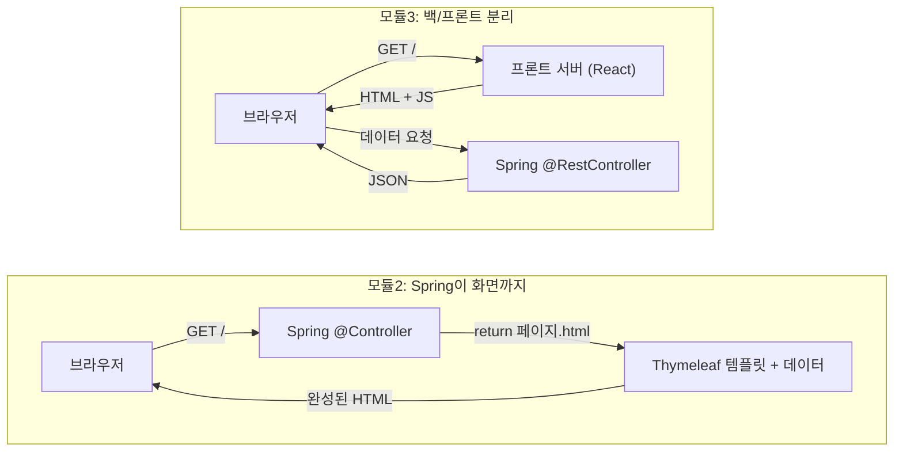
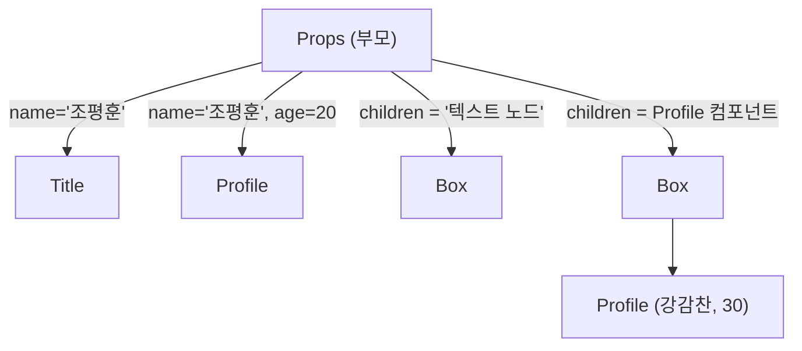

## 들어가며 (Situation)

모듈2는 Spring 하나로 화면까지 만들었고, 모듈3은 **백엔드와 프론트엔드를 나눠서** 진행한다. 수업에서 칠판에 그린 비교는 이렇게 정리된다.

| 구분 | 모듈2 (Spring App 하나) | 모듈3 (백엔드 / 프론트 분리) |
|------|------|------|
| 컨트롤러 | `@Controller` | `@RestController` |
| 메서드가 돌려주는 것 | 페이지 이름 (`return "페이지.html"`) | **데이터만** (JSON) |
| 페이지(.html)가 있는 곳 | Spring 앱 안 | Spring 앱 안에 **두지 않는다** (✗ 표시) |
| 페이지를 결정하는 주체 | Spring (서버) | **Front 서버** |
| `@RestController`의 정체 | - | `@Controller` + `@ResponseBody` |

> 이 글의 실행 결과는 수업 프로젝트 `data-fetch-app-skeleton`(React 19.3.1, react-router-dom 7.18.6)을 scratchpad에 복사해 jsdom 환경에서 실행한 것이다. Spring 코드는 이번에 실행하지 않았고, 모듈2/3 비교는 수업 필기와 Spring 공식 문서의 정의를 근거로 정리했다.

이 글은 그 "분리"가 React 쪽에서 어떤 모양이 되는지, 그리고 분리된 프론트 안에서 **데이터가 컴포넌트 사이를 어떻게 흐르는지(props)** 를 정리한다.

## 문제 상황 (Task)

모듈2 방식에서는 서버가 데이터를 만들고, 서버가 "어느 HTML을 보여줄지"까지 정했다. 분리하면 서버는 **데이터만 주고**, 화면은 다른 서버(프론트)가 맡는다. 그러면 프론트 안에서는 이런 질문이 생긴다.

1. 서버가 준 데이터를 화면 여기저기에 어떻게 전달하나?
2. 값이 바뀌면 화면은 어떻게 따라 바뀌나? (state, 다음 글)
3. 사용자의 입력은 어떻게 받나? (event, 다음 글)
4. 목록은 어떻게 그리나? (반복 렌더링, 다음 글)

이번 챕터(`chap/01`~`04`)가 이 순서로 구성되어 있고, 이 글은 1번에 해당하는 **props**와 분리 구조를 다룬다.

## 해결 과정 (Action)

### 1. 큰 그림: 모듈2 vs 모듈3의 요청 흐름



- 모듈2에서는 **요청 한 번에 완성된 HTML**이 돌아온다. (SSR, [SSR·CSR·SPA 글]({{ site.baseurl }}/2026/11/24/react-ssr-csr-spa-rendering/)에서 정리)
- 모듈3에서는 브라우저가 **프론트 서버에서 화면(JS)을 받고**, 데이터가 필요하면 **백엔드에 따로 요청**한다. 백엔드는 JSON만 돌려준다.

`@RestController`가 `@Controller`와 달라지는 지점이 정확히 여기다. 수업 칠판대로 `@Controller + @ResponseBody`이고, 의미는 "페이지를 리턴하는 책임에서 벗어나 데이터만 JSON으로 리턴한다"이다. (공식 문서: `@RestController`는 `@Controller`와 `@ResponseBody`를 합친 편의 애노테이션이다.)

### 2. 프론트 프로젝트의 뼈대 (skeleton)

이번 프로젝트는 라우터와 메뉴를 **미리 만들어 둔 뼈대**다. 수업에서는 `src/chap/`만 채운다.

```text
data-fetch-app-skeleton/
└─ src/
   ├─ main.jsx / App.jsx          ← 라우팅 (미리 완성)
   ├─ layouts/Layout.jsx          ← Navbar + Outlet
   ├─ components/Navbar.jsx       ← 메뉴 (미리 완성)
   ├─ errors/Error404.jsx         ← 없는 주소용 화면
   └─ chap/                       ← 수업에서 채우는 부분
      ├─ 01_props     02_state     03_event     04_iteration
      └─ 05_useEffect 06_fetch     07_pokemon    ← 이후 (데이터 요청)
```

`App.jsx`의 라우팅은 [라우터 글]({{ site.baseurl }}/2026/11/24/react-router-layout-outlet-navlink/)에서 본 구조 그대로이고, 하나 달라진 점이 있다. 이번에는 **404 Route**가 있다.

```jsx
// 수업 코드 (App.jsx 일부)
<Route path="/" element={<Layout/>}>
    <Route index element={<Main/>}/>
    <Route path="props" element={<Props/>}/>
    ...
</Route>
<Route path="*" element={<Error404/>}/>
```

지난 글에서 일치하는 Route가 없으면 빈 화면이 나오는 것을 확인했는데, `path="*"`가 그 빈 곳을 메운다. 메뉴 번호 순서(01 props → 04 반복 렌더링 → 05 useEffect → 06 데이터 요청 → 07 포켓몬 도감)가 곧 수업의 흐름이다.

### 3. props: 부모가 자식에게 주는 읽기 전용 값

수업 주석의 핵심을 표로 정리했다.

| 규칙 | 설명 |
|------|------|
| 전달 | `<Title name="홍길동"/>`처럼 속성으로 넘긴다 |
| 수신 | 넘긴 속성들이 **하나의 객체(`props`)** 로 묶여 함수의 매개변수로 들어온다 |
| 문자열이 아닌 값 | 숫자·배열·함수는 `{}`로 전달한다 (`age={20}`) |
| 읽기 전용 | 자식은 props를 수정하지 않는다 |
| `children` | 태그 사이에 쓴 내용은 `props.children`으로 전달된다 |

수업 코드 세 가지 형태:

```jsx
// 수업 코드 (01_props.jsx)
function Title(props) { return <h1>안녕하세요 {props.name}님 반갑습니다.</h1>; }   // 1. props 객체 그대로
function Profile({name, age}) { return <h3>{name}님은 {age}살입니다.</h3>; }       // 2. 구조 분해로 받기
function Box({children}) { return <div style={{border:'1px solid orangered', padding:10, margin:5}}>{children}</div>; } // 3. children
```

**실제로 어떻게 들어오는지** `console.log(props)`를 확인했다.

```text
{"name":"조평훈"}
{"name":"Raccoon"}
```

`<Title name="조평훈"/>`의 속성이 `{name: "조평훈"}` 객체 하나가 되어 들어온다. 수업 주석에는 "`<Title/>`은 실제로 `function Title(name) {}`"이라고 적혀 있는데, 정확히는 매개변수 이름이 `name`이 아니라 **`props`(객체 전체)** 이다. 매개변수 이름을 `name`으로 쓰면 `name`에 객체가 담기므로 `name.name`처럼 써야 한다. (이 부분은 주석의 표현만 바로잡은 것이다.)

전체 렌더링 결과:

```text
안녕하세요 조평훈님 반갑습니다.
안녕하세요 Raccoon님 반갑습니다.
조평훈님은 20살입니다.
텍스트 노드
강감찬님은 30살입니다.
```

`Box` 안에 `<Profile .../>`를 넣은 마지막 줄(강감찬)처럼, **컴포넌트 안에 컴포넌트를 `children`으로 넣을 수 있다.**

### 4. "props는 읽기 전용"을 직접 깨 보기

자식에서 props를 수정하면 어떻게 될까?

```jsx
// 실험 코드 (예시 코드)
const Mut = (props) => { props.name = '바꿈'; return <p>{props.name}</p> }
```

```text
props mutate -> TypeError: Cannot assign to read only property 'name' of object '#<Object>'
```

실제로 **에러**가 났다. 규칙이 "권장"이 아니라 React가 강제하는 읽기 전용이다. (개발 모드에서 props 객체가 얼려져 있기 때문으로 보이며, 공식 문서도 props를 변경하지 말라고 안내한다.) 값을 바꿔야 한다면 그 값은 props가 아니라 **state**에 두어야 하고, 이것이 다음 글의 주제다.

### 5. props가 흐르는 방향



수업에서 말한 것처럼 **프론트는 컴포넌트들의 집합**이고, 컴포넌트는 부모-자식-형제 관계로 구성된다. 부모에서 자식으로 **한 방향**으로만 값이 흐르기 때문에, 어디서 온 값인지 추적하기 쉽다. 모듈3에서 백엔드가 JSON을 주면, 그 데이터를 받은 상위 컴포넌트가 하위 컴포넌트들에게 props로 나눠 주는 구조가 된다.

### 6. 시행착오

- 처음에는 `act` 없이 렌더링 결과를 읽었는데 빈 화면이 나왔다. React 19에서는 렌더링이 비동기로 반영되어서, 테스트 환경에서는 `act(...)`로 감싸야 최신 화면을 읽을 수 있었다.
- `navigator`를 jsdom 것으로 덮어쓰려다 `Cannot set property navigator ... which has only a getter` 에러가 났다. Node 24의 전역 `navigator`는 setter가 없어서, 해당 줄을 빼고 필요한 전역(`window`, `document` 등)만 설정했다.

## 결과 (Result)

| 확인한 것 | 결과 |
|------|------|
| `<Title name="조평훈"/>`의 `props` | `{"name":"조평훈"}` 객체로 수신 |
| `Profile`(구조 분해) | `조평훈님은 20살입니다.` |
| `Box`(children) | 텍스트와 컴포넌트 모두 `children`으로 전달 |
| props 수정 시도 | `TypeError: Cannot assign to read only property 'name'` |

- 모듈3의 핵심은 **서버는 데이터(JSON), 프론트는 화면**으로 역할을 나눈 것이다.
- 프론트 안에서는 **props로 부모→자식 한 방향**으로 데이터를 전달하고, 자식은 받은 값을 바꾸지 않는다.

## 더 학습하면 좋은 개념

- **REST API와 JSON** — `@RestController`가 돌려주는 데이터의 형식과 URL 설계 규칙이다. 프론트가 어떤 주소로 무엇을 받아 쓰는지 정하는 약속이므로, 분리 개발에서는 가장 먼저 합의해야 한다.
- **CORS** — 프론트 서버와 백엔드 서버의 주소(포트)가 다르면 브라우저가 요청을 막을 수 있다. 분리한 뒤 처음 만나는 대표 에러다.
- **단방향 데이터 흐름** — props가 한 방향인 이유와 상위로 값을 올리는 방법("상태 끌어올리기")으로 이어진다.
- **컴포넌트 합성 (children 패턴)** — `Box`처럼 내용을 외부에서 받는 컴포넌트를 설계하는 방법이다. 레이아웃 컴포넌트를 만들 때 계속 쓴다.
- **Spring `@ResponseBody`와 HttpMessageConverter** — 객체가 JSON으로 바뀌는 원리다. 모듈3 백엔드를 이해하는 기본이다.

## 참고 자료

- [Spring 공식 문서 - @RestController](https://docs.spring.io/spring-framework/reference/web/webmvc/mvc-controller/ann.html#mvc-ann-restcontroller)
- [React 공식 문서 - Passing Props to a Component](https://react.dev/learn/passing-props-to-a-component)
- [React 공식 문서 - Describing the UI](https://react.dev/learn/describing-the-ui)
- [React Router 공식 문서](https://reactrouter.com/)
- [MDN - CORS](https://developer.mozilla.org/en-US/docs/Web/HTTP/CORS)
