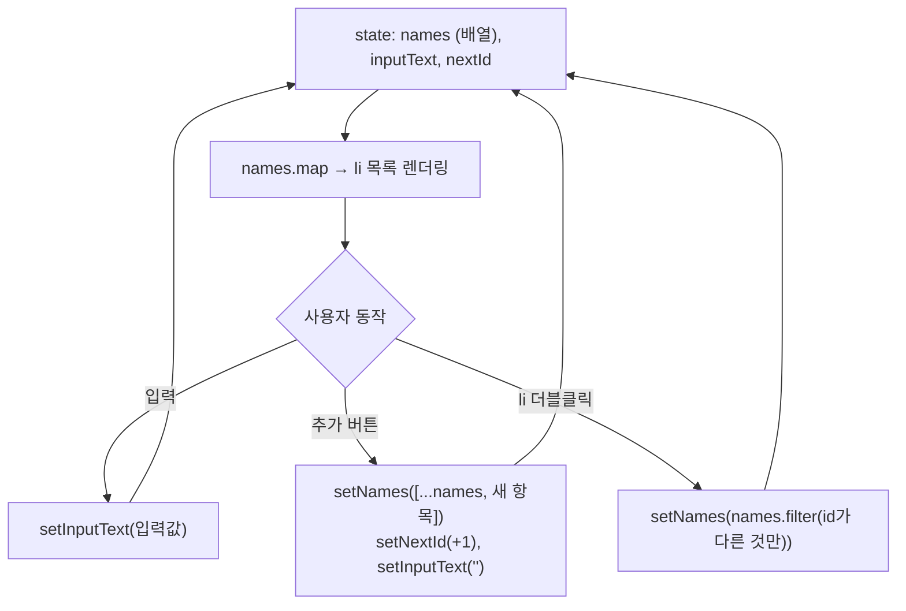

## 들어가며 (Situation)

모듈3에서 백엔드가 주는 데이터는 대부분 **배열(목록)** 이다. 상품 목록, 게시글 목록, 앞으로 만들 포켓몬 도감까지 전부 "배열을 화면에 반복해서 그린다"는 같은 문제다. 수업의 `04_iteration`은 그 기본 틀을 이름 목록(`NameList`)으로 연습한다.

> 이 글의 출력은 수업 프로젝트 `data-fetch-app-skeleton`(React 19.3.1)을 scratchpad에 복사해 jsdom 환경에서 입력·클릭·더블클릭 이벤트를 발생시켜 얻은 결과다. 실제 브라우저에서 확인한 것은 아니다.

## 문제 상황 (Task)

목록 화면에는 세 가지 일이 필요하다.

1. 배열 데이터를 `<li>` 여러 개로 **그려야** 한다.
2. 사용자가 입력한 값을 목록에 **추가**해야 한다.
3. 항목을 더블클릭하면 **삭제**해야 한다.

그리고 이 배열은 **state**라서, 배열을 어떻게 바꾸느냐에 따라 화면이 갱신되기도 하고 안 되기도 한다. 이 지점이 이 글의 중심이다.

## 해결 과정 (Action)

### 1. 전체 흐름



state가 세 개로 나뉜 이유는 역할이 다르기 때문이다.

| state | 역할 | 초기값 |
|------|------|------|
| `names` | 화면에 그릴 목록 데이터 | `[{id:1,홍길동}, {id:2,유관순}, {id:3,이순신}]` |
| `inputText` | 입력창의 현재 값 (제어 컴포넌트) | `''` |
| `nextId` | 새 항목에 붙일 번호 | `4` |

### 2. 반복 렌더링: `map`으로 데이터 배열 → 엘리먼트 배열

```jsx
// 수업 코드 (04_iteration.jsx)
{names.map( name =>
    <li key={name.id} onDoubleClick={()=> onRemove(name.id)}>{name.id} 번 {name.name}</li>
)}
```

`map`은 [JS 고차 함수 글]({{ site.baseurl }}/2026/11/17/javascript-array-higher-order-method/)에서 배운 그대로 "배열의 각 요소를 다른 값으로 바꾼 새 배열"을 돌려준다. 여기서는 **데이터 객체 배열이 `<li>` 엘리먼트 배열로 바뀌고**, JSX는 그 배열을 그대로 화면에 그린다.

초기 화면 결과:

```text
1 번 홍길동
2 번 유관순
3 번 이순신
```

### 3. key: 왜 필요하고, 없으면 어떻게 되나

수업 TODO 1은 일부러 **key 없이 먼저 작성해서 경고를 확인**하라고 한다. 실제로 key 없이 `map`을 돌렸다.

```jsx
// 실험 코드 (예시 코드)
['a','b'].map(x => <li>{x}</li>)
```

```text
console.error: Each child in a list should have a unique "key" prop. See https://react.dev/link/warning-keys for more information.
```

경고 문구 그대로, 목록의 각 항목에는 **고유한 key**가 있어야 한다. 수업 주석의 설명은 다음과 같다.

| 규칙 | 설명 |
|------|------|
| 목적 | 목록에서 어떤 항목이 추가/삭제/이동했는지 React가 구분하는 식별자 |
| 범위 | **형제 요소끼리** 고유하면 된다 |
| 값 | DB 데이터라면 **PK**를 쓴다 |
| index는 비권장 | 항목이 추가/삭제되면 index가 바뀌므로 식별자 역할을 못 한다 |

수업 코드가 `key={name.id}`를 쓴 이유가 이것이다. 모듈3에서 백엔드가 주는 데이터에는 보통 PK가 있으므로, 그 값을 key로 쓰면 된다. (index를 key로 쓰면 실제로 어떤 문제가 생기는지는 이번에 실험하지 않았다. 공식 문서의 설명을 근거로 한 내용이다.)

### 4. 추가: 원본을 건드리지 않고 새 배열 만들기

```jsx
// 수업 코드 (04_iteration.jsx)
const onClickHandler = () => {
    setNames([...names, {id : nextId , name : inputText}]);   // 기존 배열 복사 + 새 항목
    setNextId(nextId + 1);                                    // 다음 id 준비
    setInputText('');                                         // 입력창 비우기
};
```

`조평훈`을 입력하고 추가를 누른 결과:

```text
1 번 홍길동 / 2 번 유관순 / 3 번 이순신 / 4 번 조평훈
```

`...names`(스프레드)로 기존 항목을 복사하고 새 객체를 뒤에 붙인 **새 배열**을 `setNames`에 전달한다. `nextId`를 따로 state로 둔 것은 "다음 번호가 4가 되면 안 되기 때문"이라는 수업 주석처럼, **삭제 후에도 번호가 겹치지 않게** 하기 위해서다.

### 5. 삭제: `filter`로 "남길 것만" 새 배열로

```jsx
// 수업 코드 (04_iteration.jsx)
const onRemove = id => {
    setNames(names.filter(name => name.id !== id));   // 전달받은 id와 다른 것만 남긴다
};
```

삭제는 "지울 것을 빼는" 것이 아니라 **"남길 것만 모아 새 배열을 만드는"** 방식이다. 순서대로 실행해 id가 어떻게 되는지 확인했다.

| 순서 | 동작 | 화면 |
|------|------|------|
| 1 | 초기 | 1 홍길동, 2 유관순, 3 이순신 |
| 2 | `조평훈` 추가 | …, **4 번 조평훈** |
| 3 | 4번 더블클릭 | 1 홍길동, 2 유관순, 3 이순신 |
| 4 | `김철수` 추가 | …, **5 번 김철수** |
| 5 | 1번 더블클릭 | 2 유관순, 3 이순신, 5 번 김철수 |

4번을 지운 뒤에 추가한 김철수가 **4번이 아니라 5번**이 된 것이 `nextId`의 효과다. 삭제된 번호를 재사용하지 않으니 key가 겹칠 일이 없다.

### 6. 왜 `push`나 `splice` 대신 새 배열인가

수업 주석: "원본 배열을 수정(push, splice)하지 않고, 새 배열을 만들어 setter에 전달한다." 이를 어겼을 때 실제로 어떻게 되는지 실험했다.

```jsx
// 실험 코드 (예시 코드)
const [a, setA] = useState([1])
onClick = () => { a.push(2); setA(a) }     // 원본 수정 + 같은 배열을 다시 전달
```

```text
버튼 클릭 후 화면: [1]      ← 화면이 바뀌지 않음
```

원본에는 `2`가 들어갔지만 **화면은 그대로**였다. `setA(a)`가 전달한 것이 **같은 배열(같은 참조)** 이라 React가 "바뀐 게 없다"고 판단해 리렌더링하지 않은 것이다. 반면 `[...names, 새값]`이나 `filter`는 **항상 새 배열**을 만들기 때문에 React가 변경을 알아챈다.

| 방식 | 원본 | setter에 넘기는 것 | 결과 |
|------|------|------|------|
| `push` / `splice` | 수정됨 | 같은 배열 | 화면 갱신 안 됨 (실험) |
| `[...배열, 새값]` | 유지 | 새 배열 | 화면 갱신 |
| `filter(...)` | 유지 | 새 배열 | 화면 갱신 |

### 7. 시행착오

- 수업 코드에는 주석 처리되지 않은 TODO 안내문이 많아서 어디까지가 설명이고 어디부터 정답 코드인지 처음에는 구분이 어려웠다. TODO 번호를 따라 읽으니 흐름(map → 추가 → 삭제)이 보였다.
- `names.filter(name => name.id !== id)`에서 콜백의 매개변수 이름이 `name`이어서, 객체인데 `name.name`이라는 표현이 어색하게 읽힌다. 읽는 사람 입장에서는 `item`처럼 짓는 편이 헷갈리지 않는다. 수업 코드의 동작에는 문제가 없다.

## 결과 (Result)

| 확인한 것 | 결과 |
|------|------|
| 초기 렌더링 | `map`으로 3개 항목 출력 |
| key 없이 map | 콘솔 경고 `Each child in a list should have a unique "key" prop.` |
| 추가 | `[...names, 새 항목]`으로 4번 추가, 입력창 비움 |
| 삭제 후 재추가 | 4번 삭제 뒤 추가한 항목은 5번 (`nextId` 덕분) |
| `push` + 같은 배열 전달 | 화면 갱신 안 됨 |

- 목록 화면의 기본 틀은 **state 배열 + `map` + key** 세 가지다.
- 배열 state는 `...`(추가)와 `filter`(삭제)로 **새 배열을 만들어** 전달한다. 원본 수정은 화면을 바꾸지 못한다.
- 이 틀이 그대로 모듈3의 "백엔드에서 받은 목록을 화면에 그리기"로 이어진다.

## 더 학습하면 좋은 개념

- **불변성과 얕은 비교 (Object.is)** — React가 "바뀌었는지"를 참조 비교로 판단한다는 점이 이번 실험의 원인이다. 이 개념을 알면 "왜 화면이 안 바뀌지?" 유형의 버그를 빠르게 찾는다.
- **key와 재조정(Reconciliation)** — key가 정확히 어떤 알고리즘에서 쓰이고, index를 쓰면 입력창 값이 엉키는 이유가 무엇인지 알려 준다.
- **`map`/`filter`/`reduce`와 배열 불변 메서드** — 추가·삭제 외에 수정(`map`으로 한 항목만 교체)도 같은 원리로 처리한다.
- **useEffect와 데이터 요청 (다음 수업)** — 지금은 목록이 코드에 박혀 있지만, 다음은 백엔드가 주는 데이터를 받아 `setNames`에 넣는 단계다.
- **리스트 최적화 (가상화, React.memo)** — 항목이 수천 개가 되면 필요한 주제다. 지금 단계에서는 "이런 것이 있다" 정도로 알아 두면 된다.

## 참고 자료

- [React 공식 문서 - Rendering Lists](https://react.dev/learn/rendering-lists)
- [React 공식 문서 - Updating Arrays in State](https://react.dev/learn/updating-arrays-in-state)
- [React 공식 문서 - Preserving and Resetting State](https://react.dev/learn/preserving-and-resetting-state)
- [MDN - Array.prototype.map()](https://developer.mozilla.org/en-US/docs/Web/JavaScript/Reference/Global_Objects/Array/map)
- [MDN - Array.prototype.filter()](https://developer.mozilla.org/en-US/docs/Web/JavaScript/Reference/Global_Objects/Array/filter)
