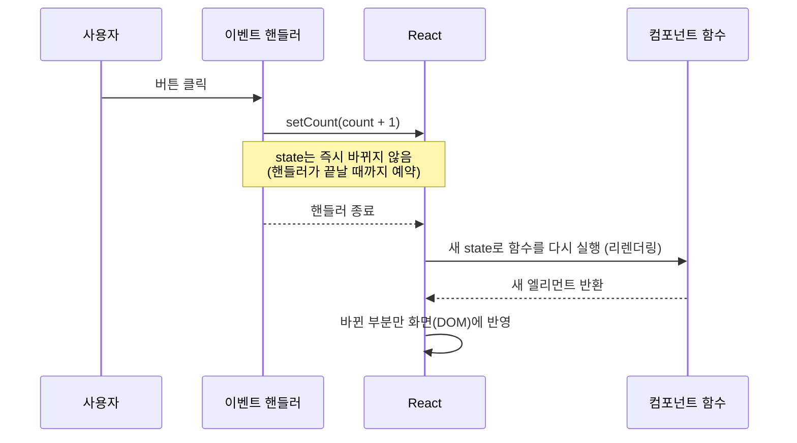
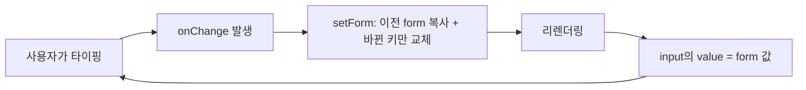

## 들어가며 (Situation)

[앞 글]({{ site.baseurl }}/2026/11/25/react-frontend-backend-separation-props/)에서 props는 부모가 주는 **읽기 전용** 값이라고 했다. 그럼 "버튼을 누르면 숫자가 올라가는" 것처럼 **바뀌는 값**은 어디에 두어야 할까? 이번 글은 수업의 `02_state`, `03_event`를 **어떤 순서로 무슨 일이 일어나는지** 중심으로 정리한다.

> 이 글의 출력은 수업 프로젝트 `data-fetch-app-skeleton`(React 19.3.1)을 scratchpad에 복사해 jsdom 환경에서 클릭·입력 이벤트를 발생시켜 얻은 결과다. 브라우저 화면에서 직접 확인한 것은 아니다.

## 문제 상황 (Task)

| 질문 | 확인 방법 |
|------|------|
| 일반 변수(`let`)를 바꾸면 화면도 바뀌나? | `let count`로 버튼 클릭 실험 |
| `useState`는 어떤 과정으로 화면을 갱신하나? | 렌더링 로그와 화면 확인 |
| `setCount(count + 1)`을 3번 호출하면 3 증가하나? | `+ 3` 버튼 실험 |
| 입력창 두 개의 값은 어떻게 관리하나? | 회원가입 폼 실험 |

## 해결 과정 (Action)

### 1. 일반 변수는 화면을 바꾸지 못한다

수업 TODO 1의 첫 단계는 `let`으로 만들어 실패해 보는 것이다.

```jsx
// 실험 코드 (예시 코드, 수업의 주석 처리된 방식과 같은 구조)
const C = () => {
  let n = 0
  console.log('render')
  return <div><b>n={n}</b><button onClick={() => { n = n + 1; console.log('n=' + n) }}>+</button></div>
}
```

버튼을 두 번 눌렀을 때의 실제 결과:

```text
console: render, n=1, n=2
화면:    n=0 +
```

콘솔에서는 `n`이 1, 2로 올라가는데 **화면은 `n=0` 그대로**다. `render`도 **처음 한 번만** 찍혔다. 값은 바뀌었지만 React는 "다시 그려야 한다"는 신호를 받지 못한 것이다. 게다가 함수가 다시 실행되면 `let n = 0`이 매번 초기화되므로 설령 다시 그려도 값을 기억하지 못한다.

### 2. useState: "값 기억" + "다시 그리기 신호"

```jsx
// 수업 코드 (02_state.jsx)
const [count, setCount] = useState(0);
const onClickPlusOne = () => { setCount(count + 1); console.log(`count: ${count}`); };
```

수업 주석 그대로 `const [값, setter함수] = useState(초기값)`이고, setter를 호출하면 **컴포넌트 함수가 다시 실행(리렌더링)** 되어 화면이 갱신된다.



실제 수업 컴포넌트를 클릭하며 화면과 콘솔을 함께 기록했다.

| 동작 | 화면 | 콘솔 |
|------|------|------|
| 최초 렌더링 | `count : 0` | `렌더링!` |
| `+ 1` 클릭 | `count : 1` | `count: 0` → `렌더링!` |
| `+ 1` 다시 클릭 | `count : 2` | `count: 1` → `렌더링!` |
| `+ 3` 클릭 | `count : 5` | `렌더링!` (한 번) |
| 초기화 클릭 | `count : 0` | `렌더링!` |

여기서 눈여겨볼 점이 두 가지다.

1. **핸들러 안의 `console.log(count)`는 "바뀌기 전" 값을 찍는다.** 화면은 `count : 1`인데 콘솔에는 `count: 0`이 먼저 찍힌다. setter를 부른 뒤에도 그 핸들러 안의 `count`는 **이번 렌더링 시점의 값 그대로**이기 때문이다. 수업 주석의 "setter를 호출해도 state는 즉시 바뀌지 않고, 이벤트 핸들러가 끝난 뒤 반영된다"가 실제로 이렇게 보인다.
2. `+ 3`을 눌렀는데 setter를 **3번** 호출했지만 `렌더링!`은 **한 번**만 찍혔다. React가 한 핸들러 안의 변경을 모아서 한 번에 처리(배치)한다.

### 3. `setCount(count + 1)` 세 번 vs `setCount(prev => prev + 1)` 세 번

수업 TODO 2의 질문("몇이 증가할까?")을 실험했다.

```jsx
// 실험 코드 (예시 코드)
setC(c + 1); setC(c + 1); setC(c + 1)      // 값을 넘김
```

```text
화면: c=1     콘솔: render c=0, render c=1
```

**3번 호출했는데 1만 증가했다.** 세 호출 모두 같은 `c`(=0)를 보고 `0 + 1`을 계산했기 때문이다.

함수를 넘기면 결과가 달라진다. 수업 코드(`+ 3` 버튼)는 `prev`를 받아 이어서 계산한다.

```jsx
// 수업 코드 (02_state.jsx)
setCount(prev => prev + 1);
setCount(prev => prev + 1);
setCount(prev => prev + 1);
```

```text
count : 2  →  + 3 클릭  →  count : 5
```

| 방식 | 계산 | 결과 (시작값 0) |
|------|------|------|
| `setCount(count + 1)` ×3 | 모두 `0 + 1` | **1** |
| `setCount(prev => prev + 1)` ×3 | `0→1→2→3` (이전 결과를 이어 받음) | **3** |

> 정리하면, **"이전 값에 이어서" 계산해야 하면 함수 형태(`prev =>`)** 를 쓴다.

### 4. 이벤트 처리 규칙

수업 주석의 세 가지 규칙이다.

| 규칙 | 예 |
|------|------|
| 이벤트 이름은 카멜 표기 | `onclick` → `onClick`, `onchange` → `onChange` |
| 코드 문자열이 아니라 **함수**를 전달 | `onClick={() => ...}` |
| 이벤트는 **DOM 요소**(button, input 등)에만 연결 | 컴포넌트에 `onClick`을 주면 props로 전달될 뿐 |

두 번째 규칙에서 자주 하는 실수는 `onClick={onReset()}`처럼 **괄호를 붙이는 것**이다. 괄호를 붙이면 클릭이 아니라 렌더링 도중에 바로 함수가 실행된다. 이번에는 이 실수를 실험하지 않았고, 규칙의 의미를 설명한 것이다.

### 5. 제어 컴포넌트: 입력값을 state로 관리

회원가입 폼(`username`, `email`)은 입력값을 **state 하나(객체)** 로 두고, 핸들러 하나로 둘 다 처리한다.

```jsx
// 수업 코드 (03_event.jsx)
const onChangeHandler = e => {
    setForm({
        ...form,                          // 기존 값을 복사
        [e.target.name] : e.target.value  // 바뀐 input의 name에 해당하는 값만 교체
    });
};

<input name="username" value={form.username} onChange={onChangeHandler}/>
<input name="email"    value={form.email}    onChange={onChangeHandler}/>
```



input의 `value`를 state가 쥐고 있어서 "화면에 보이는 값 = state"가 항상 일치한다. 이런 input을 **제어 컴포넌트**라 부른다. 실제 입력 결과:

```text
이름 입력 후:   입력한 이름: 조평훈 / 이메일:
이메일 입력 후: 입력한 이름: 조평훈 / 이메일: a@b.com
초기화 클릭 후: 입력한 이름:  / 이메일:      (두 input의 value도 모두 "")
```

**`...form`(스프레드)을 빼면?** 수업 주석에 "복사하지 않으면 다른 값이 초기화된다"고 되어 있어서 확인해 봤다.

```jsx
// 실험 코드 (예시 코드)
const on = e => setF({ [e.target.name]: e.target.value })   // ...f 없음
```

```text
username 입력 후: {"username":"조"}
email 입력 후:    {"email":"a@b"}      ← username이 사라짐
```

setter는 객체를 **병합하지 않고 통째로 교체**하기 때문에 email만 넣으면 username이 사라진다. 객체 state를 쓸 때 `...form`이 필수인 이유다. 참고로 `[e.target.name]`의 대괄호는 "값을 키 이름으로 쓴다"는 JS 문법(계산된 속성명)이다.

### 6. 시행착오

- 처음에는 input에 값을 넣으려고 `input.value = '...'`만 지정했는데, React가 값이 바뀐 것을 감지하지 못해 `onChange`가 호출되지 않았다. React는 내부적으로 값 추적을 하기 때문에, 테스트에서는 `input`의 **원래 setter**로 값을 넣고 `input` 이벤트를 발생시켜야 했다. 실제 브라우저에서 사람이 타이핑하면 이 문제는 없다.
- 핸들러 안의 `console.log(count)`가 "한 박자 늦게" 찍히는 것을 처음에는 버그로 착각했다. state가 스냅샷처럼 이번 렌더링의 값으로 고정된다는 것을 알고 나니 정상 동작이었다.

## 결과 (Result)

| 확인한 것 | 결과 |
|------|------|
| `let` 변수 변경 | 콘솔만 변하고 화면은 `n=0`, 렌더링 1회 |
| `useState` setter | 호출 후 리렌더링되어 화면 갱신 |
| 핸들러 안의 `console.log(count)` | 바뀌기 전 값 (`count: 0` 후 화면 1) |
| `+ 3` 버튼 (setter 3번) | `2 → 5`, 렌더링 로그는 1번 |
| `setCount(count + 1)` ×3 | 1만 증가 |
| `...form` 없이 `setForm` | 다른 입력값이 사라짐 |

- 화면이 바뀌려면 **state를 setter로 바꿔야** 한다. setter가 "값 변경 + 리렌더링 요청"을 같이 한다.
- state는 렌더링마다 **스냅샷**처럼 고정되므로, 이전 값에 이어 계산할 때는 `prev =>` 형태를 쓴다.
- 입력창은 **value는 state, 변경은 onChange**로 묶어 제어한다.

## 더 학습하면 좋은 개념

- **state 스냅샷과 배치(batching)** — 이번 실험에서 본 "핸들러 안의 값이 안 바뀌는 현상"과 "setter 3번에 렌더링 1번"의 근거가 되는 개념이다. 이해하면 state 관련 버그 대부분을 설명할 수 있다.
- **불변성 (immutability)** — setter에 "새 객체/배열"을 넘기는 이유다. 다음 글(반복 렌더링)에서 배열 state를 다룰 때 직접 부딪힌다.
- **비제어 컴포넌트 (`useRef`)** — 입력값을 state가 아니라 DOM이 쥐는 방식이다. 제어 컴포넌트와 비교하면 각각의 쓰임새가 보인다.
- **상태 끌어올리기** — 형제 컴포넌트가 같은 state를 써야 할 때 부모로 올리는 패턴이다. props와 state를 합쳐서 쓰는 첫 단계다.
- **React 렌더링 단계 (Render / Commit)** — "함수가 다시 실행된다"와 "DOM이 바뀐다"가 다른 단계라는 점을 알면 성능 최적화로 이어진다.

## 참고 자료

- [React 공식 문서 - State: A Component's Memory](https://react.dev/learn/state-a-components-memory)
- [React 공식 문서 - State as a Snapshot](https://react.dev/learn/state-as-a-snapshot)
- [React 공식 문서 - Queueing a Series of State Updates](https://react.dev/learn/queueing-a-series-of-state-updates)
- [React 공식 문서 - Responding to Events](https://react.dev/learn/responding-to-events)
- [React 공식 문서 - `<input>` (제어 컴포넌트)](https://react.dev/reference/react-dom/components/input)
- [MDN - 계산된 속성명](https://developer.mozilla.org/en-US/docs/Web/JavaScript/Reference/Operators/Object_initializer#computed_property_names)
