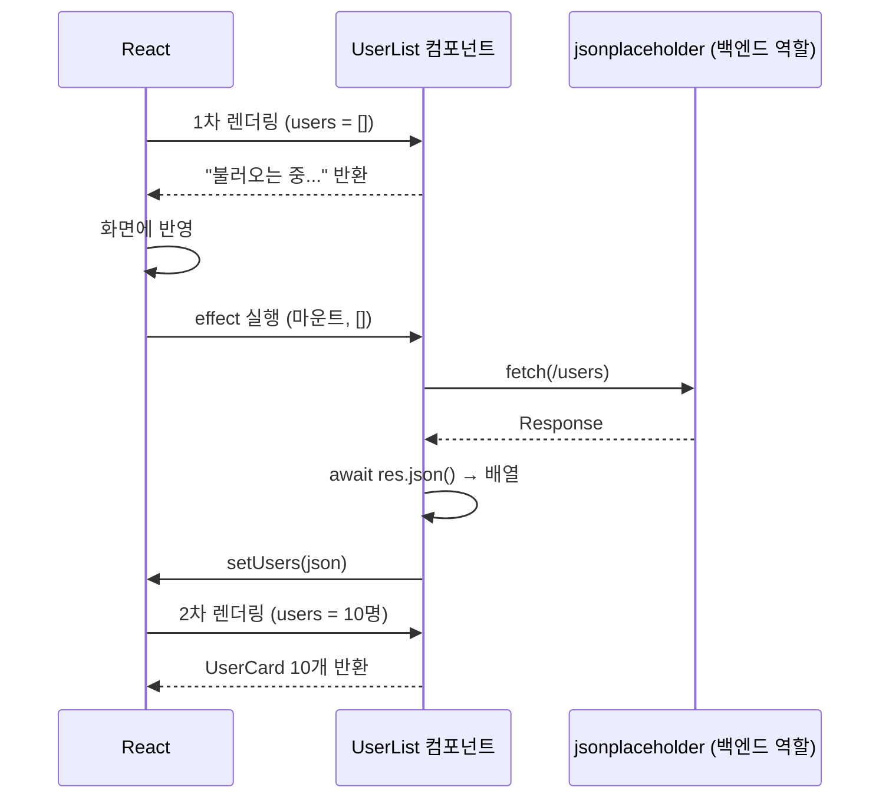
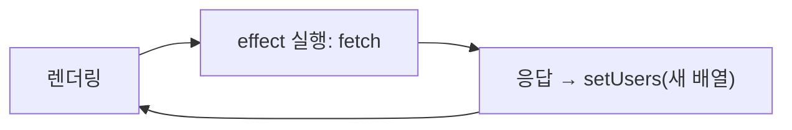

## 들어가며 (Situation)

모듈3은 백엔드와 프론트를 나눠서 개발한다. 그러면 프론트가 해야 하는 가장 흔한 일은 **"백엔드에 데이터를 요청해서 화면에 보여주는 것"** 이다. 수업의 `06_fetch`는 이 패턴을 `jsonplaceholder`의 회원 목록 API로 연습한다. (수업 주석에서 "가장 많이 쓰는 패턴"이라고 부른다.)

> 이 글의 출력은 수업 프로젝트 `data-fetch-app-skeleton`(React 19.3.1)을 scratchpad에 복사해 jsdom 환경에서 실행한 것이고, 회원 목록은 실제 `jsonplaceholder` API를 호출했다. 실제 브라우저에서 확인한 것은 아니다. `fetch`의 기본 개념은 [JavaScript fetch 글]({{ site.baseurl }}/2026/11/20/javascript-fetch-api-call/)에서 다뤘다.

## 문제 상황 (Task)

API 응답은 **언제 올지 모른다.** 그런데 컴포넌트는 데이터가 없는 상태로 먼저 그려져야 한다. 그리고 응답이 오면 화면이 다시 그려져야 한다. 그래서 풀어야 할 것은 이렇다.

| 풀어야 할 질문 | 확인 방법 |
|------|------|
| 응답 전·후 화면은 어떤 순서로 바뀌나? | 실제 API 호출 후 화면 텍스트 비교 |
| 의존성 배열을 빼면 정말 무한 요청이 되나? | mock fetch로 호출 횟수 측정 |
| `useEffect(async () => …)`는 왜 안 되나? | 직접 작성해서 에러 확인 |

## 해결 과정 (Action)

### 1. 전체 흐름: state 빈 값 → effect로 요청 → setter → 리렌더링

수업 주석의 3단계를 그대로 시간 순서로 그렸다.



수업 코드의 핵심은 세 부분이다.

```jsx
// 수업 코드 (06_fetch.jsx 일부)
const [users, setUsers] = useState([]);                  // 1. 빈 값으로 시작

useEffect( () => {                                       // 2. 마운트 시 한 번만 요청
    async function loadUsers() {
        const res = await fetch("https://jsonplaceholder.typicode.com/users");
        const json = await res.json();
        setUsers(json);                                  // 3. 응답을 state에 저장 → 리렌더링
    }
    loadUsers();
}, []);

if (users.length === 0) return <h3>불러오는 중...</h3>;  // 데이터가 오기 전 화면

return <div>{users.map( user => <UserCard key={user.id} user={user}/> )}</div>;
```

실제 호출 결과:

| 시점 | 화면 |
|------|------|
| 요청 직후 (1차 렌더링) | `회원 목록` / `불러오는 중...` |
| 응답 도착 후 (2차 렌더링) | `Leanne Graham`, `email: Sincere@april.biz`, `phone: 1-770-736-8031 x56442`, `city: Gwenborough` … |
| 콘솔 | `json [...]` (응답 배열 출력) |
| `fetch` 호출 횟수 | **1회** (마운트 때만) |
| 카드 수 | 10명 |

> 응답이 오기 전에 "불러오는 중..."을 먼저 보여 주는 `if (users.length === 0) return ...` 한 줄이 이 패턴의 핵심 장치다. 이 줄이 없어도 `users`가 빈 배열이면 `map`이 아무것도 만들지 않아서 에러는 나지 않지만, 응답이 올 때까지 사용자는 빈 화면을 보게 된다. 이 한 줄이 "지금 기다리는 중"이라는 사실을 사용자에게 알려 준다.

### 2. 부모-자식 역할 분담 (props 복습)

수업 주석: "UserList 컴포넌트는 API 호출 후, 1명의 유저 정보를 렌더링하는 자식 컴포넌트에게 api 정보를 주는 역할". 지금까지 배운 것이 모두 한 파일에 들어 있다.

| 컴포넌트 | 역할 | 쓰는 개념 |
|------|------|------|
| `UserList` | 데이터를 **가져오고** 목록을 반복 | state, useEffect, fetch, `map`, `key` |
| `UserCard` | 사용자 **한 명을 그리기만** 함 | props (`{user}`) |

데이터를 가져오는 책임은 위쪽(부모)이 갖고, 아래쪽(자식)은 받은 값만 그린다. 앞에서 정리한 "props는 부모 → 자식 한 방향"이 그대로 쓰이는 구조다.

### 3. 왜 `async` 함수를 effect 안에서 따로 만들어 호출하나

`useEffect`의 콜백 자체를 `async`로 만들면 안 된다는 수업 주석("정리 함수만 반환할 수 있다")을 직접 확인했다.

```jsx
// 예시 코드 (실패 확인용)
useEffect(async () => { await 1 }, [])
```

```text
console.error: %s must not return anything besides a function, which is used for clean-up.%s ... useEffect
TypeError: destroy is not a function      ← 컴포넌트를 언마운트할 때 발생
```

`async` 함수는 항상 **Promise를 반환**한다. React는 effect가 돌려준 값을 "정리 함수"로 보관해 두었다가 언마운트 때 호출하는데, Promise는 함수가 아니라서 언마운트하는 순간 `destroy is not a function` 에러가 났다. 렌더링 때는 경고만 뜨고 에러는 **나중에** 터지기 때문에 원인을 찾기 어렵다. 그래서 수업 코드처럼 **effect 안에 `async function`을 만들고 바로 호출**하는 형태를 쓴다.

```jsx
useEffect(() => {
    async function loadUsers() { ... }   // async는 안쪽 함수에
    loadUsers();                          // 콜백은 아무것도 반환하지 않음
}, []);
```

### 4. 의존성 배열을 빼면: 요청 → setState → 렌더링 → 요청 …

수업 주석: "의존성 배열을 빼면 state 변경 → 리렌더링 → effect 실행 → 다시 요청... 이 무한 반복된다." 실제 API를 계속 호출하면 서버에 부담을 주기 때문에, **mock fetch**(즉시 응답하는 가짜 함수)로 호출 횟수만 셌다.

```jsx
// 예시 코드 (의존성 배열 없이 fetch → setState)
useEffect(() => {
  (async () => { const r = await fetch('x'); setU(await r.json()) })()
})      // ← 두 번째 인자 없음
```



| 시점 | mock fetch 호출 횟수 |
|------|------|
| 0.3초 | **4,513회** |
| 0.6초 | **9,797회** |
| 언마운트 후 200ms | 0회 추가 |

멈추지 않고 계속 늘었고, 컴포넌트를 언마운트하자 멈췄다. 응답마다 `json`이 **새 배열**이라 `setUsers`가 매번 "바뀌었다"고 판단해 다시 렌더링되고, 의존성 배열이 없으니 렌더링마다 effect가 다시 실행되는 순환이다. (숫자는 응답이 즉시 오는 mock 환경의 값이다. 실제 네트워크에서는 훨씬 느리게 반복되지만 **멈추지 않는다는 점은 같다.** 실제 API로는 서버 부담 때문에 실험하지 않았다.)

그래서 이 패턴에서는 **`[]`가 필수**이다. 앞 글에서 본 대로 `[]`는 마운트 때 한 번만 실행하게 한다.

### 5. 수업 주석 중 정확히 짚을 부분

`const json = await res.json();` 위의 주석은 "문자열 json을 진짜 json으로 변경"이라고 되어 있다. 정확히는 `fetch`가 돌려주는 것은 **문자열이 아니라 `Response` 객체**이고, 응답 본문을 JS 값으로 읽는 것이 `res.json()`이다. 그리고 이것도 Promise라서 `await`가 한 번 더 필요하다. (수업 상단 주석의 "응답 본문은 `response.json()`으로 한 번 더 변환한다. (이것도 Promise)"가 정확한 설명이다.) 수업 흐름을 이해하는 데는 문제가 없지만, 면접 등에서 설명할 때는 정확한 표현을 쓰는 편이 안전하다.

### 6. 시행착오

- 처음 실험에서 `06_fetch`가 "불러오는 중..."에서 영원히 안 바뀌었다. 원인은 실험 스크립트가 아니라 **옛 뼈대 복사본**이었다. (앞 글의 시행착오와 같은 원인이다.) 최신 파일로 바꾸니 `fetch` 호출 1회, 카드 10개가 정상적으로 나왔다.
- 무한 요청 실험을 처음에는 테스트 도구의 `act`로 감싸서 돌렸는데, 상태 변경이 끝없이 이어지니 `act`가 **끝나지 않고** 실험 전체가 멈췄다. 요청이 끊임없이 이어지는 상황은 도구도 못 끝낸다는 것을 몸으로 확인한 셈이다. `act` 없이 시간만 재서(0.3초, 0.6초) 호출 횟수를 세는 방식으로 바꿨다.

## 결과 (Result)

| 확인한 것 | 결과 |
|------|------|
| 요청 직후 화면 | `불러오는 중...` |
| 응답 후 화면 | 회원 10명 카드 (실제 jsonplaceholder 응답) |
| `[]`일 때 fetch 호출 | 1회 |
| 의존성 배열 없을 때 (mock) | 0.3초에 4,513회, 0.6초에 9,797회 (계속 증가) |
| `useEffect(async () => …)` | 경고 후 언마운트 시 `TypeError: destroy is not a function` |

- 데이터 요청 화면의 기본 틀은 **`useState(빈 값)` + `useEffect(…, [])` + `setState(응답)` + "불러오는 중" 분기**이다.
- 부모(`UserList`)가 가져오고, 자식(`UserCard`)이 props로 받아 그린다.
- 이 틀이 다음 글(포켓몬 도감)에서 **"요청이 바뀔 때마다 다시 호출"** 로 확장된다.

## 더 학습하면 좋은 개념

- **로딩·에러 상태 관리** — 이번 코드는 성공만 처리한다. 요청이 실패했을 때(네트워크 오류, 404) 화면을 어떻게 하는지는 실제 서비스에서 가장 먼저 필요한 부분이다. 로딩 / 성공 / 실패 세 상태를 state로 나누는 방법을 학습해 보자.
- **`fetch`의 `response.ok`** — `fetch`는 404여도 reject되지 않고 정상 응답으로 돌려준다. 그래서 `res.ok`나 `res.status`를 직접 확인해야 한다. JS fetch 글에서 본 내용이 React에서도 그대로 중요하다.
- **axios** — 수업 주석에서 "실무에서 많이 쓴다"고 언급한 라이브러리다. `fetch`와 달리 응답 본문이 `res.data`에 이미 객체로 들어 있고, 상태 코드 오류를 에러로 던진다. 비교하면 두 도구의 선택 기준이 생긴다.
- **데이터 패칭 라이브러리 (TanStack Query, SWR)** — 로딩/에러/캐싱/재요청을 직접 구현하는 번거로움을 줄여 주는 도구다. 이번 수업의 수동 패턴을 이해한 뒤에 보면 "무엇을 대신해 주는지" 명확해진다.
- **CORS** — 프론트와 백엔드 주소가 다르면 브라우저가 응답을 막을 수 있다. 직접 만든 Spring 백엔드를 연결할 때 반드시 마주친다.

## 참고 자료

- [React 공식 문서 - Synchronizing with Effects (Fetching data)](https://react.dev/learn/synchronizing-with-effects#fetching-data)
- [React 공식 문서 - useEffect](https://react.dev/reference/react/useEffect)
- [MDN - Fetch API 사용하기](https://developer.mozilla.org/en-US/docs/Web/API/Fetch_API/Using_Fetch)
- [MDN - Response.json()](https://developer.mozilla.org/en-US/docs/Web/API/Response/json)
- [JSONPlaceholder](https://jsonplaceholder.typicode.com/)
- [axios 공식 문서](https://axios-http.com/docs/intro)
