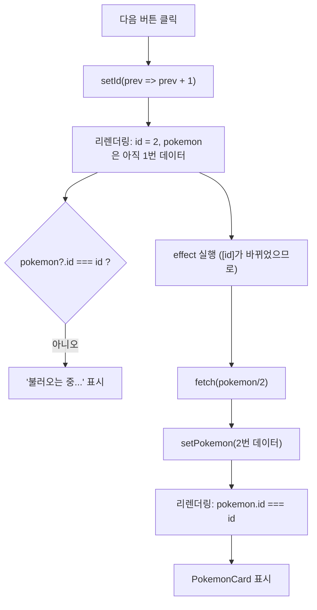
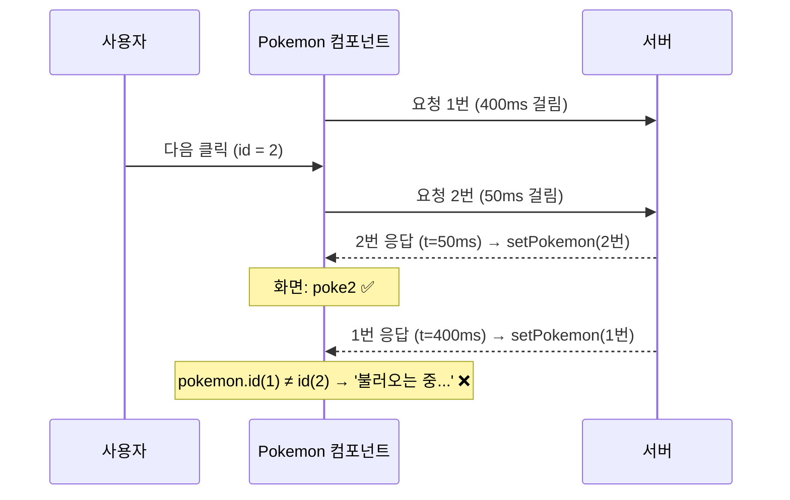
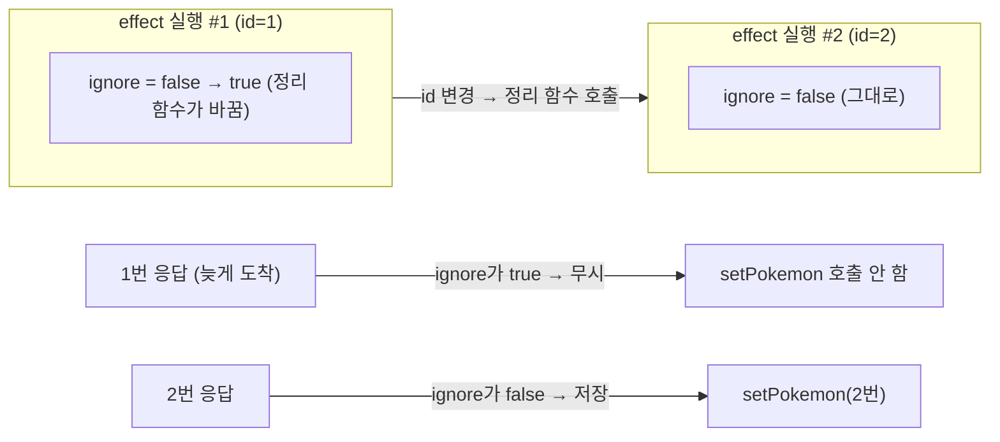

## 들어가며 (Situation)

`05_useEffect`와 `06_fetch`에서 "화면이 그려진 뒤 데이터를 요청한다"를 배웠다. `07_pokemon`은 지금까지 배운 것을 **모두 합쳐서** 포켓몬 도감을 만드는 종합 과제다. 수업 주석에서는 각 개념이 이렇게 쓰인다고 정리한다.

| 개념 | 포켓몬 도감에서의 쓰임 |
|------|------|
| state | 현재 번호 `id`, 받아온 데이터 `pokemon` |
| event | 이전 / 다음 버튼 |
| useEffect | `id`가 바뀔 때마다 다시 요청 `[id]` |
| props | 받아온 데이터를 `PokemonCard`에 전달 |
| 반복 렌더링 | 타입 목록 |

> 이 글의 출력은 수업 프로젝트 `data-fetch-app-skeleton`(React 19.3.1)을 scratchpad에 복사해 jsdom 환경에서 실행한 것이고, 포켓몬 데이터는 실제 PokeAPI를 호출했다. 경쟁 상태 실험은 응답 시간을 마음대로 정할 수 있는 mock fetch로 했다. 실제 브라우저에서 확인한 것은 아니다.

## 문제 상황 (Task)

수업 요구사항은 "이전/다음 버튼을 누를 때마다 해당 아이디를 가진 포켓몬 API를 호출한다"이다. 여기서 두 가지 문제가 나온다.

1. **버튼을 누를 때마다 어떻게 다시 요청하나?** → `useEffect`의 의존성 배열에 `id`
2. **버튼을 빠르게 누르면?** 수업 파일 상단 주석의 경고: *"버튼을 빠르게 누르면 이전 요청의 응답이 나중에 도착해 화면을 덮어쓸 수 있다. 정리 함수에서 `ignore = true`로 바꿔 이전 요청의 결과는 무시한다."*

두 번째 문제를 **실제로 일으켜서** 확인하는 것이 이 글의 중심이다.

## 해결 과정 (Action)

### 1. 전체 흐름: 버튼 → id 변경 → 리렌더링 → effect → fetch → setPokemon



수업 코드의 중심은 이렇다.

```jsx
// 수업 코드 (07_pokemon.jsx 일부)
const [id, setId] = useState(1);
const [pokemon, setPokemon] = useState(null);

useEffect( () => {
    async function loadPokemon() {
        const res = await fetch(`https://pokeapi.co/api/v2/pokemon/${id}`);
        const json = await res.json();
        setPokemon(json);
    }
    loadPokemon();
}, [id])          // id가 바뀔 때마다 다시 요청

...
<button onClick={() => setId(prev => prev - 1)} disabled={id === 1}>이전</button>
<button onClick={() => setId(prev => prev + 1)}>다음</button>
{pokemon?.id === id ? <PokemonCard pokemon={pokemon}/> : <h3>불러오는 중...</h3>}
```

`06`과 달라진 점은 단 두 가지다. 의존성 배열이 `[]`에서 **`[id]`** 로 바뀌었고, "로딩 중" 판단이 `users.length === 0`에서 **`pokemon?.id === id`** 로 바뀌었다.

### 2. 실제 PokeAPI로 확인한 동작

| 시점 | 화면 |
|------|------|
| 요청 직후 | `No.1` / `불러오는 중...` (이전 버튼 disabled) |
| 1번 응답 후 | `bulbasaur` / 키: 0.7m / 몸무게: 6.9kg / 타입: grass, poison |
| `다음` 클릭 직후 | `No.2` / `불러오는 중...` |
| 2번 응답 후 | `ivysaur` / 키: 1m / 몸무게: 13kg (이전 버튼 활성화) |

- **`pokemon?.id === id` 비교의 의미**: `다음`을 누른 직후에는 `id`는 2인데 `pokemon`은 아직 1번 데이터다. 비교가 `false`이므로 1번 카드를 2번 번호 옆에 잘못 보여 주는 대신 "불러오는 중..."이 뜬다. 수업 주석("이전 번호의 데이터라면 로딩 문구를 보여준다")이 이 장치를 설명한다. `null?.id`는 에러 없이 `undefined`가 되므로 첫 렌더링(`pokemon`이 `null`)도 같은 분기로 처리된다.
- **`/ 10`의 이유**: 실제 응답에서 1번은 `height: 7`, `weight: 69`였고 화면에는 `0.7m`, `6.9kg`가 나왔다. 코드가 `/ 10`을 해서 단위를 바꾼 것이다. (PokeAPI 문서 기준 `height`는 decimetre, `weight`는 hectogram 단위다.)
- **`disabled={id === 1}`**: 0번 이하로 내려가는 요청을 버튼 단계에서 막는다.

### 3. 경쟁 상태(race condition): 느린 응답이 나중에 도착한다

요청을 보낸 순서와 응답이 도착하는 순서는 **같지 않을 수 있다.** 이를 재현하려고 응답 시간을 직접 정하는 mock fetch를 썼다.

- 1번 요청: **400ms** 걸림 (느림)
- 2번 요청: **50ms** 걸림 (빠름)
- 시나리오: 마운트(1번 요청 시작) → 1번 응답이 오기 전에 `다음` 클릭(2번 요청 시작)



**수업 코드 그대로** 실행한 결과:

| 시점 | 화면 |
|------|------|
| 다음 클릭 직후 | `No.2` / `불러오는 중...` |
| 2번 응답 도착 후 (t≈120ms) | `No.2` / `poke2` 카드 ✅ |
| 느린 1번 응답 도착 후 (t≈620ms) | `No.2` / **`불러오는 중...`** ❌ |

처음엔 잘 나오다가 **느린 1번 응답이 뒤늦게 도착하면서 `setPokemon`이 1번 데이터로 덮어썼다.** 이때 `pokemon?.id === id` 비교 덕분에 **틀린 카드(1번)를 2번 자리에 보여 주지는 않지만**, 대신 "불러오는 중..."에 **영원히 멈춘다.** 더 이상 오는 응답이 없기 때문이다. 수업 주석의 "화면을 덮어쓸 수 있다"가 실제로는 이렇게 나타난다. 로딩 비교가 오류 데이터 노출은 막아 주지만, 문제 자체를 해결해 주는 것은 아니다.

> 현재 수업 파일의 effect에는 이 문제를 막는 코드(TODO 4의 `ignore`)가 **아직 작성되어 있지 않다.** 위 결과는 그 상태를 그대로 실행한 것이다.

### 4. 해결: 정리 함수에서 `ignore = true`

수업 주석이 알려 준 방법을 **예시 코드**로 적용해 같은 시나리오를 다시 돌렸다.

```jsx
// 예시 코드 (수업 TODO 4를 적용)
useEffect(() => {
    let ignore = false;                       // 이 effect 실행에만 속하는 플래그
    async function loadPokemon() {
        const res = await fetch(`https://pokeapi.co/api/v2/pokemon/${id}`);
        const json = await res.json();
        if (!ignore) setPokemon(json);        // 무시 대상이 아니면 저장
    }
    loadPokemon();
    return () => { ignore = true; };          // id가 바뀌어 effect가 다시 실행되기 직전에 호출됨
}, [id]);
```

| 시점 | 화면 (ignore 적용) |
|------|------|
| 다음 클릭 직후 | `No.2` / `불러오는 중...` |
| 2번 응답 도착 후 (t≈120ms) | `No.2` / `poke2` ✅ |
| 느린 1번 응답 도착 후 (t≈620ms) | `No.2` / **`poke2` ✅ (유지)** |

원리는 이렇다. `id`가 1 → 2로 바뀌면 React는 새 effect를 실행하기 **직전에** 이전 effect의 정리 함수를 호출한다. 그러면 **1번 요청을 담당하던 effect의 `ignore`만** `true`가 된다. 나중에 1번 응답이 와도 `if (!ignore)` 때문에 `setPokemon`이 호출되지 않는다. 각 effect 실행마다 자기 `ignore`를 가지므로(클로저) 2번 요청의 `ignore`는 `false`로 남아 정상 저장된다.



이번 글에서 정리 함수는 05의 타이머(`clearInterval`)와 **같은 역할**이다. "effect가 시작한 일이 더 이상 필요 없어지면 정리 함수로 끝낸다." 다만 여기서는 요청을 취소하는 것이 아니라 **결과를 무시**한다.

### 5. 수업 코드에서 더 생각해 볼 점

| 항목 | 현재 코드의 동작 | 생각해 볼 점 |
|------|------|------|
| 타입 출력 | `<span>`을 공백 없이 나열 → 화면 텍스트가 `타입: grasspoison`처럼 붙어 보임 | 쉼표나 간격(CSS)이 필요하다 |
| `다음` 버튼 | 상한이 없음 | 범위를 넘는 번호는 요청 자체가 실패한다 |
| 범위 밖 번호 | PokeAPI에 `pokemon/99999`를 요청해 봤더니 **404**와 `{"status":404,"message":"Not Found"}`가 왔다 | `fetch`는 404여도 reject되지 않고, 이 응답에는 `id`가 없어서 `pokemon?.id === id`가 `false`로 남는다. 그러면 화면이 "불러오는 중..."에 머물 것으로 보인다. (이 컴포넌트로 직접 실행해 확인하지는 않았고, 응답 내용에서 추론한 것이다.) |
| 에러 처리 | 없음 | `res.ok` 확인과 에러 상태가 필요하다 |

### 6. 시행착오

- 경쟁 상태를 처음에는 **실제 PokeAPI**로 재현하려고 했다. 그런데 응답 시간은 내가 정할 수 없어서 "느린 응답이 나중에 온다"는 상황이 매번 달랐다. 응답 시간을 400ms / 50ms로 정하는 mock fetch로 바꾸니 같은 결과가 **항상** 재현됐다. 버그를 고치려면 먼저 **항상 일어나게** 만들어야 한다는 것을 알았다.
- 마운트 시점의 1번 요청이 이미 진행 중이어야 경쟁이 생긴다. 처음에는 마운트 응답이 끝날 때까지 기다린 뒤 `다음`을 눌러서 경쟁이 일어나지 않았다. "1번 응답이 오기 **전에** 클릭"하도록 순서를 고쳤다.
- 수업 폴더의 파일이 수업 중에 계속 채워지고 있다는 점도 시행착오였다. 복사본이 옛 뼈대여서 처음 실험이 전부 엉뚱한 코드를 대상으로 돌았고, 다시 복사한 뒤 재실행했다. 참고로 새로 복사한 소스에는 `08. 해리포터 도감`(`HP.jsx`)이 추가되어 있었지만, 이번 글의 범위(05~07)가 아니라서 다루지 않았다.

## 결과 (Result)

| 확인한 것 | 결과 |
|------|------|
| 실제 PokeAPI 호출 (1번, 2번) | bulbasaur(0.7m / 6.9kg), ivysaur(1m / 13kg) 정상 표시 |
| `다음` 클릭 직후 | `pokemon?.id === id` 비교로 `불러오는 중...` 표시 |
| 느린 응답이 나중에 도착 (수업 코드 그대로) | 2번 카드가 나왔다가 **`불러오는 중...`에 고정** |
| `ignore` 정리 함수 적용 | 느린 1번 응답이 무시되어 **2번 카드 유지** |

- 요청이 **바뀌는 값에 따라** 계속 일어나는 화면은 `[값]` 의존성 + **정리 함수로 이전 요청 무시**가 한 세트다.
- 의존성 배열은 "언제 다시 요청할까", 정리 함수는 "이전 요청을 어떻게 처리할까"를 담당한다.
- React 흐름 전체(state → event → effect → fetch → props → map)가 한 컴포넌트에 들어 있어서, 오늘 배운 것을 복습하는 기준 코드로 쓸 수 있다.

## 더 학습하면 좋은 개념

- **AbortController (요청 취소)** — `ignore`는 응답을 무시할 뿐 요청 자체는 계속된다. `fetch`에 `signal`을 전달해 요청을 **실제로 취소**하는 방법이 있다. 이번 실험과 가장 직접적으로 이어지는 심화 주제다.
- **경쟁 상태와 비동기 순서 보장** — "요청 순서 ≠ 응답 순서"는 프론트뿐 아니라 백엔드(동시성)에서도 반복되는 문제다. 개념을 일반화해 두면 다른 곳에서도 알아본다.
- **디바운스(debounce)** — 버튼이나 검색창 입력마다 요청을 보내지 않고 잠깐 기다렸다가 마지막 것만 보내는 기법이다. 05에서 언급한 "실시간 검색 과부하"를 줄이는 방법이다.
- **TanStack Query / SWR** — 이런 경쟁 상태 처리, 로딩·에러 상태, 캐싱을 라이브러리가 대신해 준다. 직접 구현해 보았으니 "무엇을 대신해 주는지" 비교하며 볼 수 있다.
- **에러·로딩 상태 모델링** — 범위 밖 번호처럼 실패하는 경우를 화면에서 표현하는 방법이다. 서비스 수준의 화면을 만들 때 필수다.

## 참고 자료

- [React 공식 문서 - useEffect (Fetching data, 경쟁 상태)](https://react.dev/reference/react/useEffect)
- [React 공식 문서 - Synchronizing with Effects (Fetching data)](https://react.dev/learn/synchronizing-with-effects#fetching-data)
- [MDN - AbortController](https://developer.mozilla.org/en-US/docs/Web/API/AbortController)
- [PokeAPI 공식 문서](https://pokeapi.co/docs/v2)
- [MDN - 선택적 체이닝 (?.)](https://developer.mozilla.org/en-US/docs/Web/JavaScript/Reference/Operators/Optional_chaining)
