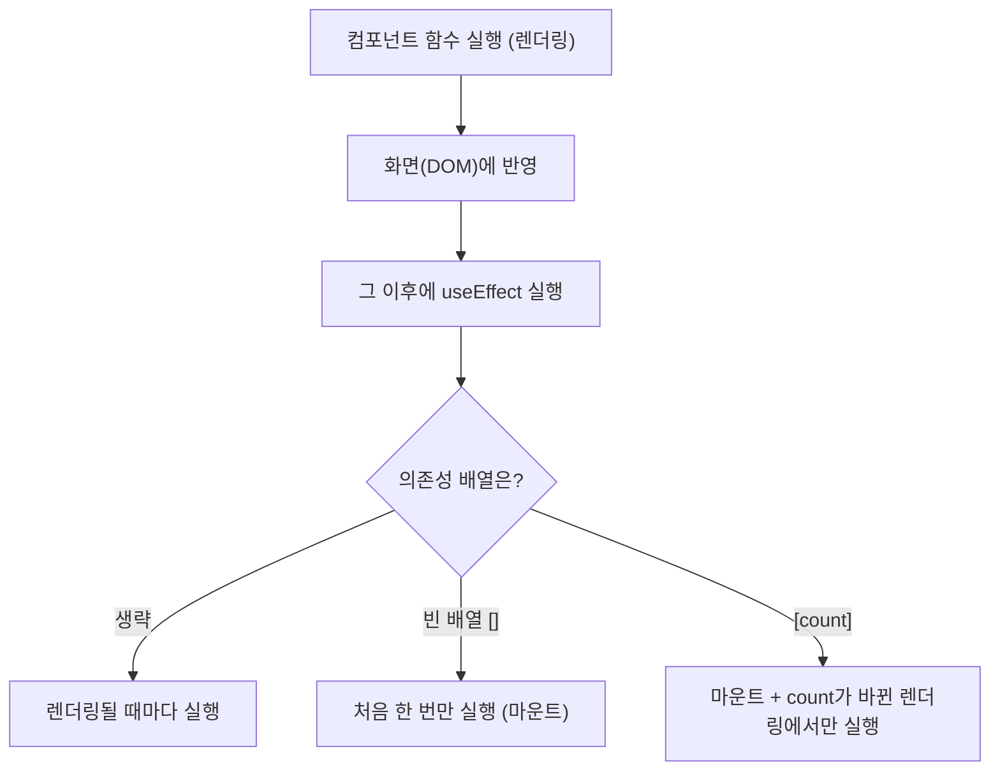
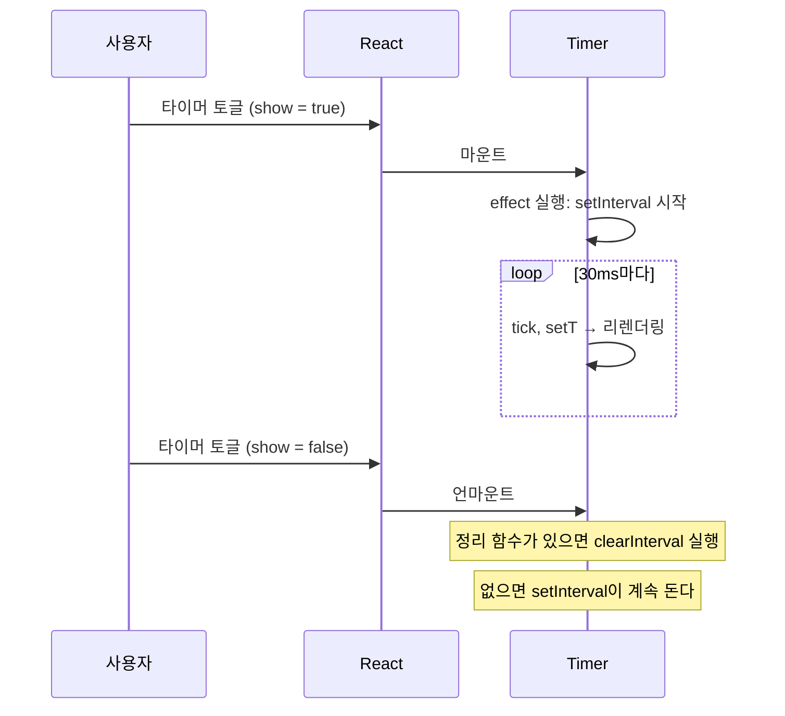

## 들어가며 (Situation)

모듈3에서 프론트는 백엔드 API를 호출해서 데이터를 받아 온다. 그런데 API 호출은 **언제 끝날지 알 수 없는 비동기 작업**이다. 수업 주석의 설명대로, 응답이 올 때까지 화면을 비워 둘 수는 없으니 **컴포넌트를 먼저 화면에 띄우고, 응답이 도착하는 대로 데이터를 끼워 넣는** 순서로 진행한다. 이때 "화면이 그려진 이후에 실행할 코드"를 등록하는 도구가 `useEffect`다.

이 글은 수업의 `05_useEffect`를 **"언제 실행되는가"** 에 집중해서 정리한다.

> 이 글의 출력은 수업 프로젝트 `data-fetch-app-skeleton`(React 19.3.1)을 scratchpad에 복사해 jsdom 환경에서 클릭·입력 이벤트를 발생시켜 얻은 결과다. 실제 브라우저에서 확인한 것은 아니다.

## 문제 상황 (Task)

`useEffect(() => { ... }, [의존성 배열])`의 두 번째 인자가 무엇이냐에 따라 실행 횟수가 완전히 달라진다. 이걸 잘못 쓰면 "API를 계속 호출하는" 문제로 이어진다.

| 풀어야 할 질문 | 확인 방법 |
|------|------|
| 의존성 배열이 없을 때 / `[]`일 때 / `[count]`일 때 각각 언제 실행되나? | 한 컴포넌트에 세 개를 모두 두고 로그 비교 |
| 버튼 클릭과 입력은 effect 실행에 어떤 차이를 만드나? | 클릭 / 타이핑 시 로그 비교 |
| 타이머처럼 effect에서 시작한 작업은 언제 멈추나? | 정리 함수 유무 비교 |

## 해결 과정 (Action)

### 1. 실행 시점 한눈에 보기



| 의존성 배열 | 실행 시점 | 수업에서 언급한 용도 |
|------|------|------|
| 생략 | 렌더링될 때마다 | (문제점: state가 바뀔 때마다 실행됨) |
| `[]` | 처음 화면에 나타날 때 **한 번** | 대부분의 백엔드 API 호출 (실시간성이 중요하지 않을 때) |
| `[값1, 값2]` | 마운트 + 배열 안의 값이 바뀔 때 | 실시간성이 중요한 경우 (예: 실시간 검색 동기화) |

수업 주석에는 마지막 경우의 주의점도 있다. "과부하가 심해진다(실시간이기 때문)". 값이 바뀔 때마다 API를 부르기 때문에 호출 횟수가 많아진다.

### 2. 세 가지를 한 컴포넌트에 넣고 실행해 보기

수업 코드는 `EffectTest` 컴포넌트에 세 effect를 나란히 두고, `count`(버튼)와 `text`(입력창) 두 state를 만든다.

```jsx
// 수업 코드 (05_useEffect.jsx 일부)
useEffect(() => { console.log("[의존성 배열 없음.] 렌더링 이후에 시작"); })     // 생략
useEffect(() => { console.log("[빈 배열.] 렌더링 이후에 시작"); }, [])          // []
useEffect(() => { console.log("[count] 관리하는 count 가 바뀔 때만 실행된다."); }, [count])  // [count]
console.log("EffectTest 컴포넌트 렌더링!");
```

화면을 띄우고 `+ 1` 클릭, 입력창에 `a`, `ab` 타이핑을 차례로 했을 때의 실제 콘솔 로그다.

| 동작 | 렌더링 | 생략 | `[]` | `[count]` |
|------|:---:|:---:|:---:|:---:|
| 마운트 | ✅ | ✅ | ✅ | ✅ |
| `+ 1` 클릭 (`count` 변경) | ✅ | ✅ | ❌ | ✅ |
| `a` 타이핑 (`text` 변경) | ✅ | ✅ | ❌ | ❌ |
| `ab` 타이핑 (`text` 변경) | ✅ | ✅ | ❌ | ❌ |

실제 로그의 순서도 확인했다. 마운트 때는 `EffectTest 컴포넌트 렌더링!`이 **먼저** 찍히고, 그다음에 effect 세 개가 **코드에 적힌 순서대로** 찍혔다. 즉 "렌더링 → 화면 반영 → effect"라는 흐름이 로그에서도 그대로 보인다.

여기서 중요한 점이 두 가지다.

1. **입력 중에는 `[count]` effect가 실행되지 않는다.** `text`가 바뀌어 컴포넌트는 다시 그려지지만, `count`는 그대로이기 때문이다. 의존성 배열은 "다시 그려질 때, 이 값이 **이전 렌더링과 달라졌는가**"를 비교한다.
2. **의존성 배열을 생략하면 입력 한 글자마다 effect가 실행된다.** 수업 코드의 첫 effect는 `"백엔드에서 메뉴 전체조회 API 호출함!"`을 출력하는데, 타이핑할 때마다 이 로그가 찍혔다. 만약 이 자리가 진짜 API 호출이었다면 글자 하나 칠 때마다 서버를 부르는 셈이다. 수업 주석의 "문제점"이 바로 이것이다.

> 이 프로젝트의 `main.jsx`는 `<StrictMode>` 없이 `<App />`만 렌더링한다. 그래서 마운트 시 effect가 한 번씩만 찍혔다. 개발 모드에서 `<StrictMode>`를 쓰면 effect가 두 번 실행되는 것으로 알려져 있는데, 이 프로젝트에서는 확인하지 못했다.

### 3. 정리(clean-up) 함수: effect가 시작한 일은 effect가 끝낸다

수업 주석: "effect에서 함수를 return하면, 컴포넌트가 사라질 때(언마운트) 또는 effect가 다시 실행되기 직전에 실행된다. 타이머처럼 effect에서 시작한 작업은 정리 함수에서 종료해야 한다. (안 하면 계속 동작한다)"

수업 파일에서 `Timer` 컴포넌트는 이 부분이 **TODO 4로 남아 있다.** 현재 파일에는 `useEffect`가 없고 시간을 보여 주는 `h2`만 있어서, 화면의 시간은 갱신되지 않는다. 그래서 정리 함수의 효과는 아래 **예시 코드**로 직접 확인했다. (`setInterval`을 30ms로 줄이고, "숨긴다 = 언마운트"를 토글 버튼으로 재현했다.)

```jsx
// 예시 코드 (수업 TODO 4를 확인하려고 직접 작성)
function Timer() {
  const [t, setT] = useState(0)
  useEffect(() => {
    const id = setInterval(() => { console.log('tick'); setT(x => x + 1) }, 30)
    return () => clearInterval(id)        // ← 정리 함수 (이 줄을 빼면 cleanup 없음)
  }, [])
  return <h2>t={t}</h2>
}
// 부모에서: {show && <Timer/>}   ← 토글 버튼으로 show를 바꾼다
```



실제 결과(숨기기 직전 → 숨긴 뒤 200ms 후의 tick 횟수):

| | 숨긴 직후 tick | 숨기고 200ms 뒤 tick | 화면 |
|------|:---:|:---:|------|
| 정리 함수 **없음** | 4 | **10** (계속 증가) | 타이머는 사라짐 |
| 정리 함수 **있음** | 4 | **4** (멈춤) | 타이머는 사라짐 |

정리 함수가 없을 때는 **화면에서 타이머가 사라졌는데도** tick이 계속 찍혔다. 눈에 보이지 않는 곳에서 `setInterval`이 계속 도는 것이다(메모리·CPU 낭비, 사라진 컴포넌트의 state를 갱신하려는 시도). 수업 TODO 4가 "정리 함수 없이 먼저 토글해 보고, 숨긴 뒤에도 tick이 계속 찍히는 것을 확인하자"고 하는 이유를 숫자로 확인한 셈이다.

### 4. 시행착오

- 처음에는 수업 프로젝트 복사본을 어제 한 번만 만들어 두고 그대로 실험했다. 그런데 로그가 하나도 안 찍혀서 확인해 보니, 그사이 수업 폴더의 `05`~`07` 파일이 **TODO 뼈대에서 완성본으로 바뀌어** 있었고, 복사본은 옛날 뼈대였다. 복사본을 지우고 다시 복사한 뒤에야 위의 로그가 나왔다. 수업 폴더는 수업이 진행되면서 계속 바뀌므로, 실험 직전에 다시 복사해야 한다.
- 타이머 실험을 처음에는 두 케이스(정리 함수 없음/있음)가 **같은 카운터**를 공유해서, 첫 케이스에서 새어 나간 타이머가 두 번째 케이스의 숫자까지 올렸다. "정리 함수가 있는데도 계속 올라간다"는 이상한 결과가 나와서 원인을 찾았고, 케이스마다 카운터를 따로 두었다. 그리고 토글 버튼에 `onClick`을 안 달아서 숨겨지지 않는 실수도 한 번 했다. 정리 함수를 빼먹었을 때의 문제가 **실험 자체에서도 그대로 재현**된 셈이다.

## 결과 (Result)

| 확인한 것 | 결과 |
|------|------|
| 마운트 시 로그 순서 | 렌더링 → effect 3개 (코드 순서대로) |
| 의존성 배열 생략 | 마운트, 클릭, 타이핑 **모두** 실행 |
| `[]` | **마운트 때만** 실행 |
| `[count]` | 마운트 + 클릭에서만 실행, 타이핑에서는 실행 안 됨 |
| 정리 함수 없는 타이머 | 숨긴 뒤 200ms 동안 tick 4 → 10 (계속 동작) |
| 정리 함수 있는 타이머 | 숨긴 뒤 tick 4 → 4 (멈춤) |

- API 호출은 **`[]`** 가 기본이다. 한 번만 부르면 되기 때문이다. 값이 바뀔 때마다 다시 불러야 하면 그 값을 배열에 넣는다.
- **effect에서 시작한 반복 작업(타이머, 구독 등)은 정리 함수로 끝낸다.**

## 더 학습하면 좋은 개념

- **컴포넌트 생명주기 (마운트 / 업데이트 / 언마운트)** — "처음 나타남, 다시 그려짐, 사라짐" 세 시점이 effect의 실행 시점과 어떻게 대응하는지 정리해 두면 의존성 배열이 외워지지 않고 이해된다.
- **StrictMode와 effect 이중 실행** — 개발 모드에서 effect를 일부러 한 번 더 실행해 정리 함수가 빠졌는지 검증하는 기능으로 알려져 있다. 오늘의 타이머 실험과 직결되는 개념이라, 실제 프로젝트에 적용해서 확인해 볼 만하다.
- **의존성 배열과 클로저 (stale closure)** — effect 안에서 쓰는 state를 배열에 빼먹으면 오래된 값을 보게 된다. 이전 글의 "state는 스냅샷" 개념의 연장이다.
- **`useEffect`가 필요 없는 경우** — 이벤트 핸들러에서 처리하면 되는 일을 effect로 처리하는 실수가 많다. 공식 문서의 "You Might Not Need an Effect"가 기준을 준다.
- **`setInterval` / `clearInterval` (Web API)** — 정리 함수의 대상이 되는 브라우저 기능이다. JS 비동기 글에서 다룬 타이머와 이벤트 루프 지식이 그대로 쓰인다.

## 참고 자료

- [React 공식 문서 - Synchronizing with Effects](https://react.dev/learn/synchronizing-with-effects)
- [React 공식 문서 - useEffect](https://react.dev/reference/react/useEffect)
- [React 공식 문서 - You Might Not Need an Effect](https://react.dev/learn/you-might-not-need-an-effect)
- [React 공식 문서 - StrictMode](https://react.dev/reference/react/StrictMode)
- [MDN - setInterval()](https://developer.mozilla.org/en-US/docs/Web/API/Window/setInterval)
